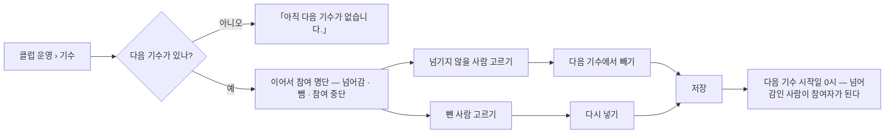
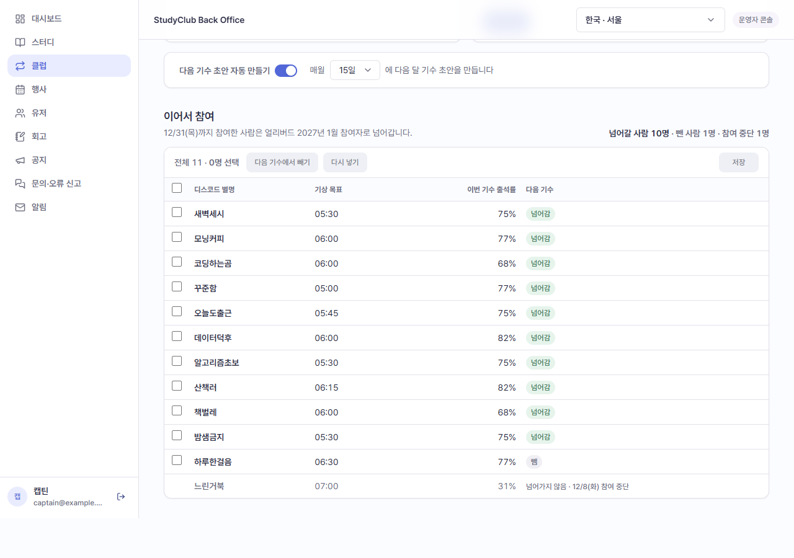
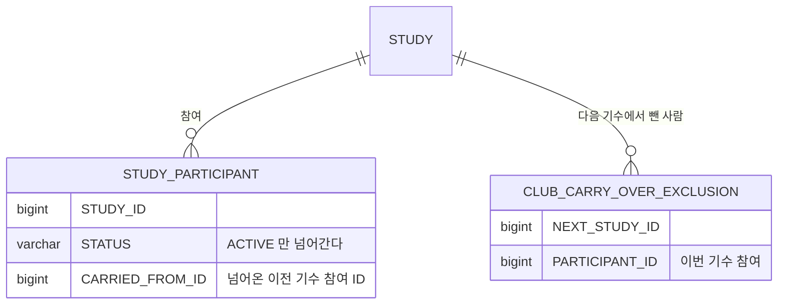

# 캡틴은 지난 기수를 끝까지 마친 참여자를 다음 기수로 이어 받을 수 있다.

story_id: ST-042 · IA: IA-043

기준 프로토타입: 운영 콘솔 › 클럽 › 기수 — https://playground.studyclub.life/proto/console/clubs

## 1. 기본설명

· **배경** — 클럽은 「이번 달을 끝까지 마친 사람은 다음 달도 자동으로 이어진다」가 운영 규칙이다. 참여자가 매달 다시 신청하지 않으므로, 다음 기수 명단의 대부분은 신청이 아니라 이번 기수에서 넘어온다. 규칙은 [POL-0012](../../_registry/policies/POL-0012-club-cohort.md).

### 진입·사용 흐름

### 완료 기준

1. 넘어갈 사람 · 뺀 사람 · 참여 중단 인원 확인
2. 이번 기수 명단 — 디스코드 별명 · 클럽 신청 값 · 이번 기수 출석률 · 다음 기수 처리
3. 고른 사람 다음 기수에서 빼기 · 다시 넣기
4. 저장 전 변경 취소 · 한 번에 저장
5. 참여 중단한 사람은 「넘어가지 않음」과 중단 날짜, 고를 수 없음
6. 다음 기수 시작일 0시에 넘어감인 사람이 다음 기수 참여자로 추가 — 신청 답은 스냅샷(질문 문구 · 답)으로 복사
7. 다음 기수가 없을 때 안내 문구
8. 넘어갈 사람에게는 사이트의 다음 기수 신청 버튼이 「신청 완료」로 보이고 신청을 받지 않는다 — 중복 신청 방지

---

## 2. 화면명세

> **화면**: 운영 콘솔 › 클럽 › 기수 — https://playground.studyclub.life/proto/console/clubs
>
> 아래 번호별 명세는 프로토의 **설명 보기**에서 그대로 가져온다. 손으로 고치지 않는다 —
> 고치려면 화면 옆 `spec.ts` 를 고치고 `pnpm --filter playground export-specs` 를 돌린다.

<!-- spec:start carry -->

### 1 — 이어서 참여 머리

- **내용**: 「{이번 기수 말일}까지 참여한 사람은 {다음 기수 제목} 참여자로 넘어갑니다.」

#### 1-1 — 인원 요약

- **내용**: 넘어갈 사람 · 뺀 사람 · 참여 중단 인원
- **정책**: 저장 전 고친 값으로 센다

### 2 — 이번 기수 명단

- **내용**: 넘어갈 사람 → 뺀 사람 → 참여 중단한 사람 순
- **데이터**: `GET /api/admin/studies/{nextStudyId}/carry-over`

#### 2-1 — 디스코드 별명

- **내용**: 참여자의 디스코드 별명

#### 2-2 — 클럽 신청 값

- **조건**: 신청 폼에 「명단에 보이기」를 켠 질문이 있을 때
- **내용**: 그 질문의 답
- **정책**: 넘어가는 사람의 신청 답은 스냅샷(질문 문구 · 답)으로 다음 기수에 복사한다 — 다음 기수 폼이 바뀌어도 그대로 남는다

#### 2-3 — 이번 기수 출석률

- **내용**: 월간 출석부의 출석률. 기록이 없으면 「-」
- **정책**: 계산은 월간 출석부와 같다 (ST-043)

#### 2-4 — 다음 기수

- **내용**
  - 넘어감 — 다음 기수 시작일에 참여자로 넘어간다
  - 뺌 — 캡틴이 뺐다
  - 넘어가지 않음 · {날짜} 참여 중단 — 이번 기수에서 참여 중단했다
- **정책**
  - 참여 중단한 사람은 고를 수 없다 — 다시 하려면 다음 기수 모집에 신청한다
  - 넘어감인 사람은 다음 기수에 신청하지 않는다 — 사이트의 신청 버튼이 「신청 완료」로 보이고 신청을 받지 않는다. 뺌이 되면 신청할 수 있다

### 3 — 작업 바

- **내용**: 고른 인원 / 고를 수 있는 인원

#### 3-1 — 다음 기수에서 빼기

- **동작**: 고른 사람을 「뺌」으로 바꾼다. 저장 전이다

#### 3-2 — 다시 넣기

- **동작**: 고른 사람 중 뺀 사람을 「넘어감」으로 되돌린다. 저장 전이다
- **정책**: 고른 사람 중 뺀 사람이 없으면 누를 수 없다

#### 3-3 — 변경 취소 · 저장

- **동작**
  - 저장하면 뺀 사람 목록을 한 번에 반영한다
  - 변경 취소는 마지막 저장 상태로 되돌린다
- **정책**: 다음 기수 시작일 0시 전까지 고칠 수 있다
- **데이터**: `PUT /api/admin/studies/{nextStudyId}/carry-over` — `excludedParticipantIds[]`

### 4 — 다음 기수가 없을 때

- **조건**: 다음 기수가 아직 없을 때
- **내용**: 「아직 다음 기수가 없습니다.」 · 「다음 기수 초안이 만들어지면 이어서 참여할 사람을 확인할 수 있습니다.」

<!-- spec:end carry -->

### 상태별 화면

| 상태 | 화면 | 카피 |
| --- | --- | --- |
| 기본 | 명단 · 인원 요약 | 「12/31(목)까지 참여한 사람은 얼리버드 2027년 1월 참여자로 넘어갑니다.」 |
| 다음 기수 없음 | 안내 | 「아직 다음 기수가 없습니다.」 · 「다음 기수 초안이 만들어지면 이어서 참여할 사람을 확인할 수 있습니다.」 |
| 처리중 | 저장 잠김 | — |
| 저장 안 한 변경으로 떠남 | 나가기 확인 | 「저장을 누르지 않으면 고친 내용이 사라집니다. 나가기 전에 저장해 주세요.」 |

### 데이터 관계

### 비고

- 범위 밖: 참여자 본인의 「다음 달은 쉬기」(크루 화면) · 참여 중단(ST-043 출석부)
- 구현 지시: 넘기는 일은 다음 기수 시작일 0시 배치가 한다. 캡틴 화면에는 「지금 넘기기」가 없다

## 3. 시스템 요건

### 개발 범위

> 2026-11-24 `beta` 기준.

| 구분 | 대상 | 지금 | 할 일 |
|---|---|---|---|
| FE | back-office-front 클럽 운영 › 기수 · 이어서 참여 | 없음 | 프로토대로 만든다 |
| BE | `GET` · `PUT /api/admin/studies/{nextStudyId}/carry-over` | 스펙작성중 | 구현 |
| BE | 기수 종료 배치 · 이어서 참여 배치 (따로) | 없음 | 구현 |
| BE | 이어서 참여 신청 답 스냅샷 복사 | 없음 | 구현 — 질문 ID 로 짝짓지 않는다 |
| BE | `CLUB_CARRY_OVER_EXCLUSION` · `STUDY_PARTICIPANT.CARRIED_FROM_ID` | 없음 | 마이그레이션 |
| BE | `GET /api/studies/{studyId}/applications/me` `carriedOver` · `POST …/applications` 넘어갈 사람 `409` | 구현완료 | `carriedOver` · 409 추가 |
| FE | core-front 스터디 상세 신청 버튼 | 신청 완료만 | `carriedOver` 면 「신청 완료」 |

### 데이터

- `CLUB_CARRY_OVER_EXCLUSION` — `NEXT_STUDY_ID` BIGINT NOT NULL · `PARTICIPANT_ID` BIGINT NOT NULL(이번 기수 참여) · `CREATED_AT`. `UNIQUE(NEXT_STUDY_ID, PARTICIPANT_ID)`
- `STUDY_PARTICIPANT.CARRIED_FROM_ID` BIGINT NULL — 이어서 참여로 만든 행이면 이전 기수 참여 ID. 신청으로 들어왔으면 NULL

### 처리

- 대상: 다음 기수의 직전 기수에서 `STATUS = ACTIVE` 이고 뺀 목록에 없는 참여자
- 저장: 뺀 목록 전체를 받아 바꾼다. 다음 기수 `START_AT` 이 지났으면 409
- 대상 아닌 참여자(참여 중단 · 다른 기수)를 보내면 400
- 기수 종료와 이어서 참여는 **따로 처리한다** (POL-0012)
  - 기수 종료(말일이 끝날 때): 다음 기수가 있든 없든 `ACTIVE → COMPLETED` · 기수 `ENDED`
  - 이어서 참여(다음 기수 시작일 0시, 기수 종료 뒤): 다음 기수가 있을 때만. `DRAFT` 여도 한다
    1. 대상마다 다음 기수 `STUDY_PARTICIPANT` 를 `ACTIVE` 로 만든다. 기본 반 · 신청 답 스냅샷(질문 문구 · 답) · `CARRIED_FROM_ID`
    2. 이미 다음 기수에 참여 행이 있는 사람은 새로 만들지 않는다
    3. 실패해도 기수 종료는 되돌리지 않는다 — 운영 알림
- 넘어갈 인원은 다음 기수 정원 계산에 들어간다 ([POL-0012](../../_registry/policies/POL-0012-club-cohort.md))

### 계산 규칙

- 이번 기수 출석률은 월간 출석부와 같은 식 — 정의 위치는 [captain-club-monthly-attendance](../captain-club-monthly-attendance/PRD.md) §3

### API

| 메서드 | 경로 | 권한 |
| --- | --- | --- |
| GET | `/api/admin/studies/{nextStudyId}/carry-over` — 명단 · 처리 | 캡틴 |
| PUT | `/api/admin/studies/{nextStudyId}/carry-over` — `excludedParticipantIds[]` | 캡틴 |

계약은 [club-cohort/spec.md](../../../specs/club-cohort/spec.md).

### 권한

- 캡틴만. 서버에서 검증한다 ([POL-0001](../../_registry/policies/POL-0001-roles.md))

### 퍼널·계측

- 퍼널 단계: 재방문 — 클럽 재참여율(다음 기수로 넘어간 사람 ÷ 이번 기수 참여자)을 이 서비스의 지표 하나로 본다
- 추가 이벤트 없음. `STUDY_PARTICIPANT.CARRIED_FROM_ID` 로 집계한다
