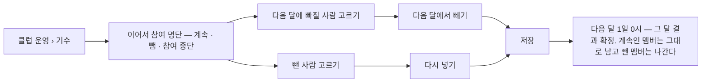
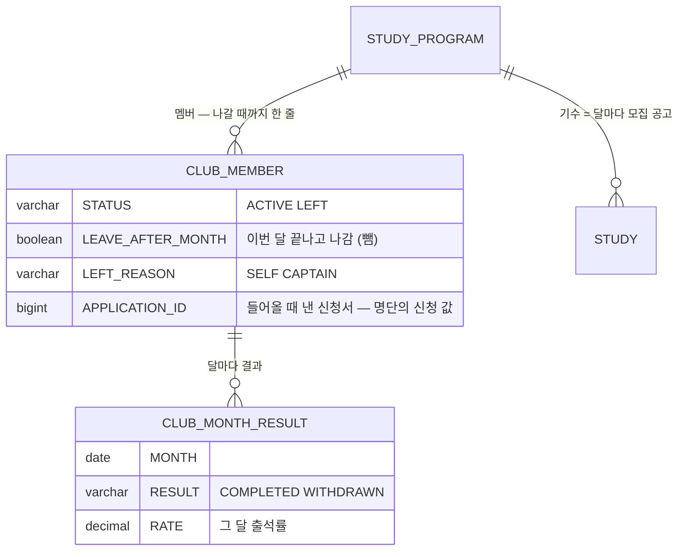

# 캡틴은 지난 기수를 끝까지 마친 참여자를 다음 기수로 이어 받을 수 있다.

story_id: ST-042 · IA: IA-043

기준 프로토타입: 운영 콘솔 › 클럽 › 기수 — https://playground.studyclub.life/proto/console/clubs

## 1. 기본설명

· **배경** — 클럽은 「이번 달을 끝까지 마친 사람은 다음 달도 자동으로 이어진다」가 운영 규칙이다. 클럽에 들어온 사람은 **멤버**로 계속 남고, 달마다 다음 기수로 옮겨 적지 않는다. 캡틴이 하는 일은 「다음 달에는 빠질 사람」을 고르는 것뿐이다. 규칙은 [POL-0012](../../_registry/policies/POL-0012-club-cohort.md), 데이터 모델은 [클럽 모델 결정 (2026-11-25)](../../../docs/share/2026-11-25-club-own-model.md).

### 진입·사용 흐름

### 완료 기준

1. 계속할 사람 · 뺀 사람 · 참여 중단 인원 확인
2. 이번 달 명단 — 디스코드 별명 · 클럽 신청 값 · 이번 달 출석률 · 다음 달 처리
3. 고른 사람 다음 달에서 빼기 · 다시 넣기
4. 저장 전 변경 취소 · 한 번에 저장
5. 참여 중단한 사람은 중단 날짜만 보이고 고를 수 없음
6. 다음 달 1일 0시에 그 달 결과(완주 · 중단 · 출석률)를 확정하고, 뺀 멤버만 나간다 — 계속인 멤버는 아무것도 복사하지 않고 그대로 남는다
7. 다음 기수가 아직 없어도 명단을 고칠 수 있다 — 기수는 모집 공고일 뿐 멤버는 기수에 매이지 않는다
8. 계속할 멤버에게는 사이트의 다음 기수 신청 버튼이 「신청 완료」로 보이고 신청을 받지 않는다 — 중복 신청 방지

---

## 2. 화면명세

> **화면**: 운영 콘솔 › 클럽 › 기수 — https://playground.studyclub.life/proto/console/clubs
>
> 아래 번호별 명세는 프로토의 **설명 보기**에서 그대로 가져온다. 손으로 고치지 않는다 —
> 고치려면 화면 옆 `spec.ts` 를 고치고 `pnpm --filter playground export-specs` 를 돌린다.

<!-- spec:start carry -->

### 1 — 이어서 참여 머리

- **내용**: 「{이번 달 말일}까지 참여한 사람은 다음 달에도 계속합니다.」

#### 1-1 — 인원 요약

- **내용**: 계속할 사람 · 뺀 사람 · 참여 중단 인원
- **정책**: 저장 전 고친 값으로 센다

### 2 — 이번 기수 명단

- **내용**: 계속할 사람 → 뺀 사람 → 참여 중단한 사람 순
- **데이터**: `GET /api/admin/clubs/{programId}/members?month={이번 달}`

#### 2-1 — 디스코드 별명

- **내용**: 참여자의 디스코드 별명

#### 2-2 — 클럽 신청 값

- **조건**: 신청 폼에 「명단에 보이기」를 켠 질문이 있을 때
- **내용**: 그 질문의 답
- **정책**: 멤버가 클럽에 들어올 때 낸 신청서의 답이다 — 달이 바뀌어도, 다음 기수 폼이 바뀌어도 그대로 보인다. 복사하지 않는다

#### 2-3 — 이번 기수 출석률

- **내용**: 월간 출석부의 출석률. 기록이 없으면 「-」
- **정책**: 계산은 월간 출석부와 같다 (ST-043)

#### 2-4 — 다음 기수

- **내용**
  - 계속 — 다음 달에도 멤버로 남는다
  - 뺌 — 캡틴이 뺐다
  - {날짜} 참여 중단 — 이번 달에 참여 중단해 클럽에서 나갔다
- **정책**
  - 참여 중단한 사람은 고를 수 없다 — 다시 하려면 다음 기수 모집에 신청한다
  - 계속인 사람은 다음 기수에 신청하지 않는다 — 사이트의 신청 버튼이 「신청 완료」로 보이고 신청을 받지 않는다. 뺌이 되면 신청할 수 있고, 신청하면 「계속」으로 돌아간다

### 3 — 작업 바

- **내용**: 고른 인원 / 고를 수 있는 인원

#### 3-1 — 다음 달에서 빼기

- **동작**: 고른 사람을 「뺌」으로 바꾼다. 저장 전이다

#### 3-2 — 다시 넣기

- **동작**: 고른 사람 중 뺀 사람을 「계속」으로 되돌린다. 저장 전이다
- **정책**: 고른 사람 중 뺀 사람이 없으면 누를 수 없다

#### 3-3 — 변경 취소 · 저장

- **동작**
  - 저장하면 뺀 사람 목록을 한 번에 반영한다
  - 변경 취소는 마지막 저장 상태로 되돌린다
- **정책**: 다음 달 1일 0시 전까지 고칠 수 있다
- **데이터**: `PUT /api/admin/clubs/{programId}/leaving` — `month` · `memberIds[]` (이번 달이 끝나면 나갈 멤버 전체)

<!-- spec:end carry -->

### 상태별 화면

| 상태 | 화면 | 카피 |
| --- | --- | --- |
| 기본 | 명단 · 인원 요약 | 「12/31(목)까지 참여한 사람은 다음 달에도 계속합니다.」 |
| 처리중 | 저장 잠김 | — |
| 저장 안 한 변경으로 떠남 | 나가기 확인 | 「저장을 누르지 않으면 고친 내용이 사라집니다. 나가기 전에 저장해 주세요.」 |

### 데이터 관계

### 비고

- 범위 밖: 멤버 본인의 「다음 달은 쉬기」(크루 화면 — 「내 클럽」 Story) · 참여 중단(ST-043 출석부)
- 구현 지시: 달 결과 확정은 다음 달 1일 0시 배치가 한다. 캡틴 화면에는 「지금 확정」이 없다

## 3. 시스템 요건

### 개발 범위

> 2026-11-26 `beta` 기준. 모델은 [클럽 모델 결정 (2026-11-25)](../../../docs/share/2026-11-25-club-own-model.md) — 백엔드 검토 전.

| 구분 | 대상 | 지금 | 할 일 |
|---|---|---|---|
| FE | back-office-front 클럽 운영 › 기수 · 이어서 참여 | 없음 | 프로토대로 만든다 |
| BE | `GET /api/admin/clubs/{programId}/members?month=` · `PUT /api/admin/clubs/{programId}/leaving` | 스펙 없음 | 스펙 (club-cohort) → 구현 |
| BE | 신청 저장 때 `CLUB_MEMBER` 만들기 | 없음 | 구현 — 클럽 기수 신청만 |
| BE | 달 결과 확정 배치 (다음 달 1일 0시) | 없음 | 구현 — `CLUB_MONTH_RESULT` · 뺀 멤버 `LEFT` |
| BE | `CLUB_MEMBER` · `CLUB_MONTH_RESULT` 테이블 | 없음 | 마이그레이션 |
| BE | `GET /api/studies/{studyId}/applications/me` `clubMember` · `POST …/applications` 계속할 멤버 `409` | 구현완료 | `clubMember` · 409 추가 |
| FE | core-front 스터디 상세 신청 버튼 | 신청 완료만 | `clubMember` 면 「신청 완료」 |

### 데이터

- `CLUB_MEMBER` — `ID` · `PROGRAM_ID` · `ACCOUNT_ID` · `STATUS`(`ACTIVE` / `LEFT`) · `JOINED_MONTH` · `LEFT_AT` · `LEFT_REASON`(`SELF` / `CAPTAIN`) · `LEAVE_AFTER_MONTH` BOOLEAN NOT NULL DEFAULT FALSE · `APPLICATION_ID`. 한 클럽에 `ACTIVE` 는 한 사람 한 줄. 나갔다가 다시 신청하면 새 줄
- `CLUB_MONTH_RESULT` — `MEMBER_ID` · `MONTH` · `RESULT`(`COMPLETED` / `WITHDRAWN`) · `RATE`. `UNIQUE(MEMBER_ID, MONTH)`

### 처리

- 대상: 이번 달에 `ACTIVE` 인 멤버
- 저장: 이번 달이 끝나면 나갈 멤버 전체(`memberIds[]`)를 받아 `LEAVE_AFTER_MONTH` 를 바꾼다. 다음 달 1일 0시가 지났으면 409
- 대상 아닌 멤버(이미 나감 · 다른 클럽)를 보내면 400
- 뺀 멤버가 다음 기수에 신청하면 `LEAVE_AFTER_MONTH = false` 로 돌아간다 — 새 멤버 줄을 만들지 않는다
- 달 결과 확정 (다음 달 1일 0시, 기수 `ENDED` 와 같은 때) — 다음 기수가 있든 없든 한다
  1. 그 달 멤버였던 사람마다 `CLUB_MONTH_RESULT` — 달 끝에 `ACTIVE` 면 `COMPLETED`, 그 달에 `LEFT` 가 됐으면 `WITHDRAWN`. `RATE` 는 그 달 출석률
  2. `LEAVE_AFTER_MONTH = true` 인 멤버는 `LEFT`(`LEFT_REASON = CAPTAIN`)
  3. 나머지 `ACTIVE` 멤버는 그대로다 — 복사 · 스냅샷 없음
  4. 한 클럽씩 한 트랜잭션. 실패하면 운영 알림, 다음 클럽을 처리한다
- 다음 달 정원 계산에 계속할 멤버(`ACTIVE` · `LEAVE_AFTER_MONTH = false`) 수가 들어간다 ([POL-0012](../../_registry/policies/POL-0012-club-cohort.md))

### 계산 규칙

- 이번 달 출석률은 월간 출석부와 같은 식 — 정의 위치는 [captain-club-monthly-attendance](../captain-club-monthly-attendance/PRD.md) §3

### API

| 메서드 | 경로 | 권한 |
| --- | --- | --- |
| GET | `/api/admin/clubs/{programId}/members?month=` — 그 달 멤버 · 출석률 · 다음 달 처리 | 캡틴 |
| PUT | `/api/admin/clubs/{programId}/leaving` — `month` · `memberIds[]` | 캡틴 |

계약은 [club-cohort/spec.md](../../../specs/club-cohort/spec.md).

### 권한

- 캡틴만. 서버에서 검증한다 ([POL-0001](../../_registry/policies/POL-0001-roles.md))

### 퍼널·계측

- 퍼널 단계: 재방문 — **다음 달로 이어지는 비율**(이번 달 멤버 중 다음 달 1일에도 `ACTIVE` 인 사람)을 클럽의 지표 하나로 본다
- 추가 이벤트 없음. `CLUB_MONTH_RESULT` · `CLUB_MEMBER` 로 집계한다
