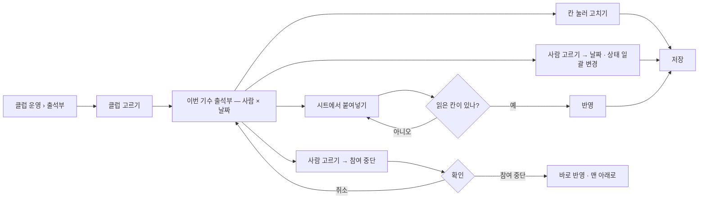
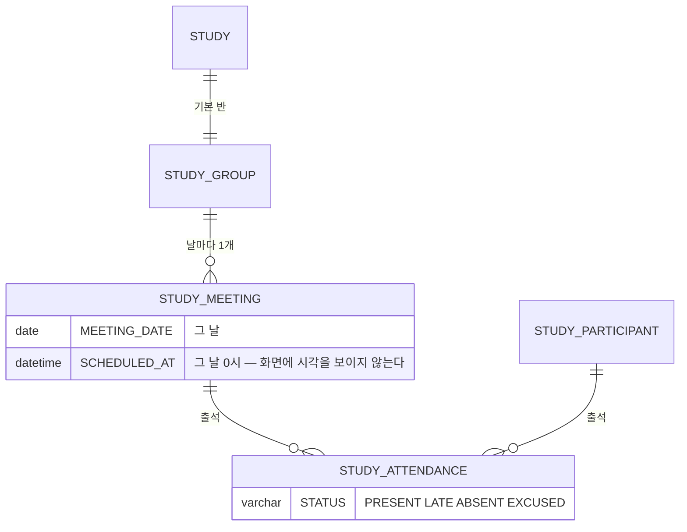

# 캡틴은 클럽 기수의 월간 출석부를 입력할 수 있다.

story_id: ST-043 · IA: IA-043

기준 프로토타입: 운영 콘솔 › 클럽 › 출석부 — https://playground.studyclub.life/proto/console/clubs

## 1. 기본설명

· **배경** — 클럽에는 모임 시각이 없다. 출석은 참여자가 디스코드 · 시트 · LeetCode 에 남긴 기록을 캡틴이 보고 판정한다. 그래서 출석부의 열은 회차가 아니라 기수 기간의 날짜이고, 캡틴은 시트에서 옮겨 적는다. 규칙은 [POL-0012](../../_registry/policies/POL-0012-club-cohort.md).

### 진입·사용 흐름

### 완료 기준

1. 이번 기수 출석부 — 참여자 × 1일~말일
2. 출석 값 안내와 입력 — 스터디와 같은 출석 · 지각 · 결석 · 휴가
3. 칸 누르기로 값 순환 · 기록 없음으로 되돌리기
4. 고른 사람의 한 날짜 일괄 변경 · 기록 지우기
5. 시트에서 붙여넣기 — 반영 미리보기, 명단에 없는 이름 · 읽을 수 없는 값 안내
6. 저장 안 한 칸 수 확인 · 변경 취소 · 한 번에 저장
7. 사람별 출석 일수(지각 0.5일) · 출석률
8. 오늘 뒤 · 참여 중단 뒤 날짜 입력 잠금
9. 고른 사람 참여 중단 — 확인 뒤 반영, 맨 아래로
10. 신청 폼에서 「명단에 보이기」를 켠 질문의 답 확인
11. 저장 안 한 변경이 있을 때 탭 · 클럽 이동 확인
12. 기수(월) 고르기 — 끝난 기수 출석도 고치기, 참여 중단은 이번 기수만
13. 스터디 상세(클럽 기수) › 출석 탭도 같은 출석부 — 발표 · 킥오프 없음
14. 이번 기수에서 참여 중단한 사람 참여 중단 취소 — 확인 뒤 반영

---

## 2. 화면명세

> **화면**: 운영 콘솔 › 클럽 › 출석부 — https://playground.studyclub.life/proto/console/clubs
>
> 아래 번호별 명세는 프로토의 **설명 보기**에서 그대로 가져온다. 손으로 고치지 않는다 —
> 고치려면 화면 옆 `spec.ts` 를 고치고 `pnpm --filter playground export-specs` 를 돌린다.

<!-- spec:start clubbook -->

### 1 — 출석부 머리

- **내용**: 「{기수 제목} 출석부」 · 전체 인원

#### 1-1 — 출석부 제목

- **내용**: 어느 기수의 출석부인지 알린다

#### 1-3 — 시트에서 붙여넣기

- **동작**: 누르면 붙여넣기 창(5)이 열린다

#### 1-4 — 기수 고르기

- **내용**: 이번 기수와 끝난 기수의 달. 이번 기수가 기본
- **동작**: 고르면 그 기수의 출석부를 연다
- **데이터**: 그 기수의 `GET /api/admin/studies/{studyId}/attendances`

#### 1-5 — 끝난 기수

- **조건**: 끝난 기수를 골랐을 때
- **내용**: 끝난 기수임을 알리고, 「?」에서 고친 출석은 그 기수 출석률에만 반영된다고 설명한다
- **정책**
  - 끝난 기수도 출석을 고칠 수 있다 — 시트에서 늦게 옮기는 경우가 있다
  - 이미 다음 기수로 넘어간 명단은 바뀌지 않는다
  - 참여 중단은 이번 기수에서만 한다

### 2 — 출석 값 안내

- **내용**: 출석 값과 「기록 없음」
- **정책**
  - 출석 값은 스터디와 같다 — 출석 · 지각 · 결석 · 휴가. 클럽마다 다르지 않다
  - 지각은 0.5일로 센다
  - 킥오프 · 발표가 없다 — 1일부터 모든 날을 출석으로 센다

### 3 — 출석부 표

- **내용**: 줄은 참여자, 열은 기수 기간의 날짜(1일~말일)
- **정책**: 참여 중단한 사람은 맨 아래
- **데이터**: `GET /api/admin/studies/{studyId}/attendances` — 클럽은 날마다 회차 하나라 열이 곧 날짜

#### 3-1 — 디스코드 별명

- **내용**: 참여자의 디스코드 별명. 참여 중단했으면 그 날짜

#### 3-2 — 클럽 신청 값

- **조건**: 신청 폼에 「명단에 보이기」를 켠 질문이 있을 때
- **내용**: 그 질문의 답(얼리버드 목표 시간 · WEEKLY X 목표 X 시간 · 리트코드 닉네임) — 출석을 확인할 때 대조하는 값

#### 3-3 — 날짜 머리

- **내용**: 날짜와 요일. 오늘은 「오늘」. 주말과 지나지 않은 날을 구분해 알린다

#### 3-4 — 출석 칸

- **내용**: 그 날의 출석 값. 비어 있으면 기록 없음. 저장 전에 고친 칸을 구분해 알린다
- **동작**: 누를 때마다 출석 → 지각 → 결석 → 휴가 순서로 돌고, 마지막 다음은 기록 없음
- **정책**
  - 오늘 뒤의 날짜는 입력할 수 없다
  - 참여 중단한 날 뒤의 날짜는 입력할 수 없다 — 「—」
  - 색만으로 가르지 않는다 — 칸에 값의 첫 글자를 적는다

#### 3-5 — 출석 · 출석률

- **내용**: 출석 일수(지각 0.5일)와 출석률. 기록이 없으면 「-」
- **정책**
  - 출석률은 스터디 출석률 산식 그대로다 (specs/attendance) — (출석 + 지각 × 0.5) ÷ (기록된 날 − 휴가)
  - 기록 없는 날 · 참여 중단 뒤의 날은 분모에 넣지 않는다
  - 저장 전 고친 값으로 다시 계산한다. 저장된 값은 서버가 같은 식으로 계산해 준다

#### 3-6 — 참여 중단한 줄

- **조건**: 참여 중단한 사람이 있을 때
- **내용**: 참여 중단한 사람과 그 날짜. 고를 수 없다

#### 3-7 — 참여 중단 취소

- **조건**: 이번 기수에서 참여 중단한 사람이 있을 때
- **동작**: 누르면 확인 창(6-1)이 열린다
- **정책**: 이번 기수에서만 — 끝난 기수에는 없다

### 4 — 작업 바

- **내용**: 고른 인원 / 고를 수 있는 인원

#### 4-1 — 바꿀 날짜

- **내용**: 1일부터 오늘까지
- **정책**: 고른 사람이 없으면 고를 수 없다

#### 4-2 — 출석 상태 일괄 변경

- **동작**: 상태를 고르는 순간 고른 사람의 그 날짜 칸이 바뀐다. 「기록 지우기」는 칸을 비운다. 저장 전이다

#### 4-3 — 참여 중단

- **조건**: 이번 기수일 때
- **동작**: 누르면 확인 창(6)이 열린다

#### 4-4 — 저장

- **내용**: 저장 안 한 칸 수
- **동작**
  - 저장하면 고친 칸을 한 번에 반영한다
  - 변경 취소는 마지막 저장 상태로 되돌린다
- **데이터**: `POST /api/admin/studies/{studyId}/attendances` — `updates[]` (그 날의 회차 · 상태)

### 5 — 붙여넣기 창

- **조건**: 「시트에서 붙여넣기」를 눌렀을 때
- **내용**: 시트에서 복사한 줄을 넣는 칸

#### 5-1 — 붙여넣을 줄

- **내용**: 첫 칸은 디스코드 별명, 그 뒤는 1일부터 차례로 그 날의 값. 값 표기(출석 O · 지각 △ · 결석 X · 휴가 휴)
- **정책**
  - 칸은 탭으로 나눈다 — 시트에서 복사하면 탭으로 나뉜다
  - 출석: O · 1 · 출석 · V / 지각: △ · (O) · 지각 · 0.5 / 결석: X · 0 · 결석 · - / 휴가: 휴 · 휴가 · E
  - 빈 칸은 그 날 값을 그대로 둔다
  - 오늘 뒤의 값은 버린다

#### 5-2 — 반영 미리보기

- **조건**: 붙여넣은 글이 있을 때
- **내용**
  - 「{n}명 · {m}칸을 반영합니다.」
  - 명단에 없는 이름 · 읽을 수 없는 값(이 클럽에 없는 값 포함)을 따로 알린다

#### 5-3 — 반영

- **동작**: 읽은 칸을 출석부에 넣고 창을 닫는다. 저장 전이다
- **정책**
  - 읽은 칸이 없으면 누를 수 없다
  - 참여 중단한 날 뒤의 칸은 넣지 않는다

### 6 — 참여 중단 확인

- **조건**: 「참여 중단」을 눌렀을 때
- **내용**: 고른 사람 이름과 「오늘({날짜})로 참여가 끝납니다. 이 기수를 완주하지 않은 것으로 남고, 다음 기수로 이어지지 않습니다. 다시 참여하려면 다음 기수 모집에 신청해야 합니다.」
- **동작**
  - 「{n}명 참여 중단」 — 바로 반영된다
  - 「취소」(기본 포커스)
- **정책**
  - 이번 기수 안에서는 「참여 중단 취소」(3-7)로 되돌릴 수 있다
  - 다음 기수의 「이어서 참여」에서 빠진다 (ST-042)
- **데이터**: `POST /api/admin/studies/{studyId}/attendances` 의 `withdrawals[]` — `STUDY_PARTICIPANT.STATUS = WITHDRAWN` · `LEFT_AT`

#### 6-1 — 참여 중단 취소 확인

- **조건**: 「참여 중단 취소」를 눌렀을 때
- **내용**: 이름과 「다시 참여 중으로 돌아갑니다. {중단 날짜} 뒤의 날짜도 입력할 수 있고, 이번 기수를 끝까지 마치면 다음 기수로 이어집니다.」
- **동작**
  - 「참여 중단 취소」 — 바로 반영된다
  - 「닫기」(기본 포커스)
- **정책**
  - 참여 중(`ACTIVE`)으로 돌아가고 중단 날짜를 지운다
  - 다음 기수 「이어서 참여」에 다시 넘어갈 사람으로 들어간다
- **데이터**: `POST /api/admin/studies/{studyId}/attendances` 의 `reinstatements[]` — `WITHDRAWN → ACTIVE` · `LEFT_AT` 비움

### 7 — 나가기 확인

- **조건**: 저장 안 한 고침이 있는데 탭 · 클럽을 바꿀 때
- **내용**: 「저장을 누르지 않으면 고친 내용이 사라집니다. 나가기 전에 저장해 주세요.」
- **동작**: 저장하지 않고 나가기 · 이 화면에 머물기

<!-- spec:end clubbook -->

### 상태별 화면

| 상태 | 화면 | 카피 |
| --- | --- | --- |
| 기본 | 출석부 | 「얼리버드 2026년 12월 출석부」 |
| 붙여넣기 미리보기 | 반영할 인원 · 칸, 오류 | 「3명 · 40칸을 반영합니다.」 · 「명단에 없는 이름: …」 · 「읽을 수 없는 값: …」 |
| 처리중 | 저장 잠김 | — |
| 참여 중단 확인 | 확인 창 | 「오늘(12/16(수))로 참여가 끝납니다. 이 기수를 완주하지 않은 것으로 남고, 다음 기수로 이어지지 않습니다. 다시 참여하려면 다음 기수 모집에 신청해야 합니다.」 |
| 저장 안 한 변경으로 떠남 | 나가기 확인 | 「저장을 누르지 않으면 고친 내용이 사라집니다. 나가기 전에 저장해 주세요.」 |

### 데이터 관계

### 비고

- 범위 밖: 출석 증빙(인증 사진 · 공부 시간 · 스트릭) · WEEKLY X 목표 시간 · 공부 시간 · 회고 · Daily LeetCode 자동 출석 · 크루가 보는 클럽 출석
- 구현 지시: 클럽 회차에는 회차 상태 판정(`MISSED`)과 회차 시작 전 알림을 적용하지 않는다

## 3. 시스템 요건

### 개발 범위

> 2026-11-24 `beta` 기준.

| 구분 | 대상 | 지금 | 할 일 |
|---|---|---|---|
| FE | back-office-front 클럽 운영 › 출석부 | 없음 | 프로토대로 만든다 |
| BE | `GET` · `POST /api/admin/studies/{studyId}/attendances` (`withdrawals[]` 포함) | 구현완료 | 클럽 기수는 날짜를 회차 대신 열로 준다 · 끝난 기수 `withdrawals[]` 409 · `reinstatements[]`(참여 중단 취소) 추가 |
| FE | back-office-front 스터디 상세(클럽 기수) — 일정 탭 숨김 · 신청자는 명단만 · 출석은 월간 출석부 | 스터디와 같은 탭 | 클럽 기수일 때 바꾼다 (회고 탭은 그대로) |
| BE | 클럽 기수 생성 시 날마다 회차 생성 | 없음 | 구현 (ST-021 초안 생성과 함께) |
| BE | 회차 `MISSED` 판정 · 회차 알림에서 클럽 제외 | 없음 | 구현 |

### 데이터

- 클럽 기수는 기본 반 하나에 **날마다 회차 하나**(`STUDY_MEETING`)를 둔다. `SCHEDULED_AT` = 그 날 0시(KST). 클럽 시간대는 두지 않는다
- 출석은 `STUDY_ATTENDANCE` 를 그대로 쓴다 — 기록 없음은 행 없음

### 처리

- 저장: 바뀐 칸만 받는다. 상태 NULL 은 행 삭제(기록 없음)
- 출석 값은 스터디와 같다 — `PRESENT` · `LATE` · `ABSENT` · `EXCUSED`
- 오늘(KST) 뒤의 회차 · 참여 중단 뒤의 회차면 400
- 참여 중단은 기존 `withdrawals[]` 처리와 같다 — 담당 캡틴만
- 참여 중단 취소는 `reinstatements[]` — `WITHDRAWN → ACTIVE` · `LEFT_AT` 비움. 진행 중 기수만, 담당 캡틴만

### 계산 규칙

- 출석 일수 = 출석 + 지각 × 0.5
- 출석률은 스터디 출석률 산식 그대로다 — 정의 위치: [attendance 스펙 「출석률 산식」](../../../specs/attendance/spec.md). 클럽용 식을 따로 두지 않는다

### API

| 메서드 | 경로 | 권한 |
| --- | --- | --- |
| GET | `/api/admin/studies/{studyId}/attendances` | 캡틴 |
| POST | `/api/admin/studies/{studyId}/attendances` — `updates[]` · `withdrawals[]` · `reinstatements[]` | 캡틴 (참여 중단 · 취소는 담당 캡틴) |

계약은 [attendance/spec.md](../../../specs/attendance/spec.md) · 클럽 차이는 [club-cohort/spec.md](../../../specs/club-cohort/spec.md).

### 권한

- 캡틴만. 서버에서 검증한다 ([POL-0001](../../_registry/policies/POL-0001-roles.md))

### 퍼널·계측

- 퍼널 단계: 해당 없음 (운영 도구)
- 추가 이벤트 없음
