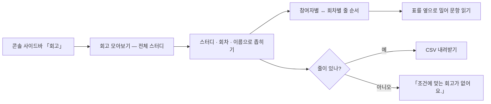

# 캡틴은 백오피스에서 스터디 미팅 회고를 모아 볼 수 있다.

story_id: ST-041 · IA: IA-042

기준 프로토타입: 운영 콘솔 › 회고

## 1. 기본설명

### 진입·사용 흐름

### 완료 기준

1. 진행 중인 스터디의 끝난 회차 회고 표 — 스터디 · 참여자 · 반 · 회차 · 문항 셋 · 작성일
2. 스터디 · 회차 · 참여자 이름으로 좁히기와 건수 확인
3. 참여자별 · 회차별 줄 순서 전환
4. 작성률과 문항별 건수(좋았던 점 · 개선할 점 · 소감) 확인
5. 문항 칸의 전문과 👍 수 확인
6. 가로 스크롤 중 스터디 · 참여자 열 고정
7. 미작성 줄 구분
8. 좁힌 조건 그대로 CSV 내려받기
9. 조건에 맞는 줄이 없을 때 안내 문구

---

## 2. 화면명세

> **화면**: 운영 콘솔 › 회고.
>
> 아래 번호별 명세는 프로토의 **설명 보기**에서 그대로 가져온다. 손으로 고치지 않는다 —
> 고치려면 화면 옆 `spec.ts` 를 고치고 `pnpm --filter playground export-specs` 를 돌린다.

<!-- spec:start retros -->

> 프로토 가정: 사용자 사이트 회고와 같은 가정 데이터다. 이 브라우저에서 사용자 사이트에 쓴 회고도 함께 보인다

### 1 — 좁히기

- **내용**: 스터디 · 회차 · 참여자 이름 검색. 처음엔 「전체 스터디」
- **동작**
  - 회차는 스터디를 고른 뒤에만 고른다. 스터디를 바꾸면 회차는 전체로 돌아간다
  - 이름 검색은 입력이 멈추고 400ms 뒤에 반영한다
  - 무엇이든 바꾸면 1페이지로
- **정책**: 진행 중인 스터디의 끝난 회차만 나온다

#### 1-1 — 줄 순서: 참여자별 / 회차별

- **내용**: 참여자별은 한 사람의 회차를 이어서, 회차별은 한 회차의 사람을 이어서 보여 준다
- **정책**: 둘 다 스터디 이름순이 먼저다. 이름은 가나다순, 회차는 번호순

### 2 — 요약

- **내용**
  - 작성률 — 「기한 지난 회고 n건 중 m건 작성」과 함께. 기한 지난 회차가 없으면 「-」 · 「기한이 지난 회차가 아직 없어요」
  - 좋았던 점 · 개선할 점 · 소감 — 남긴 건수
- **정책**
  - 좁힌 조건 전체로 센다(지금 페이지만이 아니라)
  - 작성률 = 기한 지난 줄 중 쓴 줄 ÷ 기한 지난 줄, 반올림한 정수 %. 기한 전 회차는 아직 쓸 수 있어 세지 않는다
  - 소감은 선택 문항이라 비운 회고는 세지 않는다

### 3 — 회고 표

- **내용**
  - 스터디 · 참여자 · 반 · 회차 · 좋았던 점 · 개선할 점 · 소감 · 작성일
  - 문항 칸은 답 전문과 받은 👍 수. 비운 소감은 「-」
  - 조건에 맞는 줄이 없으면 「조건에 맞는 회고가 없어요.」
- **동작**: 표가 넓어 가로로 민다. 스터디 · 참여자 열은 밀어도 남는다
- **정책**
  - 문항 칸을 줄이지 않는다 — 전문을 보인다
  - 20줄씩 페이지를 넘긴다
- **데이터**: GET /api/admin/retros?studyId&meetingId&q&sort&offset&limit

#### 3-1 — 미작성

- **조건**: 쓸 사람이 아직 안 썼을 때
- **내용**: 문항 세 칸 자리에 「미작성」, 작성일 「-」
- **정책**: 쓸 사람 = 그 회차 시작 때 반에 있던 참여자. 그전에 참여를 중단한 사람은 뺀다

### 4 — 표 아래 줄

- **내용**: 고정 열 안내 · 「총 n건」

### 5 — CSV 내려받기

- **동작**: 지금 좁힌 조건의 모든 줄을 CSV 로 내려받는다 — 미작성 줄 포함, 문항마다 👍 수 열
- **정책**: 줄이 없으면 누를 수 없다
- **데이터**: GET /api/admin/retros/export.csv — 1 과 같은 조건

<!-- spec:end retros -->

### 상태별 화면

| 상태 | 화면 | 카피 |
|---|---|---|
| 기본 | 전체 스터디 · 참여자별 | 「총 n건」 |
| 로딩 | 표 자리 | — |
| 빈 결과 | 좁힌 조건에 줄 없음 | 「조건에 맞는 회고가 없어요.」 |

### 비고

- 범위 밖: 회고 수정 · 삭제 · 숨김 · 모바일 전용 화면
- 미구현: 조회 실패 상태는 연동 시 함께 정의

---

## 3. 시스템 요건

### 개발 범위

기준일 2026-11-21 · `beta`

| 구분 | 대상 | 지금 | 할 일 |
|---|---|---|---|
| FE | back-office-front `/retros` · 사이드바 「회고」 | 없음 | 화면 · API 연결 |
| BE | `GET /api/admin/retros` | 스펙작성중 | 스펙 확정 · 구현 |
| BE | `GET /api/admin/retros/export.csv` | 스펙작성중 | 스펙 확정 · 구현 |

### 계산 규칙

- 줄 = 끝난 회차 × 쓸 사람. 안 쓴 사람도 미작성 줄로 센다. 쓸 사람은 [ST-039 §3 계산 규칙](../crew-write-meeting-retro/PRD.md#계산-규칙)과 같다
- 작성률 = 기한 지난 줄 중 쓴 줄 ÷ 기한 지난 줄, 반올림 정수 %. 좁힌 조건 전체로 센다. 기한 전 회차는 아직 쓸 수 있어 세지 않는다
- 문항별 건수 = 그 문항을 비우지 않은 쓴 줄 수

### 처리

- 정렬: 스터디 이름 → (참여자별) 이름 → 회차 번호 / (회차별) 회차 번호 → 이름
- 20줄씩. 무엇이든 바꾸면 1페이지
- CSV 는 좁힌 조건의 모든 줄, UTF-8(BOM). 열: 스터디 · 반 · 회차 · 참여자 · 문항마다 답과 👍 수 · 작성일(미작성이면 「미작성」)

### 권한

| 동작 | 허용 | 검증 |
|---|---|---|
| 목록 · CSV | 캡틴(ADMIN) | 서버 |

### 퍼널·계측

해당 없음

### API

[meeting-retro 스펙](../../../specs/meeting-retro/spec.md)
