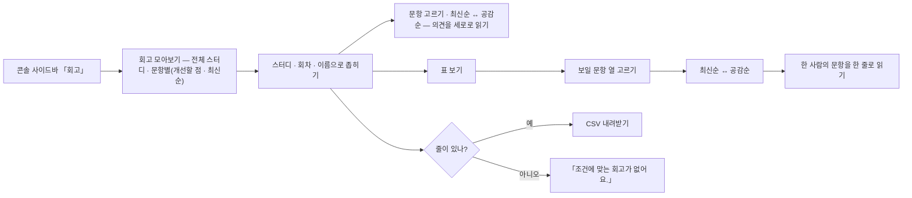

# 캡틴은 백오피스에서 스터디 미팅 회고를 모아 볼 수 있다.

story_id: ST-041 · IA: IA-042

기준 프로토타입: 운영 콘솔 › 회고

## 1. 기본설명

### 진입·사용 흐름

### 완료 기준

1. 문항별 보기(기본) — 고른 문항(기본 개선할 점)의 답을 세로 목록으로, 스터디 · 반 · 회차 · 날짜 · 참여자 · 작성 시각 · 👍 수와 함께. 최신순 · 공감순
1-1. 표 보기 — 진행 중인 스터디의 끝난 회차 회고 표 — 스터디 · 참여자 · 반 · 회차 · 문항 셋 · 작성일
2. 스터디 · 회차 · 참여자 이름으로 좁히기와 건수 확인
3. 표 보기 — 보일 문항 열(좋았던 점 · 개선할 점 · 소감) 켜고 끄기, 최신순 · 공감순 줄 순서
4. 작성률과 문항별 건수(좋았던 점 · 개선할 점 · 소감) 확인
5. 문항 칸의 전문과 👍 수 확인
6. 가로 스크롤 중 스터디 · 참여자 열 고정 · 표 위 가로 스크롤바
7. 좁힌 조건 그대로 CSV 내려받기
8. 조건에 맞는 줄이 없을 때 안내 문구

---

## 2. 화면명세

> **화면**: 운영 콘솔 › 회고.
>
> 아래 번호별 명세는 프로토의 **설명 보기**에서 그대로 가져온다. 손으로 고치지 않는다 —
> 고치려면 화면 옆 `spec.ts` 를 고치고 `pnpm --filter playground export-specs` 를 돌린다.

<!-- spec:start retros -->

> 프로토 가정: 사용자 사이트 회고와 같은 가정 데이터다. 이 브라우저에서 사용자 사이트에 쓴 회고도 함께 보인다

### 1 — 좁히기

- **내용**: 스터디 · 회차 · 참여자 이름 검색. 처음엔 「전체 스터디」
- **동작**
  - 회차는 스터디를 고른 뒤에만 고른다. 스터디를 바꾸면 회차는 전체로 돌아간다
  - 이름 검색은 입력이 멈추고 400ms 뒤에 반영한다
  - 무엇이든 바꾸면 1페이지로
- **정책**: 진행 중인 스터디의 끝난 회차만 나온다

#### 1-1 — 줄 순서: 최신순 / 공감순 (표 보기)

- **내용**: 처음엔 최신순 — 작성 시각 늦은 것부터. 공감순은 보이는 문항 열의 👍 합이 많은 것부터
- **동작**: 바꾸면 3-2 열 머리 👍 정렬이 풀린다. 1페이지로
- **정책**
  - 공감순에서 👍 합이 같으면 최신순
  - 참여자별 · 회차별 묶기는 두지 않는다 — 한 사람은 이름 검색, 한 회차는 스터디 · 회차 고르기로 본다

### 2 — 요약

- **내용**
  - 좁히기 아래 한 줄 — 「작성률 n% (기한 지난 회고 m/n 작성)」(m = 쓴 회고, n = 기한 지난 회고). 기한 지난 회차가 없으면 「-」 · 「기한이 지난 회차가 아직 없어요」
  - 문항별 건수(좋았던 점 · 개선할 점 · 소감)는 7 문항 고르기 단추 안에 붙인다
- **정책**
  - 카드가 아니라 한 줄 — 의견 목록이 첫 화면에 보이게 한다
  - 좁힌 조건 전체로 센다(지금 페이지만이 아니라)
  - 작성률 = 기한 지난 줄 중 쓴 줄 ÷ 기한 지난 줄, 반올림한 정수 %. 기한 전 회차는 아직 쓸 수 있어 세지 않는다
  - 소감은 선택 문항이라 비운 회고는 세지 않는다

### 3 — 회고 표 (표 보기)

- **내용**
  - 한 사람의 문항을 한 줄로 본다 — 누가 무엇을 썼는지 확인
  - 스터디 · 참여자 · 반 · 회차 · (10 에서 고른 문항 열) · 작성일(콘솔 표시 시간대, 약칭 붙임)
  - 문항 칸은 답 전문과 받은 👍 수 — 👍 는 칸 오른쪽, 답 첫 줄 높이. 비운 소감은 「-」
  - 조건에 맞는 줄이 없으면 「조건에 맞는 회고가 없어요.」
- **동작**: 표가 넓어 가로로 민다. 스터디 · 참여자 열은 밀어도 남는다
- **정책**
  - 문항 칸을 줄이지 않는다 — 전문을 보인다
  - 20줄씩 페이지를 넘긴다
  - 보이는 문항을 하나도 안 쓴 회고는 줄로 나오지 않는다 (소감만 보일 때 소감을 비운 회고)
  - 표 폭은 문항 열 수에 맞춘다 — 열이 적으면 가로로 밀지 않아도 된다
- **데이터**: GET /api/admin/retros?studyId&meetingId&q&sort&offset&limit

#### 3-1 — 위 가로 스크롤바

- **내용**: 표 위에 가로 스크롤바가 하나 더 있다. 아래 스크롤바와 함께 움직인다 (스터디 표와 같다)
- **정책**: 20줄을 보이면 아래 스크롤바가 화면 밖이다 — 위에서도 넘길 수 있게 한다

#### 3-2 — 👍 수로 정렬

- **내용**: 좋았던 점 · 개선할 점 · 소감 열 머리가 정렬 단추다. 정렬 중인 열은 머리 글자가 강조색
- **동작**
  - 처음 누르면 그 문항의 👍 많은 순, 다시 누르면 적은 순
  - 1-1 의 공감순(보이는 열 합)보다 먼저 적용된다
  - 줄 순서(1-1)를 다시 고르면 👍 정렬이 풀린다
  - 그 열을 10 에서 끄면 👍 정렬도 풀린다
  - 무엇이든 바꾸면 1페이지
- **정책**
  - 👍 수가 같으면 지금 고른 줄 순서(1-1)
  - 그 문항을 비운 회고(소감)는 방향과 상관없이 맨 뒤

### 4 — 건수

- **내용**
  - 목록 · 표 오른쪽 위에 「총 n건」 (스터디 · 유저 표와 같은 자리)
  - 문항별 보기는 고른 문항을 쓴 회고 수, 표 보기는 좁힌 조건의 쓴 회고 수

### 5 — CSV 내려받기

- **동작**: 지금 좁힌 조건의 모든 줄을 CSV 로 내려받는다 — 쓴 회고만, 문항마다 👍 수 열
- **정책**
  - 줄이 없으면 누를 수 없다
  - 표 보기 — 지금 보이는 문항 열 · 줄 순서 그대로 내려받는다
  - 문항별 보기 — 세 문항을 모두 담은 표 모양으로 내려받는다
- **데이터**: GET /api/admin/retros/export.csv — 1 과 같은 조건

### 6 — 보기: 문항별 / 표

- **내용**: 좁히기 줄 오른쪽. 처음엔 「문항별」
- **동작**: 바꾸면 1페이지로. 좁힌 조건은 그대로
- **정책**
  - 문항별이 먼저다 — 캡틴이 먼저 찾는 건 「최근에 어떤 개선 의견이 나왔나」이고, 표는 여러 사람의 같은 문항을 비교하려면 가로로 밀어야 한다
  - 표는 한 사람의 세 문항을 함께 보는 용도로 남긴다

### 7 — 문항 고르기 (문항별 보기)

- **내용**: 「개선할 점 n · 좋았던 점 n · 소감 n」 알약. 처음엔 개선할 점
- **동작**: 고르면 그 문항의 답만 아래 목록에 모인다. 1페이지로
- **정책**
  - 개선할 점을 맨 앞에 둔다 — 다음 미팅에 반영할 내용을 찾는 화면이라서
  - 숫자는 좁힌 조건에서 그 문항을 쓴 회고 수

### 8 — 순서: 최신순 / 공감순 (문항별 보기)

- **내용**: 처음엔 최신순
- **동작**: 최신순은 작성 시각 늦은 것부터, 공감순은 그 문항 👍 많은 것부터. 바꾸면 1페이지
- **정책**: 공감순에서 👍 수가 같으면 최신순

### 9 — 의견 목록 (문항별 보기)

- **내용**
  - 한 줄에 의견 하나 — 답 전문, 그 아래 「스터디 · 반 · n회차 날짜(요일) · 참여자 · MM.DD HH:mm 약칭 작성」, 오른쪽에 👍 수
  - 그 문항을 비운 회고(소감)는 나오지 않는다
  - 없으면 「조건에 맞는 의견이 없어요.」
- **정책**
  - 답을 줄이지 않는다 — 전문을 보인다
  - 20개씩 페이지를 넘긴다
  - 날짜 · 시각은 콘솔 위 표시 시간대 기준 (반 시간대가 아니라)
- **데이터**: GET /api/admin/retros?studyId&meetingId&q&section&sort=RECENT|LIKES&offset&limit

### 10 — 보일 문항 고르기 (표 보기)

- **내용**: 「좋았던 점 n · 개선할 점 n · 소감 n」 칩. 처음엔 셋 다 켜져 있다. 숫자는 좁힌 조건에서 그 문항을 쓴 회고 수
- **동작**
  - 누르면 그 문항 열을 표에서 빼거나 다시 넣는다. 1페이지로
  - 켜진 칩이 하나 남으면 그 칩은 끌 수 없다
- **정책**
  - 여러 사람의 같은 문항을 가로로 밀지 않고 비교하려는 용도 — 한 열만 남기면 그 문항을 세로로 훑는다
  - 열 순서는 늘 좋았던 점 · 개선할 점 · 소감
- **데이터**: GET /api/admin/retros?…&sections=GOOD,IMPROVE,FEELING — 보이는 문항을 하나도 안 쓴 회고는 빼고 센다

<!-- spec:end retros -->

### 상태별 화면

| 상태 | 화면 | 카피 |
|---|---|---|
| 기본 | 전체 스터디 · 문항별 · 개선할 점 · 최신순 | 「총 n건」 |
| 표 보기 | 전체 스터디 · 문항 셋 · 최신순 | 「총 n건」 |
| 로딩 | 목록 · 표 자리 | — |
| 빈 결과 (문항별) | 좁힌 조건에 그 문항 답 없음 | 「조건에 맞는 의견이 없어요.」 |
| 빈 결과 (표) | 좁힌 조건에 줄 없음 | 「조건에 맞는 회고가 없어요.」 |

### 비고

- 범위 밖: 회고 수정 · 삭제 · 숨김 · 모바일 전용 화면
- 미구현: 조회 실패 상태는 연동 시 함께 정의

---

## 3. 시스템 요건

### 개발 범위

기준일 2026-11-21 · `beta`

| 구분 | 대상 | 지금 | 할 일 |
|---|---|---|---|
| FE | back-office-front `/retros` · 사이드바 「회고」 | 없음 | 화면 · API 연결 |
| BE | `GET /api/admin/retros` | 스펙작성중 | 스펙 확정 · 구현 |
| BE | `GET /api/admin/retros/export.csv` | 스펙작성중 | 스펙 확정 · 구현 |

### 계산 규칙

- 표 · CSV 의 줄 = 쓴 회고 하나. 안 쓴 사람은 줄로 보이지 않는다 (작성 현황은 회고 탭에서 네비게이터가 본다)
- 작성률의 분모 = 끝난 회차 × 쓸 사람. 쓸 사람은 [ST-039 §3 계산 규칙](../crew-write-meeting-retro/PRD.md#계산-규칙)과 같다
- 작성률 = 기한 지난 줄 중 쓴 줄 ÷ 기한 지난 줄, 반올림 정수 %. 좁힌 조건 전체로 센다. 기한 전 회차는 아직 쓸 수 있어 세지 않는다
- 문항별 건수 = 그 문항을 비우지 않은 쓴 줄 수

### 처리

- 정렬: (최신순) 작성 시각 내림차순 / (공감순) 보이는 문항 👍 합 내림차순, 같으면 최신순
- 문항 열 머리로 👍 정렬을 고르면 그 문항 👍 수가 먼저, 같으면 위 순서. 그 문항을 비운 회고는 맨 뒤
- 20줄씩. 무엇이든 바꾸면 1페이지
- CSV 는 좁힌 조건의 쓴 회고 전부, UTF-8(BOM). 열: 스터디 · 반 · 회차 · 참여자 · 문항마다 답과 👍 수 · 작성일

### 권한

| 동작 | 허용 | 검증 |
|---|---|---|
| 목록 · CSV | 캡틴(ADMIN) | 서버 |

### 퍼널·계측

해당 없음

### API

[meeting-retro 스펙](../../../specs/meeting-retro/spec.md)
