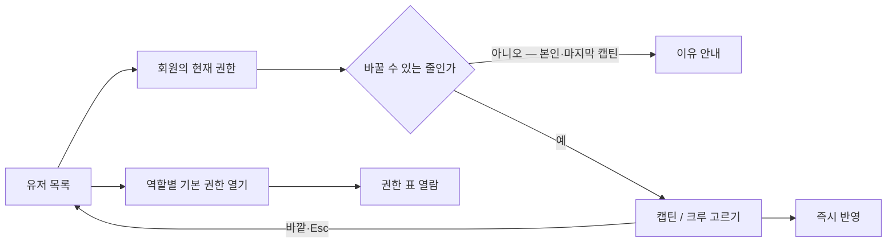
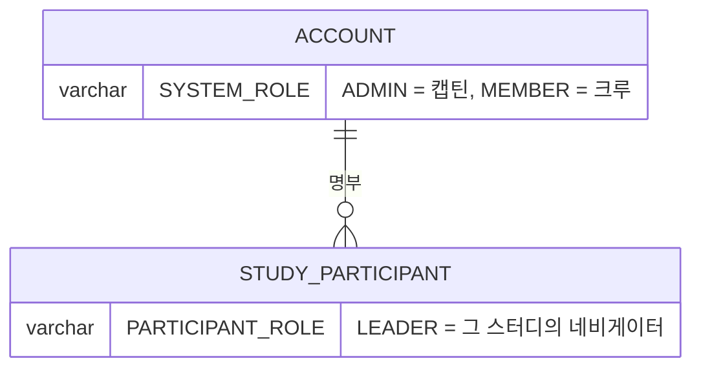

# 캡틴은 유저에게 서로 다른 역할과 권한을 줄 수 있다.

기준 프로토타입: 유저 — 권한 부여 (playground 운영 콘솔 · 유저)

## 1. 기본설명

· **진입·사용 흐름**

· **완료 기준**

1. 유저 목록에서 계정 권한을 캡틴·크루로 변경
2. 선택 즉시 반영
3. 자기 권한 변경 차단
4. 마지막 캡틴 강등 차단
5. 변경 불가 행 구분 및 사유 안내
6. 역할별 기본 권한 표 열람
7. 네비게이터는 이 화면에서 주지 않음 — 스터디 크루 명단에서 지정

## 2. 화면명세

> **화면**: 유저 (운영 콘솔) — 권한 칸 · 기본 권한 표
>
> 아래 번호별 명세는 프로토의 **설명 보기**에서 그대로 가져온다. 손으로 고치지 않는다 —
> 고치려면 화면 옆 `spec.ts` 를 고치고 `pnpm --filter playground export-specs` 를 돌린다.

<!-- spec:start role -->

> 권한 변경은 화면 상태로만 처리한다. 새로고침하면 되돌아간다 — 저장 API 가 아직 없다. 서버에 맡기고 기다리는 과정만 흉내 낸다
>
> **프로토는 세 줄에 한 줄꼴로 일부러 실패한다** — 저장하지 못했을 때의 화면도 눌러 봐야 한다. 같은 줄은 늘 같게 동작한다
>
> **계정에 줄 수 있는 것은 캡틴·크루 둘뿐이다.** 네비게이터는 스터디마다 서는 역할이라 그 스터디의 크루 명단에서 정한다
>
> 역할 밖의 개별 권한 예외는 두지 않는다
>
> 백엔드 Role enum(STUDENT/OPERATOR/ADMIN)과 이름이 다르다 — 매핑은 PRD 에서 정한다

### 1 — 현재 권한

- **내용**
  - 그 사람의 지금 권한. 바꿀 수 있는 자리임이 드러난다
  - 바꿀 수 없는 줄은 바꿀 수 있는 줄과 구분되고, 짚어 보면 이유를 알려준다
- **동작**
  - 고르면 고를 수 있는 값이 열린다
  - 저장을 기다리는 동안 **배지 옆에서 하나가 돌고 다시 고를 수 없다** — 두 번 눌러 두 번 저장되지 않게. 「변경 중」이라고 적지 않는다: 줄마다 글이 늘고 배지가 밀린다
- **정책**
  - 두 값이 서로 구분되어야 하며, 색만으로 구분하지 않는다
  - **기다리는 동안에도 배지는 지금 저장된 값 그대로다** — 누른 값으로 미리 바꾸면 저장에 실패해도 바뀐 것처럼 남아, 다시 누를 이유를 알 수 없다
- **데이터**: 계정 권한 값

### 2 — 권한 고르기

- **조건**: 현재 권한을 눌렀을 때
- **내용**: 고를 수 있는 값 둘 — 캡틴 · 크루
- **동작**
  - 고르면 바로 서버에 맡긴다 — 저장 조작이 따로 없다
  - **저장된 뒤에** 배지가 바뀌고, 바뀌었다는 사실과 **디스코드 설정은 따로 바꿔야 한다는 안내**를 함께 알린다
  - 저장하지 못하면 **배지는 원래 값 그대로** 두고 그 사실과 다시 시도를 알린다
  - 바깥을 누르거나 Esc → 바꾸지 않고 닫힌다
- **정책**
  - 순서는 캡틴 → 크루. 화면 어디서나 같다
  - **지금 값을 따로 표시하지 않는다** — 닫힌 자리에 이미 보이므로 목록 안에서 또 말하면 같은 말이 두 번이다
  - 자기 권한은 스스로 바꿀 수 없다
  - 마지막 캡틴은 내릴 수 없다 — 되돌릴 사람이 사라진다
  - **디스코드 역할은 이 화면이 바꾸지 못한다** — 바꾼 사람이 그 자리에서 알아야 한다. 나중에 알면 권한만 올라가고 디스코드는 그대로인 사람이 남는다
  - 결과는 **토스트로 한 번만** 알린다. 창으로 띄우지 않는다 ([POL-0008](https://github.com/StudyClub-PlusPlus/studyclub-engineering/blob/beta/01-planning/_registry/policies/POL-0008-screen-rules.md))
- **데이터**: 계정 권한 값 (쓰기)

### 3 — 역할별 기본 권한 열기

- **동작**: 누르면 역할별 기본 권한표가 열린다
- **정책**: 표를 화면에 펴 두지 않는다 — 명단은 매번 보고 역할 체계는 가끔 본다

### 4 — 역할별 기본 권한 표

- **조건**: 3 을 눌렀을 때
- **내용**
  - **표가 둘이다** — 스터디 단위 권한(캡틴 · 네비게이터 · 크루) 넷, 사이트 전체 권한(캡틴 · 크루) 일곱
  - 첫 칸 머리는 「하는 일」. 스터디 단위 표 제목 옆에 「네비게이터 권한은 담당 스터디에 국한」
- **동작**: 열람 전용이다. 이 표에서 권한을 바꾸지 않는다
- **정책**
  - **담당 스터디 안에서 도는 일과 사이트 전체에 미치는 일을 한 표에 섞지 않는다** — 섞으면 네비게이터의 체크가 모든 스터디를 뜻하는 것처럼 읽힌다
  - 역할 순서는 권한이 많은 쪽부터 (캡틴 → 네비게이터 → 크루)
  - **출석 체크는 권한이 아니다** — 보이스룸에서 그날 출석을 여는 일은 누구나 할 수 있다. 권한이 필요한 것은 기록된 출석을 고치는 일이다
  - **스터디 공개는 정보 수정과 다른 권한이다** — 한 권한으로 묶으면 담당 스터디를 굴리는 네비게이터가 사이트에 스터디를 세울 수 있게 된다
  - **스터디 공지와 사이트 공지를 이름으로 가른다** — 「공지 발행」 한 줄만 두면 네비게이터가 담당 스터디에 공지를 못 올리는 것처럼 읽힌다
  - 반 편성은 스터디에 하는 일이지만 사이트 전체 표에 둔다 — 네비게이터가 못 하는 일이라 스터디 단위 표에 넣으면 그 표에서 홀로 빈 줄이 된다
- **데이터**: 역할별 허용 권한 집합 (한 곳에서만 정의)

### 5 — 상태별 화면

- **내용**
  - 기본 — 지금 권한 하나
  - 바꿀 수 없음 — 구분된 칸, 짚으면 이유(본인 · 마지막 캡틴)
  - 고르는 중 — 캡틴 · 크루
  - **변경 중 — 원래 배지 그대로, 옆에서 하나가 돈다. 그 줄은 다시 고를 수 없다**
  - 완료 — 바뀐 배지와 알림 한 번(디스코드 안내 포함)
  - **실패 — 원래 배지 그대로. 사유와 다시 시도를 알린다**
- **정책**: **바뀐 것이 없으면 화면도 그대로다** — 권한은 지금 저장돼 있는 것이 보여야 하는 값이다

<!-- spec:end role -->

### 비고

- 범위 밖: 네비게이터 지정 — [captain-view-attendees](../captain-view-attendees/PRD.md), 회원 정지
- 미구현: 권한 변경은 화면에서만 처리한다. 저장 API 가 없다

## 3. 시스템 요건

### 데이터 관계

### 데이터

| 화면 이름 | 저장 값 |
| --- | --- |
| 캡틴 | `ACCOUNT.SYSTEM_ROLE = ADMIN` |
| 크루 | `ACCOUNT.SYSTEM_ROLE = MEMBER` |
| 네비게이터 | 계정 값 아님. `STUDY_PARTICIPANT.PARTICIPANT_ROLE = LEADER` |

### 처리

- 요청자 본인의 권한 변경은 거절한다
- 대상이 마지막 `ADMIN` 이고 `MEMBER` 로 내리는 요청은 거절한다. 판정은 같은 트랜잭션 안에서 `ADMIN` 수를 세서 한다
- **저장되기 전에는 화면을 바꾸지 않는다.** 실패하면 바뀐 것이 없으므로 배지도 그대로다
- 서버가 거절하면 그 사유를 적어 알린다 — 본인 변경(`CANNOT_CHANGE_OWN_ROLE`) · 마지막 캡틴(`LAST_ADMIN_REQUIRED`)
- 백오피스 로그인은 `SYSTEM_ROLE = ADMIN` 만 통과하므로, 캡틴으로 올린 회원은 다음 로그인부터 백오피스에 들어온다 — [back-office-login/spec.md](../../../specs/back-office-login/spec.md)

### API

| 메서드 | 경로 | 권한 |
| --- | --- | --- |
| PATCH | `/api/admin/users/{accountId}/system-role` | 캡틴 |

계약은 [admin-users/spec.md](../../../specs/admin-users/spec.md). 본인 변경은 409 `CANNOT_CHANGE_OWN_ROLE`, 마지막 캡틴 강등은 409 `LAST_ADMIN_REQUIRED`.

### 권한

- 캡틴만. 서버에서 검증한다

### 외부 연동

- **디스코드 역할은 따라가지 않는다.** 이 API 는 계정 권한만 바꾼다 — 디스코드 서버의 역할은 사람이
  따로 바꾼다. 그래서 바꾼 자리에서 **「디스코드 설정 변경은 운영자에게 요청해 주세요」**를 함께 알린다

## 4. 미확정

- ~~권한 변경 API 경로와 스펙 위치~~ → `PATCH /api/admin/users/{accountId}/system-role`, [admin-users/spec.md](../../../specs/admin-users/spec.md) (2026-10-06)
- 백엔드 Role 이름과 화면 이름의 매핑 — 코드의 `STUDENT/OPERATOR/ADMIN` 과 ERD 의 `MEMBER/ADMIN` 이 다르다
- 권한 변경 이력(누가 언제 바꿨는지)을 남길지
