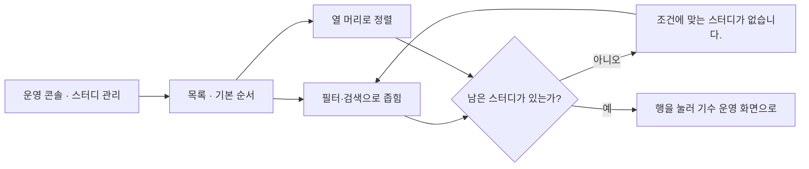
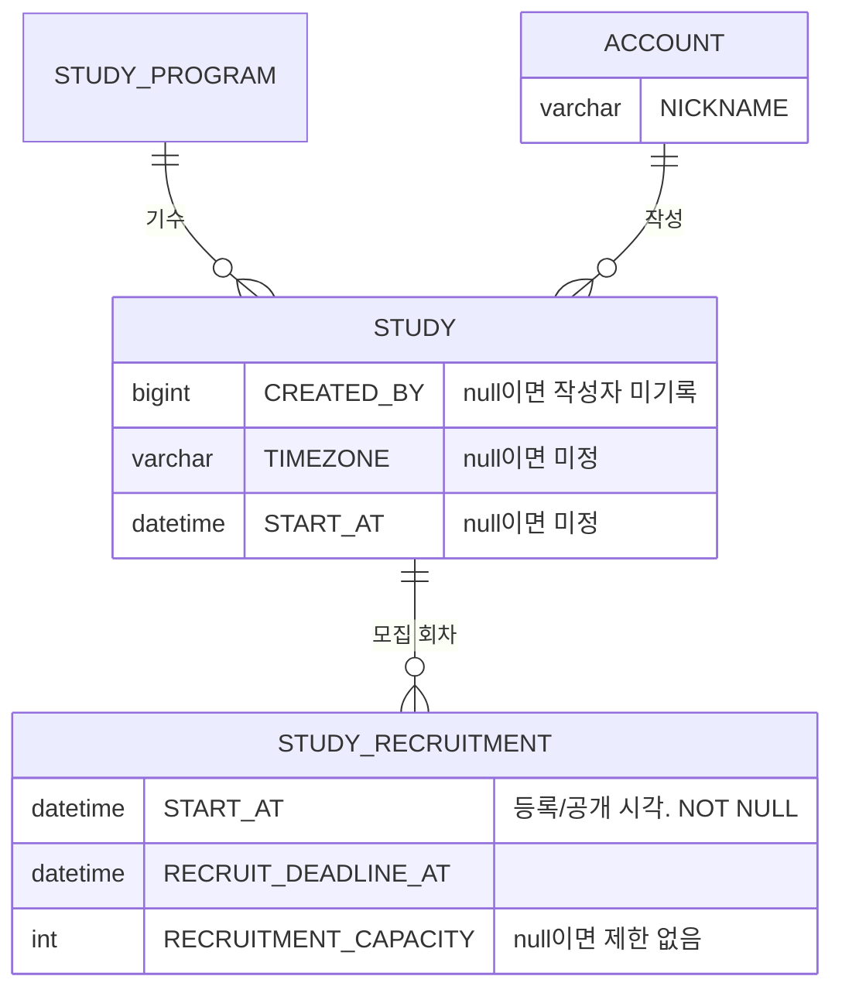

# 캡틴은 모든 스터디의 리스트를 볼 수 있다.

기준 프로토타입: 스터디 관리 (playground 운영 콘솔 · 스터디 목록)

## 1. 기본설명

· **진입·사용 흐름**

· **완료 기준**

1. 한 행에서 카테고리·시간대·모집 일정·모집 상태·지원 현황·시작일·신청 폼·공개 상태·작성자 조회
2. 지원 현황 — 현재 인원 / 정원. 정원 없으면 「제한 없음」
3. 작성자 열 — 기록 없으면 「—」
4. 검색·카테고리·상태·모집·공개·신청 폼 필터
5. 신청 폼 드롭다운 — 있음 · 없음
6. 열 이름을 누르면 오름차순, 다시 누르면 내림차순. 기본은 모집 상태 오름차순
7. 열 순서는 고정 — 끌어서 바꾸지 않음
8. 한 페이지 20개, 필터·검색·정렬 변경 시 1페이지로
9. 출석률은 목록에 두지 않음

## 2. 화면명세

> **화면**: 스터디 관리 (운영 콘솔)

### 1. 지원 현황

- **내용**: 열 이름 「지원 현황」. 「현재/정원」. 정원을 비운 스터디는 「현재 · 제한 없음」
- **정책**
  - 현재 인원은 신청 명부에서 계산한다. 운영자가 입력하지 않는다
  - 정원은 등록 폼의 「모집 정원」이다. 모집 회차마다 따로 정한다
- **데이터**: `STUDY_RECRUITMENT.RECRUITMENT_CAPACITY` · 신청 명부의 참여자 수

### 2. 모집 시작일

- **내용**: 모집을 시작한 날. 시작 전이면 「—」
- **정책**
  - 모집 시작일은 공개한 날이다
  - 모집 상태(모집중 · 마감)와 다른 열로 둔다
- **데이터**: `STUDY_RECRUITMENT.START_AT`

### 2-1. 모집 종료일

- **내용**: 모집 마감일
- **정책**: 필수 값이다. 이 날이 지나면 모집 마감으로 판정한다
- **데이터**: `STUDY_RECRUITMENT.RECRUIT_DEADLINE_AT`

### 2-3. 시간대

- **내용**: 「KST」 · 「PST」 · 「동시 진행(KST·PST)」. 값이 없으면 「미정」
- **정책**: 등록 폼에서 운영자가 고른 값을 그대로 쓴다. 일정 문구로 추정하지 않는다
- **데이터**: `STUDY.TIMEZONE`

### 3. 스터디 시작일

- **내용**: 모임이 실제로 시작하는 날. 등록 폼의 「진행 시작일」과 같은 값. 없으면 「미정」
- **정책**: 자유 텍스트 「진행 일정」은 목록에 두지 않는다 — 정렬·필터를 걸 수 없다
- **데이터**: `STUDY.START_AT`

### 4. 필터

- **내용**: 검색 · 주제 · 상태 · 모집 · 공개 · 신청 폼 조건과 걸린 개수
- **동작**: 조건을 바꾸면 그 자리에서 목록이 좁혀진다
- **정책**
  - 조건들을 한 줄에 둔다. 좁은 화면에서는 줄바꿈 대신 옆으로 넘긴다
  - 주제는 한 번에 하나만 고른다 — `STUDY.CATEGORY` 가 단일 값이다
  - 각 조건의 「전체」 항목에 축 이름을 붙인다 (예: 「공개 전체」)
  - 개수는 필터에 걸린 전체 개수다. 현재 페이지의 개수가 아니다

### 5. 신청 폼 필터

- **내용**: 「신청 폼」 드롭다운 — 있음 · 없음
- **동작**: 켜면 신청 폼이 없는 스터디만 남는다. 끄면 전체
- **데이터**: 스터디의 신청 폼 유무

### 6. 컬럼 순서

- **정책**: 고정이다 — 운영자가 끌어서 바꾸지 않는다. P-ID · 스터디 두 열이 맨 앞

### 7. 가로 스크롤바

- **내용**: 표 위에서도 가로로 넘길 수 있다
- **동작**: 위·아래 스크롤이 함께 움직인다
- **정책**: 행이 많아도 표 맨 아래까지 내려가지 않고 옆 열을 볼 수 있어야 한다

### 8. 페이징

- **내용**: 페이지 번호 · 「이전」 · 「다음」. 번호가 많으면 앞뒤를 「…」로 줄인다
- **동작**: 필터·검색·정렬을 바꾸면 1페이지로 돌아간다
- **정책**
  - 한 페이지 20개
  - 한 페이지에 다 들어가면 페이지 번호를 보이지 않는다

### 9. 컬럼 정렬

- **내용**: 열마다 오름차순·내림차순 조작. 걸려 있는 방향이 구분되어 보인다
- **동작**
  - 오름차순·내림차순을 누르면 바로 정렬된다
  - 걸려 있는 방향을 다시 누르면 정렬이 풀리고 기본 순서로 돌아간다
  - 다른 열을 누르면 정렬이 그 열로 옮겨 간다
- **정책**
  - 한 번에 한 열로만 정렬한다
  - 기본 순서: 모집중 먼저, 그 안에서 모집 종료일이 가까운 순
  - 값이 없는 행은 방향과 관계없이 맨 뒤로 보낸다
  - 정렬 대상: P-ID · 스터디 · 스터디 상태 · 주제 · 시간대 · 모집 시작일 · 모집 종료일 · 모집 상태 · 지원 현황 · 스터디 시작일 · 신청 폼 · 공개 상태 · 작성자

### 10. 작성자

- **내용**: 이 스터디를 등록한 캡틴의 닉네임. 작성자가 기록되지 않은 스터디는 「—」
- **정책**
  - 스터디를 등록한 계정이 작성자다. 등록 요청을 보낸 계정을 서버가 채운다
  - 등록 폼에서 작성자를 고르지 않는다
  - 등록 뒤에는 바뀌지 않는다. 스터디를 수정한 사람이 달라도 작성자는 그대로다
  - 닉네임만 보인다. 이메일은 목록에 두지 않는다
- **데이터**: `STUDY.CREATED_BY` → `ACCOUNT.NICKNAME`

### 상태별 화면

| 상태 | 화면 | 카피 |
|---|---|---|
| 기본 | 기본 순서로 첫 페이지 | 「N개」 |
| 빈 결과 | 필터·검색에 걸린 스터디가 없음 | 「조건에 맞는 스터디가 없습니다.」 |

### 데이터 관계

### 비고

- **범위 밖**: 공개 설정·신청 폼 열·공개 필터 · 스터디 상태 열·안내·필터 · P-ID 열 · 등록·수정·삭제 · 출석 기록
- **미구현**
  - `STUDY.CREATED_BY` 컬럼이 없다. 등록 API 가 작성자를 기록하지 않는다
  - 운영 콘솔 전용 목록 API 가 없다. 프로토는 mock 데이터로 그린다
  - 프로토의 작성자는 mock 캡틴 중 한 명을 스터디마다 고정으로 배정한 값이다

<!-- spec:start list -->

### 1 — 지원 현황

- **내용**: 열 이름은 「지원 현황」. 「현재/정원」, 정원을 비운 스터디는 「현재 · 제한 없음」
- **정책**
  - 현재 인원은 신청 명부에서 계산한다 — 운영자가 입력하지 않는다
  - 정원은 등록 폼의 「모집 정원」이다. 모집 회차마다 따로 정한다
  - 제목 · 카테고리 · 시간대 · 모집 상태와 마감일 · 스터디 시작일 · 공개 상태가 같은 행에 함께 보인다. 종류(스터디/클럽)는 두지 않는다
- **데이터**
  - study.recruitment.capacity
  - 신청 명부의 참여자 수

### 2 — 모집 시작일

- **내용**: 모집 상태(모집중 · 마감)와 **다른 열**이다. 모집을 시작한 날, 시작 전이면 「—」
- **정책**: **공개한 날이다** — 모집 시작 일자가 있으면 공개로 본다. 별도 「공개 시작일」 열은 두지 않는다
- **데이터**: STUDY_RECRUITMENT.START_AT

#### 2-1 — 모집 종료일

- **내용**: 모집 마감일. 모집 시작일과 **별개의 열**이다
- **정책**: 필수 입력이다 — 상시 모집은 없다. 이 날이 지나면 모집 마감이다
- **데이터**: STUDY_RECRUITMENT.RECRUIT_DEADLINE_AT

#### 2-3 — 시간대

- **내용**: 「KST」 · 「PST」 · 「동시 진행(KST·PST)」. 값이 없으면 「미정」
- **정책**
  - 등록 폼에서 운영자가 직접 고른 값이다 — 일정·킥오프 문구를 읽어서 추정하지 않는다
  - 이 필드가 생기기 전에 만든 스터디는 값이 없어 「미정」으로 보인다. 사용자 사이트도 이 값이 있으면 그대로 쓰고, 없는 행만 문구로 추정한다
- **데이터**: STUDY.TIMEZONE

### 3 — 스터디 시작일

- **내용**: 모임이 실제로 시작하는 날. 등록 폼의 「진행 시작일」과 같은 값이다. 없으면 「미정」
- **정책**
  - 모집 시작일·모집 종료일과는 다른 축이다 — 저 둘은 「언제까지 신청받는가」, 이건 「언제 모이기 시작하는가」
  - 자유 텍스트인 「진행 일정」(요일·시간 문구)은 목록에 두지 않는다 — 정렬·필터를 걸 수 없고, 운영자가 훑어볼 값이 아니라 신청 화면에 알리는 문구다
- **데이터**: STUDY.START_AT

### 4 — 필터

- **내용**: 검색 · 카테고리 · 상태 · 모집 · 공개 · 신청 폼 드롭다운, 개수를 **한 줄**에 나란히
- **정책**
  - 두 줄로 나누지 않는다. 화면이 좁으면 줄바꿈 대신 옆으로 넘긴다
  - 축이 많아 탭으로 늘어놓으면 장황해진다 — 드롭다운으로 줄인다. 「전체」 항목에 축 이름을 붙여 라벨 없이도 구분한다
  - 카테고리 필터는 드롭다운 단일 선택이다 — `STUDY.CATEGORY` 가 단일 값이라 목록도 한 번에 하나만 고른다
  - 정렬은 필터 줄이 아니라 컬럼 머리 이름을 눌러서 한다

### 5 — 신청 폼 필터

- **내용**: 드롭다운 「신청 폼」 — 있음 · 없음
- **동작**: 고르면 그 스터디만 남는다. 「전체」로 되돌린다
- **정책**
  - 모집중인데 폼이 없는 스터디를 모아 보는 길이다 — 신청할 데가 없는 채로 공고가 나가는 것을 막는다
  - 다른 거르는 칸과 같은 드롭다운이다 — 이것만 스위치면 줄이 어긋나 보인다

### 7 — 가로 스크롤바 위치

- **내용**: 표 위에 가로 스크롤바가 하나 더 있다. 아래 스크롤바와 함께 움직인다
- **정책**: 열이 많아 가로로 넘치는데, 행이 많으면 표 맨 아래까지 내려가야 스크롤바가 보인다 — 위에서도 넘길 수 있게 한다

### 8 — 페이징

- **내용**: 표 아래 페이지 번호. 한 페이지 20개. 「이전」 · 「다음」 과 번호, 번호가 많으면 앞뒤를 「…」 로 줄인다
- **동작**
  - 필터·검색·정렬을 바꾸면 1페이지로 돌아간다
  - 한 페이지에 다 들어가면 페이지 번호를 보이지 않는다
- **정책**: 상단의 「N개」 는 페이지가 아니라 필터에 걸린 전체 개수다

### 9 — 컬럼 정렬

- **내용**: 컬럼 머리 이름이 곧 정렬 버튼이다. 화살표는 그리지 않는다. 정렬 중인 열은 이름이 강조색
- **동작**
  - 이름을 처음 누르면 오름차순, 다시 누르면 내림차순, 또 누르면 오름차순
  - 한 번에 한 열로만 정렬한다. 다른 열 이름을 누르면 그 열의 오름차순으로 옮겨 간다
  - 정렬하면 1페이지로 돌아간다
- **정책**
  - 기본은 **모집 상태 오름차순**이다(모집중 먼저, 같은 상태끼리는 마감이 가까운 순) — 처음부터 그 열 이름이 강조된다. 운영자가 손댈 것부터 위로
  - 값이 없는 행(예: 모집 시작일이 없는 미공개)은 오름·내림과 관계없이 맨 뒤로 보낸다
  - 프로그램 · 스터디 · 상태 · 카테고리 · 시간대 · 모집 시작일 · 모집 종료일 · 모집 상태 · 지원 현황 · 스터디 시작일 · 신청 폼 · 공개 상태 · 작성자 모두 정렬된다

### 10 — 작성자

- **내용**: 이 스터디를 등록한 캡틴의 표시명(닉네임). 작성자가 기록되지 않은 스터디는 「—」
- **정책**
  - **스터디를 등록한 계정이 작성자다.** 등록 요청을 보낸 캡틴을 서버가 채운다 — 등록 폼에서 고르지 않는다
  - 등록 뒤에는 바뀌지 않는다. 수정한 사람이 달라도 작성자는 그대로다
  - 이름만 보인다. 이메일은 목록에 두지 않는다
- **데이터**: STUDY.CREATED_BY → ACCOUNT.NICKNAME

<!-- spec:end list -->

## 3. 시스템 요건

### 개발 범위

> 2026-10-14 `beta` 기준. **지금 → 할 일**만 적는다. 다 끝나면 「할 일」이 모두 「없음」이 된다.
> FE 「지금」은 실제 앱의 화면과 데이터 연결(API · mock)까지 본 값이다 — 완료 기준 하나하나의 동작은 따로 확인하지 않았다.
> BE 「지금」은 스펙 엔드포인트 표의 상태 칸을 옮겨 적는다.

| 구분 | 대상 | 지금 | 할 일 |
|---|---|---|---|
| FE | back-office-front `/studies` (`StudiesTable`) | 있음 — 필터 · 「신청 폼 없는 것만」 · 정렬 · 페이지 · 위아래 가로 스크롤 | 작성자 열 (완료 기준 3) · 종류 칼럼·필터 빼기 · 「신청 폼 없는 것만」 토글 → 「신청 폼」 드롭다운(있음 · 없음) |
| FE | 목록 데이터 | 사이트용 `GET /api/studies` 를 부른다 | `GET /api/admin/studies` 로 바꿀지 정한다 ([study 스펙](../../../specs/study/spec.md) 표의 메모) |
| BE | `GET /api/admin/studies` | 구현완료 | 작성자(`CREATED_BY`) 닉네임을 응답에 넣는지 스펙에서 확인 |

· **데이터**

| 필드 | 타입 | 필수 | 뜻 |
|---|---|---|---|
| `STUDY.CREATED_BY` | BIGINT | N | 작성자. ACCOUNT 참조(인덱스만, 외래키 없음). null = 컬럼이 생기기 전에 등록된 스터디 |

· **처리**
- 스터디 등록(`POST /api/admin/studies`) 시 서버가 인증된 계정의 ID 로 `CREATED_BY` 를 채운다
- 요청 바디로 작성자를 받지 않는다
- 스터디 수정(`PATCH /api/admin/studies/{studyId}` · 네비게이터용 `PATCH /api/studies/{studyId}`)은 작성자를 바꾸지 않는다
- 기존 스터디는 백필하지 않는다. null 로 둔다

· **API**
- 목록: 운영 콘솔용 스터디 목록 응답에 작성자 닉네임을 포함한다. DRAFT 를 포함해야 하므로 공개용 `GET /api/studies` 와 분리해 `/api/admin` 아래 둔다
- 출석률은 목록 응답에 넣지 않는다

· **권한**
- 목록 조회: `SYSTEM_ROLE=ADMIN`. 서버에서 검증한다

· **계산 규칙**
- 지원 현황의 현재 인원: 신청 명부의 참여자 수. 정의 위치 [study-recruit-status/spec.md](../../../specs/study-recruit-status/spec.md)
- 모집 상태: 모집 종료일 경과 또는 정원 도달. 정의 위치 같음

## 4. 미확정

- 운영 콘솔 목록 API 의 경로·응답 필드 (`GET /api/admin/studies`)
- 작성자 계정이 탈퇴한 경우의 표시
