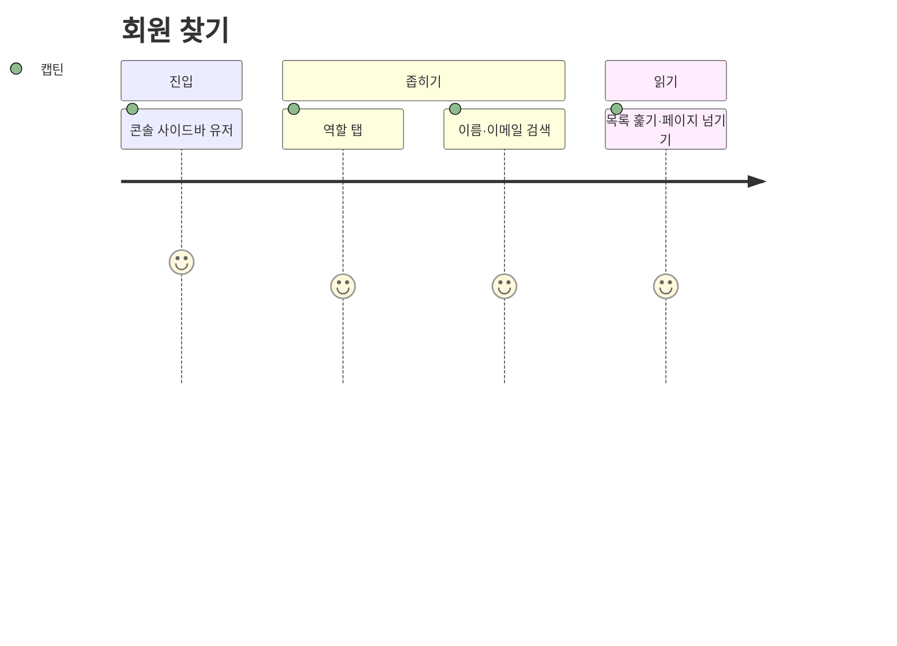
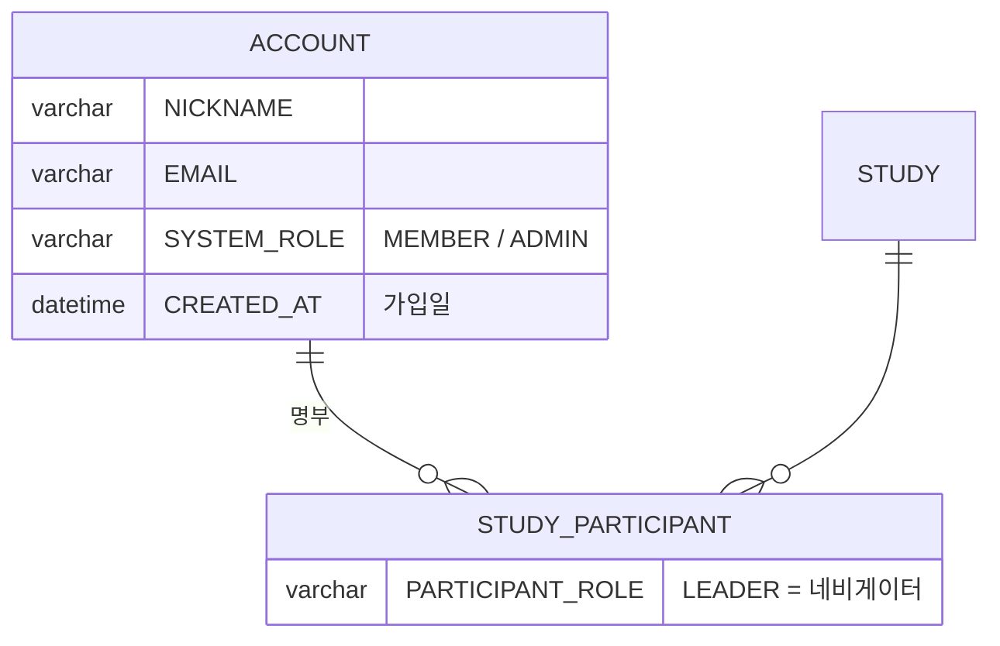

# 캡틴은 전체 회원 리스트를 조회할 수 있다.

기준 프로토타입: 유저 (playground 운영 콘솔 · 유저)

## 1. 기본설명

· **진입·사용 흐름**

· **완료 기준**

1. 가입 회원 전체 조회 — 탈퇴 회원 제외
2. 이름·이메일·권한·담당 스터디·가입일 표기
3. 전체·캡틴·네비게이터·크루 필터
4. 이름·이메일 검색
5. 걸러진 인원 수 표시
6. 참여 스터디 없는 회원은 휴면 구분
7. 20명씩 페이지 이동

## 2. 화면명세

> **화면**: 유저 (운영 콘솔)

### 1. 페이지 머리

- **내용**: 「유저」

### 2. 역할 탭 · 검색 · 인원 수

- **내용**
  - 탭: 전체 · 캡틴 · 네비게이터 · 크루
  - 걸러진 뒤의 인원 수
- **동작**
  - 탭을 고르면 그 사람들만 남는다. 「네비게이터」는 담당 스터디가 있는 사람이다
  - 검색은 이름과 이메일에 걸린다
- **정책**
  - 인원 수는 탭·검색으로 걸러진 전체 수다. 현재 페이지의 수가 아니다
  - 네 탭이 모두 보인다. 접지 않는다
  - 역할 순서는 어디서나 캡틴 → 네비게이터 → 크루

### 3. 유저 목록

- **내용**: 이름(참여 스터디가 없으면 「휴면」) · 이메일 · 권한 · 네비게이터 · 가입일
- **정책**
  - 정렬: 캡틴 → 담당 스터디가 있는 사람 → 나머지. 그 안에서 참여 스터디가 많은 순
  - 네비게이터 칸은 읽기 전용이다. 담당은 그 스터디의 크루 명단에서 정한다
  - 네비게이터 칸에는 담당 스터디 이름을 적는다. 둘 이상이면 하나만 적고 나머지는 개수로 접는다
- **데이터**: `ACCOUNT` · 담당 스터디(`STUDY_PARTICIPANT.PARTICIPANT_ROLE = LEADER`) · 참여 스터디 수

### 4. 페이지 이동

- **내용**: 한 페이지 20명. 지금 페이지가 드러난다
- **동작**
  - 탭이나 검색을 바꾸면 첫 페이지로 돌아간다
  - 한 페이지에 다 들어가면 보이지 않는다
- **정책**: 지금 페이지는 색만으로 구분하지 않는다

### 상태별 화면

| 상태 | 화면 | 카피 |
| --- | --- | --- |
| 기본 | 탭 · 검색 · 목록 | 인원 수 |
| 휴면 | 이름 칸 | `휴면` |
| 검색 결과 없음 | 인원 0 | — |

### 데이터 관계

### 비고

- 범위 밖: 권한 바꾸기 — [captain-grant-roles](../captain-grant-roles/PRD.md), 정지·초대
- 구현 지시: 탈퇴한 회원의 출석 기록은 남되 누구인지 알 수 없다. 이 목록에는 나오지 않는다 (이용약관 제11조 3항)

<!-- spec:start list -->

> **탈퇴한 회원은 이 목록에 없다.** 처리방침 제4조가 회원 정보의 보유 기간을 「회원 탈퇴 시까지」로 두므로, 목록에 남기려면 파기해야 할 정보를 계속 들고 있어야 한다
>
> 탈퇴 회원이 참여했던 회차의 출석 기록은 남는다 — 다른 참여자의 기록과 결합되어 있어 빼면 그 회차의 출석률이 깨진다. 다만 누구인지는 알 수 없게 처리한다 (이용약관 제11조 3항)
>
> 정지·초대는 이 화면 범위 밖이다

### 1 — 페이지 헤더

- **내용**: 제목 「유저」

### 2 — 역할 탭 · 검색 · 인원 수

- **내용**
  - 탭 = 전체 · 캡틴 · 네비게이터 · 크루
  - 걸러진 뒤의 인원 수
- **동작**
  - 탭을 고르면 그 사람들만 남는다. 「네비게이터」는 담당 스터디가 있는 사람이다
  - 검색은 이름과 이메일에 걸린다
  - 인원 수는 탭·검색으로 걸러진 뒤의 수다 — 지금 장의 인원이 아니다
- **정책**
  - 역할이 셋뿐이라 접지 않는다 — 지금 무엇으로 걸러져 있는지 한눈에 보여야 한다
  - 역할 순서는 화면 어디서나 같다: 캡틴 → 네비게이터 → 크루

### 3 — 유저 목록

- **내용**: 이름(참여 스터디가 없으면 「휴면」) · 이메일 · 디스코드 · 권한 · 네비게이터 · 가입일
- **정책**
  - 정렬은 캡틴 → 담당 스터디가 있는 사람 → 나머지, 그 안에서 참여 스터디가 많은 순
  - **네비게이터 칸은 읽기 전용이다** — 누가 어느 스터디를 맡는지는 그 스터디의 크루 명단에서 정한다
  - 네비게이터 칸에는 담당 스터디 이름을 적는다. 둘 이상이면 하나만 적고 나머지는 개수로 접는다
  - **디스코드 칸은 「연동」 아니면 「미연동」이다** — 이 명단에서 먼저 알아야 하는 것은 이을 수 있는 사람인가다
  - 스터디가 디스코드에서 돌아가므로, 이어져 있지 않은 사람은 권한을 올려도 합류하지 못한다
  - **미연동만 눈에 들어오게 한다** — 손댈 거리는 그쪽이고 이어진 줄은 조용해야 한다. 「미연동」이라는 글자가 이미 다르므로 표식을 덧붙이지 않는다
  - **아이디는 가린 채로 두고, 눈 아이콘을 누른 줄만 펼친다. 같은 버튼으로 다시 가린다** — 이메일과 같은 규칙이다 ([POL-0007](https://github.com/StudyClub-PlusPlus/studyclub-engineering/blob/beta/01-planning/_registry/policies/POL-0007-account-data.md)). 늘 펼쳐 두면 화면을 공유할 때 수십 명의 계정이 한꺼번에 드러난다
  - **목록 전체를 한 번에 펼치는 토글은 두지 않는다** — 펼친 것은 그 줄에만 남는다
- **데이터**
  - 스터디 크루를 이메일로 합쳐 만든 명단
  - 디스코드 핸들 — `USERS.DISCORD_HANDLE`. **목록 응답에 더해야 한다** (지금 `AccountView` 에 없다)

### 4 — 페이지 이동

- **내용**: 한 장에 20명. 현재 장이 어디인지 드러난다
- **동작**
  - 탭이나 검색을 바꾸면 첫 장으로 돌아간다
  - 한 장에 다 들어가면 아예 나오지 않는다
- **정책**: 현재 장은 색만으로 구분하지 않는다

<!-- spec:end list -->

## 3. 시스템 요건

### 개발 범위

> 2026-10-14 `beta` 기준. **지금 → 할 일**만 적는다. 다 끝나면 「할 일」이 모두 「없음」이 된다.
> FE 「지금」은 실제 앱의 화면과 데이터 연결(API · mock)까지 본 값이다 — 완료 기준 하나하나의 동작은 따로 확인하지 않았다.
> BE 「지금」은 스펙 엔드포인트 표의 상태 칸을 옮겨 적는다.

| 구분 | 대상 | 지금 | 할 일 |
|---|---|---|---|
| FE | back-office-front `/users` | 있음 — 목록 · 검색 · 이메일·디스코드 개별 열람 API 연결 | 없음 |
| BE | `GET /api/admin/users` · 이메일 펼치기 | 구현완료 | 없음 |
| BE | `POST /api/admin/users/{accountId}/discord-reveals` | 구현완료 — 2026-10-31, 이메일과 같은 개별 열람·감사 기록 | 없음 |

### 데이터

- 행마다: 계정 ID · 닉네임 · 이메일 · `SYSTEM_ROLE` · 가입일 · 담당 스터디 목록 · 참여 스터디 수
- 휴면: 참여 스터디 수 0

### 처리

- 탭·검색·페이지 조건을 받아 걸러진 전체 수와 그 페이지 행을 돌려준다
- 검색은 닉네임과 이메일의 부분 일치

### API

| 메서드 | 경로 | 권한 |
| --- | --- | --- |
| GET | `/api/admin/users` (`role` · `q` · `offset` · `limit`) | 캡틴 |
| POST | `/api/admin/users/{accountId}/discord-reveals` | 캡틴 |

계약은 [admin-users/spec.md](../../../specs/admin-users/spec.md).

### 권한

- 캡틴만. 서버에서 검증한다

### 개인정보

- 이메일이 담긴 목록은 운영 콘솔 API 로만 돌려준다
- 탈퇴한 계정은 이미 삭제되어 나오지 않는다
- **2026-10-31 구현 기준**: 이메일·디스코드 모두 플레이그라운드처럼 눈 아이콘으로 개별 열람하고 눈 가림 아이콘으로 다시 가린다. 디스코드 목록에는 원본 없이 연동 여부만 보내고, 눈 아이콘을 누르면 DB에 열람 기록을 저장한 뒤 원본을 보여준다. 미연동이면 아이콘은 없다.
- 가리면 해당 원본을 즉시 메모리에서 지우며, 다시 열 때는 서버에 새 요청을 보내 새 열람 기록을 남긴다. 이메일·디스코드는 각각 독립적으로 열고 가릴 수 있다. 목록 데이터 갱신·화면 이탈 시에도 다시 가려진다. 요청 중에는 해당 아이콘을 비활성화하고 로딩을 표시한다.
- 이메일·디스코드 열람은 각각 기록한다. 기록 저장에 실패하면 원본도 보여주지 않으며, 로그에는 원문을 저장하지 않는다. 보관 기간·자동 삭제는 기존 감사 로그의 미확정 항목을 따른다.

### 외부 연동

- 없음

## 4. 미확정

- ~~회원 목록 API 경로와 스펙 위치~~ → `GET /api/admin/users`, [admin-users/spec.md](../../../specs/admin-users/spec.md) (2026-10-06)
- 이름 칸에 닉네임을 쓸지 Google 이름을 쓸지
