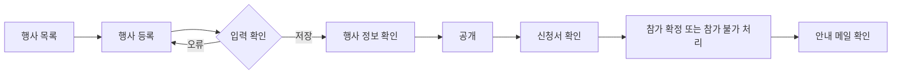
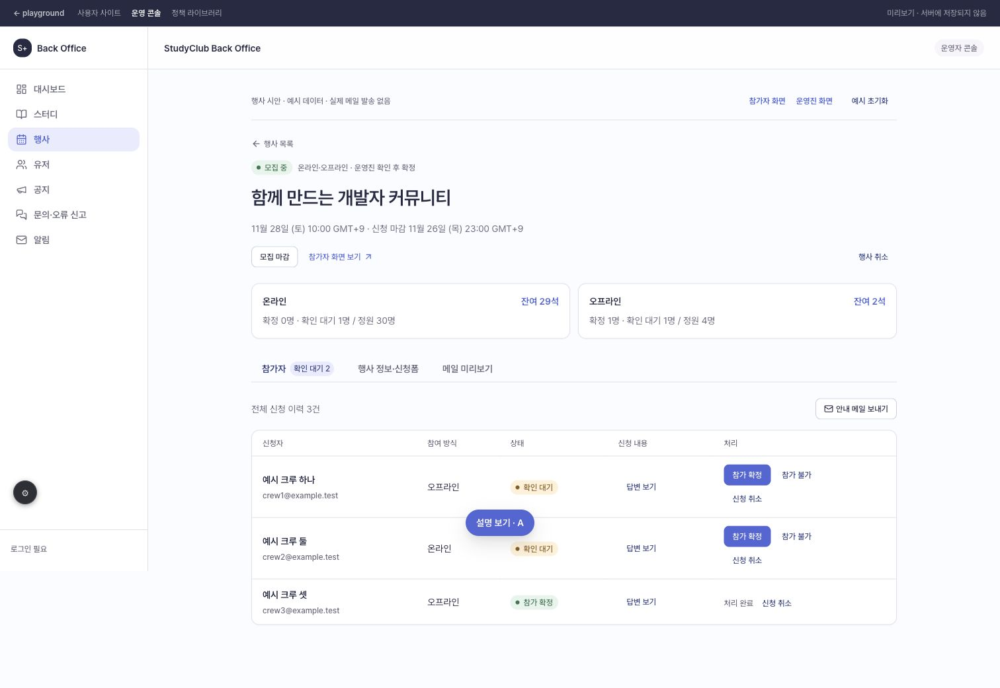

# 캡틴은 행사를 등록하고 신청자의 참가를 확정할 수 있다.

기준 프로토타입: 운영 콘솔 행사 목록·등록·상세

## 1. 기본설명

1. 행사 기본 정보·일정·신청 마감·참여 방식·정원 저장
2. 자동 확정·운영진 확인 후 확정 선택
3. 추가 질문 작성·순서 변경·필수 여부 설정
4. 공개·마감·재모집·행사 취소 처리
5. 신청서 조회 및 확인 대기자 확정·참가 불가 처리
6. 참여 방식별 잔여석 확인과 참가 확정자 안내 메일 작성

## 2. 화면명세

<!-- spec:start event-manage -->

### 1 — 행사 관리

- **내용**: 행사 목록의 등록 버튼 또는 상세의 행사명·모집 상태·확정 방식·일정
- **동작**
  - 행사 등록은 작성 중 상태로 저장
  - 상세에서 공개·모집 마감·모집 다시 열기·행사 취소
  - 신청 이력이 없는 공개 행사만 공개 취소 가능
- **정책**
  - 행사 취소 시 확인 대기·참가 확정 신청도 취소, 안내 메일 예시 생성
  - 취소된 행사 재공개 제한
  - 공개 이력이 없는 취소 행사는 회원 목록에 노출하지 않음
- **데이터**: 행사 제목·상태·확정 방식·일정

#### 1-1 — 행사 목록

- **조건**: 행사 목록 화면
- **내용**: 행사명, 참여 방식, 행사 일정, 확정 방식, 유효 신청 인원, 모집 상태
- **동작**: 행사명을 누르면 운영 상세로 이동
- **정책**: 신청 수는 확인 대기와 참가 확정의 합
- **데이터**: 행사 목록·신청 상태

### 2 — 기본 정보

- **조건**: 등록 창 또는 행사 정보 탭
- **내용**: 행사명·한 줄 소개·모집 상세·기준 시간대·시작·종료·신청 마감
- **동작**: 저장 시 입력 검증, 실패 시 입력값 유지
- **정책**
  - 행사명 60자 이내
  - 종료는 시작 이후, 신청 마감은 시작 이전 또는 같은 시각
  - 마감 후에도 장소·온라인 링크 등 정보 수정 가능. 공개·재모집 시 미래 마감시간 필요
  - 서머타임 때문에 존재하지 않거나 중복되는 현지 시각은 저장 제한
- **데이터**: 제목·설명·절대 시각·IANA 시간대

### 3 — 모집 설정

- **조건**: 등록 창 또는 행사 정보 탭
- **내용**: 온라인·오프라인·동시 진행, 방식별 정원, 장소·참여 링크, 참가 확정 방식
- **동작**: 자동 확정 또는 운영진 확인 후 확정 선택
- **정책**
  - 기본은 자동 확정
  - 첫 신청 이후 참여 방식과 확정 방식 변경 제한
  - 정원은 1~10,000명, 확인 대기와 참가 확정 합보다 작게 변경 제한
  - 참여 링크는 http·https 주소
- **데이터**: 참여 방식·정원·장소·링크·확정 방식

### 4 — 신청 질문

- **조건**: 등록 창 또는 행사 정보 탭
- **내용**: 기본 수집 정보와 추가 질문, 답변 형식, 필수 여부, 선택지
- **동작**: 질문 추가·삭제·순서 변경, 최대 10개
- **정책**
  - 공개 전이고 신청 이력이 없을 때 편집 가능
  - 단답형·장문형·객관식·복수 선택·드롭다운 지원
  - 선택형 문항은 서로 다른 선택지 2개 이상
- **데이터**: 질문 ID·제목·형식·필수 여부·선택지

### 5 — 모집 현황

- **조건**: 행사 상세 화면
- **내용**: 참여 방식별 확정 수·확인 대기 수·정원·잔여석
- **정책**: 잔여석 = 정원 - 확인 대기 - 참가 확정
- **데이터**: 참여 방식별 신청 상태

### 6 — 참가자

- **조건**: 참가자 탭
- **내용**: 신청자 이름·이메일·참여 방식·상태, 답변 보기, 확인 대기 처리, 안내 메일 보내기
- **동작**
  - 신청 당시 질문과 답변 조회
  - 확인 대기자를 참가 확정 또는 참가 불가로 처리
  - 참가 불가 처리 전 확인 창
  - 행사 시작 전 운영진이 확인 대기·참가 확정 신청을 개별 취소 가능. 마감 후 취소 요청도 처리
- **정책**
  - 확정 시 확보된 자리 유지, 참가 불가 시 자리 반환
  - 행사 시작 이후 확정·참가 불가·개별 취소 처리 제한
- **데이터**: 신청자·상태·신청 당시 질문과 답변

### 7 — 메일 미리보기

- **조건**: 메일 미리보기 탭
- **내용**: 메일 제목·생성 시각·수신자 수, 선택 시 본문과 예시 수신 주소
- **동작**
  - 접수·확정·참가 불가·신청 취소·행사 취소 메일 예시 생성
  - 수동 안내 메일은 전체 또는 참여 방식별 참가 확정자 대상으로 생성
- **정책**: 플레이그라운드에서는 실제 발송 없이 브라우저에 예시 저장
- **데이터**: 메일 제목·본문·수신자·생성 시각

<!-- spec:end event-manage -->

### 시안 캡처

## 3. 시스템 요건

### 개발 범위

기준: 2026-11-13, beta에서 분기한 행사 플레이그라운드

| 구분 | 대상 | 지금 | 할 일 |
|---|---|---|---|
| 기획 | 행사 운영 흐름 | 플레이그라운드와 화면 설명 | 시안 검토 |
| FE | back-office-front 행사 운영 | 기존 기본 등록 시안, 실제 행사 API 연결 없음 | 검토한 화면을 실제 앱으로 구현 |
| BE | 행사·신청·메일 API | 행사 API 스펙 없음 | 시안 확정 후 계약 작성·구현 |

### 데이터와 처리 규칙

- 행사 데이터: 제목·소개·본문·시작·종료·신청 마감·IANA 시간대·참여 방식·방식별 정원·장소·온라인 링크·확정 방식·공개 상태·최초 공개 시각·질문 목록
- 신청 데이터: 회원·행사·참여 방식·상태·신청 시각·신청 당시 질문과 답변
- 신청 상태: 확인 대기, 참가 확정, 참가 불가, 신청 취소
- 유효 인원: 확인 대기와 참가 확정의 합. 참가 불가·취소 시 확보 자리 반환
- 첫 신청 이후 확정 방식·참여 방식 잠금. 질문은 공개 전이고 신청 이력이 없을 때 편집
- 실제 서비스의 권한·중복 신청·정원 판정은 서버에서 처리. 운영 기능은 캡틴 권한 확인
- 플레이그라운드는 예시 회원과 브라우저 저장소 사용. 메일은 미리보기 기록 생성
- 구현 범위 밖: 결제·환불·자동 리마인드·폼 버전 편집·선발형 초과 모집·통계 대시보드

참고: [Luma 행사 생성](https://help.luma.com/p/creating-an-event), [Luma 참가자 관리](https://help.luma.com/p/managing-your-guest-list)
