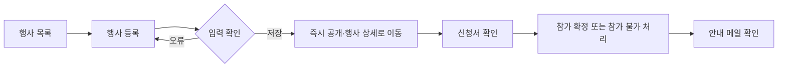

# 캡틴은 행사를 등록하고 신청자의 참가를 확정할 수 있다.

기준 프로토타입: 운영 콘솔 행사 목록·등록·상세

## 1. 기본설명

1. 행사 기본 정보·일정·신청 마감·참여 방식·정원 입력
2. 자동 확정·운영진 확인 후 확정 선택
3. 추가 질문 작성·순서 변경·필수 여부 설정
4. 처음 저장하면 크루 목록에 즉시 공개. 이후 모집 마감·재모집·행사 취소 처리
5. 신청서 조회 및 확인 대기자 확정·참가 불가 처리
6. 참여 방식별 잔여석 확인과 참가 확정자 안내 메일 작성

## 2. 화면명세

<!-- spec:start event-manage -->

### 1 — 행사 관리

- **내용**: 행사 목록의 등록 버튼 또는 상세의 행사명·모집 상태·확정 방식·일정
- **동작**
  - 신규 행사 등록에서 저장하면 크루 행사 목록에 즉시 공개. 등록 창에 공개 안내 표시
  - 공개된 행사 상세에서 모집 마감·모집 다시 열기·행사 취소
  - 모집을 마감하거나 다시 열기 전에 크루 화면과 신청 가능 여부에 대한 확인창을 표시. 확인 버튼을 선택하면 변경
  - 신청 마감 시각이 지난 행사는 모집을 다시 열 수 없는 이유를 안내
- **정책**
  - 모집 마감 상태에서는 예정된 행사와 기존 신청 내역을 계속 확인할 수 있고 새 신청은 받지 않음. 모집을 다시 열면 남은 자리로 신청 가능
  - 운영진이 모집을 먼저 닫아도 설정된 신청 마감 시각 전까지 크루 본인이 취소할 수 있음
  - 행사 취소 시 크루 화면의 지난 행사로 이동하고 확인 대기·참가 확정 신청도 취소. 취소 직전 대상자를 보존하고 대상자가 있을 때 취소 안내 메일 작성 창을 바로 표시
  - 별도 행사 취소 안내 템플릿의 기본 문구를 수정·미리보기한 뒤 운영자가 발송. 행사명과 취소 안내 내용을 표시. 작성 창을 닫아도 행사와 신청의 취소 상태는 유지
  - 취소 안내 대상자가 있을 때 빨간색 취소 안내 메일 보내기 버튼으로 작성 창을 다시 열 수 있음. 새로고침 후에도 취소 직전 대상자를 유지하고 이전 개별 취소·참가 불가자는 제외
  - 취소된 행사는 모집 상태를 변경할 수 없음
  - 종료된 행사는 행사 취소·모집 마감·재모집 처리 불가
  - S1: 공개 중·수동 모집 마감의 같은 상태 요청은 변경 없이 성공. 취소·종료 행사는 오류 유지. 실제 상태 변경만 버전 검사·증가
  - S2: 행사 전체 취소는 자동 메일을 만들지 않음. 작성창을 닫아도 취소 유지, 재진입·추가 안내 발송 가능. 미발송 독촉 알림 없음
  - S3: 마감 시각 이후에도 종료 전에는 수동 모집 마감 가능. 수동 마감 후 마감 시각을 연장해도 모집 다시 열기를 누르기 전까지 닫힘
  - S4: 실제 서비스는 신청자 유무와 관계없이 취소자·행사 ID·시각·함께 취소된 신청 수를 같은 트랜잭션의 감사 기록으로 보관. 개인정보·본문 제외, 보관 기준은 구현 스펙에서 정의. 별도 운영자 알림·조회 화면 없음
  - S5: 취소 확인창·메일 버튼·작성창의 대상은 계정이 남아 있는 사람 기준. 취소 이력은 보존하고 실제 발송 시 수신자 재확인. 수신자 0명이면 취소 안내 버튼 숨김
- **데이터**: 행사 제목·상태·확정 방식·일정

#### 1-1 — 행사 목록

- **조건**: 행사 목록 화면
- **내용**: 행사명, 행사 일정, 모집 상태
- **동작**
  - 행사 시작 시각 내림차순으로 20개씩 표시. 페이지를 선택하면 해당 목록으로 이동
  - 행사명을 누르면 운영 상세로 이동
- **정책**
  - 행사명 아래 참여 방식, 확정 방식·신청 인원 열은 표시하지 않음
  - 모집 중·모집 마감·정원 마감·종료·행사 취소를 구분. 신청 마감 후 행사 종료 전까지 모집 마감으로 표시
- **데이터**: 행사 목록·신청 상태

### 2 — 기본 정보

- **조건**: 등록 창 또는 행사 정보 탭
- **내용**: 행사명·한 줄 소개·모집 상세·기준 시간대·시작·종료(선택)·신청 마감
- **동작**: 저장 시 입력 검증, 실패 시 입력값 유지
- **정책**
  - 행사명 60자, 한 줄 소개 120자, 모집 상세 5,000자 이내
  - 종료는 선택 입력이며 입력 시 시작 이후. 신청 마감은 시작 이전 또는 같은 시각
  - 종료 시각이 되면 종료로 표시. 종료 시각을 입력하지 않은 행사는 행사 기준 시간대에서 시작일이 지나면 종료로 표시
  - 마감 후에도 장소·온라인 링크 등 정보 수정 가능. 신규 등록·재모집 시 미래 마감시간 필요
  - 이미 시작한 행사는 시작 시각을 미래로 옮길 수 없음. 종료 전까지 장소·온라인 링크 등은 수정 가능
  - 종료·취소된 행사는 기본 정보·모집 설정·신청 질문을 조회 전용으로 표시하고 저장·수정 기능은 제공하지 않음
  - 서머타임 전환으로 사라진 시각은 입력란에 표시하고 다른 시각을 선택하도록 안내. 같은 시각이 두 번 나오면 시계 전환 전·후 중 선택
  - 확정한 시각은 UTC로 저장. 수정하지 않은 일정은 이미 저장한 시각을 유지
- **데이터**: 제목·설명·절대 시각·IANA 시간대

### 3 — 모집 설정

- **조건**: 등록 창 또는 행사 정보 탭
- **내용**: 온라인·오프라인·동시 진행, 방식별 정원, 장소·참여 링크, 참가 확정 방식
- **동작**: 자동 확정 또는 운영진 확인 후 확정 선택
- **정책**
  - 기본은 자동 확정
  - 신규 등록의 자동 확정 설명은 신청 즉시 참가가 확정됩니다. 기존 운영진 확인 행사를 자동 확정으로 변경할 때만 현재 확인 대기 신청에 미치는 영향 안내
  - 신청 이력이 있어도 확정 방식 변경 가능. 신청 즉시 확정으로 저장하면 기존 확인 대기 신청도 참가 확정하고 확정 안내 메일 생성
  - 운영진 확인 방식으로 저장해도 이미 참가 확정·참가 불가·신청 취소된 상태는 되돌리지 않고 이후 신청을 확인 대기로 접수
  - 확정 방식 변경은 행사 시작 전까지만 가능
  - 참여 방식 변경 가능. 확인 대기·참가 확정 신청자가 있는 방식을 제거하는 변경만 제한
  - 정원은 1~10,000명, 확인 대기와 참가 확정 합보다 작게 변경 제한
  - 오프라인 장소는 300자 이내. 참여 링크는 http·https 주소
- **데이터**: 참여 방식·정원·장소·링크·확정 방식

### 4 — 신청 질문

- **조건**: 등록 창 또는 행사 정보 탭
- **내용**: 추가 질문, 답변 형식, 필수 여부, 선택지. 보조 문구는 변경한 질문은 이후 신청부터 적용됩니다.
- **동작**
  - 질문 추가·삭제·순서 변경, 최대 20개
  - 객관식 선택지는 한 줄씩 추가·삭제하며 Enter로 다음 선택지 추가
- **정책**
  - 공개 여부와 신청 이력에 관계없이 편집 가능. 변경한 질문은 이후 신청부터 적용
  - 기존 신청은 신청 당시 질문·답변을 유지하며 현재 행사 질문으로 덮어쓰지 않음
  - 질문 변경 후 이전 폼을 제출하면 최신 질문을 보여주고 바뀌지 않은 질문의 답변만 유지
  - 단답형·장문형·객관식 지원. 객관식의 복수 응답 허용을 켜면 체크박스로 여러 답 선택
  - 드롭다운 형식은 제공하지 않으며 기존 드롭다운 질문은 단일 선택 객관식으로 전환
  - 질문 제목 200자 이내. 객관식은 서로 다른 선택지 2~10개, 선택지 하나당 100자 이내
- **데이터**: 질문 ID·제목·형식·필수 여부·선택지

### 5 — 모집 현황

- **조건**: 행사 상세 화면
- **내용**: 참여 방식별 확정 수·확인 대기 수·정원·잔여석
- **정책**: 잔여석 = 정원 - 확인 대기 - 참가 확정
- **데이터**: 참여 방식별 신청 상태

### 6 — 참가자

- **조건**: 참가자 탭
- **내용**: 신청자 닉네임·이메일·참여 방식·상태·신청 내용·처리의 별도 열. 이메일은 마스킹 주소와 눈 아이콘, 처리는 참가 확정·참가 불가·신청 취소 버튼을 한 줄로 표시
- **동작**
  - 신청 당시 질문과 답변 조회
  - P1: 최신 신청순으로 20건씩 표시. 전체 신청 이력 N건, 20건 이하면 페이지 이동 숨김. 검색·필터·개수 선택 없음. API 기본 20·최대 100건
  - 재신청한 경우에도 취소된 이전 신청과 최신 신청을 각각 표시
  - 확인 대기자를 참가 확정 또는 참가 불가로 처리
  - 참가 불가 처리 전 확인 창
  - 행사 종료 전까지 운영진이 확인 대기·참가 확정 신청을 개별 취소 가능. 마감 후 취소 요청도 처리
- **정책**
  - 이메일은 기존 운영 콘솔 규칙으로 기본 마스킹. 목록의 눈 아이콘은 해당 행의 주소만 펼치고 다시 누르면 가림. 화면을 다시 열면 마스킹
  - 메일 이력 상세의 수신 주소는 마스킹 표시
  - 행사 시작 후에도 종료 전까지 신청 상태에 따라 가능한 처리 버튼 표시. 확정자는 신청 취소만 표시
  - 확정 시 확보된 자리 유지, 참가 불가 시 자리 반환
  - P2: 실제 서비스는 1분 주기 서버 작업으로 종료 시 남은 확인 대기만 참가 불가로 전환하고 기존 참가 불가 메일 예약. 확정자는 유지. 조회는 읽기 전용이며 종료 시각부터 참가자 처리 금지
  - 플레이그라운드는 브라우저 실행 중 1분 주기 및 다시 열 때 종료 상태를 정리하는 시안. 화면을 닫은 동안의 서버 작업·실제 발송은 구현하지 않음
  - P3: 탈퇴 시 종료 전 대기·확정 신청은 ACCOUNT_DELETED로 취소·자리 반환, 자동 메일 없음. 종료·취소 행사와 처리 완료 이력은 유지. 목록은 탈퇴한 회원으로 표시하고 이메일·눈 아이콘 숨김
  - P3: 신청 행에 닉네임·이메일을 별도 복사하지 않고 현재 계정 조회. 질문·답은 기존 스터디 신청 보관·비식별 기준에 맞추며 자유 서술 개인정보 기준도 확인
  - P4: 실제 이메일 조회는 기존 EMAIL_REVEAL 감사 기록과 보관·파기 기준 사용. 기록 실패 시 원본 비공개. 화면 구분 필드·원문 이메일 기록 없음
  - P6: 개별 참가 불가·취소 사유 입력 없음. 확인창 후 기본 자동 템플릿 사용. 내부 ADMIN_CANCELLED·SELF_CANCELLED·ACCOUNT_DELETED 사유 구분 유지
  - 종료·취소된 행사의 신청은 조회만 가능
- **데이터**: 신청자·상태·신청 당시 질문과 답변

### 7 — 메일 이력

- **조건**: 메일 이력 탭
- **내용**: 메일 제목·발송 대상(전체/온라인/오프라인/취소 직전 신청자)·생성 시각·수신자 수, 선택 시 본문·발송 대상과 접어서 표시한 마스킹 수신자 목록. 상세의 인원수는 받는 사람 펼치기에만 표시
- **동작**
  - 수동 안내 메일은 전체 또는 참여 방식별 참가 확정자 대상으로 생성
  - 행사 취소 안내 메일은 취소 직전의 확인 대기·참가 확정 신청자 전체를 대상으로 생성
  - 메일 이력 탭에는 운영자가 안내 메일 보내기로 생성한 이력만 표시. 확인 대기·참가 확정·참가 불가·신청 취소 자동 메일은 표시하지 않음
  - 한 번의 발송을 이력 한 건으로 표시. 대상과 인원은 발송 시점 기준으로 보관하며 현재 신청 상태가 바뀌어도 유지
  - 발송 당시 제목과 본문을 보관해 이후 템플릿 수정·삭제와 관계없이 조회
- **정책**
  - 플레이그라운드에서는 실제 발송 없이 브라우저에 예시 저장
  - M4: 종료 후에도 기간 제한 없이 확정자 전체·방식별 안내 메일 허용. 실제 출석이 아닌 신청 상태 기준이며 참가 불가·취소자는 제외
  - M2: 자동 템플릿이 없으면 신청 처리는 유지하고 메일만 생략. 실제 서비스는 행사·신청·알림 종류 누락 경보와 반복 제한 제공. 복구 후 자동 소급 발송 없음. DB 예약 저장 오류는 전체 롤백
  - 기본 예시 메일 이력은 최신 기본 알림 템플릿으로 갱신하되 운영자가 직접 만든 이력은 발송 당시 본문을 유지
  - 화면의 행사 시각과 메일 생성 시각은 운영자 프로필 시간대로 변환하고 날짜별 시간대 약어로 표시
- **데이터**: 메일 구분(운영자 안내/자동)·제목·본문·수신자·생성 시각

#### 7-1 — 안내 메일 작성·미리보기

- **조건**: 안내 메일 작성 창
- **내용**: 대상·안내 내용, 안내 작성·미리보기 탭
- **동작**
  - M1: 행사 여섯 조건 각각에서 ID가 가장 작은 이메일 템플릿 하나 사용. 삭제·조건 이동 시 다음 ID 사용. 사용 중 표시·선택 UI 없음. 기존 알림 규칙 유지
  - 운영진은 행사별 안내 내용만 입력
  - 행사 취소 안내에는 행사명과 취소 안내만 표시. 참여 링크와 장소는 자동으로 넣지 않음
  - 미리보기는 공통 HTML 프레임에 행사명·작성 내용·운영자 프로필 시간대로 변환한 일정과 참여 안내 순서로 채우고 닉네임만 원문 유지. 전체 대상인 동시 행사는 온라인·오프라인 안내를 함께 표시. 참가자 선택 없음
  - 보내기는 발송 작업 한 건과 확정자별 치환 결과를 함께 저장. 이력 미리보기 제목·본문도 닉네임만 원문으로 두고 나머지를 발송 시점 값으로 저장. 구버전의 미치환 행사 정보는 현재 행사 정보로 한 번 보완. 개인별 결과에도 남은 변수 문자열은 운영진 안내 원문일 수 있어 보존하며 개인별 발송 결과는 변경하지 않음
- **정책**
  - 확정자가 없어도 작성창 진입과 미리보기 가능. 템플릿이 없거나 대상·안내 내용이 없으면 보내기 제한
  - 템플릿의 안내 내용 자리는 {{notice}}
  - M3: 개인별 메일은 예약 생성 시 현재 프로필 → 신청 당시 시간대 → 행사 시간대 순. 예약 후 프로필 변경·재발송에도 표시 고정. 공통 미리보기는 선택 시간대 → 운영자 프로필 → 행사 시간대 순
  - M5: 실제 발송 API는 Idempotency-Key로 중복 접수 방지. 요청 중 버튼 비활성화, 응답 불명 재시도는 같은 키, 성공 후 별도 발송은 새 키. 쿨다운·일일 한도 없음
  - M6: 취소 안내 추가 발송 허용. 접수 시 템플릿과 개인별 결과를 고정하고 수정·삭제·재발송에도 보존. 재발송은 현재 행사·해당 신청 상태를 별도로 검증
  - 미리보기 iframe은 sandbox로 스크립트 실행 제한
- **데이터**: 템플릿 ID·대상·안내 내용·치환 결과

<!-- spec:end event-manage -->

## 3. 시스템 요건

### 개발 범위

기준: 2026-11-14, beta에서 분기한 행사 플레이그라운드

| 구분 | 대상 | 지금 | 할 일 |
|---|---|---|---|
| 기획 | 행사 운영 흐름 | 플레이그라운드와 화면 설명 | 시안 검토 |
| FE | back-office-front 행사 운영 | 목록·등록·상세(행사 정보·상태 전환·참가자·메일 이력·안내/취소 안내 메일)를 `/api/admin/events` 스펙에 맞춰 구현. BE 구현 전이라 실제 연결은 BE 머지 뒤 확인. dev mock(MSW) 핸들러는 없음 | BE 배포 뒤 stage 에서 연결 확인 |
| BE | 행사 등록·수정·운영 목록·상세 API ([event 스펙](../../../specs/event/spec.md)) | 구현중. 엔드포인트 4개 · `CLUB_EVENT` 테이블(V59) BE PR. 신청 수·일괄 확정은 임시 포트 어댑터(0건) | 신청 스펙 어댑터 연결, back-office-front 연결(후속 FE PR) |
| BE | 모집 마감·재모집·행사 취소 API ([event-status 스펙](../../../specs/event-status/spec.md)) | 스펙작성중. PR #479 리뷰 결정(S1~S5) 반영 완료 | 스펙 확정 후 구현 |
| BE | 참가자 목록·신청서·이메일 보기·참가 처리·종료 자동 전환 API ([event-participant 스펙](../../../specs/event-participant/spec.md)) | 스펙작성중. PR #479 리뷰 결정(P1~P6) 반영 완료. 신청 테이블 `CLUB_EVENT_REGISTRATION` 은 ST-038 과 공동 PR 로 먼저 만든다 | 공통 신청 테이블 PR 머지 후 구현 |
| BE | 안내·취소 안내 메일·메일 이력·행사 알림 템플릿 ([event-mail 스펙](../../../specs/event-mail/spec.md)) | 스펙작성중. PR #479 리뷰 결정(M1~M7·재발송 검증·탈퇴 동시성) 반영 완료 | 스펙 확정 후 구현 |
| BE | 크루 행사 조회·신청·본인 취소 API (ST-038 [크루 행사 신청](../crew-apply-event/PRD.md) 담당) | 스펙 없음 | ST-038 에서 계약 작성·구현. 이 스토리는 신청 테이블과 자동 메일 이벤트만 맞춘다 |

### 데이터와 처리 규칙

- 행사 데이터: 제목·소개·본문·시작·종료·신청 마감·IANA 시간대·참여 방식·방식별 정원·장소·온라인 링크·확정 방식·공개 상태·최초 공개 시각·질문 목록
- 신청 데이터: 회원·행사·참여 방식·상태·신청 시각·신청 당시 질문과 답변
- 신청 상태: 확인 대기, 참가 확정, 참가 불가, 신청 취소
- 유효 인원: 확인 대기와 참가 확정의 합. 참가 불가·취소 시 확보 자리 반환
- 행사 시작 전 신청 즉시 확정으로 변경하면 기존 확인 대기 신청도 참가 확정하고 안내 메일 생성. 운영진 확인 방식으로 변경해도 이미 처리된 상태는 유지
- 질문 변경은 이후 신청부터 적용. 기존 신청은 신청 당시 질문과 답변 유지
- 참여 방식 중 확인 대기·확정 신청자가 남은 방식은 제거 제한
- 실제 서비스의 권한·중복 신청·정원 판정은 서버에서 처리. 운영 기능은 캡틴 권한 확인
- 플레이그라운드는 예시 회원과 브라우저 저장소 사용. 메일은 미리보기 기록 생성
- 구현 범위 밖: 결제·환불·자동 리마인드·선발형 초과 모집·통계 대시보드

### 행사 취소 행동 분석

합의: 2026-11-18, PR #508 R4. 분석 도구에서 행사 신청·취소 흐름을 확인하기 위한 요구사항이다. 백오피스 통계 대시보드는 이번 범위에서 계속 제외하며, 플레이그라운드 예시 조작은 실제 분석 기록으로 전송하지 않는다.

- 최초 활성화와 공통 분석 정책은 [크루 PRD의 활성화와 행동 분석](../crew-apply-event/PRD.md#활성화와-행동-분석)을 따른다. 첫 스터디 또는 행사 신청 성공 시 계정당 한 번만 활성화하며, 운영진의 참가 확정·참가 불가·취소 처리는 활성화를 새로 만들거나 되돌리지 않는다.
- 취소 완료는 운영진이 버튼을 누른 시점이 아니라 **신청 상태 변경이 서버에 정상 저장된 뒤** Amplitude에 기록한다. 실패·롤백된 처리는 완료로 세지 않는다.

| 취소 구분 | 기록 대상 | 분석 시 구분할 의미 |
|---|---|---|
| 본인 취소 | 크루가 직접 취소해 상태가 바뀐 본인 신청 | 크루가 스스로 신청을 철회함. 크루 신청 API에서 기록 |
| 운영진 개별 취소 | 캡틴이 개별 취소해 상태가 바뀐 신청 | 운영진이 취소한 것으로, 크루의 자발적인 취소와 구분 |
| 행사 전체 취소 | 행사 취소로 함께 취소된 확인 대기·참가 확정 신청 각각 | 행사 운영 사유로 취소됨. 이미 취소·참가 불가였던 신청은 새 취소로 세지 않음 |

- 행사 ID·신청 ID·취소 구분으로 연결하고, 분석 대상은 해당 신청자 기준으로 한다. 행사 전체 취소는 실제로 취소된 신청별로 기록하므로 취소된 신청이 없으면 신청 취소 완료 기록도 없다.
- 같은 취소 요청을 재시도해도 동일 신청의 취소 완료는 중복 집계하지 않는다. FE에서 서버의 완료 기록을 중복 전송하지 않는다.
- 행사 취소 안내 메일의 작성·발송 여부는 취소 완료 집계와 무관하다. 메일 작성창을 닫아도 취소가 저장됐다면 취소 완료로 기록한다.
- 분석 전송 실패 때문에 행사·신청 취소나 자동 메일 예약을 되돌리지 않는다. 기존 분석용 식별자와 수집 중단·탈퇴 규칙을 적용하며, 이메일·이름·닉네임·신청 답변은 전송하지 않는다.
- 구체적인 분석 이벤트 이름·속성·전송 시점은 [analytics 스펙](../../../specs/analytics/spec.md)에 반영하고, 효승님·동일님이 크루 취소와 운영진 취소에 같은 기준을 적용하도록 관련 스펙을 맞춘다.

참고: [Luma 행사 생성](https://help.luma.com/p/creating-an-event), [Luma 참가자 관리](https://help.luma.com/p/managing-your-guest-list)

## 후속 구현 합의 (PR #479 리뷰)

- P5: 효승님·동일님이 신청 구조를 합의하고 별도 공통 PR에 마이그레이션·ERD·엔티티·저장소·실제 ClubEventRegistrationPort를 구현해 #478 임시 어댑터를 교체한다. 효승님 작성·동일님 리뷰를 제안하며 작업량에 따라 조정한 담당·순서를 명시한다. 이후 각 API를 구현한다.
- M7: 행사 잠금을 유지한 채 수신자·이력·개인별 예약을 같은 트랜잭션에서 저장하고 실제 발송은 커밋 후 수행한다. 스테이지에서 최대 합계 20,000명까지 저장 시간·동시 신청/취소 대기·실패 롤백을 검증한다. 과도한 대기나 타임아웃이면 배포 전 상한 또는 분리 방식을 결정한다.
- 탈퇴·메일 예약은 취소 안내 대상까지 순서를 보장한다. 예약이 먼저면 탈퇴가 그 예약도 정리하고, 탈퇴가 먼저면 새 예약을 만들지 않는다. 행사·계정의 잠금 순서는 두 담당자가 합의한다.
- 종료 자동 처리도 행사 잠금 뒤 최신 취소 여부·종료 시각을 재확인하며, DB 오류는 해당 행사 롤백 후 다음 주기에 재시도한다.
- 이 문서의 서버 작업·감사 기록·동시성·멱등성·누락 경보는 실제 서비스 구현 요구사항이다. 플레이그라운드는 브라우저 예시이며 DB·실제 발송·백그라운드 서버 처리를 보장하지 않는다.
