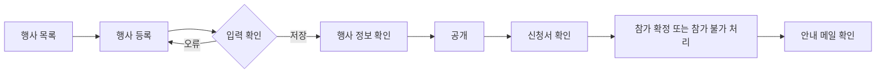
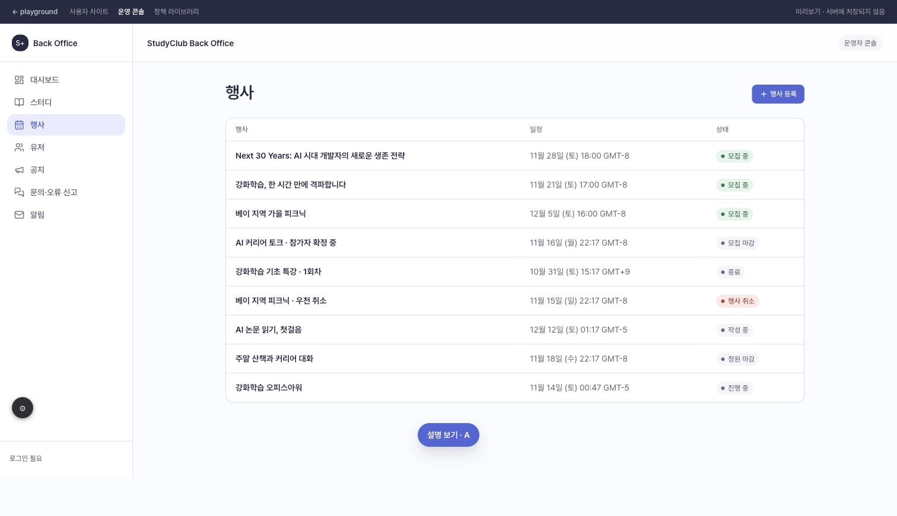
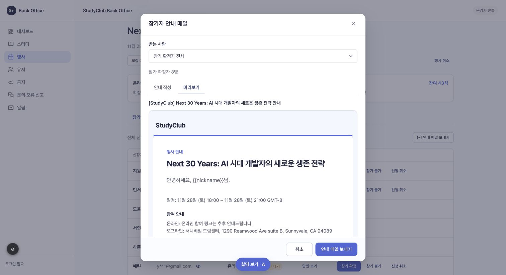
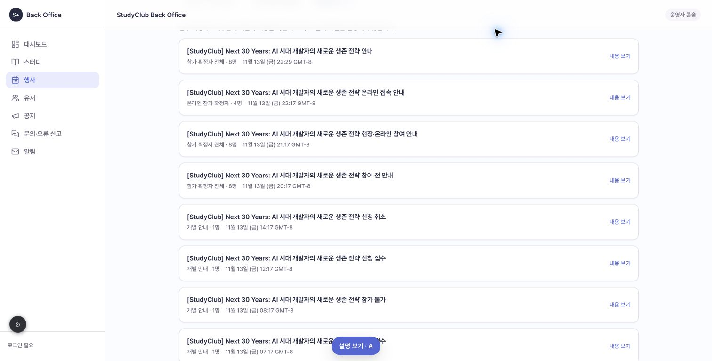
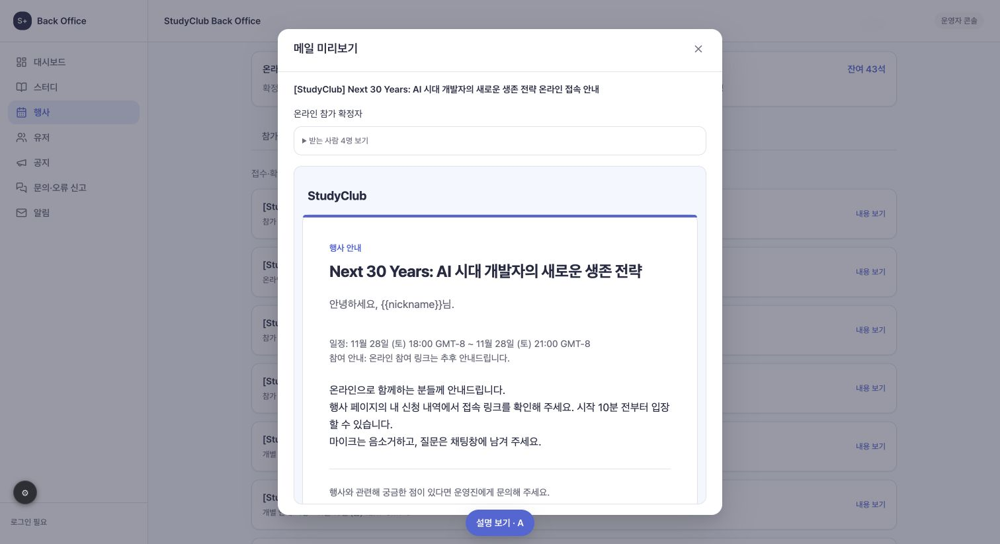

# 캡틴은 행사를 등록하고 신청자의 참가를 확정할 수 있다.

기준 프로토타입: 운영 콘솔 행사 목록·등록·상세

## 1. 기본설명

1. 행사 기본 정보·일정·신청 마감·참여 방식·정원 저장
2. 자동 확정·운영진 확인 후 확정 선택
3. 추가 질문 작성·순서 변경·필수 여부 설정
4. 공개·마감·재모집·행사 취소 처리
5. 신청서 조회 및 확인 대기자 확정·참가 불가 처리
6. 참여 방식별 잔여석 확인과 참가 확정자 안내 메일 작성

## 2. 화면명세

<!-- spec:start event-manage -->

### 1 — 행사 관리

- **내용**: 행사 목록의 등록 버튼 또는 상세의 행사명·모집 상태·확정 방식·일정
- **동작**
  - 행사 등록은 작성 중 상태로 저장
  - 상세에서 공개·모집 마감·모집 다시 열기·행사 취소
  - 신청 이력이 없는 공개 행사만 공개 취소 가능
- **정책**
  - 행사 취소 시 확인 대기·참가 확정 신청도 취소하고, 취소 직전 대상자를 받는 사람으로 보존한 행사 취소 안내 메일 작성 창을 바로 표시
  - 행사 취소 안내 메일은 기본 문구를 수정·미리보기한 뒤 운영자가 발송하며, 작성 창을 닫아도 행사와 신청의 취소 상태는 유지
  - 취소된 행사는 빨간색 취소 안내 메일 보내기 버튼으로 작성 창을 다시 열 수 있음. 새로고침 후에도 취소 직전 대상자를 유지하고 이전 개별 취소·참가 불가자는 제외
  - 취소된 행사 재공개 제한
  - 종료된 행사는 행사 취소·모집 마감·재모집·공개 취소 처리 불가
  - 공개 이력이 없는 취소 행사는 회원 목록에 노출하지 않음
- **데이터**: 행사 제목·상태·확정 방식·일정

#### 1-1 — 행사 목록

- **조건**: 행사 목록 화면
- **내용**: 행사명, 행사 일정, 모집 상태
- **동작**: 행사명을 누르면 운영 상세로 이동
- **정책**
  - 행사명 아래 참여 방식, 확정 방식·신청 인원 열은 표시하지 않음
  - 작성 중·모집 중·모집 마감·정원 마감·진행 중·종료·행사 취소를 구분. 종료 미입력 행사는 시작 당일 행사 시작, 행사 기준 시간대의 다음 날부터 종료로 표시
- **데이터**: 행사 목록·신청 상태

### 2 — 기본 정보

- **조건**: 등록 창 또는 행사 정보 탭
- **내용**: 행사명·한 줄 소개·모집 상세·기준 시간대·시작·종료(선택)·신청 마감
- **동작**: 저장 시 입력 검증, 실패 시 입력값 유지
- **정책**
  - 행사명 60자 이내
  - 종료는 선택 입력이며 입력 시 시작 이후. 신청 마감은 시작 이전 또는 같은 시각
  - 종료 미입력 행사는 시작 시각 이후 행사 시작으로 표시하고 행사 기준 시간대에서 시작일이 지나면 종료로 분류. 입력된 종료 시각은 그대로 우선 적용
  - 마감 후에도 장소·온라인 링크 등 정보 수정 가능. 공개·재모집 시 미래 마감시간 필요
  - 취소된 행사는 기본 정보·모집 설정·신청 질문을 조회 전용으로 표시하고 저장·수정 기능은 제공하지 않음
  - 서머타임 때문에 존재하지 않거나 중복되는 현지 시각은 저장 제한
- **데이터**: 제목·설명·절대 시각·IANA 시간대

### 3 — 모집 설정

- **조건**: 등록 창 또는 행사 정보 탭
- **내용**: 온라인·오프라인·동시 진행, 방식별 정원, 장소·참여 링크, 참가 확정 방식
- **동작**: 자동 확정 또는 운영진 확인 후 확정 선택
- **정책**
  - 기본은 자동 확정
  - 신규 등록의 자동 확정 설명은 신청 즉시 참가가 확정됩니다. 기존 운영진 확인 행사를 자동 확정으로 변경할 때만 현재 확인 대기 신청에 미치는 영향 안내
  - 신청 이력이 있어도 확정 방식 변경 가능. 신청 즉시 확정으로 저장하면 기존 확인 대기 신청도 참가 확정하고 확정 안내 메일 생성
  - 운영진 확인 방식으로 저장해도 이미 참가 확정·참가 불가·신청 취소된 상태는 되돌리지 않고 이후 신청을 확인 대기로 접수
  - 확정 방식 변경은 행사 시작 전까지만 가능
  - 참여 방식 변경 가능. 확인 대기·참가 확정 신청자가 있는 방식을 제거하는 변경만 제한
  - 정원은 1~10,000명, 확인 대기와 참가 확정 합보다 작게 변경 제한
  - 참여 링크는 http·https 주소
- **데이터**: 참여 방식·정원·장소·링크·확정 방식

### 4 — 신청 질문

- **조건**: 등록 창 또는 행사 정보 탭
- **내용**: 추가 질문, 답변 형식, 필수 여부, 선택지. 보조 문구는 변경한 질문은 이후 신청부터 적용됩니다.
- **동작**
  - 질문 추가·삭제·순서 변경, 최대 10개
  - 객관식 선택지는 한 줄씩 추가·삭제하며 Enter로 다음 선택지 추가
- **정책**
  - 공개 여부와 신청 이력에 관계없이 편집 가능. 변경한 질문은 이후 신청부터 적용
  - 기존 신청은 신청 당시 질문·답변을 유지하며 현재 행사 질문으로 덮어쓰지 않음
  - 단답형·장문형·객관식 지원. 객관식의 복수 응답 허용을 켜면 체크박스로 여러 답 선택
  - 드롭다운 형식은 제공하지 않으며 기존 드롭다운 질문은 단일 선택 객관식으로 전환
  - 선택형 문항은 서로 다른 선택지 2개 이상
- **데이터**: 질문 ID·제목·형식·필수 여부·선택지

### 5 — 모집 현황

- **조건**: 행사 상세 화면
- **내용**: 참여 방식별 확정 수·확인 대기 수·정원·잔여석
- **정책**: 잔여석 = 정원 - 확인 대기 - 참가 확정
- **데이터**: 참여 방식별 신청 상태

### 6 — 참가자

- **조건**: 참가자 탭
- **내용**: 신청자 닉네임·이메일·참여 방식·상태·신청 내용·처리의 별도 열. 이메일은 마스킹 주소와 눈 아이콘, 처리는 참가 확정·참가 불가·신청 취소 버튼을 한 줄로 표시
- **동작**
  - 신청 당시 질문과 답변 조회
  - 확인 대기자를 참가 확정 또는 참가 불가로 처리
  - 참가 불가 처리 전 확인 창
  - 행사 시작 전 운영진이 확인 대기·참가 확정 신청을 개별 취소 가능. 마감 후 취소 요청도 처리
- **정책**
  - 이메일은 기존 운영 콘솔 규칙으로 기본 마스킹. 목록의 눈 아이콘은 해당 행의 주소만 펼치고 다시 누르면 가림. 화면을 다시 열면 마스킹
  - 메일 이력 상세의 수신 주소는 마스킹 표시
  - 신청 상태와 행사 시작 시각에 따라 가능한 처리 버튼만 표시. 확정자는 신청 취소만 표시
  - 확정 시 확보된 자리 유지, 참가 불가 시 자리 반환
  - 행사 시작 이후 확정·참가 불가·개별 취소 처리 제한
- **데이터**: 신청자·상태·신청 당시 질문과 답변

### 7 — 메일 이력

- **조건**: 메일 이력 탭
- **내용**: 메일 제목·발송 대상(전체/온라인/오프라인/개별)·생성 시각·수신자 수, 선택 시 본문·발송 대상과 접어서 표시한 마스킹 수신자 목록. 상세의 인원수는 받는 사람 펼치기에만 표시
- **동작**
  - 수동 안내 메일은 전체 또는 참여 방식별 참가 확정자 대상으로 생성
  - 행사 취소 안내 메일은 취소 직전의 확인 대기·참가 확정 신청자 전체를 대상으로 생성
  - 메일 이력 탭에는 운영자가 안내 메일 보내기로 생성한 이력만 표시. 확인 대기·참가 확정·참가 불가·신청 취소 자동 메일은 표시하지 않음
  - 한 번의 발송을 이력 한 건으로 표시. 대상과 인원은 발송 시점 기준으로 보관하며 현재 신청 상태가 바뀌어도 유지
  - 발송 당시 제목과 본문을 보관해 이후 템플릿 수정·삭제와 관계없이 조회
- **정책**
  - 플레이그라운드에서는 실제 발송 없이 브라우저에 예시 저장
  - 기본 예시 메일 이력은 최신 기본 알림 템플릿으로 갱신하되 운영자가 직접 만든 이력은 발송 당시 본문을 유지
  - 화면의 행사 시각과 메일 생성 시각은 운영자 프로필 시간대로 변환하고 날짜별 시간대 약어로 표시
- **데이터**: 메일 구분(운영자 안내/자동)·제목·본문·수신자·생성 시각

#### 7-1 — 안내 메일 작성·미리보기

- **조건**: 안내 메일 작성 창
- **내용**: 대상·안내 내용, 안내 작성·미리보기 탭
- **동작**
  - 기존 알림 템플릿 관리의 첫 행사 안내 템플릿을 자동 사용. 템플릿 선택·관리 링크와 보조 안내 문구는 표시하지 않으며 운영진은 안내 내용만 입력
  - 미리보기는 공통 HTML 프레임에 행사명·작성 내용·운영자 프로필 시간대로 변환한 일정과 참여 안내 순서로 채우고 닉네임만 원문 유지. 전체 대상인 동시 행사는 온라인·오프라인 안내를 함께 표시. 참가자 선택 없음
  - 보내기는 발송 작업 한 건과 확정자별 치환 결과를 함께 저장. 이력 미리보기 제목·본문도 닉네임만 원문으로 두고 나머지를 발송 시점 값으로 저장. 구버전의 미치환 행사 정보는 현재 행사 정보로 한 번 보완. 개인별 결과에도 남은 변수 문자열은 운영진 안내 원문일 수 있어 보존하며 개인별 발송 결과는 변경하지 않음
- **정책**
  - 확정자가 없어도 작성창 진입과 미리보기 가능. 템플릿이 없거나 대상·안내 내용이 없으면 보내기 제한
  - 템플릿의 안내 내용 자리는 {{notice}}
  - 미리보기 iframe은 sandbox로 스크립트 실행 제한
- **데이터**: 템플릿 ID·대상·안내 내용·치환 결과

<!-- spec:end event-manage -->

### 시안 캡처

## 3. 시스템 요건

### 개발 범위

기준: 2026-11-14, beta에서 분기한 행사 플레이그라운드

| 구분 | 대상 | 지금 | 할 일 |
|---|---|---|---|
| 기획 | 행사 운영 흐름 | 플레이그라운드와 화면 설명 | 시안 검토 |
| FE | back-office-front 행사 운영 | 기존 기본 등록 시안, 실제 행사 API 연결 없음 | 검토한 화면을 실제 앱으로 구현 |
| BE | 행사·신청·메일 API | 행사 API 스펙 없음 | 시안 확정 후 계약 작성·구현 |

### 데이터와 처리 규칙

- 행사 데이터: 제목·소개·본문·시작·종료·신청 마감·IANA 시간대·참여 방식·방식별 정원·장소·온라인 링크·확정 방식·공개 상태·최초 공개 시각·질문 목록
- 신청 데이터: 회원·행사·참여 방식·상태·신청 시각·신청 당시 질문과 답변
- 신청 상태: 확인 대기, 참가 확정, 참가 불가, 신청 취소
- 유효 인원: 확인 대기와 참가 확정의 합. 참가 불가·취소 시 확보 자리 반환
- 행사 시작 전 신청 즉시 확정으로 변경하면 기존 확인 대기 신청도 참가 확정하고 안내 메일 생성. 운영진 확인 방식으로 변경해도 이미 처리된 상태는 유지
- 질문 변경은 이후 신청부터 적용. 기존 신청은 신청 당시 질문과 답변 유지
- 참여 방식 중 확인 대기·확정 신청자가 남은 방식은 제거 제한
- 실제 서비스의 권한·중복 신청·정원 판정은 서버에서 처리. 운영 기능은 캡틴 권한 확인
- 플레이그라운드는 예시 회원과 브라우저 저장소 사용. 메일은 미리보기 기록 생성
- 구현 범위 밖: 결제·환불·자동 리마인드·선발형 초과 모집·통계 대시보드

실제 행사 예시: [메인 디스코드 출처와 시안 설정](examples.md)

참고: [Luma 행사 생성](https://help.luma.com/p/creating-an-event), [Luma 참가자 관리](https://help.luma.com/p/managing-your-guest-list)
