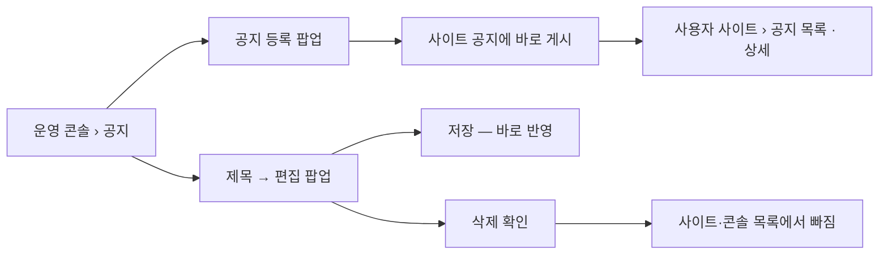

# 캡틴은 스터디클럽 웹사이트에 공지를 올릴 수 있다.

기준 프로토타입: 운영 콘솔 › 공지 — https://playground.studyclub.life/proto/console/notices

## 1. 기본설명

스터디클럽 **사이트 전체**에 알릴 글을 캡틴이 쓰는 자리다. 네비게이터가 스터디마다 올리는
스터디별 공지(ST-016)와는 다른 기능이다.

운영 콘솔 「공지」에서 쓰고, 사용자 사이트 「공지」에서 읽는다 — 같은 데이터의 두 화면이다.
크루와 비로그인 방문자 모두 본다.

**공개 단계가 없다.** 등록하면 곧 사이트에 올라간다. 분류·상단 고정·알림 메일도 두지 않는다 — 제목과 본문뿐이다.

### 진입·사용 흐름

### 완료 기준

1. 운영 콘솔 사이드바 「공지」 — 대시보드 · 스터디 · 행사 · 유저 · **공지** · 알림 순
2. 공지 목록 — 제목 · 작성자 · 게시일 · 마지막 수정. 제목 검색, 20개씩
3. 정렬 — 컬럼 이름을 누르면 오름차순, 다시 누르면 내림차순. 기본은 게시일 내림차순
4. 공지 등록 — 제목 · 본문. 등록 즉시 사이트 공지에 게시
5. 공지 편집 — 목록에서 제목을 누르면 값이 채워진 팝업. 저장 즉시 사이트에 반영
6. 공지 삭제 — 편집 팝업 안, 확인 단계 후 삭제. 사이트·콘솔 목록에서 빠짐. 되돌리기 없음(소프트 삭제)
7. 작성자 — 등록한 캡틴. 운영 콘솔에만 표시
8. 사용자 사이트 공지 목록 · 상세 — 비로그인 공개, 게시일 내림차순

---

## 2. 화면명세

> **화면**: 운영 콘솔 › 공지.
>
> 아래 번호별 명세는 프로토의 **설명 보기**에서 그대로 가져온다. 손으로 고치지 않는다 —
> 고치려면 화면 옆 `spec.ts` 를 고치고 `pnpm --filter playground export-specs` 를 돌린다.

<!-- spec:start notice -->

> **스터디 관리 목록·등록 팝업과 같은 모양이다** — 두 화면을 오가는 운영자가 다른 규칙을 외우지 않게
>
> 사용자 사이트의 공지와 같은 데이터다. 콘솔은 쓰는 쪽, 사이트는 읽는 쪽. 비로그인 방문자도 본다
>
> **공개 단계가 없다** — 등록하면 곧 사이트에 올라간다. 분류·상단 고정·알림 메일도 두지 않는다
>
> 네비게이터의 스터디별 공지(ST-016)와는 다른 기능이다
>
> 미구현 — 공지를 저장할 테이블·API 가 없다. 지금은 화면 상태로만 처리한다

### 1 — 제목 검색

- **내용**: 검색칸 하나. 오른쪽 끝에 걸린 개수
- **동작**: 입력하면 목록이 바로 줄고 1페이지로 간다

### 2 — 공지 등록

- **내용**: 헤더 오른쪽 버튼
- **동작**: 누르면 등록 팝업이 열린다. 등록하면 목록 맨 위에 서고 사이트 공지에도 바로 올라간다
- **정책**: 입력·설정 팝업이라 취소 버튼을 두지 않는다. 닫는 길은 X 와 Esc (POL-0008)
- **데이터**: `POST /api/admin/notices` — 미구현

#### 2-1 — 제목

- **내용**: 권장 40자. 넘으면 글자수가 주황 — 막지는 않는다

#### 2-2 — 본문

- **내용**: 여러 줄 입력. 마크다운 안내
- **정책**: 스터디 상세 설명과 같은 마크다운 규칙. 이미지 올리기는 두지 않는다

#### 2-5 — 등록 · 저장

- **동작**
  - 제목·본문이 비면 그 칸 아래 사유가 뜨고 등록되지 않는다
  - 등록 — 「사이트 공지에 바로 올라갑니다」. 저장 — 「사이트 공지에 바로 반영됩니다」
- **정책**: 작성자는 받지 않는다 — 로그인한 캡틴으로 정해진다
- **데이터**: `PATCH /api/admin/notices/{id}` — 미구현

#### 2-6 — 공지 삭제

- **내용**: 편집 팝업 왼쪽 아래. 누르면 같은 팝업이 확인 단계로 바뀐다
- **동작**: 취소가 기본 포커스. 삭제하면 사이트 공지와 이 목록에서 바로 빠진다
- **정책**
  - **목록 행에 삭제 버튼을 두지 않는다** — 스치듯 눌러 지운다. 저장 버튼과도 떨어뜨린다
  - **소프트 삭제다** — 화면에서는 사라지고 되돌리는 길도 없지만, 행은 지우지 않고 삭제 시각만 남긴다
- **데이터**: `DELETE /api/admin/notices/{id}` — 미구현. `DELETED_AT` 기록

### 3 — 공지 목록

- **내용**: 제목 · 작성자 · 게시일 · 마지막 수정. 20개씩
- **동작**
  - 제목을 누르면 값이 채워진 편집 팝업
  - 제목 · 게시일 · 마지막 수정은 머리 이름을 누르면 오름차순, 다시 누르면 내림차순 — 스터디 목록과 같다. 기본은 **게시일 내림차순**이고 처음부터 그 열 이름이 강조된다
- **정책**: 공지가 없으면 「등록된 공지가 없습니다」, 걸러서 없으면 「조건에 맞는 공지가 없습니다」

### 4 — 작성자

- **내용**: 등록한 캡틴의 닉네임
- **정책**: **콘솔에만 보인다** — 사이트 공지에는 내보내지 않는다

<!-- spec:end notice -->

### 사용자 사이트 — 공지 목록 · 상세

- **목록**: 카드마다 게시일 · 제목 · 본문 앞 두 줄. 게시일 내림차순. 고정·분류 표시 없음
- **상세**: 제목 · 본문 · 게시일. 목록으로 돌아가기, 이전·다음 공지
- **작성자는 보이지 않는다** — 운영 콘솔에만 있다
- 로그인 없이 볼 수 있다

### 비고

- 이미 프로토가 있는 사용자 사이트 공지 목록·상세에서 분류 꼬리표와 고정 표시를 뺐다 — 이 기획과 맞추기 위해서다
- 삭제는 **소프트 삭제**다. 화면에서는 사라지고 되돌리는 길이 없지만, 행은 남기고 삭제 시각만 기록한다

---

## 3. 시스템 요건

### 개발 범위

> 2026-10-18 `beta` 기준. **지금 → 할 일**만 적는다.

| 구분 | 대상 | 지금 | 할 일 |
|---|---|---|---|
| FE | back-office-front 사이드바 「공지」 | 없음 | 유저와 알림 사이에 메뉴 추가. 아이콘은 메가폰 (완료 기준 1) |
| FE | back-office-front `/notices` 목록 · 등록·편집 팝업 · 삭제 | 없음 | 프로토 `proto/console/notices` 대로 (완료 기준 2~7) |
| FE | core-front `/notices` 목록 · 상세 | 없음 — 프로토만 있다 | 프로토 `proto/core/[locale]/notices` 대로. 비로그인 공개 (완료 기준 8) |
| BE | 공지 테이블 | 없음 | 제목 · 본문 · 작성자(ACCOUNT_ID) · 게시 시각 · 마지막 수정 · `DELETED_AT` |
| BE | 공지 API | 없음 · **스펙 없음** | `specs/` 에 계약부터 쓴다 → 구현. 아래 표 |

- **범위 밖** — 분류 · 상단 고정 · 예약 게시 · 초안 · 알림 메일 · 이미지 업로드 · 영어 본문 · 조회수

### API

| 메서드 | 경로 | 설명 |
|---|---|---|
| GET | `/api/notices` | 사이트 공지 목록 — 삭제되지 않은 것, 게시일 내림차순. 작성자 없음. 비로그인 허용 |
| GET | `/api/notices/{id}` | 사이트 공지 상세. 비로그인 허용 |
| GET | `/api/admin/notices` | 콘솔 공지 목록 — 작성자 포함 |
| POST | `/api/admin/notices` | 공지 등록 — 제목 · 본문. 작성자는 토큰에서 정한다 |
| PATCH | `/api/admin/notices/{id}` | 공지 수정 — 제목 · 본문. 마지막 수정 갱신 |
| DELETE | `/api/admin/notices/{id}` | 공지 삭제 — `DELETED_AT` 기록 |

- 권한: `/api/admin/**` 는 캡틴 ([POL-0001](../../_registry/policies/POL-0001-roles.md)). 라우팅만으로 막지 않고 서버가 검증한다

### 처리

| 경우 | 처리 |
|---|---|
| 제목·본문이 빔 | 등록·저장되지 않는다. 그 칸 아래 사유 |
| 삭제된 공지 상세 주소로 들어옴 | 사이트에서 찾을 수 없음으로 처리 |
| 공지가 하나도 없음 | 콘솔 「등록된 공지가 없습니다」 |
| 작성자 계정이 탈퇴함 | 공지는 남는다. 작성자 칸은 탈퇴 표시 |
