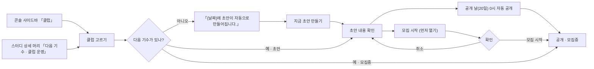
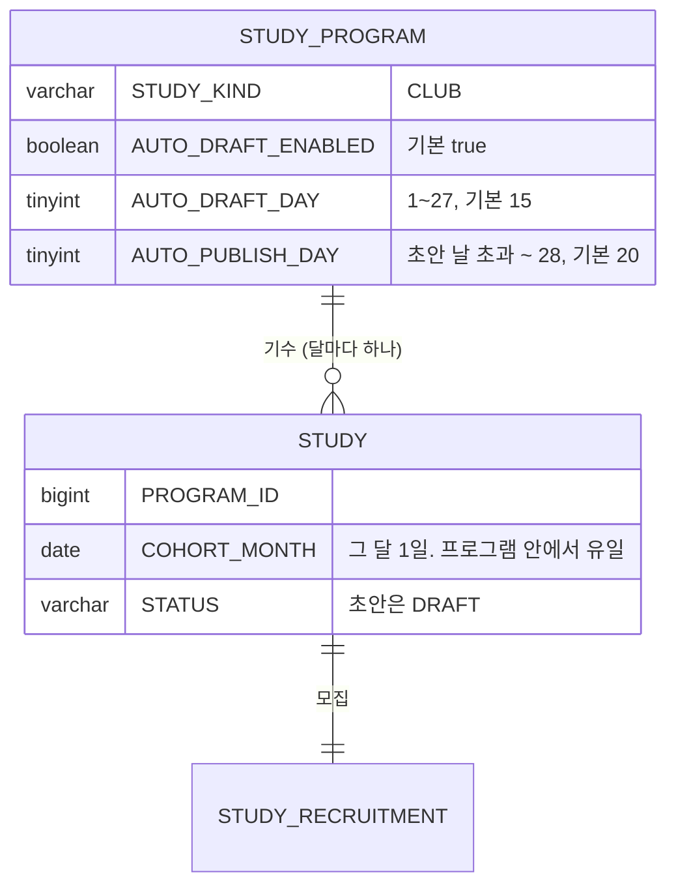

# 캡틴은 기존 스터디를 재등록할 수 있다(기수제).

story_id: ST-021 · IA: IA-043

기준 프로토타입: 운영 콘솔 › 클럽 › 기수 — https://playground.studyclub.life/proto/console/clubs

## 1. 기본설명

· **배경** — 클럽은 매달 같은 내용으로 다음 기수를 연다. 캡틴이 매달 새로 등록하지 않도록 다음 달 기수는 시스템이 15일에 초안으로 만들고 20일에 공개한다. 캡틴은 그 사이에 확인하고, 원하면 먼저 연다. 기수 규칙은 [POL-0012](../../_registry/policies/POL-0012-club-cohort.md).

### 진입·사용 흐름

### 완료 기준

1. 이번 기수의 제목 · 진행 기간 · 참여 중 인원 확인
2. 매월 초안 날(기본 15일) 다음 달 기수 초안 자동 생성 — 미공개 · 공개 날(기본 20일) 자동 공개
3. 초안 내용 확인 — 진행 기간 · 모집 기간 · 정원과 남은 자리 · 신청 폼 · 이어서 참여 인원
4. 「모집 시작」으로 먼저 공개 — 누른 날이 모집 시작일, 마감은 이번 달 말일
5. 다음 기수가 아직 없을 때 자동 생성 예정일 안내와 「지금 초안 만들기」
6. 클럽별 자동 만들기 · 공개 켜고 끄기 · 초안 날(1~27일) · 공개 날(초안 날 다음 날~28일) 변경
7. 스터디 상세(클럽)에서 클럽 운영으로 이동
8. 이번 기수 신청자 · 명단, 다음 기수 신청 폼으로 이동
9. 지난 기수 목록 — 달마다 시작 · 완주 · 참여 중단 · 다음 달로 이어짐 · 평균 출석률, 그 기수 출석부 열기

---

## 2. 화면명세

> **화면**: 운영 콘솔 › 클럽 › 기수 — https://playground.studyclub.life/proto/console/clubs
>
> 아래 번호별 명세는 프로토의 **설명 보기**에서 그대로 가져온다. 손으로 고치지 않는다 —
> 고치려면 화면 옆 `spec.ts` 를 고치고 `pnpm --filter playground export-specs` 를 돌린다.

<!-- spec:start cohort -->

> 클럽 기수는 달 하나다 — 1일 시작, 말일 종료 (POL-0012)
>
> 화면 위 클럽 고르기(얼리버드 · WEEKLY X · Daily LeetCode)와 「기수 · 출석부」 탭은 이 지면의 공통 틀이다

### 1 — 이번 기수

- **내용**: 지금 진행 중인 기수의 제목
- **데이터**: `GET /api/admin/clubs/{programId}` — `currentCohort`

#### 1-1 — 진행 상태

- **내용**: 이번 기수가 진행 중임을 알린다
- **정책**
  - 클럽 기수의 상태는 날짜로 바뀐다 — 1일 0시에 진행 중(`ONGOING`), 말일이 끝나면 종료(`ENDED`)
  - 네비게이터의 첫 미팅 등록 · 종료 처리를 기다리지 않는다

#### 1-2 — 진행 기간

- **내용**: 그 달 1일 ~ 말일. 요일을 함께 적는다

#### 1-3 — 참여 중

- **내용**: 참여 중단하지 않은 참여자 수
- **데이터**: `STUDY_PARTICIPANT.STATUS = ACTIVE` 수

#### 1-4 — 신청자 · 명단

- **동작**: 누르면 이번 기수의 스터디 상세 › 신청자 탭으로 간다
- **정책**: 클럽 기수의 신청자 탭은 명단만 보인다 — 반 · 네비게이터 · 참여 가능 시간이 없다

### 2 — 다음 기수

- **내용**: 다음 달 기수 — 「{클럽} · {YYYY}년 {M}월」. 기수 제목은 클럽 이름 그대로고, 운영 화면만 달을 붙여 구별한다
- **정책**: 한 클럽에 같은 달 기수는 하나뿐이다 — 이미 있으면 초안을 다시 만들지 않는다

#### 2-1 — 다음 기수 상태

- **내용**: 아직 없음 · 초안(사이트 미공개) · 모집중(마감까지 남은 날) 셋을 구분해 알린다

#### 2-2 — 초안 내용

- **내용**
  - 진행: 다음 달 1일 ~ 말일
  - 모집: 자동 공개 날(기본 20일) ~ 이번 달 말일. 캡틴이 먼저 열었으면 그날부터
  - 정원: 이번 기수 값과 남은 자리 (정원 − 이어서 참여 − 신청). 정원이 없으면 「제한 없음」
  - 신청 폼: 이번 기수 폼을 그대로 쓴다. 「명단에 보이기」를 켠 질문이 있으면 그 이름
  - 이어서 참여: 다음 기수로 넘어갈 예정 인원
  - 신청: 모집 중일 때 들어온 신청 수
- **정책**
  - 소개 · 상세 설명 · 카테고리 · 디스코드 채널 · 드라이브 · 정원 · 신청 폼은 이번 기수 값을 복사한다
  - 복사한 값을 고쳐도 이번 기수는 그대로다
  - 모집 마감은 이번 달 말일 23:59 (한국 시간)
  - 신청에 승인 단계가 없다 — 신청하면 참여자다. 남은 자리가 0이면 신청을 받지 않는다
  - 킥오프가 없다 — 1일부터 출석으로 센다
- **데이터**: 새 `STUDY`(`STATUS = DRAFT`) · `STUDY_RECRUITMENT` 1행 · 기본 반 1개

#### 2-3 — 모집 시작

- **조건**: 다음 기수가 초안일 때
- **동작**: 누르면 확인 창(2-4)이 열린다 — 자동 공개 날을 기다리지 않고 먼저 연다

#### 2-4 — 모집 시작 확인

- **조건**: 「모집 시작」을 눌렀을 때
- **내용**: 「‘{기수 제목}’ 모집을 시작하시겠습니까?」 · 「사용자 사이트에 공개되고 오늘부터 {말일}까지 신청을 받습니다.」
- **동작**
  - 「모집 시작」 — 기수를 공개하고 오늘을 모집 시작일로 적는다. 다음 기수 상태가 모집중으로 바뀐다
  - 「취소」(기본 포커스) — 아무것도 바꾸지 않고 닫는다
- **정책**: 공개 조건은 스터디 공개와 같다 — 신청 폼이 연결되어 있어야 한다 (POL-0003)
- **데이터**: `POST /api/admin/studies/{studyId}/publish`

#### 2-5 — 초안 예정 안내

- **조건**: 다음 기수가 아직 없을 때
- **내용**
  - 자동이 켜져 있으면 「{초안 날짜}에 초안이 만들어지고 {공개 날짜}에 자동으로 공개됩니다.」
  - 꺼져 있으면 「자동 초안이 꺼져 있습니다. 직접 만들어 주세요.」

#### 2-6 — 지금 초안 만들기

- **조건**: 다음 기수가 아직 없을 때
- **동작**: 누르면 자동 초안과 같은 내용으로 다음 기수 초안을 바로 만든다
- **데이터**: `POST /api/admin/clubs/{programId}/next-cohort`

#### 2-8 — 자동 공개 안내

- **조건**: 다음 기수가 초안일 때
- **내용**
  - 자동이 켜져 있으면 「{날짜}에 자동으로 공개되고 모집이 열립니다. 먼저 열려면 「모집 시작」을 누르세요.」
  - 꺼져 있으면 「자동 공개가 꺼져 있습니다. 내용을 확인하고 「모집 시작」을 누르세요.」
- **정책**
  - 공개하는 날 0시(한국 시간)에 초안을 공개한다 — 「모집 시작」과 같은 처리, 그날이 모집 시작일
  - 공개 조건(POL-0003)을 못 맞추면 초안으로 남기고 캡틴에게 알린다. 다음 날 0시에 다시 시도한다

#### 2-7 — 신청 폼

- **동작**: 누르면 다음 기수의 스터디 상세 › 신청 폼 탭으로 간다 — 질문을 고칠 수 있다

### 3 — 자동 만들기 · 공개 설정

- **내용**: 클럽마다 따로 정한다
- **데이터**: `PATCH /api/admin/clubs/{programId}` — `autoDraftEnabled` · `autoDraftDay` · `autoPublishDay`

#### 3-1 — 자동 만들기 켜고 끄기

- **동작**: 켜면 매월 초안 날 0시(한국 시간)에 다음 달 기수가 미공개로 만들어지고, 공개 날 0시에 공개된다
- **정책**: 기본값은 켜짐

#### 3-2 — 초안 만드는 날

- **내용**: 매월 1~27일 중 하루. 기본 15일
- **정책**
  - 꺼져 있으면 고를 수 없다
  - 정한 날이 이미 지났으면 다음 달부터 적용된다

#### 3-3 — 공개하는 날

- **내용**: 초안 날 다음 날 ~ 28일 중 하루. 기본 20일
- **정책**
  - 꺼져 있으면 고를 수 없다
  - 초안 날보다 늦어야 한다 — 초안 날을 늦추면 함께 밀린다

### 4 — 지난 기수

- **내용**: 끝난 기수를 최신 순으로
- **데이터**: `GET /api/admin/clubs/{programId}/cohorts`

#### 4-1 — 시작

- **내용**: 기수 첫날 참여자 수

#### 4-2 — 완주

- **내용**: 말일까지 참여한 사람 수
- **데이터**: `STUDY_PARTICIPANT.STATUS = COMPLETED` 수

#### 4-3 — 참여 중단

- **내용**: 기수 중에 참여 중단한 사람 수
- **데이터**: `STUDY_PARTICIPANT.STATUS = WITHDRAWN` 수

#### 4-4 — 다음 달로 이어짐

- **내용**: 다음 기수로 넘어간 사람 수와 완주 대비 비율
- **데이터**: 다음 기수에서 `CARRIED_FROM_ID` 가 이 기수 참여인 수

#### 4-5 — 평균 출석률

- **내용**: 참여자 출석률의 평균
- **정책**: 출석률 계산은 월간 출석부와 같다 (ST-043)

#### 4-6 — 출석부

- **동작**: 누르면 출석부 탭에서 그 기수의 출석부가 열린다

<!-- spec:end cohort -->

### 상태별 화면

| 상태 | 화면 | 카피 |
| --- | --- | --- |
| 다음 기수 없음 · 자동 켜짐 | 예정일 안내 · 지금 초안 만들기 | 「12/15(화)에 초안이 만들어지고 12/20(일)에 자동으로 공개됩니다.」 |
| 다음 기수 없음 · 자동 꺼짐 | 안내 · 지금 초안 만들기 | 「자동 초안이 꺼져 있습니다. 직접 만들어 주세요.」 |
| 초안 | 초안 내용 · 자동 공개 안내 · 모집 시작 | 「초안 · 미공개」 · 「12/20(일)에 자동으로 공개되고 모집이 열립니다. 먼저 열려면 「모집 시작」을 누르세요.」 |
| 모집 시작 확인 | 확인 창 | 「‘얼리버드 2027년 1월’ 모집을 시작하시겠습니까?」 · 「사용자 사이트에 공개되고 오늘부터 12/31(목)까지 신청을 받습니다.」 |
| 모집중 | 신청 수 포함 초안 내용 | 「모집중 · D-15」 |

### 데이터 관계

### 비고

- 범위 밖: 초안 내용 고치기(스터디 상세 정보 탭 — ST-004) · 신청 폼 고치기(ST-023) · 이어서 참여(ST-042)
- 구현 지시: 스터디 등록 창의 「기존 클럽의 새 기수」는 그대로 둔다. 클럽 운영 화면과 같은 프로그램 · 같은 달 기수 유일 규칙을 따른다

## 3. 시스템 요건

### 개발 범위

> 2026-11-24 `beta` 기준.

| 구분 | 대상 | 지금 | 할 일 |
|---|---|---|---|
| FE | back-office-front 클럽 운영 화면 (`/clubs`) — 기수 탭 | 없음 | 프로토대로 만든다 |
| FE | 스터디 상세(클럽) 머리 「다음 기수 · 클럽 운영」 | 「다음 기수 만들기」 창 | 클럽 운영으로 가는 링크로 바꾼다 |
| BE | `GET /api/admin/clubs` · `GET /api/admin/clubs/{programId}` · `GET /api/admin/clubs/{programId}/cohorts` | 스펙작성중 | 구현 |
| BE | `PATCH /api/admin/clubs/{programId}` (자동 초안 설정) | 스펙작성중 | 구현 |
| BE | `POST /api/admin/clubs/{programId}/next-cohort` · 자동 초안 · 자동 공개 스케줄러 | 스펙작성중 | 구현 |
| BE | 클럽 기수 상태를 날짜로 전환 (1일 `ONGOING` · 말일 끝 `ENDED`) | 없음 — 스터디는 네비게이터 첫 미팅 · 종료 처리로 바뀐다 | 구현 |
| BE | `POST /api/admin/studies/{studyId}/publish` | 구현완료 | 없음 |
| BE | `STUDY_PROGRAM.AUTO_DRAFT_*` · `AUTO_PUBLISH_DAY` · `STUDY.COHORT_MONTH` · 신청 폼 질문 `SHOW_IN_ROSTER` 컬럼 | 없음 | 마이그레이션 |
| FE | 신청 폼 편집 — 질문별 「명단에 보이기」 | 없음 | 추가 (클럽 기수) |

### 데이터

- `STUDY_PROGRAM.AUTO_DRAFT_ENABLED` BOOLEAN NOT NULL DEFAULT TRUE — `CLUB` 만 쓴다
- `STUDY_PROGRAM.AUTO_DRAFT_DAY` TINYINT NOT NULL DEFAULT 15 — 1~27
- `STUDY_PROGRAM.AUTO_PUBLISH_DAY` TINYINT NOT NULL DEFAULT 20 — `AUTO_DRAFT_DAY` 초과 · 28 이하
- `STUDY.COHORT_MONTH` DATE NULL — 클럽 기수의 달(그 달 1일). `UNIQUE(PROGRAM_ID, COHORT_MONTH)`. 스터디는 NULL

### 처리

- 시각은 따로 적지 않으면 한국 시간(KST)이다
- 자동 초안: 매일 0시에 `AUTO_DRAFT_ENABLED` 이고 오늘이 `AUTO_DRAFT_DAY` 인 클럽마다 다음 달 기수를 만든다. 이미 있으면 건너뛴다
- 초안 내용
  - `TITLE` = 프로그램 제목 그대로 (달은 `COHORT_MONTH`)
  - `START_AT` = 다음 달 1일 0시 · `END_AT` = 다음 달 말일 24시 (기수 시간대)
  - `RECRUIT_DEADLINE_AT` = 이번 달 말일 23:59
  - 소개 · 상세 설명 · 카테고리 · 시간대 · 디스코드 채널 · 드라이브 · 정원 · 신청 폼은 이번 기수(같은 프로그램에서 `COHORT_MONTH` 가 가장 늦은 기수)에서 복사
  - `STATUS = DRAFT` · 기본 반 1개 · `STUDY_RECRUITMENT` 1행
- 「지금 초안 만들기」는 같은 처리를 즉시 한다. 이미 있으면 409
- 자동 공개: 매일 0시에 오늘 일자 ≥ `AUTO_PUBLISH_DAY` 인 클럽의 다음 달 `DRAFT` 기수를 공개한다. 공개 조건을 못 맞추면 그대로 두고 운영 알림, 다음 날 다시
- 「모집 시작」은 기존 공개 처리와 같다 — 공개한 날이 `STUDY_RECRUITMENT.START_AT`
- 신청에 승인 단계가 없다 — 신청하면 참여자. 남은 자리가 0이면 신청을 받지 않는다
- 기수 상태: `COHORT_MONTH` 1일 0시 `OPEN → ONGOING`, 말일이 끝나면 `ENDED` (기수 종료 — ST-042). 클럽 기수에는 `CLOSED` 가 없다

### API

| 메서드 | 경로 | 권한 |
| --- | --- | --- |
| GET | `/api/admin/clubs` — 클럽 목록 | 캡틴 |
| GET | `/api/admin/clubs/{programId}` — 이번 기수 · 다음 기수 · 자동 초안 설정 | 캡틴 |
| PATCH | `/api/admin/clubs/{programId}` — `autoDraftEnabled` · `autoDraftDay` · `autoPublishDay` | 캡틴 |
| POST | `/api/admin/clubs/{programId}/next-cohort` — 지금 초안 만들기 | 캡틴 |
| POST | `/api/admin/studies/{studyId}/publish` — 모집 시작 | 캡틴 |

계약은 [club-cohort/spec.md](../../../specs/club-cohort/spec.md).

### 권한

- 캡틴만. 서버에서 검증한다 ([POL-0001](../../_registry/policies/POL-0001-roles.md))

### 퍼널·계측

- 퍼널 단계: 유입 · 가입 — 클럽 모집이 매달 빠짐없이 열린다
- 추가 이벤트 없음. 모집 시작은 기존 공개 기록으로 본다
