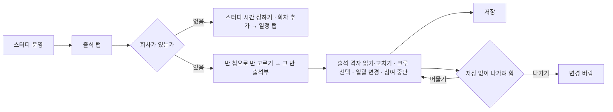
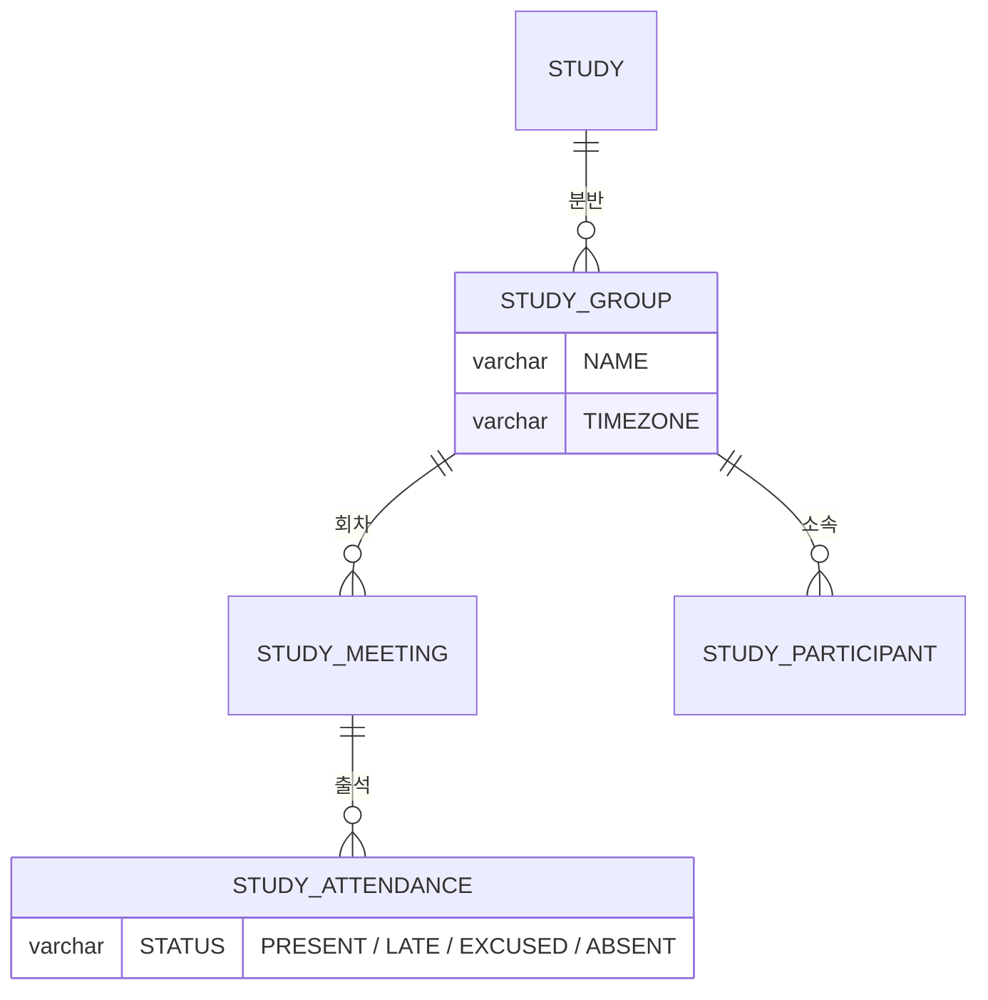

# 캡틴은 스터디별 출석명부를 볼 수 있다.

기준 프로토타입: 스터디 운영 — 출석 탭 (playground 운영 콘솔 · 스터디 운영)

관련 결정: [10-14 백오피스 신청자 탭 정리](../../../docs/share/2026-10-14-class-title-and-captain-applies.md) · [10-18 일정·출석 화면 피드백](../../../docs/share/2026-10-18-schedule-attendance-feedback.md)

## 1. 기본설명

· **진입·사용 흐름**

· **완료 기준**

1. 반별 크루 × 회차 출석 격자 조회
2. 반 칩으로 한 반씩 본다. 모든 반을 잇는 전체 보기는 없다. 반이 하나면 칩을 두지 않는다
3. 제목 줄 「출석 · 전체 N」 · KST/PDT 전환. 반 이름은 반 칩이 말한다(머리 줄 · 규모 · 기준 시간대 문구는 두지 않는다)
4. 크루별 출석률 표시
5. 칸 클릭으로 상태 변경, 저장으로 일괄 반영, 저장 전 되돌리기
6. 저장 전 고친 칸은 상태 색 테두리로 표시(변경 칸 수 · 「저장 필요」 문구 없음). 이탈 시 재확인
7. 회차 없을 때 할 일과 이동 경로 안내
8. 반마다 고쳐 저장. 저장하지 않은 고침이 있으면 다른 반 칩 · 탭으로 옮기기 전에 묻는다
9. 체크박스로 크루를 골라 출석 일괄 변경(「출석 상태」 고르면 바로 적용) · 참여 중단(네비게이터 제외). 사용자 사이트 출석부와 같은 기능
10. 회차 머리 시간대 KST/PDT 전환
11. 표 맨 위 작업 바, 닉네임 · 디스코드 닉네임 열, 고정 열, 고친 칸 상태 색 테두리, 「?」 발표 표시 설명. 사용자 사이트 출석부와 같다

## 2. 화면명세

> **화면**: 스터디 운영 — 출석 탭

### 1. 머리 줄을 두지 않는다

- **정책**: 「출석부 수요일반 · 크루 6 · 회차 4 · KST 기준」 같은 머리 줄은 두지 않는다. 반은 반 칩(1-1), 인원은 제목 옆 「전체 N」, 날짜 기준은 KST/PDT 탭이 말한다 (2026-10-07 기획 결정)
- **정책**: 회차 날짜는 고른 시간대(KST/PDT)의 현지 날짜다

### 1-1. 반 칩

- **내용**: 출석부 위 반 칩 한 줄. 고른 반은 채운 칩. 그 아래 제목 줄: 「출석」 · 「전체 N」 · 「?」 · 오른쪽 KST/PDT 전환
- **동작**: 칩을 누르면 그 반의 출석부로 바뀐다. 고른 반은 일정 탭과 같이 쓴다
- **정책**
  - 전체 보기(모든 반 이어 보기)는 두지 않는다. 반마다 작업 바가 붙어 어느 바가 어느 표의 것인지 흐려진다 (→ [share 10-18](../../../docs/share/2026-10-18-schedule-attendance-feedback.md))
  - 표 하나로 합치지 않는다. 반마다 회차 날짜가 달라 열이 맞지 않는다
  - 반마다 저장한다 (→ [share 10-14](../../../docs/share/2026-10-14-class-title-and-captain-applies.md))
- **조건**: 반이 둘 이상일 때 칩이 보인다

### 2. 크루 선택 · 일괄 변경 · 참여 중단

- **내용**: 닉네임 왼쪽 체크박스. 출석부 카드 맨 위 작업 바 왼쪽에 「n명 선택 · 회차 · 출석 상태 · 참여 중단 · 선택 해제」(0명이어도 보이고 드롭다운 · 버튼은 옅은 회색으로 잠김)
- **동작**
  - 「출석 상태」에서 상태를 마우스로 고르는 순간(키보드는 화살표로 옮긴 뒤 Enter 를 누르거나 칸을 떠날 때) 고른 사람의 그 회차 칸이 바뀐다. 「적용」 버튼은 없다. 저장해야 반영
  - 「참여 중단」은 그 줄을 옅은 빨강(중단 예정)으로 두고, 저장 확인 창을 거쳐 출석과 함께 반영. 되돌리지 않는다
- **정책**
  - 사용자 사이트 출석부와 같은 기능 · 같은 자리
  - 하차 · 제명을 가르지 않고 사유를 묻지 않는다
  - 네비게이터가 섞이면 「참여 중단」이 잠기고 줄 끝(「선택 해제」 뒤)에 「네비게이터는 참여 중단할 수 없습니다. 캡틴에게 문의하세요.」. 신청자 탭에서 역할을 크루로 바꾼 뒤 중단
  - 중단한 사람은 맨 아래 · 흐린 이름 · 「참여 중단」 칩 · 중단 뒤 회차 제외. 일정 표 발표자 후보에서 빠지고, 중단 뒤 회차의 발표자 칸에서도 빠진다

### 3. 출석 격자

- **내용**: 가로는 회차, 세로는 크루. 한 칸이 한 사람의 한 회차
- **정책**
  - 가로 회차 · 세로 크루 배치를 지킨다 — 구글시트로 하던 출석부와 같은 모양이라야 운영자가 그대로 옮겨 온다
  - 회차별 화면을 따로 두지 않는다. 한 사람의 결석 횟수를 한 줄에서 본다
- **데이터**: 크루 × 회차 `STUDY_ATTENDANCE.STATUS`

### 3-1. 닉네임 · 디스코드 닉네임 열

- **내용**: 닉네임(디스코드 닉네임을 붙이지 않음) · 옆 열에 디스코드 닉네임. 둘 다 가로로 넘겨도 왼쪽에 고정

### 3-2. 회차 머리

- **내용**: 회차 번호와 날짜. 시각은 없다

### 3-3. 출석 칸

- **내용**: 출석 · 지각 · 결석 · 휴가 중 하나. 체크 전이면 비어 있다
- **동작**
  - 누를 때마다 출석 → 지각 → 결석 → 휴가 → 미체크
  - 눌러도 저장하지 않는다
  - 저장된 값과 다르면 그 칸에만 상태 색 테두리, 스크린리더는 「저장되지 않음」. 평소에는 테두리가 없다
- **정책**
  - 한 바퀴 돌면 미체크로 돌아온다
  - 바뀐 칸은 색만으로 구분하지 않는다

### 3-4. 크루별 출석률

- **내용**: 정수 %. 체크된 회차가 없으면 「-」. 가운데 정렬 · 오른쪽 끝에 고정
- **동작**: 칸을 바꾸면 바로 다시 계산된다. 저장 전 미리보기다
- **정책**
  - 분모는 체크된 회차뿐이다
  - 휴가는 분모에서 뺀다
  - 지각은 0.5 로 센다

### 4. 조작 안내

- **정책**: 화면에 늘 두는 조작 안내 문구는 없다. 칸 순환은 칸을 가리키면 「눌러서 출석 → 지각 → 결석 → 휴가 → 미체크」, 발표 표시는 제목 옆 「?」 가 설명한다

### 5. 회차 없음 안내

- **내용**
  - 스터디 시간이 없는 반: 「이 반은 아직 스터디 시간이 없습니다.」 · 「일정 탭에서 스터디 시간을 정하고 회차를 추가하면 출석부가 만들어집니다.」 · 「스터디 시간 정하러 가기」
  - 스터디 시간은 있고 회차가 없는 반: 「이 반에는 아직 회차가 없습니다.」 · 「회차 추가하러 가기」
- **동작**: 일정 탭으로 가서 스터디 시간 창 또는 회차 추가 창을 연다
- **조건**: 그 반에 회차가 하나도 없을 때

### 6. 저장

- **내용**: 출석부 카드 맨 위 작업 바 오른쪽. 「저장」(바뀐 칸이 없으면 잠김), 바뀐 칸이 있으면 앞에 「변경 취소」
- **동작**
  - 저장 → 바뀐 칸을 한 번에 반영한다. 화면 결과 문구는 없다(테두리가 사라지고 「저장」이 잠기는 것이 결과). 스크린리더에만 「출석 n칸을 저장했습니다.」
  - 변경 취소 → 저장 전 값으로 되돌린다
  - 처리 중에는 저장과 칸이 잠긴다
- **정책**: 칸마다 따로 보내지 않는다. 한 요청으로 보낸다

### 7. 저장 전 표시

- **내용**: 고친 칸에만 상태 색 테두리. 머리 옆 「저장 필요 · N칸」 · 탭 「저장 전」 · 변경 칸 수 문구는 두지 않는다 (2026-10-07 기획 결정)
- **정책**: 테두리는 색만으로 알리지 않는다. 스크린리더는 「저장되지 않음」을 함께 듣는다
- **조건**: 저장된 값과 다른 칸이 있을 때

### 8. 이탈 확인

- **내용**
  - 「저장하지 않은 변경이 있습니다」
  - 「저장을 누르지 않으면 고친 출석이 사라집니다. 나가기 전에 저장해 주세요.」
  - 「저장하지 않고 나가기」 · 「이 화면에 머물기」
- **동작**
  - 머물기 → 출석 탭에 남고 고친 값이 유지된다
  - 저장하지 않고 나가기 → 고친 값을 버리고 가려던 곳으로 간다
- **정책**: 새로고침·창 닫기는 브라우저 기본 안내를 쓴다
- **조건**: 저장하지 않은 변경이 있는 채로 탭·링크를 누를 때

### 상태별 화면

| 상태 | 화면 | 카피 |
| --- | --- | --- |
| 기본 | 반 칩 · 제목 줄 · 작업 바 · 격자 | `출석 · 전체 N` |
| 회차 없음 | 회차 없음 안내 | `이 반은 아직 스터디 시간이 없습니다.` · `이 반에는 아직 회차가 없습니다.` |
| 저장 전 | 고친 칸 상태 색 테두리 · 「저장」 활성 | - (스크린리더 `저장되지 않음`) |
| 처리중 | 저장·칸 잠김 | - |
| 완료 | 테두리 사라짐 · 「저장」 잠김 | - (스크린리더 `출석 n칸을 저장했습니다.`) |
| 이탈 확인 | 확인 창 | `저장하지 않은 변경이 있습니다` |

### 데이터 관계

### 비고

- 범위 밖: 반 만들기 — [captain-assign-classes](../captain-assign-classes/PRD.md), 디스코드 출석 체크
- 미구현: 회차 추가(예외 회차)
- 구현 지시: 출석부는 반마다 하나다. 회차는 일정 탭 「회차 추가」로만 만든다

<!-- spec:start attendance -->

> 출석부는 **반마다 하나**다 — 반이 다르면 모이는 날이 다르다. 일정 탭과 고른 반을 같이 쓴다
>
> 열은 그 반의 회차다 — 일정 탭에서 더하고 고친 회차가 그대로 열이 된다. 회차는 여기서 만들지 않는다
>
> 사용자 사이트 출석부(네비게이터 출석 수정 Story)와 같은 화면이다. 격자 · 상태값 · 저장 방식 · 표시가 같다. 다른 점은 반 칩뿐
>
> 반 칩으로 한 반씩 본다: 모든 반을 한 페이지에 잇는 전체 보기는 두지 않는다 (2026-10-17 기획 결정)
>
> 머리 줄(반 · 인원 · 기준 시간대) · 진행 기간 · 조작 안내 · 저장 결과 문구 · 「저장 필요」 표시는 두지 않는다 — 탭 이름 · 반 칩 · 표가 이미 말해 준다 (2026-10-07 기획 결정)
>
> 회차 추가 버튼도 두지 않는다 — 회차는 일정 탭에서 만든다
>
> 캡틴은 모든 스터디의 모든 반 출석을 고친다 (2026-10-06 기획 결정 — 쓰기 권한을 ADMIN 까지 넓힌다)
>
> 칸을 눌러도 저장하지 않는다. 저장을 눌러 바뀐 칸을 한 번에 반영한다 — updates[] 한 요청
>
> 출석 체크 방식(디스코드 명령어 전환)은 별도 Story 소관이다

### 0 — 반 칩

- **조건**: 반이 둘 이상일 때
- **내용**: 출석부 위 반 칩 한 줄: 고른 반은 채운 칩. 반이 하나면 두지 않는다
- **동작**
  - 칩을 누르면 그 반의 출석부로 바뀐다. 고른 반은 일정 탭과 같이 쓴다
  - 저장하지 않은 고침이 있으면 반 · 탭 · 링크를 옮기기 전에 묻는다
- **정책**
  - 전체 보기(모든 반 이어 보기)는 두지 않는다. 반마다 작업 바가 붙어 어느 바가 어느 표의 것인지 흐려진다 (2026-10-17 기획 결정)
  - 표 하나로 합치지 않는다 — 반마다 회차 날짜가 달라 열이 맞지 않는다

### 11 — 회차 표시 시간대

- **조건**: 반에 회차가 있을 때
- **내용**: 출석부 제목 줄: 「출석」 · 「전체 N」 · 오른쪽 「KST · PDT」 탭. 회차 머리의 일자가 고른 시간대로 보인다. 머리에 시각은 두지 않는다
- **정책**
  - 사용자 사이트 출석부 · 일정 표와 같은 전환이다. 반을 바꿔도 고른 시간대는 남는다
  - 고른 사람 수는 제목에 두지 않는다. 작업 바의 「n명 선택」 하나뿐 (2026-10-17 기획 결정)

### 12 — 크루 선택 · 출석 일괄 변경

- **조건**: 반에 회차가 있을 때
- **내용**
  - 이름 왼쪽 체크박스 · 머리 칸 전체 선택. 출석부 카드 맨 위 한 줄 작업 바 왼쪽. 「n명 선택」 · 회차 · 「출석 상태」 · 「참여 중단」 · (고른 뒤) 「선택 해제」, 오른쪽: 「변경 취소 · 저장」
  - 고르기 전에도 보인다: 「0명 선택」 · 버튼은 잠김. 스크롤하면 화면 위에 붙는다
- **동작**: 「출석 상태」에서 상태를 마우스로 고르는 순간(키보드는 화살표로 옮긴 뒤 Enter 를 누르거나 칸을 떠날 때) 고른 사람의 그 회차 칸이 바뀐다. 「적용」 버튼은 없다 (2026-10-17 기획 결정). 저장 전 변경이라 「저장」을 눌러야 반영된다
- **정책**: 사용자 사이트 출석부와 같은 바다. 참여를 중단한 사람은 고를 수 없다

### 13 — 참여 중단

- **조건**: 고른 사람 중 네비게이터가 없을 때
- **내용**
  - 중단 예정 줄은 줄 전체를 옅은 빨강으로 칠하고(칩 없음) 닉네임 옆에 되돌리기 아이콘, 작업 바에 「중단 예정 n명」. 저장 확인 창을 거쳐 반영된다
  - 중단한 사람은 맨 아래로 내려가 이름이 흐려지고 「참여 중단」 칩. 중단 뒤 회차 칸은 「-」 · 출석률에서 빠진다
- **동작**: 저장할 때 출석과 함께 반영한다. 되돌리기는 없다
- **정책**
  - 하차 · 제명을 가르지 않는다 — 사유를 묻지도 남기지도 않는다 (사용자 사이트와 같다)
  - 네비게이터가 섞여 있으면 「참여 중단」이 잠기고 줄 끝(「선택 해제」 뒤)에 「네비게이터는 참여 중단할 수 없습니다. 캡틴에게 문의하세요.」 — 신청자 탭에서 역할을 크루로 바꾼 뒤 중단한다
  - 중단한 사람은 일정 표에서 발표자로 고를 수 없고, 중단 시점 뒤에 시작하는 회차의 발표자 칸에서 빠진다. 지난 회차의 발표 기록은 남는다 (2026-10-18 기획 결정)
- **데이터**: POST /api/admin/studies/{studyId}/attendances 의 withdrawals[] — 미구현

### 3 — 출석 격자

- **조건**: 고른 반에 회차가 있을 때
- **내용**: 가로는 회차(첫 열은 킥오프), 세로는 그 반 크루. 한 칸이 한 사람의 한 회차
- **정책**
  - 닉네임 · 디스코드 닉네임 · 발표 횟수(왼쪽)와 출석률(오른쪽)은 고정하고 킥오프 ~ 마지막 회차 열만 가로로 스크롤한다
  - 회차 칸은 모두 같은 너비: 중단 뒤 「-」 칸도. 닉네임 열과 킥오프 사이는 좁게, 남는 폭은 마지막 회차와 출석률 사이에 둔다
  - 구글시트로 하던 일이라 시트와 같은 모양을 유지한다
  - 회차별 화면을 따로 두지 않는다 — 한 사람이 몇 번 빠졌는지 한 줄에서 본다
- **데이터**: STUDY_ATTENDANCE.STATUS — 고른 반의 회차 × 그 반 크루

#### 3-1 — 닉네임 · 디스코드 닉네임 열

- **조건**: 고른 반에 회차가 있을 때
- **내용**
  - 「닉네임」 열: 닉네임만(디스코드 닉네임을 붙이지 않는다). 이 스터디의 네비게이터면 역할 칩
  - 바로 오른쪽 「디스코드 닉네임」 열: 스터디클럽 서버 별명. 길면 말줄임, 가리키면 전체. 없으면 -
- **정책**
  - 둘 다 가로로 스크롤해도 왼쪽에 고정된다. 휴대폰 폭에서는 디스코드 닉네임 열을 숨기고 닉네임 아래에 작게 둔다. 역할 · 「참여 중단」 칩은 휴대폰 폭에서 화면에서만 숨긴다(스크린리더는 듣는다)
  - 동명이인은 디스코드 닉네임(넓은 화면은 옆 열, 휴대폰은 닉네임 아래)이 가른다 (2026-10-18 기획 결정)

#### 3-2 — 회차 열 머리

- **조건**: 고른 반에 회차가 있을 때
- **내용**: 「킥오프」 또는 「n회」와 날짜(M/dd): 시각은 없다

#### 3-3 — 출석 칸

- **조건**: 고른 반에 회차가 있을 때
- **내용**: 출석 · 지각 · 결석 · 휴가 중 하나. 아직 체크하지 않았으면 옅은 회색 빈 칸. 평소에는 테두리가 없다
- **동작**
  - 누를 때마다 출석 → 지각 → 결석 → 휴가 → 미체크 순으로 돈다
  - 저장 버튼을 누르기 전까지는 화면에만 반영된다
  - 저장된 값과 다르면 그 칸에만 그 상태 색 테두리를 두른다(출석 초록 · 지각 주황 · 결석 빨강 · 휴가/미체크 회색, 사이트 포인트 색 아님 · 점 표시 없음). 평소에는 테두리가 없다. 스크린리더는 「저장되지 않음」을 함께 듣는다
- **정책**: 한 바퀴 돌아 미체크로 되돌아온다 — 잘못 누른 것을 되돌릴 수 있어야 한다

#### 3-4 — 크루별 출석률

- **조건**: 고른 반에 회차가 있을 때
- **내용**: 정수 %. 체크된 회차가 없으면 -. 가운데 정렬 · 오른쪽 끝에 고정
- **동작**: 칸을 바꾸면 바로 다시 계산된다 — 저장 전 미리보기다
- **정책**
  - 분모는 체크된 정규 회차만 — 킥오프는 넣지 않는다
  - 휴가는 분모에서 빠진다
  - 지각은 0.5로 센다

#### 3-5 — 발표 횟수

- **조건**: 고른 반에 회차가 있을 때
- **내용**: 디스코드 닉네임 열 오른쪽. 일정의 발표자1·2로 맡은 회차 수
- **정책**: 발표 여부는 따로 입력하지 않는다 — 일정 탭의 발표자가 정본이다

#### 3-6 — 발표 표시

- **조건**: 그 회차 발표자의 칸
- **내용**
  - 칸 왼쪽 위 마이크
  - 「출석 · 전체 N」 옆 「?」: 누르면 마이크 · 발표 횟수 설명이 열린다 (2026-10-18 기획 결정)
- **정책**: 일정의 발표자가 바뀌면 표시도 바뀐다

### 5 — 출석부 없음 안내

- **조건**: 반이 없거나 고른 반에 회차가 없을 때
- **내용**
  - 반이 없으면 「아직 반이 없습니다.」 · 「반 만들기」 — 신청자 탭으로 간다
  - 반은 있는데 회차가 없으면 「이 반에는 아직 회차가 없습니다.」 · 「회차 추가하러 가기」 — 일정 탭에서 회차 추가 창을 연다
- **정책**: 회차가 없다는 사실만 말하지 않는다 — 무엇을 해야 출석부가 생기는지와 갈 곳을 함께 준다

### 7 — 저장

- **조건**: 고른 반에 회차가 있을 때
- **내용**: 출석부 카드 맨 위 작업 바 오른쪽: 저장. 고친 칸이 있으면 「변경 취소」가 함께. 변경 칸 수 문구 · 결과 문구 없음
- **동작**
  - 저장 → 바뀐 칸을 한 번에 반영한다. 처리 중에는 저장과 칸이 잠긴다
  - 변경 취소 → 저장 전 값으로 되돌린다
  - 스크롤하면 사이트 머리 아래에 붙어 크루가 많아도 보인다
- **정책**
  - 한 칸마다 따로 보내지 않는다 — updates[] 한 요청이다
  - 저장 결과는 표가 바뀌는 것으로 알린다. 스크린리더만 「출석 N칸을 저장했습니다」를 듣는다

### 9 — 이탈 확인

- **조건**: 저장하지 않은 변경이 있는 채로 탭·반·링크를 누를 때
- **내용**
  - 「저장하지 않은 변경이 있습니다」
  - 「저장을 누르지 않으면 고친 출석이 사라집니다. 나가기 전에 저장해 주세요.」
  - 「저장하지 않고 나가기」 · 「이 화면에 머물기」
- **동작**
  - 머물기 → 고친 값이 유지된다
  - 나가기 → 고친 값을 버리고 가려던 곳으로 간다
  - 새로고침·창 닫기는 브라우저 기본 안내

<!-- spec:end attendance -->

## 3. 시스템 요건

### 개발 범위

> 2026-10-14 `beta` 기준. **지금 → 할 일**만 적는다. 다 끝나면 「할 일」이 모두 「없음」이 된다.
> FE 「지금」은 실제 앱의 화면과 데이터 연결(API · mock)까지 본 값이다 — 완료 기준 하나하나의 동작은 따로 확인하지 않았다.
> BE 「지금」은 스펙 엔드포인트 표의 상태 칸을 옮겨 적는다.

| 구분 | 대상 | 지금 | 할 일 |
|---|---|---|---|
| FE | back-office-front 출석 탭 (`features/attendance/AttendanceTab`) | 있음 — 아래 API 에 연결 (2026-10-23). 반 칩 · 선택 · 일괄 변경 · 참여 중단 · 격자 · 저장 · 나가기 확인 | 없음 |
| BE | `GET /api/admin/studies/{studyId}/attendances` | 구현완료 | 없음 |
| BE | `POST /api/admin/studies/{studyId}/attendances` | 구현완료 — `withdrawals[]` 받음 (담당 캡틴 · 크루 · 네비게이터) | 없음 |

> **2026-10-23 기획 결정**: 백오피스 출석부에서 **담당 캡틴**이 크루와 **네비게이터**의 참여를 중단시킬 수 있다. 사용자 사이트는 그대로(네비게이터는 크루만). 그래서 아래 생성 블록(`spec:start attendance`)의 「네비게이터가 섞이면 참여 중단이 잠긴다」 는 백오피스에서 더는 맞지 않는다 — playground `spec.ts` 는 다음 기획 손질 때 고친다 ([참여 중단 스펙](../../../specs/study-participant/spec.md) 「백오피스 경로」)

#### 10-18 기획 변경: FE / BE 추가 작업

> 결정 전문은 [share 10-18 일정·출석 화면 피드백](../../../docs/share/2026-10-18-schedule-attendance-feedback.md). D# 는 그 문서의 결정 번호.

| 구분 | 할 일 | 결정 |
|---|---|---|
| FE | 출석 탭: 모든 반 이어 보기 → 반 칩으로 한 반씩. 고른 반은 일정 탭과 공유, 미저장 시 반 전환 전 확인 | D3 |
| FE | 작업 바를 출석부 카드 맨 위로. 「출석 적용」 버튼 제거(상태 고르면 바로 적용). 고르기 전 옅은 회색 | D1 · D2 · D13 |
| FE | 사용자 사이트 출석부와 같은 격자 변경(고정 열 · 칸 너비 · 일자만 · 상태 색 테두리 · 닉네임/디스코드 열 · 중단 예정 줄 · 「?」) | D5 · D6 · D8 · D9 |
| BE | 관리자 출석 조회 응답에도 `discordNickname` 추가 (`/api/admin/studies/{id}/attendances`) | D6 |
| BE | 관리자 출석 저장의 참여 중단도 중단 뒤 회차 발표자 비우기 ([참여 중단 PRD](../navigator-withdraw-participant/PRD.md#개발-범위)와 같은 규칙) | D7 |

### 데이터

- 읽기: 반의 회차 목록, 크루 목록, 크루 × 회차 상태, 크루별 출석률, 반 평균
- 쓰기: `STUDY_ATTENDANCE.STATUS` — `PRESENT` · `LATE` · `ABSENT` · `EXCUSED`

### 처리

- 저장은 바뀐 칸을 `updates[]` 한 요청으로 보낸다. 서버는 한 트랜잭션으로 반영한다 — 하나라도 거절되면 아무것도 반영하지 않는다
- 칸의 회차·참여자가 그 스터디에 속하지 않으면 400. 같은 칸이 두 번 오면 400. 같은 칸을 동시에 고치면 나중 요청의 값이 남는다 (충돌 409는 없다 — [출석 스펙](../../../specs/attendance/spec.md))

### 계산 규칙 (단일 정의)

- 출석률 = (출석 + 지각 × 0.5) / (체크된 회차 − 휴가). 분모 0 이면 null → 「—」
- 정의 위치: [attendance/spec.md](../../../specs/attendance/spec.md) 출석률 산식. 화면 미리보기도 같은 식을 쓴다

### API

| 메서드 | 경로 | 권한 |
| --- | --- | --- |
| GET | `/api/admin/studies/{studyId}/attendances` | 캡틴 |
| POST | `/api/admin/studies/{studyId}/attendances` | 캡틴 |

네비게이터(LEADER)는 사용자 사이트에서 `/api/me/studies/{studyId}/attendances` 로 같은 일을 한다.

계약은 [attendance/spec.md](../../../specs/attendance/spec.md).

### 권한

- 열람: 캡틴
- 쓰기: attendance 스펙은 그 스터디의 LEADER 만 허용한다

### 외부 연동

- 없음

## 4. 미확정

- 캡틴(`SYSTEM_ROLE = ADMIN`)이 운영 콘솔에서 출석을 고칠 수 있게 쓰기 권한을 넓힐지
- 미체크로 되돌린 칸을 저장하는 방법 — 쓰기 API 는 네 값만 받는다
- 예외 회차 추가
