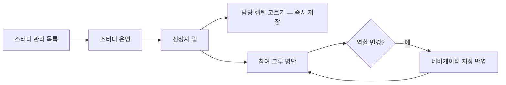
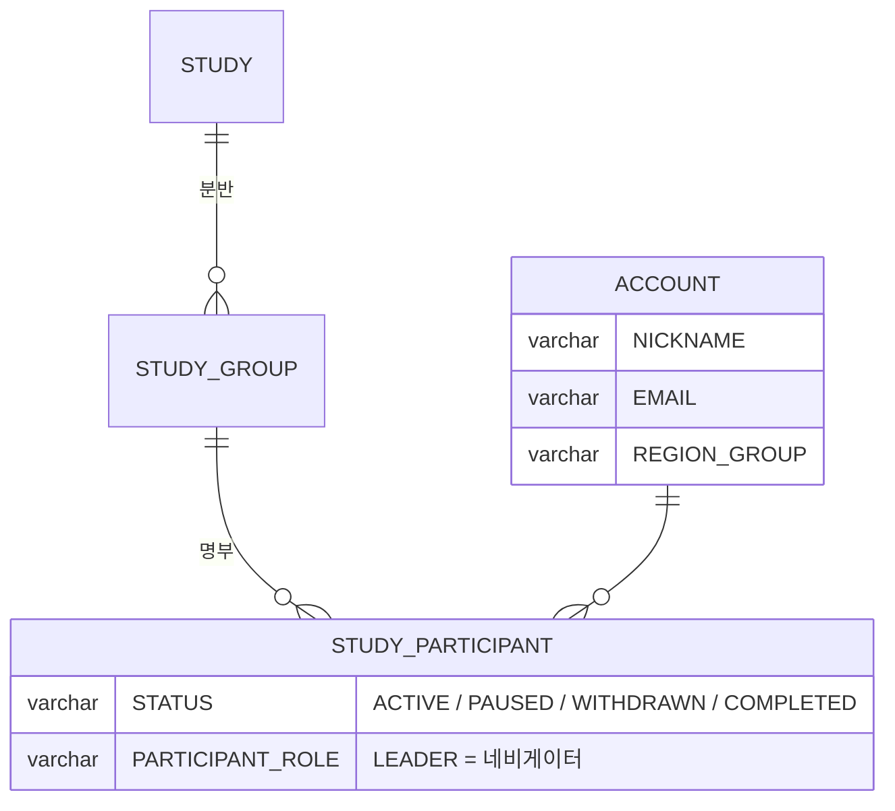

# 캡틴은 개별 스터디의 참석자를 볼 수 있다.

> 시간대 공통 규칙: [확장 PRD](../timezone-expansion/PRD.md).

기준 프로토타입: 스터디 운영 — 신청자 탭 참여 크루 명단 (playground 운영 콘솔 · 스터디 운영)

관련 결정: [10-14 백오피스 신청자 탭 정리](../../../docs/share/2026-10-14-class-title-and-captain-applies.md) · [10-18 일정·출석 화면 피드백](../../../docs/share/2026-10-18-schedule-attendance-feedback.md) · [11-16 담당 캡틴 지정](../../../docs/share/2026-11-16-owner-captain-assignable.md)

## 1. 기본설명

· **진입·사용 흐름**

· **완료 기준**

1. 스터디명과 모집 상태 확인
2. 참여 크루의 닉네임·디스코드 닉네임·이메일·시간대·반 조회
3. 반 · 역할 변경은 「저장」으로 한 번에 반영. 저장 전 탭 이동 시 확인
4. 역할 드롭다운으로 네비게이터 지정·해제(기본 크루) — 복수 지정 가능
5. 신청한 캡틴은 크루와 같은 줄로 표시. 신청하지 않은 캡틴 줄 없음
6. 반 · 시간대 드롭다운 필터 — 제목 아래 줄. 둘 다 고르면 둘 다 맞는 크루만
7. 체크박스로 여러 명을 골라 반 · 역할 일괄 변경. 표 맨 위 작업 바 「n명 선택」 · 「반 변경」 · 「역할 변경」 (마우스로 고르는 순간(키보드는 화살표로 옮긴 뒤 Enter 를 누르거나 칸을 떠날 때) 적용, 「적용」 버튼 없음), 저장으로 반영. 고르기 전에는 드롭다운이 옅은 회색
8. 머리 아래 요약 카드(진행 일정 · 참석자 · 출석률)가 어느 탭에서나 보인다. 출석률은 모든 반을 합친 서버 값
9. 담당 캡틴 확인 및 변경 — 캡틴 계정 중 하나, 고르는 즉시 저장. 저장 중 드롭다운 잠김

## 2. 화면명세

> **화면**: 스터디 운영 (운영 콘솔) — 머리 · 신청자 탭

### 1. 스터디 머리

- **내용**: 어느 스터디의 명단을 보고 있는지

### 1-1. 스터디명

- **데이터**: `STUDY.TITLE` (운영 콘솔은 한국어)

### 1-2. 모집 상태 · 미공개

- **내용**
  - 「모집중 · D-5」 · 「모집중 · D-0」 · 「모집 마감」 중 하나
  - 아직 공개하지 않았으면(작성 중) 「미공개」 배지가 함께 붙는다
- **정책**
  - 머리는 상태만 말한다. 마감일의 실제 날짜는 정보 탭에 있다
  - 모집 상태는 `recruitState()` 한 곳에서 계산한다. 사용자 사이트와 같다

### 1-4. 요약 카드 — 진행 일정 · 참석자 · 출석률

- **내용**
  - 머리 아래, 탭 위에 카드 셋. 어느 탭을 보고 있어도 보인다
  - 진행 일정(없으면 「미정 · 신청자 조율」) · 참석자 수(「정원 N명」 · 「정원 제한 없음」) · 출석률(정수 %, 「모든 반 · 지각 포함」, 체크된 회차가 없으면 「-」)
- **정책**
  - 운영자가 매일 확인하는 숫자라 탭을 옮겨 다니지 않아도 보이게 둔다 (2026-11-16 결정 — 백오피스 · 프로토 통일)
  - 출석률은 모든 반 크루의 분자 · 분모를 합친 가중평균. 산식은 출석 탭과 같다 — 화면이 아니라 서버가 계산한다
  - 출석 저장 · 회차 수정 뒤 다시 읽는다

### 2. 탭

- **내용**: 정보 · 신청 폼 · 신청 결과 · 신청자 · 일정 · 출석. 참여 명단과 반 편성은 신청자 탭, 반별 회차는 일정 탭에 있다

### 3. 참여 크루 명단

- **내용**: 닉네임 · 디스코드 닉네임 · 이메일 · 시간대 · 반 · 역할
- **정책**
  - 승인 단계는 없다. 신청한 사람이 곧 크루다
  - 캡틴도 참여하려면 신청한다. 신청하면 크루와 같은 줄로 나온다 ([POL-0001](../../_registry/policies/POL-0001-roles.md)) (→ [share 10-14](../../../docs/share/2026-10-14-class-title-and-captain-applies.md))
- **데이터**: `STUDY_PARTICIPANT` · `ACCOUNT` (시간대 `TIME_ZONE` · 디스코드 닉네임 `DISCORD_NICKNAME`)
- **조건**: 신청자 탭을 보고 있을 때

### 3-1. 참여 크루 제목

- **내용**: 「참여 크루 18」처럼 참여 인원 숫자만(필터와 무관한 전체). 정원은 적지 않는다 — 모집 현황은 신청 결과 탭
- **조건**: 신청자 탭을 보고 있을 때

### 3-2. 역할 — 크루 · 네비게이터

- **내용**: 드롭다운 「크루」(기본) · 「네비게이터」. 네비게이터인 줄은 테두리를 강조한다
- **동작**
  - 캡틴이 「네비게이터」를 고르면 지정, 「크루」를 고르면 해제
  - 여러 명을 지정할 수 있다
- **정책**
  - 역할은 스터디마다 따로 선다. 지정된 사람은 이 스터디에 한해 크루 명단 열람 · 정보 수정 · 출석 현황 수정 · 스터디 공지 발행을 할 수 있다
  - 다른 스터디에서는 크루일 뿐이다
  - 지정은 캡틴만 한다
  - 계정 권한(캡틴 · 크루)과 섞지 않는다
- **데이터**: `STUDY_PARTICIPANT.PARTICIPANT_ROLE` (쓰기)
- **조건**: 신청자 탭을 보고 있을 때

### 4. 담당 캡틴

- **내용**: 신청자 탭 맨 위 카드 — 「담당 캡틴」 · 지금 담당 캡틴 드롭다운 · 「신청 폼 수정 · 참여 중단 · 사이트 일정 관리를 맡습니다. 참여하지 않아도 됩니다.」
- **동작**
  - 고르면 바로 저장한다. 저장하는 동안 드롭다운이 잠기고 옆에서 하나가 돈다
  - 저장된 뒤 칸이 바뀌고 「담당 캡틴을 바꿨습니다.」. 같은 사람을 고르면 아무 일도 일어나지 않는다
- **정책**
  - 스터디당 한 명. 스터디를 만들면 만든 캡틴이 담당 캡틴이다
  - 명부와 따로 선다 — 참여하지 않는 캡틴도 담당 캡틴이다
  - 바꾸는 사람은 캡틴이면 누구나. 고를 수 있는 사람은 캡틴 계정뿐 ([POL-0001](../../_registry/policies/POL-0001-roles.md))
  - 저장되기 전에는 지금 값 그대로 둔다
- **데이터**: `STUDY.OWNER_CAPTAIN_ID` (쓰기) · 후보 `ACCOUNT.SYSTEM_ROLE = ADMIN`
- **조건**: 신청자 탭을 보고 있을 때

### 상태별 화면

| 상태 | 화면 | 카피 |
| --- | --- | --- |
| 기본 | 머리 · 명단 · 인원 | `참여 크루 N/M` |
| 공개 전 | 머리 | `미공개` · 「사이트 공개」 스위치 꺼짐 |
| 담당 캡틴 없음 | 담당 캡틴 칸 | `없음 · 캡틴 누구나` |
| 담당 캡틴 저장 중 | 담당 캡틴 칸 | 드롭다운 잠김 · 옆에 스피너 |
| 담당 캡틴 저장 실패 | 담당 캡틴 칸 · 토스트 | 지금 값 그대로. 서버 문구(예: `캡틴만 담당 캡틴이 될 수 있습니다.`) |

### 데이터 관계

### 비고

- 범위 밖: 반 편성 — [captain-assign-classes](../captain-assign-classes/PRD.md), 회차별 출석 — [captain-view-attendance-roster](../captain-view-attendance-roster/PRD.md), 제명

<!-- spec:start attendee -->

> 시간대 공통 규칙: 01-planning/stories/timezone-expansion/PRD.md.
>
> **승인이라는 단계가 없다** — 신청한 사람이 곧 크루다
>
> 회차는 일정 탭, 회차별 출석 여부는 출석 탭에서 본다
>
> 역할 지정은 화면 상태로만 처리한다. 새로고침하면 되돌아간다 — 저장 API 가 아직 없다

### 1 — 스터디 헤더

- **내용**: 어느 스터디의 명단을 보고 있는지 알려준다

#### 1-1 — 스터디명

- **데이터**: 스터디 제목 (운영 콘솔은 한국어 고정)

#### 1-2 — 모집 상태 · 미공개

- **내용**
  - D-day는 공통 헤더 시간대의 오늘 날짜로 계산한다. 「모집중 · D-5」 · 「모집중 · D-0」 · 「모집 마감」 중 하나 — **마감일 당일도 모집중이다**
  - 아직 공개하지 않은 스터디(작성 중)면 「미공개」 배지가 함께 붙는다
- **정책**
  - 헤더는 상태만 말한다 — 마감일의 실제 날짜는 정보 탭이 갖는다. 공개는 날짜가 아니라 「사이트 공개」 스위치(1-3)로 켠다
  - 모집 상태는 recruitState() 한 곳에서만 계산한다 — 사용자 사이트와 판정이 갈리면 안 된다

#### 1-3 — 사이트 공개 스위치

- **내용**
  - 「모집중」 배지 아래 「사이트 공개」 스위치 — 켜짐(초록) 공개 · 꺼짐(회색) 미공개
  - 바꿀 수 없으면 스위치 아래에 이유를 글로 보인다 — 「신청 폼을 먼저 연결하세요.」 · 「진행 중이거나 종료된 스터디는 비공개로 돌릴 수 없습니다.」
- **동작**: 누르면 목록과 같은 공개 · 비공개 확인 팝업이 뜬다. 「공개」 / 「비공개로 전환」을 눌러야 바뀐다
- **정책**
  - **상세 페이지에서도 토글로 스터디를 공개 · 미공개할 수 있다** — 목록 「스터디 공개」 칸과 같은 규칙 · 같은 확인 팝업이다 ([captain-publish-study](https://github.com/StudyClub-PlusPlus/studyclub-engineering/blob/beta/01-planning/stories/captain-publish-study/PRD.md))
  - 공개는 모집 시작이다 — 켜면 오늘이 모집 시작일이 되고 스터디 상태가 「개설」이 된다
  - 이 프로토는 화면 상태로만 바꾼다. 새로고침하면 되돌아간다
- **데이터**: STUDY.STATUS · STUDY_RECRUITMENT.START_AT (쓰기) · 신청 폼 질문 수 (읽기)

#### 1-4 — 요약 카드 — 진행 일정 · 참석자 · 출석률

- **내용**
  - 헤더 아래, 탭 위에 카드 셋. 어느 탭을 보고 있어도 늘 보인다
  - 진행 일정: 스터디 일정 글. 없으면 「미정 · 신청자 조율」
  - 참석자: 참여 인원 숫자, 아래에 「정원 N명」 또는 「정원 제한 없음」
  - 출석률: 모든 반을 합친 정수 %, 아래에 「모든 반 · 지각 포함」. 체크된 회차가 없으면 「-」
- **동작**: 출석 탭에서 저장하거나 일정 탭에서 회차를 고치면 출석률이 다시 계산돼 바뀐다
- **정책**
  - **운영자가 매일 확인하는 숫자다** — 탭을 옮겨 다니지 않아도 보이게 위에 둔다 (2026-11-16 기획 결정, 백오피스와 통일)
  - 출석률은 반별 평균을 다시 평균하지 않는다 — 모든 반 크루의 분자 · 분모를 합친다. 크루 수가 다른 반이 같은 무게로 섞이면 안 된다
  - 산식은 출석 탭과 같다: 지각 0.5, 휴가 · 킥오프 · 체크 안 한 회차는 빼고, 참여를 중단한 크루는 중단 뒤 회차를 뺀다. 중단 전 기록은 센다
  - **화면이 계산하지 않는다** — 서버가 출석 탭과 같은 계산기로 내려준 값을 그린다. 반별 숫자는 출석 탭에서 본다
- **데이터**
  - 진행 일정: STUDY.SCHEDULE · 참석자: 참여 명단 participantCount · 정원: STUDY_RECRUITMENT.CAPACITY
  - 출석률: GET /api/admin/studies/{studyId}/attendances/summary → attendanceRate (0 ~ 1, null 이면 「-」)

### 2 — 탭

- **내용**: 정보 · 신청 폼 · 신청 결과 · 신청자 · 일정 · 출석. 참여 명단과 반 편성은 신청자 탭, 반별 회차는 일정 탭에 있다

### 3 — 참여 크루 명단

- **조건**: 신청자 탭을 보고 있을 때
- **내용**: 닉네임 · 디스코드 닉네임 · 디스코드 · 이메일 · 시간대 · 반 · 역할
- **정책**
  - 신청한 사람이 곧 크루다. 캡틴도 신청했으면 여기 크루와 같은 줄로 나온다
  - **디스코드 칸은 「연동」 아니면 「미연동」이다** — 이어져 있지 않으면 승인해도 들어오지 못한다
  - **아이디는 가린 채로 두고, 눈 아이콘을 누른 줄만 펼친다. 같은 버튼으로 다시 가린다** — 유저 목록과 같은 규칙이다 ([POL-0007](https://github.com/StudyClub-PlusPlus/studyclub-engineering/blob/beta/01-planning/_registry/policies/POL-0007-account-data.md))
  - 별명은 신청서에 적어 낸 글자이고 아이디는 계정 그 자체다 — **둘은 다를 수 있다**: 별명으로 찾다 못 찾는 일이 생긴다
- **데이터**: 참여 건

#### 3-1 — 참여 크루 제목

- **조건**: 신청자 탭을 보고 있을 때
- **내용**: 「참여 크루 18」 — 제목 오른쪽에 참여 인원 숫자만. 「반 3」과 같은 모양
- **정책**
  - 필터와 상관없이 전체 인원이다
  - 정원은 적지 않는다: 모집 현황은 신청 결과 탭이 말한다

#### 3-2 — 역할 — 크루 · 네비게이터

- **조건**: 신청자 탭을 보고 있을 때
- **내용**
  - 드롭다운 「크루」(기본) · 「네비게이터」. 옆 「반」 칸과 같은 모양
  - 네비게이터인 줄은 테두리가 진하고 글자가 굵다 — 긴 명단에서 몇 안 되는 네비게이터가 바로 보인다
- **동작**
  - 「네비게이터」를 고르면 지정, 「크루」를 고르면 해제. 그 자리에서 바뀐다
  - 여러 명을 지정할 수 있다 — 반이 둘이면 맡는 사람도 둘일 수 있다
- **정책**
  - **역할은 스터디마다 따로 선다** — 여기서 지정된 사람은 이 스터디에 한해 크루 명단 열람 · 정보 수정 · 출석 현황 수정 · 스터디 공지 발행 넷을 할 수 있고, 다른 스터디에서는 크루일 뿐이다
  - 지정은 캡틴만 한다
  - 누를 때마다 바뀌는 배지로 두지 않는다 — 바꿀 수 있다는 것이 안 보이고, 잘못 누르면 권한이 바로 넘어간다
  - 계정 권한과 섞지 않는다 — 유저 지면이 정하는 것은 캡틴·크루 둘뿐이고, 네비게이터는 여기서만 선다
- **데이터**: STUDY_PARTICIPANT.PARTICIPANT_ROLE — MEMBER(크루) · LEADER(네비게이터) (쓰기)

#### 3-6 — 크루 선택 체크박스

- **조건**: 신청자 탭을 보고 있을 때
- **내용**: 명단 맨 왼쪽 칸. 머리 칸은 보이는 크루 전체 선택 — 일부만 고르면 반쯤 찬 표시
- **동작**: 고르면 표 위 작업 바(3-7)의 「n명 선택」이 늘고 드롭다운이 풀린다
- **정책**: 필터로 숨긴 크루는 전체 선택 · 일괄 적용에 들어가지 않는다 — 보이는 줄만

#### 3-7 — 표 맨 위 작업 바: 선택 (왼쪽)

- **조건**: 크루가 한 명 이상일 때
- **내용**
  - 표 맨 위(카드 안) 한 줄의 왼쪽: 스크롤하면 화면 위에 붙는다. 일정 · 출석 표와 같은 자리 (2026-10-18 기획 결정) · 「n명 선택」 · 「반 변경 / {반}」 · 「역할 변경 / 크루 / 네비게이터」 · (고른 뒤) 「선택 해제」. 「적용」 버튼은 없다 (2026-10-17 기획 결정)
  - 고르기 전에도 보인다: 「0명 선택」 · 드롭다운은 잠김
- **동작**
  - 드롭다운에서 반 · 역할을 마우스로 고르는 순간(키보드는 화살표로 옮긴 뒤 Enter 를 누르거나 칸을 떠날 때) 고른 사람 모두에게 얹힌다. 바로 반영하지 않고 저장 전 변경(3-5): 「저장」을 눌러야 반영
  - 고른 뒤 드롭다운은 다시 「반 변경」 · 「역할 변경」으로 돌아온다. 선택은 그대로 남아 반과 역할을 이어서 바꿀 수 있다
  - 반 고르기는 반이 둘 이상일 때만
- **정책**: 선택 줄과 저장 줄을 따로 쌓지 않는다. 한 줄에 왼쪽 선택 · 오른쪽 저장 (POL-0008, `@studyclub/ui` TableActionBar)

#### 3-5 — 표 맨 위 작업 바: 저장 (오른쪽)

- **조건**: 크루가 한 명 이상일 때
- **내용**
  - 같은 줄 오른쪽 — 「저장」(고친 것이 없으면 잠김). 고친 것이 있으면 앞에 「변경 취소」. 고친 줄은 옅게 칠한다
  - 저장하면 「저장했습니다.」
- **동작**
  - 반 · 역할 드롭다운은 바로 반영하지 않고 모은다. 「저장」으로 한 번에 반영, 「변경 취소」로 모두 되돌린다
  - 고친 값을 원래대로 되돌리면 그 줄은 변경에서 빠진다
  - 저장하지 않은 채 다른 탭 · 링크로 가면 「저장하지 않은 변경이 있습니다」로 묻는다
- **정책**: 한 칸 바꿀 때마다 저장하지 않는다 — 여러 명을 옮기는 도중의 어중간한 편성이 남는다. 일정 표 · 출석부와 같은 방식
- **데이터**: PATCH …/participants 한 번 — 바뀐 줄만 changes[] 로. 하나라도 거절되면 아무것도 바뀌지 않는다. 미구현

#### 3-3 — 반 · 시간대 필터

- **조건**: 신청자 탭을 보고 있을 때
- **내용**
  - 「참여 크루」 제목 아래 줄, 왼쪽부터 「반」 · 「시간대」 드롭다운. 고르면 테두리가 진해진다
  - 반 드롭다운은 반이 둘 이상일 때만 나온다. 맞는 크루가 없으면 「조건에 맞는 크루가 없습니다.」
- **동작**
  - 둘을 함께 고르면 둘 다 맞는 크루만 보인다
  - 각 드롭다운의 「… 전체」로 푼다
- **정책**
  - 반 필터는 저장된 반으로 거른다 — 고치는 중에 줄이 사라지지 않게
  - 화면에서 거른다. 명단 API 에 필터 파라미터를 두지 않는다 — 한 스터디 명단은 수십 명이다

#### 3-4 — 디스코드 닉네임

- **조건**: 신청자 탭을 보고 있을 때
- **내용**: 그 크루의 스터디클럽 디스코드 서버 별명. 없으면 「—」
- **정책**: 운영자가 디스코드에서 그 사람을 찾을 때 쓴다. 신청할 때 받은 값으로 계정에 저장된다
- **데이터**: ACCOUNT.DISCORD_NICKNAME

### 4 — 담당 캡틴

- **조건**: 신청자 탭을 보고 있을 때
- **내용**: 신청자 탭 맨 위 카드 — 「담당 캡틴」과 지금 담당 캡틴 이름
- **정책**
  - **스터디당 한 명이다.** 스터디를 만들면 만든 캡틴이 담당 캡틴이 된다
  - **명부와 따로 선다** — 참여하지 않는 캡틴도 담당 캡틴이다. 참여하려면 크루처럼 신청하고, 그러면 참여 크루 명단에 같은 줄로 나온다
  - 담당 캡틴만 하는 일: 신청 폼 수정 · 출석부에서 참여 중단 · 사용자 사이트 일정 관리 ([POL-0001](https://github.com/StudyClub-PlusPlus/studyclub-engineering/blob/beta/01-planning/_registry/policies/POL-0001-roles.md))
  - 담당 캡틴이 비어 있는 스터디(탈퇴 · 끝난 스터디에서 권한 해제)는 담당 캡틴의 일을 캡틴 누구나 한다
- **데이터**: STUDY.OWNER_CAPTAIN_ID → ACCOUNT.NICKNAME

#### 4-1 — 담당 캡틴 고르기

- **조건**: 신청자 탭을 보고 있을 때
- **내용**: 드롭다운 — 캡틴 계정 전체. 저장하는 동안 드롭다운이 잠기고 옆에서 하나가 돈다
- **동작**
  - 고르면 바로 저장한다 — 명단의 반 · 역할처럼 모았다가 「저장」하지 않는다
  - 저장된 뒤에 칸이 바뀌고 「담당 캡틴을 바꿨습니다.」를 알린다. 지금과 같은 사람을 고르면 아무 일도 일어나지 않는다
- **정책**
  - 바꾸는 사람은 캡틴이면 누구나다 — 지금 담당 캡틴이 아니어도 된다
  - 고를 수 있는 사람은 캡틴 계정뿐이다. 크루는 목록에 나오지 않는다
  - 저장되기 전에는 지금 값 그대로 둔다 — 실패해도 바뀐 것처럼 남지 않게
- **데이터**
  - PATCH /api/admin/studies/{studyId}/owner-captain { accountId }
  - 후보: GET /api/admin/users?role=CAPTAIN&limit=100

#### 4-2 — 담당 캡틴 안내

- **조건**: 신청자 탭을 보고 있을 때
- **내용**: 「신청 폼 수정 · 참여 중단 · 사이트 일정 관리를 맡습니다. 참여하지 않아도 됩니다.」

<!-- spec:end attendee -->

## 3. 시스템 요건

### 개발 범위

> 2026-10-14 `beta` 기준. **지금 → 할 일**만 적는다. 다 끝나면 「할 일」이 모두 「없음」이 된다.
> FE 「지금」은 실제 앱의 화면과 데이터 연결(API · mock)까지 본 값이다 — 완료 기준 하나하나의 동작은 따로 확인하지 않았다.
> BE 「지금」은 스펙 엔드포인트 표의 상태 칸을 옮겨 적는다.
> 2026-10-23 갱신 — FE · BE 「지금」을 머지된 PR 로 다시 봤다.
> 2026-11-16 갱신 — 담당 캡틴 칸 줄 추가.

| 구분 | 대상 | 지금 | 할 일 |
|---|---|---|---|
| FE | back-office-front 신청자 탭 | 있음 (#302 · 역할 2026-10-31) — `ParticipantsTab`: 참여 크루 명단 · 행 반 · 역할 드롭다운 · 체크박스 반 · 역할 일괄 변경 · 저장 바. #302 는 반만 붙였고 역할(3-2 드롭다운 · 3-7 「역할 변경」)은 같은 저장 흐름에 2026-10-31 붙였다. `ApplicationsTab` 은 지웠다. `CrewTab` 은 mock 이고 쓰지 않는다 | 없음 — 명단 `GET` 은 구현됐다(#324). 10-18 변경 표는 모두 반영 |
| BE | `GET /api/admin/studies/{studyId}/applications` 의 `completionRate` | 구현완료 | 신청자 탭에서 쓰지 않는다. 다른 화면이 쓰지 않으면 응답에서 뺄지 정한다 (→ [share 10-14](../../../docs/share/2026-10-14-class-title-and-captain-applies.md)) |
| BE | `GET /api/admin/studies/{studyId}/participants` · `PATCH …/participants` (반 · 역할 일괄) | 구현완료 (#324) · 구현완료 (#303) · `ownerCaptain` 구현완료 (2026-11-16) | 없음 |
| FE | back-office-front 요약 카드 출석률 (1-4) | 있음 (2026-11-16) — `StudyConsole` 의 `Stat` 이 `useStudyAttendanceRate` 값을 그린다. 전에는 「-」 고정 | 없음 |
| BE | `GET /api/admin/studies/{studyId}/attendances/summary` | 구현완료 (2026-11-16) | 없음 |
| BE | `PATCH /api/admin/studies/{studyId}/owner-captain` · V58 `STUDY.OWNER_CAPTAIN_ID` | 구현완료 (2026-11-16) | 없음 |
| FE | back-office-front 신청자 탭 담당 캡틴 칸 | 있음 — `OwnerCaptainSection`: 캡틴 목록 드롭다운 · 즉시 저장 (2026-11-16) | 없음 |

#### 10-18 기획 변경: FE / BE 추가 작업

> 결정 전문은 [share 10-18 일정·출석 화면 피드백](../../../docs/share/2026-10-18-schedule-attendance-feedback.md). D# 는 그 문서의 결정 번호.

| 구분 | 할 일 | 결정 |
|---|---|---|
| FE | 참여 크루 표: 「이름」 열 → 「닉네임」 (반영) | D10 |
| FE | 작업 바를 표 카드 맨 위로, 스크롤 시 고정. 「적용」 버튼 제거(반 · 역할 드롭다운에서 고르면 바로 저장 전 변경). 고르기 전 드롭다운 옅은 회색 (반영) | D1 · D2 · D13 |

### 데이터

- 명단: 그 스터디의 `STUDY_PARTICIPANT` 와 계정 이름·디스코드 닉네임(`ACCOUNT.DISCORD_NICKNAME`)·이메일·시간대(`ACCOUNT.TIME_ZONE`), 소속 분반
- 필터: 시간대·반은 화면에서 거른다. 명단 API 에 필터 파라미터를 두지 않는다

### 처리

- 네비게이터 지정: `PARTICIPANT_ROLE = LEADER`, 해제: `MEMBER`
- 담당 캡틴 변경: `STUDY.OWNER_CAPTAIN_ID = 고른 캡틴`. 대상 계정을 잠그고 `ADMIN` 인지 확인한 뒤 바꾼다. 감사 로그 `OWNER_CAPTAIN`

### 계산 규칙 (단일 정의)

- 모집 상태: `recruitState()` — [study-recruit-status/spec.md](../../../specs/study-recruit-status/spec.md)
- 요약 카드 출석률: `AttendanceRateCalculator` — [attendance/spec.md 「스터디 출석률 요약」](../../../specs/attendance/spec.md)

### API

| 메서드 | 경로 | 권한 |
| --- | --- | --- |
| GET | `/api/admin/studies/{studyId}/participants` | 캡틴 |
| PATCH | `/api/admin/studies/{studyId}/participants` — 반 · 역할 한 번에 | 캡틴 |
| GET | `/api/admin/studies/{studyId}/attendances/summary` — 요약 카드 출석률 | 캡틴 |
| PATCH | `/api/admin/studies/{studyId}/owner-captain` — 담당 캡틴 바꾸기 | 캡틴 |
| GET | `/api/admin/users?role=CAPTAIN` — 담당 캡틴 후보 | 캡틴 |

계약은 [study-group/spec.md](../../../specs/study-group/spec.md) · 출석률 요약은 [attendance/spec.md](../../../specs/attendance/spec.md).

### 권한

- 명단 열람: 캡틴, 그 스터디의 네비게이터
- 역할 지정: 캡틴만. 서버에서 검증한다
- 담당 캡틴 변경: 캡틴이면 누구나. 대상은 캡틴 계정만. 서버에서 검증한다

### 개인정보

- 이메일은 운영 콘솔에서만 보인다. 사용자 사이트 응답에 싣지 않는다

### 외부 연동

- 없음

## 4. 미확정

- ~~명단·역할 지정 API 경로~~ → [study-group/spec.md](../../../specs/study-group/spec.md) (2026-10-06)
- ~~완주율 정의와 계산 위치~~ — 명단에서 완주율을 뺐다. 필요해지면 그때 정한다 (→ [share 10-14](../../../docs/share/2026-10-14-class-title-and-captain-applies.md))
- ~~공동 네비게이터(`CO_LEADER`)를 이 화면에서 구분할지~~ — 부반장을 없앴다 (POL-0001, 2026-10-09)
