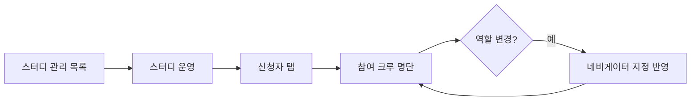
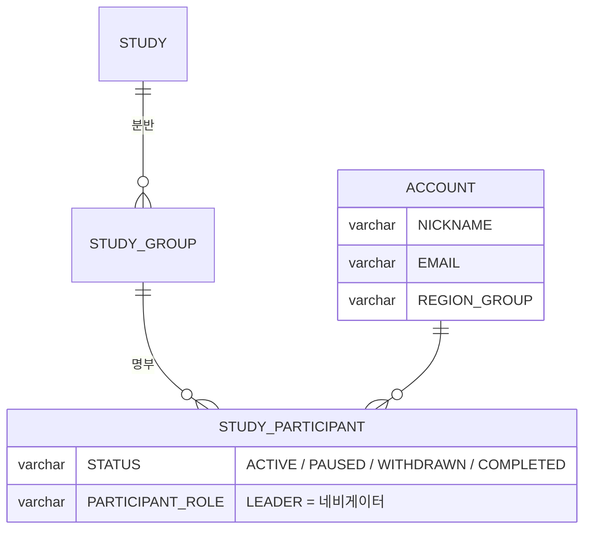

# 캡틴은 개별 스터디의 참석자를 볼 수 있다.

기준 프로토타입: 스터디 운영 — 신청자 탭 참여 크루 명단 (playground 운영 콘솔 · 스터디 운영)

## 1. 기본설명

· **진입·사용 흐름**

· **완료 기준**

1. 스터디명과 모집 상태 확인
2. 참여 크루의 이름·디스코드 닉네임·이메일·지역·반 조회
3. 반 · 역할 변경은 「저장」으로 한 번에 반영. 저장 전 탭 이동 시 확인
4. 역할 드롭다운으로 네비게이터 지정·해제(기본 크루) — 복수 지정 가능
5. 신청한 캡틴은 크루와 같은 줄로 표시. 신청하지 않은 캡틴 줄 없음
6. 지역·반 필터 — 둘 다 고르면 둘 다 맞는 크루만. 「필터 해제」로 전체 복귀

## 2. 화면명세

> **화면**: 스터디 운영 (운영 콘솔) — 머리 · 신청자 탭

### 1. 스터디 머리

- **내용**: 어느 스터디의 명단을 보고 있는지

### 1-1. 스터디명

- **데이터**: `STUDY.TITLE` (운영 콘솔은 한국어)

### 1-2. 모집 상태 · 공개 예정

- **내용**
  - 「모집중 · D-5」 · 「모집중 · D-0」 · 「모집 마감」 중 하나
  - 아직 공개하지 않았으면 「공개 예정」이 함께 붙는다
- **정책**
  - 머리는 상태만 말한다. 마감일의 실제 날짜는 정보 탭에 있다
  - 모집 상태는 `recruitState()` 한 곳에서 계산한다. 사용자 사이트와 같다

### 2. 탭

- **내용**: 정보 · 신청 폼 · 신청 결과 · 신청자 · 일정 · 출석. 참여 명단과 반 편성은 신청자 탭, 반별 회차는 일정 탭에 있다

### 3. 참여 크루 명단

- **내용**: 이름 · 디스코드 닉네임 · 이메일 · 지역 · 반 · 역할
- **정책**
  - 승인 단계는 없다. 신청한 사람이 곧 크루다
  - 캡틴도 참여하려면 신청한다. 신청하면 크루와 같은 줄로 나온다 ([POL-0001](../../_registry/policies/POL-0001-roles.md)) (→ [share 10-14](../../../docs/share/2026-10-14-class-title-and-captain-applies.md))
- **데이터**: `STUDY_PARTICIPANT` · `ACCOUNT` (지역 `REGION_GROUP` · 디스코드 닉네임 `DISCORD_NICKNAME`)
- **조건**: 신청자 탭을 보고 있을 때

### 3-1. 참여 크루 제목

- **내용**: 「참여 크루」. 인원 / 정원은 적지 않는다 — 모집 현황은 신청 결과 탭
- **조건**: 신청자 탭을 보고 있을 때

### 3-2. 역할 — 크루 · 네비게이터

- **내용**: 드롭다운 「크루」(기본) · 「네비게이터」. 네비게이터인 줄은 테두리를 강조한다
- **동작**
  - 캡틴이 「네비게이터」를 고르면 지정, 「크루」를 고르면 해제
  - 여러 명을 지정할 수 있다
- **정책**
  - 역할은 스터디마다 따로 선다. 지정된 사람은 이 스터디에 한해 크루 명단 열람 · 정보 수정 · 출석 현황 수정 · 스터디 공지 발행을 할 수 있다
  - 다른 스터디에서는 크루일 뿐이다
  - 지정은 캡틴만 한다
  - 계정 권한(캡틴 · 크루)과 섞지 않는다
- **데이터**: `STUDY_PARTICIPANT.PARTICIPANT_ROLE` (쓰기)
- **조건**: 신청자 탭을 보고 있을 때

### 상태별 화면

| 상태 | 화면 | 카피 |
| --- | --- | --- |
| 기본 | 머리 · 명단 · 인원 | `참여 크루 N/M` |
| 공개 전 | 머리 | `공개 예정` |

### 데이터 관계

### 비고

- 범위 밖: 반 편성 — [captain-assign-classes](../captain-assign-classes/PRD.md), 회차별 출석 — [captain-view-attendance-roster](../captain-view-attendance-roster/PRD.md), 제명
- 미구현: 역할 지정은 화면에서만 처리한다. 저장 API 가 없다

<!-- spec:start attendee -->

> **승인이라는 단계가 없다** — 신청한 사람이 곧 크루다
>
> 회차는 일정 탭, 회차별 출석 여부는 출석 탭에서 본다
>
> 역할 지정은 화면 상태로만 처리한다. 새로고침하면 되돌아간다 — 저장 API 가 아직 없다

### 1 — 스터디 헤더

- **내용**: 어느 스터디의 명단을 보고 있는지 알려준다

#### 1-1 — 스터디명

- **데이터**: 스터디 제목 (운영 콘솔은 한국어 고정)

#### 1-2 — 모집 상태 · 공개 예정

- **내용**
  - 「모집중 · D-5」 · 「모집중 · D-0」 · 「모집 마감」 중 하나 — **마감일 당일도 모집중이다**
  - 공개일이 아직 오지 않았으면 「공개 예정」이 함께 붙는다
- **정책**
  - 헤더는 상태만 말한다 — 마감일·공개일의 실제 날짜는 정보 탭이 갖는다
  - 모집 상태는 recruitState() 한 곳에서만 계산한다 — 사용자 사이트와 판정이 갈리면 안 된다

### 2 — 탭

- **내용**: 정보 · 신청 폼 · 신청 결과 · 신청자 · 일정 · 출석. 참여 명단과 반 편성은 신청자 탭, 반별 회차는 일정 탭에 있다

### 3 — 참여 크루 명단

- **조건**: 신청자 탭을 보고 있을 때
- **내용**: 이름 · 디스코드 닉네임 · 이메일 · 지역 · 반 · 역할
- **정책**: 신청한 사람이 곧 크루다. 캡틴도 신청했으면 여기 크루와 같은 줄로 나온다
- **데이터**: 참여 건

#### 3-1 — 참여 크루 제목

- **조건**: 신청자 탭을 보고 있을 때
- **내용**: 「참여 크루」. 오른쪽에 필터(3-3)
- **정책**: 인원 / 정원은 적지 않는다 — 모집 현황은 신청 결과 탭이 말한다

#### 3-2 — 역할 — 크루 · 네비게이터

- **조건**: 신청자 탭을 보고 있을 때
- **내용**
  - 드롭다운 「크루」(기본) · 「네비게이터」. 옆 「반」 칸과 같은 모양
  - 네비게이터인 줄은 테두리가 진하고 글자가 굵다 — 긴 명단에서 몇 안 되는 네비게이터가 바로 보인다
- **동작**
  - 「네비게이터」를 고르면 지정, 「크루」를 고르면 해제. 그 자리에서 바뀐다
  - 여러 명을 지정할 수 있다 — 반이 둘이면 맡는 사람도 둘일 수 있다
- **정책**
  - **역할은 스터디마다 따로 선다** — 여기서 지정된 사람은 이 스터디에 한해 크루 명단 열람 · 정보 수정 · 출석 현황 수정 · 스터디 공지 발행 넷을 할 수 있고, 다른 스터디에서는 크루일 뿐이다
  - 지정은 캡틴만 한다
  - 누를 때마다 바뀌는 배지로 두지 않는다 — 바꿀 수 있다는 것이 안 보이고, 잘못 누르면 권한이 바로 넘어간다
  - 계정 권한과 섞지 않는다 — 유저 지면이 정하는 것은 캡틴·크루 둘뿐이고, 네비게이터는 여기서만 선다
- **데이터**: STUDY_PARTICIPANT.PARTICIPANT_ROLE — MEMBER(크루) · LEADER(네비게이터) (쓰기)

#### 3-5 — 저장 바

- **조건**: 반 · 역할을 고친 줄이 있을 때
- **내용**
  - 표 아래 「변경 취소 · 저장」. 고친 줄은 옅게 칠한다
  - 저장하면 바가 사라지고 「저장했습니다.」
- **동작**
  - 반 · 역할 드롭다운은 바로 반영하지 않고 모은다. 「저장」으로 한 번에 반영, 「변경 취소」로 모두 되돌린다
  - 고친 값을 원래대로 되돌리면 그 줄은 변경에서 빠진다
  - 저장하지 않은 채 다른 탭 · 링크로 가면 「저장하지 않은 변경이 있습니다」로 묻는다
- **정책**
  - 한 칸 바꿀 때마다 저장하지 않는다 — 여러 명을 옮기는 도중의 어중간한 편성이 남는다. 일정 표 · 출석부와 같은 방식
  - 반 필터는 저장된 반으로 거른다 — 고치는 중에 줄이 사라지지 않게
- **데이터**: PATCH …/participants/{participantId}/group · PATCH …/participants/{participantId}/role — 바뀐 줄만. 미구현

#### 3-3 — 지역 · 반 필터

- **조건**: 신청자 탭을 보고 있을 때
- **내용**
  - 「참여 크루」 제목 줄 오른쪽. 「지역」(한국 · 북미 · 기타) · 「반」 고르기. 고르면 테두리가 진해지고 걸러진 인원 수와 「필터 해제」가 나온다
  - 반 필터는 반이 둘 이상일 때만 나온다
  - 맞는 크루가 없으면 「조건에 맞는 크루가 없습니다.」
- **동작**
  - 둘을 함께 고르면 둘 다 맞는 크루만 보인다
  - 「필터 해제」는 둘 다 전체로 되돌린다
- **정책**: 화면에서 거른다. 명단 API 에 필터 파라미터를 두지 않는다 — 한 스터디 명단은 수십 명이다

#### 3-4 — 디스코드 닉네임

- **조건**: 신청자 탭을 보고 있을 때
- **내용**: 그 크루의 스터디클럽++ 디스코드 서버 별명. 없으면 「—」
- **정책**: 운영자가 디스코드에서 그 사람을 찾을 때 쓴다. 신청할 때 받은 값으로 계정에 저장된다
- **데이터**: ACCOUNT.DISCORD_NICKNAME

<!-- spec:end attendee -->

## 3. 시스템 요건

### 개발 범위

> 2026-10-14 `beta` 기준. **지금 → 할 일**만 적는다. 다 끝나면 「할 일」이 모두 「없음」이 된다.
> FE 「지금」은 실제 앱의 화면과 데이터 연결(API · mock)까지 본 값이다 — 완료 기준 하나하나의 동작은 따로 확인하지 않았다.
> BE 「지금」은 스펙 엔드포인트 표의 상태 칸을 옮겨 적는다.

| 구분 | 대상 | 지금 | 할 일 |
|---|---|---|---|
| FE | back-office-front 참여 크루 명단 · 네비게이터 지정 | 없음 — `CrewTab` 컴포넌트는 mock 이고 어느 화면에서도 쓰지 않는다 | 프로토대로 만들고 `CrewTab` 을 정리한다 |
| BE | `GET /api/admin/studies/{studyId}/participants` · `PATCH …/participants/{id}/role` | 스펙작성중 · 컨트롤러 없음 | [study-group 스펙](../../../specs/study-group/spec.md) 확정 → 구현 |

### 데이터

- 명단: 그 스터디의 `STUDY_PARTICIPANT` 와 계정 이름·디스코드 닉네임(`ACCOUNT.DISCORD_NICKNAME`)·이메일·지역(`ACCOUNT.REGION_GROUP`), 소속 분반
- 필터: 지역·반은 화면에서 거른다. 명단 API 에 필터 파라미터를 두지 않는다

### 처리

- 네비게이터 지정: `PARTICIPANT_ROLE = LEADER`, 해제: `MEMBER`

### 계산 규칙 (단일 정의)

- 모집 상태: `recruitState()` — [study-recruit-status/spec.md](../../../specs/study-recruit-status/spec.md)

### API

| 메서드 | 경로 | 권한 |
| --- | --- | --- |
| GET | `/api/admin/studies/{studyId}/participants` | 캡틴 |
| PATCH | `/api/admin/studies/{studyId}/participants/{participantId}/role` | 캡틴 |

계약은 [study-group/spec.md](../../../specs/study-group/spec.md).

### 권한

- 명단 열람: 캡틴, 그 스터디의 네비게이터
- 역할 지정: 캡틴만. 서버에서 검증한다

### 개인정보

- 이메일은 운영 콘솔에서만 보인다. 사용자 사이트 응답에 싣지 않는다

### 외부 연동

- 없음

## 4. 미확정

- ~~명단·담당 지정 API 경로~~ → [study-group/spec.md](../../../specs/study-group/spec.md) (2026-10-06)
- ~~완주율 정의와 계산 위치~~ — 명단에서 완주율을 뺐다. 필요해지면 그때 정한다 (→ [share 10-14](../../../docs/share/2026-10-14-class-title-and-captain-applies.md))
- ~~공동 네비게이터(`CO_LEADER`)를 이 화면에서 구분할지~~ — 부반장을 없앴다 (POL-0001, 2026-10-09)
