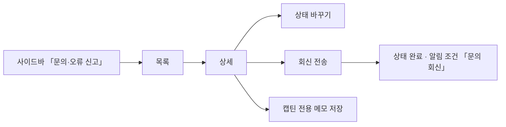

# 캡틴은 유저가 제출한 문의/오류신고를 조회할 수 있다.

기준 프로토타입: 운영 콘솔 › 문의·오류 신고 — https://playground.studyclub.life/proto/console/feedbacks

## 1. 기본설명

크루가 「내 문의」에서 보낸 문의 · 개선 의견 · 오류 신고를 캡틴이 보고, 상태를 바꾸고, 회신하는 자리다
([크루 제출](../crew-submit-feedback/PRD.md)).

- 사이드바 「문의·오류 신고」(말풍선) — 공지 아래, 알림 위
- 회신하면 제출자가 내 문의에서 본다. 제출자에게 알리는 일은 **알림 조건 「문의 회신」**이 맡는다 — 템플릿이 등록돼 있으면 그 문구로 메일이 나가고 발송 이력에 쌓인다
- 캡틴 전용 메모는 제출자에게 보이지 않는다

### 진입·사용 흐름

### 완료 기준

1. 목록 — 접수 시각 · 유형 · 제목 · 제출자 · 상태 · 완료 처리자. 접수 시각 내림차순 고정, 20건씩
2. 제목·내용 검색(400ms 뒤) · 유형 · 상태로 거른다. 무엇이든 바꾸면 1페이지
3. 줄을 누르면 상세 — 유형 · 제목 · 제출자 · 접수 시각 · 내용 · 첨부 이미지 · 브라우저 · 화면 크기
4. 상태 — 상세의 상태 뱃지가 곧 드롭다운. 미확인 · 확인 · 완료, 고르면 바로 저장
5. 회신 — 10~2000자, 「전송」하면 저장 + 상태 「완료」. 회신 뒤에는 읽기 전용과 「수정」
6. 캡틴 전용 메모 — 저장 버튼으로 저장, 제출자에게 보이지 않음
7. 완료 처리자 — 「완료」로 바꾼 캡틴. 완료가 아니면 비어 있음
8. 회신 알림 — 알림 조건 「문의 회신」으로 템플릿 · 발송 이력에 연결

---

## 2. 화면명세

> **화면**: 운영 콘솔 › 문의·오류 신고 목록 · 상세.
>
> 아래 번호별 명세는 프로토의 **설명 보기**에서 그대로 가져온다. 손으로 고치지 않는다 —
> 고치려면 화면 옆 `spec.ts` 를 고치고 `pnpm --filter playground export-specs` 를 돌린다.

<!-- spec:start feedback-admin -->

> 사용자 사이트 「내 문의」에서 보낸 문의·오류 신고가 여기로 쌓인다. 로그인한 사람만 보낸다. 프로토는 이 브라우저에서 보낸 것도 함께 보인다
>
> 사이드바 「문의·오류 신고」(말풍선) — 공지 아래, 알림 위
>
> 회신하면 제출자가 「내 문의」에서 본다. 제출자에게는 상태가 접수 · 답변 완료 둘로만 보인다
>
> 미구현 — 테이블·API 가 없다. 지금은 화면 상태로만 처리한다

### 1 — 검색 · 거르는 칸

- **내용**: 제목·내용 검색 · 유형 · 상태. 오른쪽 끝에 「총 n건」
- **동작**
  - 검색은 입력을 멈추고 400ms 뒤에 건다
  - 무엇이든 바꾸면 1페이지로 간다
- **정책**: 고르기 전에는 축 이름만 보인다. 하나 고르면 첫 줄이 「전체」로 바뀐다 (POL-0008)

### 2 — 목록

- **내용**: 접수 시각 · 유형(뱃지) · 제목 · 제출자 · 상태(뱃지) · 완료 처리자. 20건씩
- **동작**
  - 접수 시각 내림차순 고정 — 열 머리를 눌러 정렬하지 않는다
  - 줄 어디를 눌러도 상세
- **정책**
  - 제목은 한 줄로 자르고, 가리키면 전체 제목이 뜬다
  - 제출자 — 늘 닉네임이 있다(로그인해야 보낸다). 탈퇴했으면 「탈퇴한 사용자」
  - 완료 처리자 — 「완료」로 바꾼 캡틴(회신 전송이든 상태 변경이든). 완료가 아니면 —
  - 상태 뱃지 — 미확인 회색 · 확인 파랑 · 완료 초록. 색만으로 가르지 않고 문구를 늘 붙인다
  - 없으면 「접수된 문의·오류 신고가 없습니다」, 걸러서 없으면 「조건에 맞는 문의·오류 신고가 없습니다」 + 전체 보기
  - 불러오는 동안 20줄 자리표시. 조회 실패를 0건으로 보이지 않는다
- **데이터**: `GET /api/admin/feedbacks` — 미구현. 캡틴 전용

#### 2-1 — 페이지 넘김

- **내용**: 다른 콘솔 목록과 같은 페이지 번호
- **동작**: 한 페이지에 다 들어가면 번호를 보이지 않는다

### 3 — 상태

- **내용**: 상세 머리 오른쪽 상태 뱃지가 곧 드롭다운 — 누르면 미확인 · 확인 · 완료 뱃지가 펼쳐진다
- **동작**
  - 고르면 바로 저장 — 확인 창 없음. 「상태를 변경했습니다」
  - 실패하면 이전 값으로 돌아가고 다시 시도
- **데이터**: `PATCH /api/admin/feedbacks/{id}` — 미구현

### 4 — 제출 환경

- **내용**: 브라우저(예: Chrome 131 · macOS) · 화면 크기. 묶음 제목은 두지 않는다
- **정책**
  - 제출자가 입력한 값이 아니다 — 보낼 때 함께 실려 온다
  - 화면 경로는 모으지 않는다 — 내 문의 목록을 거쳐 쓰므로 문제의 화면을 가리키지 않는다

### 7 — 회신

- **내용**: 캡틴 전용 메모 위. 유형과 상관없이 모든 건에 있다. 10~2000자
- **동작**
  - 「전송」 — 확인 창 없이 바로. 회신 저장 + 상태 「완료」. 「회신을 보냈습니다」
  - 회신한 뒤에는 읽기 전용과 「수정」. 고치는 것은 새 회신이 아니다 — 알림이 다시 나가지 않는다
  - 실패하면 입력을 남기고 「회신을 보내지 못했습니다」 + 다시 시도
- **정책**: 제출자에게 알리는 일은 알림이 맡는다 — 알림 조건 「문의 회신」에 템플릿이 등록돼 있으면 그 문구로 나간다(발송 이력에 쌓인다)
- **데이터**: `PATCH /api/admin/feedbacks/{id}` 의 `reply` — 미구현

### 5 — 캡틴 전용 메모

- **내용**: 여러 줄 입력 · 저장. 비어 있을 때 칸 안에 「내부용 — 제출자에게 보이지 않습니다」
- **동작**: 저장을 눌러야 저장된다. 「저장했습니다」
- **정책**: **내부용** — 제출자에게 보이지 않는다
- **데이터**: `PATCH /api/admin/feedbacks/{id}` — 미구현

### 6 — 첨부 이미지

- **내용**: 본문 아래 썸네일. 묶음 제목은 두지 않는다. 첨부가 없으면 칸을 두지 않는다
- **동작**: 누르면 크게 본다
- **데이터**: 업로드 fileId (STORAGE_OBJECT) — 미구현

<!-- spec:end feedback-admin -->

### 상태별 화면

| 상태 | 화면 | 카피 |
| --- | --- | --- |
| 불러오는 중 | 표 자리 20줄 스켈레톤 | — |
| 접수 없음 | 빈 표 | `접수된 문의·오류 신고가 없습니다.` |
| 걸러서 없음 | 빈 표와 전체 보기 | `조건에 맞는 문의·오류 신고가 없습니다.` · `전체 보기` |
| 목록 오류 | 안내와 다시 시도 — 0건으로 보이지 않는다 | `불러오지 못했습니다. 다시 시도해 주세요.` |
| 상태 변경 | 초록 알림 / 실패 시 이전 값으로 되돌림 | `상태를 변경했습니다.` / `상태를 변경하지 못했습니다. 다시 시도해 주세요.` |
| 회신 전송 | 초록 알림 / 실패 시 입력 유지 | `회신을 보냈습니다.` / `회신을 보내지 못했습니다. 다시 시도해 주세요.` |
| 메모 저장 | 초록 알림 / 실패 | `저장했습니다.` / `저장하지 못했습니다. 다시 시도해 주세요.` |
| 상세 없음 | 삭제되었거나 없는 건 | `삭제되었거나 없는 문의·오류 신고입니다.` |

---

## 3. 시스템 요건

### 개발 범위

> 2026-10-19 `beta` 기준. **지금 → 할 일**만 적는다.

| 구분 | 대상 | 지금 | 할 일 |
|---|---|---|---|
| FE | back-office-front 사이드바 「문의·오류 신고」 | 없음 | 공지 아래, 알림 위. 말풍선 아이콘 (완료 기준 1) |
| FE | back-office-front `/feedbacks` 목록 · `/feedbacks/{id}` 상세 | 없음 | 프로토 `proto/console/feedbacks` 대로 (완료 기준 1~7) |
| FE | 알림 조건 「문의 회신」 | 구현완료 — 템플릿 조건·변수 안내·마지막 템플릿 삭제 영향·발송 이력 라벨 | 없음 |
| BE | `GET /api/admin/feedbacks(/{id})` · `PATCH /api/admin/feedbacks/{id}` | 없음 · **스펙 없음** | 스펙 → 구현. 아래 표 |
| BE | 알림 이벤트 `FEEDBACK_REPLIED` | 구현완료 — 첫 회신과 발송 예약을 같은 트랜잭션으로 저장. 등록된 템플릿마다 메일 발송. 회신 수정은 발행하지 않음 | 없음. stage 템플릿 시드·사이트 주소 설정은 [메일 가이드](../../../docs/mail-templates/README.md#문의-회신-배포) |

- **범위 밖** — 이전·다음 건 이동 · 대시보드 미확인 수 · 상세 진입 시 자동 「확인」

### API

| 메서드 | 경로 | 설명 |
|---|---|---|
| GET | `/api/admin/feedbacks` | 목록 — type · status · q · offset · limit. items(id · createdAt · type · title · submitterNickname · status · doneBy) · total |
| GET | `/api/admin/feedbacks/{id}` | 상세 — 목록 항목 + content · images · userAgent(파싱) · viewport · reply · adminMemo |
| PATCH | `/api/admin/feedbacks/{id}` | status · reply · adminMemo 중 하나. 완료로 바꾼 캡틴을 doneBy 로 남기고, 완료에서 벗어나면 비운다. 첫 reply 는 status 를 완료로 바꾸고 알림 이벤트를 낸다 |

- 권한: `/api/admin/**` 는 캡틴 ([POL-0001](../../_registry/policies/POL-0001-roles.md)). 서버가 검증한다

### 처리

| 경우 | 처리 |
|---|---|
| 제출자 탈퇴 | 제출자 자리에 「탈퇴한 사용자」 |
| 내용에 HTML | 문자 그대로 출력 |
| 회신 수정 | 내용만 바뀐다 — 보낸 시각 유지, 알림 다시 나가지 않음 |
| 삭제 | 소프트 삭제 — 목록·상세에서 빠지고 상세 직접 접근은 404 |
