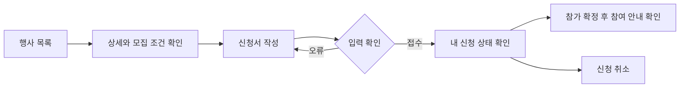

# 크루는 행사에 신청하고 참가 확정 상태를 확인할 수 있다.

기준 프로토타입: 사용자 사이트 행사 목록·상세·신청

## 1. 기본설명

1. 행사 소개·참여 방식·정원·신청 마감 확인
2. 기준 시간대와 현지 시각 확인
3. 참여 방식 선택 및 추가 질문 응답
4. 자동 확정·확인 대기 상태 구분과 내 신청서 조회
5. 참가 확정 후 참여 안내 확인
6. 신청 마감 전 취소와 잔여석 반영

## 2. 화면명세

<!-- spec:start event-apply -->

### 1 — 행사 둘러보기

- **조건**: 행사 목록 화면
- **내용**: 예정된 행사·지난 행사 탭과 각 행사 수, 행사 유형 소개와 참가자 후기
- **동작**: 기본은 예정된 행사 탭. 지난 행사 탭에서 종료·취소 행사와 기존 행사 기록을 날짜 최신순으로 함께 정렬한 한 목록으로 조회
- **데이터**: 공개된 행사·기존 행사 기록

#### 1-1 — 행사 목록

- **조건**: 행사 목록 화면
- **내용**: 날짜 카드·행사명·소개·온라인·오프라인·동시 진행 중 하나의 참여 형태·모집 상태·내 신청 상태
- **동작**: 현재 행사와 상세 정보가 있는 기존 기록은 상세로 이동. 상세 정보가 없는 기존 행사 기록은 목록에서만 표시
- **정책**
  - 작성 중 행사는 공개 목록에서 제외
  - 모집 중·모집 마감·정원 마감·진행 중은 예정된 행사, 종료·행사 취소는 지난 행사로 분류
  - 종료 미입력 행사는 행사 기준 시간대에서 시작일이 지나면 지난 행사로 이동
  - 날짜만 있는 기존 행사 기록은 사용자 시간대와 무관하게 원래 날짜를 유지
  - 모집 중에만 새 신청 가능
- **데이터**: 행사 정보·현재 크루 신청 상태

### 2 — 행사 정보

- **조건**: 행사 상세 화면
- **내용**: 모집 상태·행사명·한 줄 소개. 참여 형태는 제목 위가 아니라 일정과 장소 영역에서 표시
- **데이터**: 행사 정보

#### 2-1 — 모집 상세

- **조건**: 행사 상세 화면
- **내용**: 운영진이 작성한 행사 소개·참가 조건·추가 절차
- **데이터**: 모집 상세 본문

#### 2-2 — 일정과 장소

- **조건**: 행사 상세 화면
- **내용**: 시작·종료·신청 마감·오프라인 장소·온라인 안내
- **동작**: 로그인한 사용자의 프로필 시간대를 기본 선택하고, 사용자가 선택한 시간대로 시작·종료·신청 마감 변환
- **정책**
  - 사용자 시간대의 서머타임을 반영하고 KST·EST·EDT·PST·PDT 같은 약어로 표시
  - 시간대 변경은 현재 화면의 표시만 바꾸며 프로필 DB 값은 수정하지 않음
  - 종료 미입력 시 시작 시각만 표시
- **데이터**: 절대 시각·행사 기준 시간대·사용자 프로필 시간대·장소

### 3 — 신청 안내

- **조건**: 행사 상세 화면
- **내용**: 참여 방식별 잔여석·정원, 확정 방식 설명, 신청 버튼
- **동작**: 신청 버튼으로 신청 폼 열기
- **정책**
  - 공개·신청 마감 전·선택 방식 잔여석이 있을 때 신청 가능
  - 중복 신청 제한
  - 취소 후에는 모집 중이면 재신청 가능
  - 참가 불가 처리 후 재신청 제한
- **데이터**: 모집 상태·정원·신청 이력

### 4 — 내 신청 내역

- **조건**: 본인 신청 이력이 있을 때
- **내용**: 확인 대기·참가 확정·참가 불가·신청 취소 상태, 참여 방식, 신청서 보기
- **동작**: 신청 마감 전 확인 대기·참가 확정 신청 취소, 확인 창 제공
- **정책**
  - 자동 확정 신청은 바로 참가 확정
  - 운영진 확인 방식은 확인 대기로 접수
  - 운영진 확인 방식의 안내는 참가 확정을 보장하지 않고 참가 가능 여부를 이메일로 안내한다고 표시
  - 운영진이 신청 즉시 확정으로 변경하면 기존 확인 대기 신청도 참가 확정
  - 운영진 확인 방식으로 변경해도 이미 처리된 신청 상태는 유지하고 이후 신청은 확인 대기로 접수
  - 확정 방식 변경은 행사 시작 전까지만 가능
  - 참가 확정자만 온라인 참여 링크 확인
  - 취소 시 자리 반환, 마감 후 취소는 운영진 문의 안내
- **데이터**: 본인 신청·신청 당시 질문과 답변·참여 링크

### 5 — 신청 폼

- **조건**: 신청 창이 열렸을 때
- **내용**: 행사명·참여 방식·추가 질문·확정 방식 안내. 닉네임·이메일 입력란은 표시하지 않음
- **동작**
  - 로그인 계정의 닉네임과 이메일을 신청 정보에 자동으로 포함
  - 필수 응답 검증 후 신청 접수
  - 실패 시 입력값 유지
- **정책**
  - 신청 시 선택 방식의 정원 재확인
  - 로그인 계정의 이메일이 비어 있거나 잘못된 형식이면 신청을 막고 계정 이메일 확인 안내. 예시 이메일로 대체하지 않음
  - 개별 자동 메일과 운영진 안내 메일의 개인별 본문은 신청자 프로필 시간대로 일정 표시. 시간대가 없는 이전 신청은 행사 기준 시간대 사용. 운영진 공통 미리보기는 운영자 시간대 사용
  - 확인 대기도 정원에 포함
  - 신청 당시 질문과 답변 함께 보관
  - 운영진이 질문을 변경하면 이후 신청은 최신 질문을 사용하고 기존 신청은 저장된 질문·답변 유지
- **데이터**: 회원 ID·닉네임·이메일·참여 방식·질문·답변

<!-- spec:end event-apply -->

## 3. 시스템 요건

### 개발 범위

기준: 2026-11-14, beta에서 분기한 행사 플레이그라운드

| 구분 | 대상 | 지금 | 할 일 |
|---|---|---|---|
| 기획 | 행사 신청 흐름 | 플레이그라운드와 화면 설명 | 시안 검토 |
| FE | core-front 행사 | 과거 행사 콘텐츠·외부 링크 표시 | 자체 신청·상태·취소 연결 |
| BE | 행사 조회·본인 신청 API | 행사 API 스펙 없음 | 시안 확정 후 계약 작성·구현 |

### 데이터와 처리 규칙

- 입력: 회원 정보, 행사, 참여 방식, 질문별 답변
- 조회: 공개 행사 정보·참여 방식별 잔여석·본인 신청 상태·신청 당시 질문과 답변
- 자동 확정: 접수 즉시 참가 확정. 운영진이 행사 시작 전 자동 확정으로 변경하면 기존 확인 대기도 참가 확정
- 운영진 확인: 접수 시 확인 대기, 운영진 처리 후 확정 또는 참가 불가. 이미 처리된 신청은 방식 변경으로 되돌리지 않음
- 정원 계산은 확인 대기와 참가 확정 합. 선택 방식 정원 재검사 및 동일 회원의 중복 신청 제한
- 신청 마감 시각부터 신청·본인 취소 제한. 모집 마감 전 취소 자리 재모집
- 신청 질문 변경 후 새 신청은 최신 질문을 사용하고 기존 신청 조회는 신청 당시 질문과 답변 사용
- 참가 확정자의 온라인 참여 링크 조회. 링크 미입력 시 추후 안내 문구 표시
- 실제 서비스에서 로그인 확인, 본인 신청 조회·취소 권한, 확정자 링크 접근을 서버에서 검증
- 플레이그라운드는 예시 회원 사용, 실제 신청 저장·메일 발송 미연동
- 구현 범위 밖: 비회원 신청·답변 수정·결제·환불·자동 리마인드

참고: [Luma 신청 흐름](https://help.luma.com/p/event-registration-process)
