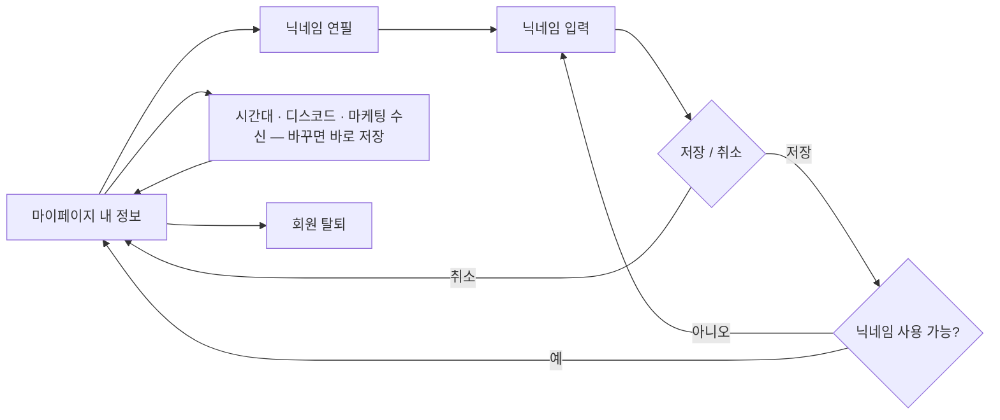
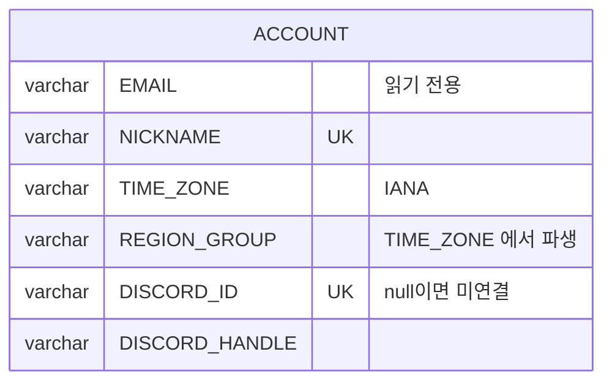

# 크루는 프로필을 수정할 수 있다.

기준 프로토타입: 마이페이지 (playground 사용자 사이트 · 마이페이지 내 정보)

## 1. 기본설명

· **진입·사용 흐름**

· **완료 기준**

1. 마이페이지에서 닉네임·이메일·시간대·디스코드 연결 상태·마케팅 수신 조회
2. 줄마다 따로 저장 — 닉네임만 입력 후 저장, 시간대·디스코드·마케팅 수신은 바꾸면 바로 저장
3. 닉네임은 가입과 같은 규칙으로 검사 — 자기 현재 닉네임은 중복 아님
4. 쓸 수 없는 값이거나 확인 중이면 닉네임 저장 차단
5. 저장 시 즉시 반영 및 저장 표시
6. 닉네임 취소 시 수정값 폐기
7. 디스코드 연결·해제
8. 이메일 수정 불가
9. 회원 탈퇴 지면으로 이동

## 2. 화면명세

> **화면**: 마이페이지 — 내 정보

### 1. 내 정보

- **내용**: 닉네임 · 이메일, 그 아래 시간대 · 디스코드 · 마케팅 수신 줄
- **동작**: 줄마다 스스로 저장된다. 카드 전체를 편집 상태로 바꾸지 않는다
- **정책**
  - 닉네임만 확정 단계가 있다 — 형식·중복 검사가 있어서다. 나머지는 잘못 들어갈 값이 없어 바꾸면 바로 저장된다
  - 카드 전체를 편집 상태로 바꾸면 저장 버튼을 기다리는 값과 즉시 저장되는 값이 한 카드에 섞인다
  - 이름은 왼쪽, 값과 바꾸는 손은 오른쪽으로 모은다
  - 바로 저장된 줄은 이름 옆에 잠깐 「저장됨」을 띄운다
  - 이메일은 읽기 전용이다
- **데이터**: `ACCOUNT.NICKNAME` · `ACCOUNT.EMAIL` · `ACCOUNT.TIME_ZONE` · `ACCOUNT.DISCORD_ID`·`DISCORD_HANDLE` · `ACCOUNT_CONSENT.MARKETING`

### 1-1. 닉네임 고치기

- **내용**: 닉네임 바로 옆 연필. 짚으면 「닉네임 수정」
- **동작**: 누르면 닉네임 줄만 입력칸이 된다
- **정책**: 고치는 자리는 고칠 값 바로 옆이다 — 카드 모서리에 두면 무엇을 고치는지 읽히지 않는다

### 2. 닉네임

- **내용**
  - 지금 닉네임
  - 현재 글자수와 상한 · 취소 · 저장
  - 한 줄로 규칙 또는 지금 값의 상태
- **동작**
  - 한글 조합 중에는 검사하지 않는다
  - 형식을 먼저 보고, 형식이 맞으면 중복을 묻는다
  - 쓸 수 없는 값이거나 확인 중이면 저장이 눌리지 않는다. Enter 는 저장, Esc 는 취소
  - 저장하면 닉네임 줄로 돌아가고 값이 바로 반영된다. 취소하면 고친 값을 버린다
- **정책**
  - 규칙은 가입과 같다 — [crew-google-login-onboarding](../crew-google-login-onboarding/PRD.md) 닉네임 참조
  - 지금 쓰는 내 닉네임과 같은 값은 중복으로 보지 않는다
  - 상태 문구는 이메일 줄 자리를 바꿔 쓴다. 아래 요소가 밀리지 않는다
- **데이터**: 비교값은 앞뒤 공백 제거 → NFC → 소문자. 저장값은 입력 그대로. `PATCH /api/me` 에 시간대는 지금 값을 같이 보낸다
- **조건**: 닉네임을 고칠 때

### 3. 시간대

- **내용**: 고르는 자리가 늘 열려 있다
- **동작**: 고르면 바로 저장된다
- **정책**
  - 선택지는 가입과 같다: 한국 · 서울 / 북미 동부 / 북미 서부
  - 이 값이 거주 지역이고, 반을 가르는 단위다
- **데이터**: `ACCOUNT.TIME_ZONE` (IANA id). 지역(`REGION_GROUP`)은 여기서 파생한다. `PATCH /api/me` 에 닉네임은 지금 값을 같이 보낸다

### 4. 디스코드

- **내용**: 연결됐으면 디스코드 계정 이름과 연결 해제, 아니면 「연결 안 됨」과 연결하기
- **동작**: 누르면 바로 연결·해제된다
- **데이터**: `ACCOUNT.DISCORD_ID` · `ACCOUNT.DISCORD_HANDLE` (선택 수집 항목)

### 5. 마케팅 수신

- **내용**: 동의 여부를 체크 상태로 표시
- **동작**: 누르면 바로 저장. 실패 시 이전 값 복귀 및 사유 표시
- **정책**
  - **가입 때 받는 선택 동의라 끄고 켜는 길이 있어야 한다** — 가입 화면에만 두면 바꿀 수 없다
  - 가입 완료·탈퇴 같은 안내 메일은 이 값과 무관하게 나간다 (처리방침 제2조 · [POL-0009](../../_registry/policies/POL-0009-notification.md))
  - 매체를 함께 적는다 — 지금은 이메일뿐이지만 늘어나면 어느 쪽을 끈 것인지 알아야 한다
- **데이터**: `ACCOUNT_CONSENT.MARKETING`

### 7. 회원 탈퇴

- **내용**: 회원 탈퇴로 가는 링크. 카드 바로 아래
- **동작**: 누르면 탈퇴 지면으로 간다
- **정책**
  - 카드 안 한 줄을 통째로 내주지 않는다 — 링크 하나에 무게가 실린다
  - 찾을 수 있되 주액션보다 드러나지 않는다
- **작업**: 탈퇴 지면은 [crew-leave](../crew-leave/PRD.md)

### 상태별 화면

| 상태 | 화면 | 카피 |
| --- | --- | --- |
| 기본 | 닉네임 · 이메일, 시간대 선택 · 디스코드 · 마케팅 수신 줄 | — |
| 닉네임 편집 | 닉네임 줄만 입력칸 · 취소 · 저장 | — |
| 검증 실패 | 닉네임 상태 줄, 저장 불가 | 형식 오류 · 중복 문구 |
| 처리중 | 닉네임 확인 중, 저장 불가 | 확인 중 |
| 디스코드 미연결 | 디스코드 값 | `연결 안 됨` |
| 마케팅 수신 | 동의 여부를 체크 상태로. 누르면 바로 저장 | `스터디 소식과 행사 안내를 이메일로 받기` |
| 완료 | 새 값 · 이름 옆 저장 표시 | `저장됨` |

### 데이터 관계

### 비고

- 범위 밖: 직함·국가·도시 수정, 이메일 변경
- 프로필 사진: 2026-10-07 결정으로 받는다 — 내 정보 카드에서 올리고 지운다. 정책 [POL-0007](../../_registry/policies/POL-0007-account-data.md), 스펙 [profile-image](../../../specs/profile-image/spec.md). 사진 영역의 위치·문구는 이 PRD 에 아직 없다 (기획 확정 필요)
- 미구현: 저장은 브라우저에만 한다. 저장 API 가 없다

<!-- spec:start profile -->

> 저장은 브라우저에만 한다. 새로고침하면 남지만 서버에는 가지 않는다. 저장 API 가 아직 없다

### 1 — 내 정보

- **내용**: 닉네임과 이메일, 그 아래 시간대 · 디스코드 · 마케팅 수신 줄
- **동작**: **줄마다 스스로 저장된다**. 카드 전체를 편집 상태로 바꾸지 않는다
- **정책**
  - 닉네임만 확정 단계가 있다 — 형식·중복 검사가 있어서다. 나머지는 잘못 들어갈 값이 없어 누르면 바로 저장된다
  - 카드 전체를 편집 상태로 바꾸면 저장 버튼을 기다리는 값과 즉시 저장되는 값이 한 카드에 섞인다
  - 이름은 왼쪽, 값과 바꾸는 손은 오른쪽으로 모은다. 고칠 값이 넷뿐이라 페이지 폭을 다 쓰지 않는다
  - 바로 저장된 줄은 이름 옆에 잠깐 「저장됨」을 띄운다 — 저장 버튼이 없는 줄도 저장됐는지 알 수 있게
- **데이터**: 닉네임 · 이메일 · 시간대 · 디스코드 연결 상태 · 마케팅 수신 동의

#### 1-1 — 닉네임 고치기

- **내용**: 닉네임 바로 옆 연필. 짚어 보면 「닉네임 수정」
- **동작**: 누르면 닉네임 줄만 입력칸이 된다
- **정책**: 고치는 자리는 고칠 값 바로 옆이다. 카드 모서리에 두면 무엇을 고치는지 읽히지 않는다

### 2 — 닉네임

- **조건**: 닉네임을 고칠 때
- **내용**: 밑줄 입력칸 · 글자수/상한 · 취소 · 저장. 그 아래 한 줄로 규칙 또는 지금 값의 상태
- **동작**
  - **가입 때와 같은 규칙으로 검사한다**. 형식도 중복도
  - 지금 쓰고 있는 이름은 중복으로 보지 않는다. 자기 이름을 자기가 쓰고 있을 뿐이다
  - 한글 조합 중에는 검사하지 않는다
  - 쓸 수 없는 값이거나 확인 중이면 저장이 눌리지 않는다. Enter 는 저장, Esc 는 취소
- **정책**
  - 같은 이름을 가입에서는 막고 여기서는 받으면 두 화면이 다른 말을 하게 된다
  - 이메일 줄 자리를 상태 문구로 바꾼다. 줄을 더하면 아래가 밀린다
- **데이터**
  - 비교값은 앞뒤 공백 제거 → NFC → 소문자. 저장값은 입력 그대로
  - `PATCH /api/me` — 시간대는 지금 값을 같이 보낸다

### 3 — 시간대

- **내용**: 고르는 자리가 늘 열려 있다
- **동작**: 고르면 바로 저장된다
- **정책**
  - 가입 때와 같은 선택지다. 한국 · 서울 / 북미 동부 / 북미 서부
  - 이 값이 곧 거주 지역이고, 반이 갈리는 단위다
- **데이터**
  - IANA 시간대 id. 지역 값은 여기서 파생한다
  - `PATCH /api/me` — 닉네임은 지금 값을 같이 보낸다

### 4 — 디스코드

- **내용**: 연결됐으면 계정 이름과 연결 해제, 아니면 연결 안 됨과 연결하기
- **동작**: 누르면 바로 연결·해제된다
- **정책**: 스터디가 디스코드에서 굴러가므로 연결 여부는 회원이 바로 알아야 한다
- **데이터**: 디스코드 계정 식별자 및 사용자명 (선택 수집 항목)

### 5 — 마케팅 수신

- **내용**: 동의 여부를 체크 상태로 보여준다
- **동작**: 누르면 바로 저장된다. 실패하면 이전 값으로 돌아가고 사유를 보여준다
- **정책**
  - **가입 때 받는 선택 동의라 끄고 켜는 길이 있어야 한다**. 가입 화면에만 두면 바꿀 수 없다
  - 가입 완료·탈퇴 같은 안내 메일은 이 값과 무관하게 나간다 (처리방침 제2조)
  - 매체를 함께 적는다. 지금은 이메일뿐이지만, 늘어나면 어느 쪽을 끈 것인지 알아야 한다
- **데이터**: `ACCOUNT_CONSENT.MARKETING`: 미구현. 지금은 브라우저에만 저장한다

### 7 — 회원 탈퇴

- **내용**: 카드 바로 아래 왼쪽, 작은 글씨
- **동작**: 누르면 탈퇴 지면으로 간다
- **정책**
  - 카드 안 한 줄을 통째로 내주지 않는다. 링크 하나에 무게가 실린다
  - 찾을 수 있되 눈에 띄지 않아야 한다

<!-- spec:end profile -->

## 3. 시스템 요건

### 개발 범위

> 2026-10-14 `beta` 기준. **지금 → 할 일**만 적는다. 다 끝나면 「할 일」이 모두 「없음」이 된다.
> FE 「지금」은 실제 앱의 화면과 데이터 연결(API · mock)까지 본 값이다 — 완료 기준 하나하나의 동작은 따로 확인하지 않았다.
> BE 「지금」은 스펙 엔드포인트 표의 상태 칸을 옮겨 적는다.

| 구분 | 대상 | 지금 | 할 일 |
|---|---|---|---|
| FE | core-front `/my` 내 정보 (`ProfileCard`) | 있음 — 닉네임 · 시간대 저장, 마케팅 수신 API 연결 | 디스코드 칸 (아래 API 가 생기면) |
| BE | `PATCH /api/me` · 마케팅 수신 `GET` · `PUT` | 있음 · 엔드포인트 표가 있는 스펙 없음 | [profile-edit 스펙](../../../specs/profile-edit/spec.md)에 표를 둔다 |
| BE | `POST /api/me/discord/link` | 스펙작성중 · 컨트롤러 없음 | [crew-submit-application](../crew-submit-application/PRD.md#개발-범위)과 같은 일 |

### 데이터

| 필드 | 쓰기 | 제약 |
| --- | --- | --- |
| NICKNAME | O | 가입과 같은 형식. 정규화 값 기준 유일 |
| TIME_ZONE | O | 한국 · 북미 동부 · 북미 서부의 IANA id 중 하나 |
| REGION_GROUP | 서버 계산 | TIME_ZONE 에서 파생. 클라이언트가 보내지 않는다 |
| MARKETING_CONSENT | O | 선택 동의. 끄고 켤 수 있다. 안내 메일은 이 값과 무관하게 나간다 |
| DISCORD_ID, DISCORD_HANDLE | 연동 흐름으로만 | 연결 해제 시 null |
| EMAIL | X | 읽기 전용 |

### 처리

- 저장은 바뀐 필드만 받는다
- 닉네임 중복은 저장 시 서버가 다시 판정한다. 본인 계정은 비교 대상에서 뺀다
- 실패 응답: 400 형식 · 409 중복 · 401 세션 만료. 실패해도 입력값은 화면에 남긴다

### API

| 메서드 | 경로 | 권한 |
| --- | --- | --- |
| GET | `/auth/me` | 로그인 |
| GET | `/api/nicknames/availability` | 로그인 |
| PATCH | 프로필 저장 — 미정 | 로그인 본인 |
| POST | `/api/me/discord/link` | 로그인 본인 |

디스코드 연동 계약은 [study-application/spec.md](../../../specs/study-application/spec.md).

### 권한

- 본인만 자기 프로필을 고친다. 서버에서 토큰의 계정으로만 저장한다

### 외부 연동

- Discord OAuth: 연결 실패 시 연결 안 됨 상태를 유지하고 다시 시도할 수 있다

## 4. 비고

- **미구현** — 프로필 저장 API. 프로토는 브라우저에만 저장한다
- **미구현** — 디스코드 연결 해제 API
