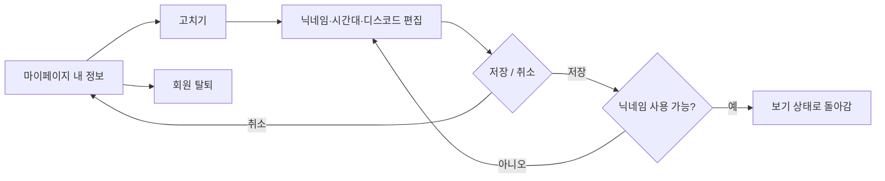
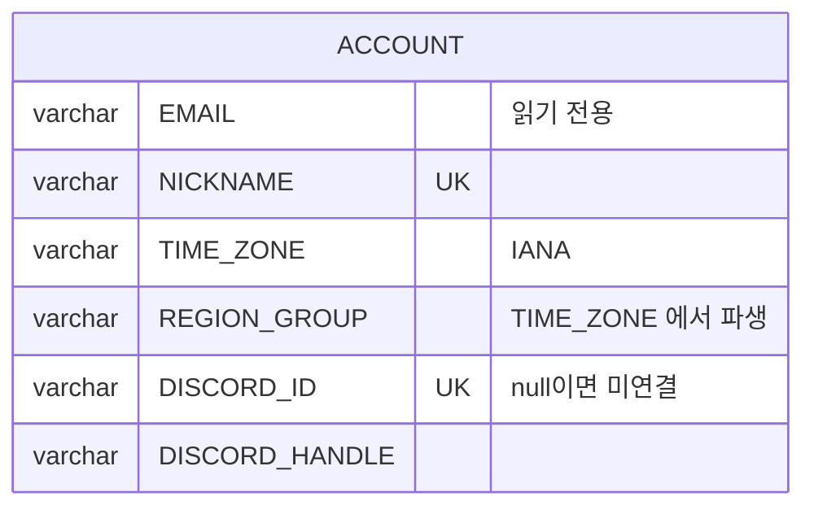

# 크루는 프로필을 수정할 수 있다.

기준 프로토타입: 마이페이지 (playground 사용자 사이트 · 마이페이지 내 정보)

## 1. 기본설명

· **진입·사용 흐름**

· **완료 기준**

1. 마이페이지에서 닉네임·이메일·시간대·디스코드 연결 상태 조회
2. 같은 자리에서 닉네임·시간대·디스코드·마케팅 수신 한 번에 수정
3. 닉네임은 가입과 같은 규칙으로 검사 — 자기 현재 닉네임은 중복 아님
4. 쓸 수 없는 값이거나 확인 중이면 저장 차단
5. 저장 시 보기 상태로 복귀 및 즉시 반영
6. 취소 시 수정값 폐기
7. 디스코드 연결·해제
8. 이메일 수정 불가
9. 회원 탈퇴 지면으로 이동

## 2. 화면명세

> **화면**: 마이페이지 — 내 정보

### 1. 내 정보

- **내용**: 닉네임 · 이메일 · 시간대 · 디스코드 연결 상태
- **동작**: 고치기 전에는 값만 보인다. 고치기를 누르면 같은 자리에 입력 수단이 들어선다
- **정책**
  - 보기와 편집은 같은 카드 안에서 바뀐다. 다른 지면으로 가지 않는다
  - 이메일은 읽기 전용이다
- **데이터**: `ACCOUNT.NICKNAME` · `ACCOUNT.EMAIL` · `ACCOUNT.TIME_ZONE` · `ACCOUNT.DISCORD_ID`·`DISCORD_HANDLE`

### 1-1. 고치기

- **내용**: 편집을 시작하는 자리. 무엇을 고치는지 짚으면 알려 준다
- **동작**
  - 누르면 카드 전체가 편집 상태가 된다
  - 편집 중에는 이 자리가 보이지 않는다
- **정책**: 값마다 따로 고치지 않는다. 한 번에 고치고 한 번에 저장한다

### 2. 닉네임

- **내용**
  - 지금 닉네임
  - 현재 글자수와 상한
  - 한 줄로 규칙 또는 지금 값의 상태
- **동작**
  - 한글 조합 중에는 검사하지 않는다
  - 형식을 먼저 보고, 형식이 맞으면 중복을 묻는다
- **정책**
  - 규칙은 가입과 같다 — [crew-google-login-onboarding](../crew-google-login-onboarding/PRD.md) 닉네임 참조
  - 지금 쓰는 내 닉네임과 같은 값은 중복으로 보지 않는다
  - 상태 문구는 도움말 자리를 바꿔 쓴다. 아래 요소가 밀리지 않는다
- **데이터**: 비교값은 앞뒤 공백 제거 → NFC → 소문자. 저장값은 입력 그대로
- **조건**: 편집 상태일 때

### 3. 시간대

- **내용**: 고른 지역. 편집 상태에서는 고르는 자리가 된다
- **정책**
  - 선택지는 가입과 같다: 한국 · 서울 / 북미 동부 / 북미 서부
  - 이 값이 거주 지역이고, 반을 가르는 단위다
- **데이터**: `ACCOUNT.TIME_ZONE` (IANA id). 지역(`REGION_GROUP`)은 여기서 파생한다

### 4. 디스코드

- **내용**: 연결됐으면 디스코드 계정 이름, 아니면 「연결 안 됨」
- **동작**: 편집 상태에서만 연결하기 · 연결 해제가 보인다
- **데이터**: `ACCOUNT.DISCORD_ID` · `ACCOUNT.DISCORD_HANDLE` (선택 수집 항목)

### 5. 마케팅 수신

- **내용**: 받는지 아닌지와 어느 매체로 받는지. 편집 상태에서는 켜고 끄는 자리
- **동작**: 저장을 눌러야 바뀐다 — 켜자마자 반영하지 않는다. 같은 카드의 다른 값과 함께 움직인다
- **정책**
  - **가입 때 받는 선택 동의라 끄고 켜는 길이 있어야 한다** — 가입 화면에만 두면 바꿀 수 없다
  - 가입 완료·탈퇴 같은 안내 메일은 이 값과 무관하게 나간다 (처리방침 제2조 · [POL-0009](../../_registry/policies/POL-0009-notification.md))
  - 매체를 함께 적는다 — 지금은 이메일뿐이지만 늘어나면 어느 쪽을 끈 것인지 알아야 한다
- **데이터**: `ACCOUNT_CONSENT.MARKETING`

### 6. 저장 · 취소

- **동작**
  - 저장 → 보기 상태로 돌아가고 값이 바로 반영된다
  - 닉네임이 쓸 수 없는 값이거나 확인 중이면 저장이 눌리지 않는다
  - 취소 → 고친 값을 버리고 보기 상태로 돌아간다
- **조건**: 편집 상태일 때

### 7. 회원 탈퇴

- **내용**: 회원 탈퇴로 가는 링크
- **동작**: 누르면 탈퇴 지면으로 간다
- **정책**
  - 보기·편집 어느 상태에서도 같은 자리에 있다
  - 찾을 수 있되 주액션보다 드러나지 않는다
- **작업**: 탈퇴 지면은 [crew-leave](../crew-leave/PRD.md)

### 상태별 화면

| 상태 | 화면 | 카피 |
| --- | --- | --- |
| 기본 | 값만 보이는 카드 | — |
| 편집 | 입력 수단이 들어선 카드 · 저장 · 취소 | — |
| 검증 실패 | 닉네임 상태 줄, 저장 불가 | 형식 오류 · 중복 문구 |
| 처리중 | 닉네임 확인 중, 저장 불가 | 확인 중 |
| 디스코드 미연결 | 디스코드 값 | `연결 안 됨` |
| 마케팅 수신 — 보기 | 받는지 아닌지와 매체 | `받음 · 이메일` / `받지 않음` |
| 마케팅 수신 — 편집 | 켜고 끄는 자리 | `스터디 소식과 행사 안내를 이메일로 받기` |
| 완료 | 보기 상태, 새 값 | — |

### 데이터 관계

### 비고

- 범위 밖: 프로필 사진·직함·국가·도시 수정, 이메일 변경
- 미구현: 저장은 브라우저에만 한다. 저장 API 가 없다

<!-- spec:start profile -->

> 저장은 브라우저에만 한다. 새로고침하면 남지만 서버에는 가지 않는다 — 저장 API 가 아직 없다

### 1 — 내 정보

- **내용**: 닉네임과 이메일, 그 아래 시간대 · 디스코드
- **동작**: 고치기 전에는 값만 보이고, 고치기 시작하면 같은 자리에 입력 수단이 들어선다
- **정책**
  - **보는 것과 고치는 것이 한 카드 안에서 바뀐다** — 고칠 것이 셋뿐이라 지면을 옮길 일이 아니다
  - 이름과 값을 두 줄로 세운다 — 칸을 나눠 담으면 값 셋이 표처럼 보인다
- **데이터**: 닉네임 · 이메일 · 시간대 · 디스코드 연결 상태

#### 1-1 — 고치기

- **내용**: 연필 하나. 짚어 보면 무엇을 고치는지 알려준다
- **동작**: 누르면 카드 전체가 편집 상태가 된다. 편집 중에는 이 자리가 비워진다
- **정책**: 값마다 따로 고치지 않는다 — 한 번에 고치고 한 번에 저장한다

### 2 — 닉네임

- **조건**: 편집 상태일 때
- **내용**: 지금 닉네임. 오른쪽 위에 글자수 / 상한. 그 아래 한 줄로 규칙 또는 지금 값의 상태
- **동작**
  - **가입 때와 같은 규칙으로 검사한다** — 형식도 중복도
  - 지금 쓰고 있는 이름은 중복으로 보지 않는다 — 자기 이름을 자기가 쓰고 있을 뿐이다
  - 한글 조합 중에는 검사하지 않는다
- **정책**
  - 같은 이름을 가입에서는 막고 여기서는 받으면 두 화면이 다른 말을 하게 된다
  - 도움말 자리를 상태 문구로 바꾼다 — 줄을 더하면 아래가 밀린다
- **데이터**: 비교값은 앞뒤 공백 제거 → NFC → 소문자. 저장값은 입력 그대로

### 3 — 시간대

- **내용**: 고른 지역. 편집 상태에서는 고르는 자리가 된다
- **정책**
  - 가입 때와 같은 선택지다 — 한국 · 서울 / 북미 동부 / 북미 서부
  - 이 값이 곧 거주 지역이고, 반이 갈리는 단위다
- **데이터**: IANA 시간대 id. 지역 값은 여기서 파생한다

### 4 — 디스코드

- **내용**: 연결됐으면 계정 이름, 아니면 연결 안 됨
- **동작**: 편집 상태에서만 연결하기 · 연결 해제가 함께 나온다
- **정책**: 스터디가 디스코드에서 굴러가므로 연결 여부는 회원이 바로 알아야 한다
- **데이터**: 디스코드 계정 식별자 및 사용자명 (선택 수집 항목)

### 5 — 마케팅 수신

- **내용**: 받는지 아닌지와 어느 매체로 받는지. 편집 상태에서는 켜고 끄는 자리
- **동작**: 저장을 눌러야 바뀐다 — 켜자마자 반영하지 않는다. 같은 카드의 다른 값과 함께 움직인다
- **정책**
  - **가입 때 받는 선택 동의라 끄고 켜는 길이 있어야 한다** — 가입 화면에만 두면 바꿀 수 없다
  - 가입 완료·탈퇴 같은 안내 메일은 이 값과 무관하게 나간다 (처리방침 제2조)
  - 매체를 함께 적는다 — 지금은 이메일뿐이지만, 늘어나면 어느 쪽을 끈 것인지 알아야 한다
- **데이터**: `ACCOUNT_CONSENT.MARKETING` — 미구현. 지금은 브라우저에만 저장한다

### 6 — 저장 · 취소

- **조건**: 편집 상태일 때
- **동작**
  - 저장하면 카드가 보기 상태로 돌아가고 값이 바로 반영된다
  - 닉네임이 쓸 수 없는 값이거나 확인 중이면 저장이 눌리지 않는다
  - 취소하면 고친 것이 버려진다
- **정책**: 주액션은 줄의 오른쪽 끝에 둔다

### 7 — 회원 탈퇴

- **내용**: 카드를 닫는 줄 왼쪽 끝
- **동작**: 누르면 탈퇴 지면으로 간다
- **정책**
  - 보기든 편집이든 자리를 지킨다 — 모드에 따라 옮기면 같은 링크를 눈이 두 번 찾는다
  - 찾을 수 있되 눈에 띄지 않아야 한다

<!-- spec:end profile -->

## 3. 시스템 요건

### 데이터

| 필드 | 쓰기 | 제약 |
| --- | --- | --- |
| NICKNAME | O | 가입과 같은 형식. 정규화 값 기준 유일 |
| TIME_ZONE | O | 한국 · 북미 동부 · 북미 서부의 IANA id 중 하나 |
| REGION_GROUP | 서버 계산 | TIME_ZONE 에서 파생. 클라이언트가 보내지 않는다 |
| MARKETING_CONSENT | O | 선택 동의. 끄고 켤 수 있다. 안내 메일은 이 값과 무관하게 나간다 |
| DISCORD_ID, DISCORD_HANDLE | 연동 흐름으로만 | 연결 해제 시 null |
| EMAIL | X | 읽기 전용 |

### 처리

- 저장은 바뀐 필드만 받는다
- 닉네임 중복은 저장 시 서버가 다시 판정한다. 본인 계정은 비교 대상에서 뺀다
- 실패 응답: 400 형식 · 409 중복 · 401 세션 만료. 실패해도 입력값은 화면에 남긴다

### API

| 메서드 | 경로 | 권한 |
| --- | --- | --- |
| GET | `/auth/me` | 로그인 |
| GET | `/api/nicknames/availability` | 로그인 |
| PATCH | 프로필 저장 — 미정 | 로그인 본인 |
| POST | `/api/me/discord/link` | 로그인 본인 |

디스코드 연동 계약은 [study-application/spec.md](../../../specs/study-application/spec.md).

### 권한

- 본인만 자기 프로필을 고친다. 서버에서 토큰의 계정으로만 저장한다

### 외부 연동

- Discord OAuth: 연결 실패 시 연결 안 됨 상태를 유지하고 다시 시도할 수 있다

## 4. 비고

- **미구현** — 프로필 저장 API. 프로토는 브라우저에만 저장한다
- **미구현** — 디스코드 연결 해제 API
