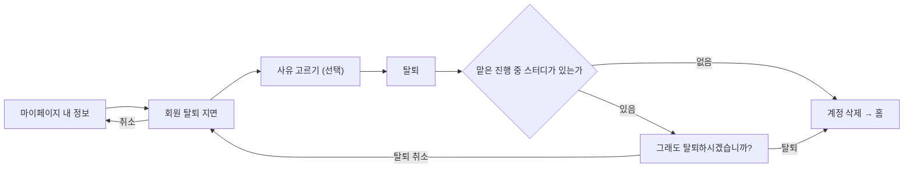
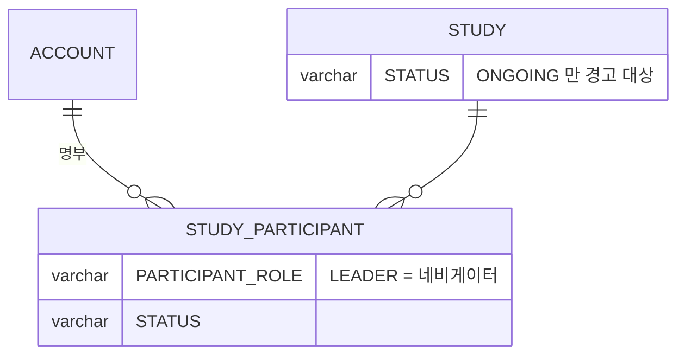

# 크루는 회원에서 탈퇴할 수 있다.

기준 프로토타입: 회원 탈퇴 (playground 사용자 사이트 · 마이페이지 → 회원 탈퇴)

## 1. 기본설명

· **진입·사용 흐름**

· **완료 기준**

1. 마이페이지 내 정보에서 탈퇴 지면 진입
2. 되돌릴 수 없음·재가입해도 기록 미복구 사전 고지
3. 탈퇴 사유 선택 — 고르지 않아도 탈퇴 가능
4. 네비게이터로 맡은 진행 중 스터디 이름·수 표시
5. 맡은 스터디 있으면 재확인 후 탈퇴, 없으면 즉시 탈퇴
6. 탈퇴 취소 시 지면 유지
7. 탈퇴 완료 시 로그아웃 상태로 홈 이동

## 2. 화면명세

> **화면**: 회원 탈퇴 — 프로토는 네비게이터 버전을 보여준다(볼 것이 더 많은 쪽). `?navigator=0` 이면 크루 화면.
>
> 아래 번호별 명세는 프로토의 **설명 보기**에서 그대로 가져온다. 손으로 고치지 않는다 —
> 고치려면 화면 옆 `spec.ts` 를 고치고 `pnpm --filter playground export-specs` 를 돌린다.

<!-- spec:start leave -->

> Playground 탈퇴는 예시 세션·연동 정보를 초기화한다. 실제 DELETE /api/me는 구현되어 있으며 이 프로토에서 호출하지 않는다
>
> 들어오는 길은 내 정보 수정 한 곳뿐이다
>
> **프로토는 네비게이터 버전을 보여준다**. 볼 것이 더 많은 쪽이다. `?navigator=0` 이면 크루 화면

### 1 — 탈퇴 안내

- **내용**
  - 되돌릴 수 없다는 사실
  - 재가입은 되지만 이전 기록은 복구되지 않는다는 사실
  - 회원 탈퇴 시 홈페이지에 저장된 디스코드 연동 정보도 삭제됩니다.
- **정책**
  - 디스코드 연동 정보 삭제는 홈페이지 계정 삭제에 포함된다. 외부 디스코드 계정 삭제·서버 탈퇴와 구분한다
  - 재가입을 같이 말한다. 영구 차단으로 오해하면 떠날 사람도 망설인다

### 2 — 탈퇴 사유

- **내용**: 고르는 한 칸. 고르지 않아도 된다
- **동작**: 고른 값은 탈퇴 요청과 함께 보낸다
- **정책**
  - **필수로 두지 않는다**. 답해야 나갈 수 있으면 붙잡는 장치가 된다
  - 직접 쓰는 칸은 두지 않는다. 모아서 세려는 값이라 자유 문장은 집계가 안 된다
- **데이터**
  - 원하는 스터디 없음 · 스터디 참여가 부담됨 · 기타
  - 탈퇴한 계정과 잇지 않고 사유만 쌓는다. 계정이 지워지면 이을 대상도 없다

### 3 — 맡은 스터디 경고

- **조건**: 네비게이터로 맡은 스터디가 있을 때
- **내용**
  - 맡은 스터디 이름과 그 수
  - 캡틴에게 탈퇴 사실을 공유해 달라는 당부
  - 탈퇴를 누르면 이 상자 안에 「그래도 탈퇴하시겠습니까?」와 버튼 둘이 붙는다
- **동작**
  - 탈퇴를 다시 누르면 처리한다
  - 탈퇴 취소를 누르면 이 지면에 그대로 머문다. 마이페이지로 돌려보내지 않는다
- **정책**
  - **막지 않는다**. 탈퇴는 회원의 권리다. 대신 맡은 자리가 비는 것을 알린 뒤 한 번 더 묻는다
  - 인계는 화면에서 하지 않는다. 캡틴에게 알리는 것으로 끝낸다
  - **자기 것이 아닌 것이 남을 때만 다시 묻는다**. 맡은 스터디가 없으면 이 단계가 없다
  - **버튼보다 위에 둔다**. 누르기 전에 읽는 것이 순서다. 아래에 두면 누른 뒤에야 눈에 들어온다
  - 경고는 들어오자마자 보이고, 되묻는 줄만 버튼을 누른 뒤에 붙는다
  - 진행 중인 스터디만 센다. 끝난 스터디는 맡은 사람이 빠져도 멈출 것이 없다
  - 글자는 상자 색이 아니라 본문 색으로 쓴다. 옅은 바탕에 옅은 글자를 얹으면 읽히지 않는다
- **데이터**: 네비게이터로 맡은 진행 중인 스터디 목록. **서버가 판정한다**

### 4 — 탈퇴

- **동작**
  - 맡은 스터디가 없으면 바로 처리하고 홈으로 보낸다
  - 맡은 스터디가 있으면 위의 3 안에서 한 번 더 묻는다
  - 처리 중에는 다시 눌리지 않는다
- **정책**
  - 머무는 길(취소)을 같은 자리에 둔다. 나가는 문만 있으면 잘못 들어온 사람이 갇힌다
  - 이 지면을 읽은 뒤의 버튼이 곧 확인이다
  - 유예를 두지 않는다. 두면 처리방침의 「탈퇴 시까지 보유」와 어긋나 설명이 늘어난다
- **데이터**: DELETE /api/me: 구현완료. Playground는 예시 회원 데이터와 세션만 초기화한다

### 5 — 상태별 화면

- **조건**: 상태별 화면 요약 (개별 요소는 1~4에서 확인)
- **내용**
  - 기본: 안내 세 줄 · 사유 · 탈퇴 · 취소
  - 맡은 스터디 있음: 위에 경고가 하나 더 붙는다
  - 재확인: 경고 안에 「그래도 탈퇴하시겠습니까?」와 버튼 둘
  - 처리 중: 탈퇴가 눌리지 않는다
  - 완료: 홈으로 보내고 로그아웃한다
- **정책**: 회원 탈퇴는 참여 여부와 관계없이 계정 삭제 절차로 처리한다

<!-- spec:end leave -->

### 비고

- 범위 밖: 네비게이터 인계, 탈퇴 철회
- 미구현: 프로토는 화면에서만 처리한다. 실제 계정을 지우지 않는다
- 구현 지시: 들어오는 길은 마이페이지 내 정보 한 곳이다

## 3. 시스템 요건

### 개발 범위

> 2026-10-28 `beta` 기준 (디스코드 안내 확인). **지금 → 할 일**만 적는다. 다 끝나면 「할 일」이 모두 「없음」이 된다.
> FE 「지금」은 실제 앱의 화면과 데이터 연결(API · mock)까지 본 값이다 — 완료 기준 하나하나의 동작은 따로 확인하지 않았다.
> BE 「지금」은 스펙 엔드포인트 표의 상태 칸을 옮겨 적는다.

| 구분 | 대상 | 지금 | 할 일 |
|---|---|---|---|
| FE | core-front `/my/leave` | 있음 — 맡은 스터디 확인(`GET /api/me/studies`) · 탈퇴 API · 홈페이지 디스코드 연동 정보 삭제 안내 | 없음 |
| BE | `DELETE /api/me` · `GET /api/me/studies` | 구현완료 | 없음 |
| Playground | 디스코드 연동 정보 삭제 안내 | 구현 · 탈퇴 시 예시 세션·데이터 초기화 | 없음 |

### 데이터 관계

### 데이터

| 대상 | 처리 |
| --- | --- |
| `ACCOUNT` (프로필·디스코드 연동 포함) | 물리 삭제 |
| `ACCOUNT_CONSENT` | 계정 삭제에 따라 함께 삭제 |
| `ACCOUNT_IDENTITY` | 물리 삭제 — 같은 Google 계정으로 다시 가입할 수 있어야 한다 |
| `STUDY_PARTICIPANT` | 물리 삭제 — 맡던 네비게이터 자리도 사라진다 |
| `STUDY_BOOKMARK` · `STUDY_PROPOSAL_INTEREST` | 물리 삭제 |
| `STUDY_ATTENDANCE` · `STUDY_REVIEW` | 보존. 계정이 없어져 누구인지 알 수 없게 된다 (이용약관 제11조 3항) |
| `ACCOUNT_LEAVE_REASON` | 탈퇴마다 1행. `REASON` = `NO_DESIRED_STUDY` · `PARTICIPATION_BURDEN` · `OTHER` · null. 계정 ID 를 두지 않는다 |

### 처리

- 홈페이지 디스코드 연동 정보 삭제를 탈퇴 전에 안내
- 디스코드 연결 해제의 참여 중 제한과 회원 탈퇴 절차는 별개. 탈퇴는 계정 삭제 정책 적용
- 외부 Discord 계정 삭제·서버 탈퇴는 수행 대상에서 제외

- 요청 즉시 삭제한다. 유예 없음
- 사유가 세 값 외면 `400 INVALID_INPUT`
- 맡은 진행 중 스터디 판정: `STUDY_PARTICIPANT.PARTICIPANT_ROLE = LEADER` 이고 `STUDY.STATUS = ONGOING`
- 탈퇴 뒤 클라이언트는 저장된 토큰을 지우고 홈으로 보낸다. 이미 발급된 토큰은 서버가 무효화하지 못한다 — [user-leave/spec.md](../../../specs/user-leave/spec.md) 알려진 한계

### API

| 메서드 | 경로 | 권한 |
| --- | --- | --- |
| DELETE | `/api/me` | 로그인 본인 |
| GET | `/api/me/studies` | 로그인 본인 — `participantRole`·`isActiveNavigator` 로 경고 판정 |

계약은 [user-leave/spec.md](../../../specs/user-leave/spec.md).

### 권한

- 본인만 자기 계정을 탈퇴한다. 서버는 토큰의 계정만 지운다

### 외부 연동

- 없음. 디스코드 연동 정보는 계정 삭제에 포함된다

## 4. 미확정

- 발급된 토큰의 서버 측 무효화
