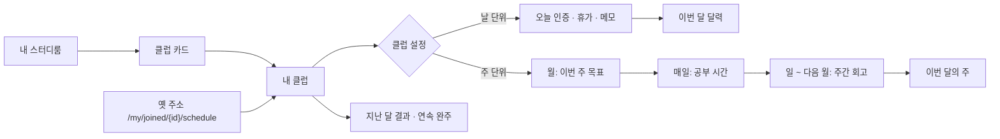

# 크루는 「내 클럽」에서 매일 인증하고 이번 달 기록을 볼 수 있다.

story_id: ST-044 · IA: IA-044 · 상태: 스펙작성중 (초안 — R2)

기준 프로토타입: 사용자 사이트 › 내 스터디룸 › 클럽 카드 › 내 클럽 (배포 전 — 로컬 `/proto/core/ko/my/clubs/{programId}`)

## 1. 기본설명

· **배경** — 클럽은 각자 정한 목표를 날마다(또는 주마다) 인증하며 한 달씩 이어 가는 챌린지형 모임이다 ([POL-0012](../../_registry/policies/POL-0012-club-cohort.md)). 모임 시각 · 회차 · 미팅이 없으므로 스터디 일정 화면(일정 · 출석 탭)을 쓰지 않고, 멤버가 매일 들어오는 「내 클럽」 한 화면을 둔다. 참여 이후 모델은 [클럽 모델 결정 (2026-11-25)](../../../docs/share/2026-11-25-club-own-model.md).

· **설정이 화면을 정한다** — 얼리버드 · Daily LeetCode(날 단위)와 WEEKLY X(주 단위)는 같은 틀에 칸만 다르다. 어떤 칸을 그릴지는 클럽 이름이 아니라 클럽 설정(판정 단위 · 매일 남기는 것 · 주간 목표 · 회고 · 휴가 한도 · 인증 출처)이 고른다. 새 진행 방식은 칸 하나와 설정 값 하나로 더한다.

· **규칙 값은 제안이다** — 지금까지 캡틴이 구글 시트에 사람 판단으로 적어 와서 정해진 규칙이 뚜렷하지 않다. 목표 마감 · 회고 기간 · 기록 수정 기한은 캡틴 확인 전 제안이고, 휴가는 지금 운영대로 **제한 없음**이다.

### 진입·사용 흐름

### 완료 기준

1. 내 스터디룸의 클럽 카드 · 옛 스터디 일정 주소가 「내 클럽」으로 온다. 주간 일정에 클럽은 나오지 않는다
2. 주소는 클럽 하나(`programId`) — 달이 바뀌어도 같다
3. 요약 숫자 — 날 단위: 이번 달 달성률 · 휴가 · 연속 완주 / 주 단위: 이번 주 · 이번 달 달성 주 · 휴가 · 연속 완주
4. 날 단위 — 오늘 인증(지각을 받는 클럽은 제때 · 늦게) · 오늘 휴가 · 메모 · 인증 취소 · 이번 달 달력
5. 주 단위 — 월요일에 이번 주 목표, 안 쓰면 지난주 목표 이어 쓰기 · 날마다 공부 시간 · 목표까지 남은 시간 · 주간 회고(내면 그 주 잠금) · 이번 주 휴가 · 이번 달의 주 목록
6. 지난 달 결과(완주 · 중단)

## 2. 화면명세

<!-- spec:start myclub -->

> 클럽에는 일정 · 회차 · 미팅이 없다. 스터디 일정 화면 대신 이 화면이다 — 내 스터디룸의 클럽 카드가 여기로 온다
>
> 주소는 클럽(STUDY_PROGRAM.ID) 하나다. 달이 바뀌어도 같은 주소에서 이번 달을 본다
>
> **칸은 클럽 설정에서 고른다** — 클럽 이름으로 나누지 않는다. 날 단위(얼리버드 · Daily LeetCode)는 오늘 인증 · 달력, 주 단위(WEEKLY X)는 주간 목표 · 공부 시간 · 주간 회고 · 주 목록
>
> 규칙 값(목표 마감 · 회고 기간 · 휴가)은 캡틴 확인 전 제안이다. 휴가는 지금 운영대로 제한 없음
>
> 검토용 「오늘」(수 · 일 · 월)은 프로토 도구다 — 회고가 열리는 일요일, 목표를 쓰는 월요일을 볼 수 있다

### 1 — 머리

- **내용**: 「내 클럽 · 멤버」 · 클럽 이름 · 이번 달 · 진행 방식 한 줄
- **데이터**: `GET /api/clubs/{programId}/me` — 클럽 · 이번 기수 · 멤버

#### 1-1 — 클럽 소개 · 규칙

- **동작**: 이번 기수의 공개 상세(모집 페이지)로 간다. 하루를 세는 기준 같은 규칙은 거기 규칙 글에 있다

### 2 — 요약 숫자

- **내용**: 클럽 설정에 따라 고른 숫자 카드
- **정책**: 날 단위: 이번 달 달성률 · 휴가 · 연속 완주. 주 단위: 이번 주 · 이번 달 달성 주 · 휴가 · 연속 완주

#### 2-1 — 이번 달 달성률 / 이번 주

- **내용**: 날 단위는 이번 달 달성률(%), 주 단위는 이번 주 합계 / 목표
- **정책**: 달성률은 스터디 출석률 산식 그대로 — 인증 1 · 늦게 0.5 · 휴가 · 기록 없는 날은 빼고 센다

#### 2-2 — 이번 달 달성 주

- **조건**: 주 단위 클럽
- **내용**: 끝난 주 중 목표를 채운 주 / 이번 달 주 수

#### 2-3 — 휴가

- **내용**: 이번 달에 쓴 휴가. 한도가 있는 클럽이면 「쓴 수 / 한도」
- **정책**: 한도는 클럽 설정 값이다. 없으면 제한 없음 — 지금 세 클럽은 제한이 없다

#### 2-4 — 연속 완주

- **내용**: 한 달을 끝까지 한 달이 몇 달 이어졌나
- **데이터**: `CLUB_MONTH_RESULT` 의 최근 연속 `COMPLETED` 수

### 3 — 오늘 인증

- **조건**: 매일 기록이 「했다」인 클럽 (날 단위)
- **내용**: 오늘 날짜. 인증했으면 값 · 메모와 「인증 취소」

#### 3-1 — 인증 버튼

- **동작**
  - 「오늘 했어요」 — 지각을 받는 클럽은 「목표 시간에 했어요」 · 「늦게 했어요」 둘
  - 인증한 날에는 「인증 취소」 — 그날 안에만
- **정책**
  - 지각(늦게)을 받는지는 클럽 설정이다
  - 오늘 칸만 인증한다. 지난 날은 캡틴이 출석부에서 고친다
- **데이터**: `PUT /api/clubs/{programId}/me/checkins` — `date` · `result` · `note` → `CLUB_CHECKIN`(`SOURCE = CREW`)

#### 3-2 — 오늘 휴가

- **동작**: 오늘을 휴가로 남긴다 — 달성률 분모에서 빠진다
- **정책**: 한도가 있는 클럽이면 다 쓰면 누를 수 없다. 지금은 제한 없음

#### 3-3 — 메모 한 줄

- **내용**: 선택. 100자

#### 3-4 — 자동 기록 안내

- **조건**: 외부 기록을 자동으로 받아 오는 클럽 (Daily LeetCode)
- **내용**: 「{외부 서비스} 기록을 자동으로 받아 오기 전까지는 직접 인증합니다」

### 4 — 이번 달 기록

- **조건**: 날 단위 클럽
- **내용**: 월요일부터 시작하는 달력. 날마다 인증 · 늦게 · 못 함 · 휴가 색, 오늘 테두리, 앞날은 흐리게

### 5 — 이번 주 목표

- **조건**: 주마다 목표를 쓰는 클럽 (WEEKLY X)
- **내용**
  - 이번 주(월 ~ 일) 목표 시간 · 무엇을
  - 목표를 안 썼으면 「지난주 목표를 이어 씁니다」
- **정책**
  - 목표는 그 주 월요일 23:59까지 쓰고 고친다 (제안)
  - 안 쓰면 지난주 목표를 이어 쓴다. 첫 주는 신청 때 쓴 「목표하는 나의 X 시간」

#### 5-1 — 목표 시간

- **조건**: 월요일
- **정책**: 0.5시간 단위 · 1 ~ 80시간

#### 5-2 — 무엇을 할까요

- **조건**: 월요일
- **내용**: 선택. 100자

#### 5-3 — 목표 저장

- **조건**: 월요일
- **데이터**: `PUT /api/clubs/{programId}/me/weeks/{monday}` — `goalMinutes` · `goalText` → `CLUB_WEEK`

#### 5-4 — 이번 주 휴가

- **동작**: 이번 주를 휴가로 둔다 — 판정에서 빠진다
- **정책**
  - 회고를 낸 주에는 쓸 수 없다
  - 한도는 클럽 설정. 지금은 제한 없음

### 6 — 공부 시간

- **조건**: 매일 기록이 공부 시간인 클럽 (WEEKLY X)
- **내용**: 이번 주 월 ~ 일, 날마다 시간 · 분 칸. 앞날은 「-」
- **정책**
  - 그 주 회고를 내기 전까지 그 주 어느 날이든 적고 고친다 (제안)
  - 회고를 냈거나 휴가인 주는 잠긴다
- **데이터**: `PUT /api/clubs/{programId}/me/checkins` — `date` · `minutes` → `CLUB_CHECKIN.VALUE`

#### 6-1 — 목표까지 남은 시간

- **내용**: 「이번 주 목표까지 {남은 시간} 남았어요」 · 채우면 「이번 주 목표를 채웠어요」 · 합계 / 목표 막대
- **정책**: 판정: 주 합계 ≥ 목표면 달성

### 7 — 주간 회고

- **조건**: 주간 회고를 쓰는 클럽 (WEEKLY X)
- **내용**
  - 그 주 합계 / 목표 · 달성 여부
  - 열리기 전이면 언제 열리는지, 냈으면 낸 내용과 날짜
- **정책**
  - 일요일에 열리고 다음 날(월요일) 23:59까지 낸다 (제안). 월요일에는 지난주 회고가 보인다
  - 내면 그 주 기록(공부 시간)이 잠긴다
  - 문항은 클럽 설정 — 프로토는 제안안(필수 1 · 선택 1)

#### 7-1 — 이번 주 잘된 것 · 아쉬운 것

- **정책**: 필수 · 1,000자

#### 7-2 — 다음 주에 바꿀 것

- **정책**: 선택 · 500자

#### 7-3 — 회고 내기

- **동작**: 필수 칸을 채우면 누를 수 있다
- **데이터**: `PUT /api/clubs/{programId}/me/weeks/{monday}` — `retro` → `CLUB_WEEK`

### 8 — 이번 달의 주

- **조건**: 주 단위 클럽
- **내용**: 주마다 기간 · 목표 · 합계 · 판정(달성 · 미달 · 휴가 · 진행 중 · 예정) · 회고 냄 여부
- **정책**: 주는 월요일 ~ 일요일이고 월요일이 속한 달에 센다 — 달 첫 며칠은 지난달 마지막 주일 수 있다 (제안)

### 9 — 지난 달

- **내용**: 달마다 완주 · 중단과 그 달 달성률(주 단위는 달성 주 비율)
- **데이터**: `CLUB_MONTH_RESULT`

<!-- spec:end myclub -->

### 상태별 화면

| 상태 | 무엇이 다른가 |
| --- | --- |
| 날 단위 · 인증 전 | 인증 버튼 · 휴가 · 메모 칸 |
| 날 단위 · 인증 뒤 | 값 배지 · 메모 · 「인증 취소」 |
| 주 단위 · 월요일 | 목표 입력이 열리고 지난주 회고를 낸다 |
| 주 단위 · 화 ~ 토 | 목표는 읽기만, 회고는 「일요일에 열립니다」 |
| 주 단위 · 일요일 | 이번 주 회고가 열린다 |
| 주 단위 · 회고를 낸 주 / 휴가인 주 | 공부 시간 칸이 잠긴다 |
| 멤버가 아님 | 「참여 중인 클럽이 아닙니다」 |

## 3. 시스템 요건

### 개발 범위

기준일 2026-11-26 · `beta`

| 구분 | 대상 | 지금 | 할 일 |
| --- | --- | --- | --- |
| FE | core-front `/my/clubs/{programId}` | 없음 | 화면 · API 연결 (R2) |
| FE | core-front 내 스터디룸 | 클럽도 스터디 일정으로 간다 | 클럽 카드는 「내 클럽」으로 · 주간 일정에서 클럽 빼기 |
| BE | `GET /api/clubs/{programId}/me` | 스펙 없음 | 스펙 · 구현 |
| BE | `PUT /api/clubs/{programId}/me/checkins` | 스펙 없음 | 스펙 · 구현 |
| BE | `PUT /api/clubs/{programId}/me/weeks/{monday}` | 스펙 없음 | 스펙 · 구현 (`CLUB_WEEK` 표 필요) |
| 기획 | 클럽 설정 칸(`STUDY_PROGRAM`) | 제안 | 캡틴 확인 — 목표 마감 · 회고 기간 · 기록 수정 기한 · 휴가 한도 |

### 데이터

- `CLUB_MEMBER` — 멤버는 나갈 때까지 남는다 (ST-042)
- `CLUB_CHECKIN` — 멤버 × 날짜. 날 단위는 `RESULT`, 주 단위는 `VALUE`(분). `SOURCE = CREW | CAPTAIN | AUTO`. 캡틴의 출석부(ST-043)와 같은 표
- `CLUB_WEEK` (새 표 제안) — 멤버 × 그 주 월요일. 목표(분 · 글) · 휴가 · 회고 · 낸 시각
- `CLUB_MONTH_RESULT` — 멤버 × 달. 완주 · 중단 · 달성률
- 클럽 설정 — `STUDY_PROGRAM` 의 칸: 판정 단위(`day | week`) · 매일 남기는 것(`check | minutes`) · 지각 받음 · 주간 목표 · 회고(`none | weekly`) · 휴가 한도(없으면 제한 없음) · 인증 출처

### 처리

- 날짜는 시간대 없는 그날이다. 주는 월요일 ~ 일요일이고 월요일이 속한 달에 센다
- 크루는 오늘 칸만 인증한다 (날 단위). 지난 날은 캡틴이 출석부에서 고친다
- 주 단위 판정: 주 합계 ≥ 그 주 목표면 달성. 휴가인 주는 판정에서 뺀다
- 회고를 내면 그 주 `CLUB_CHECKIN` 을 크루가 고칠 수 없다

### 퍼널·계측

- 단계: **재방문** — 매일 들어오는 화면이 생긴다
- OMTM 에 기대하는 변화: 클럽 멤버의 다음 달 유지율(연속 완주) ↑
- 이벤트 (제안 — 트래킹 플랜 반영은 구현 PR 에서)

| Amplitude | GA4 | 보내는 곳 |
| --- | --- | --- |
| `Club Checkin Recorded` | `club_checkin` | server |
| `Club Weekly Goal Set` | `club_weekly_goal_set` | server |
| `Club Weekly Retro Submitted` | `club_weekly_retro` | server |

- 실험: 해당 없음

## 4. 미확정

- 목표 마감(월요일 23:59) · 회고 기간(일요일 ~ 다음 월요일) · 기록 수정 기한(회고 전까지) — 캡틴 확인
- 휴가 한도를 둘지 — 지금은 제한 없음
- 회고 문항(필수 1 · 선택 1 제안)
- Daily LeetCode 자동 인증 시점 (R3)
