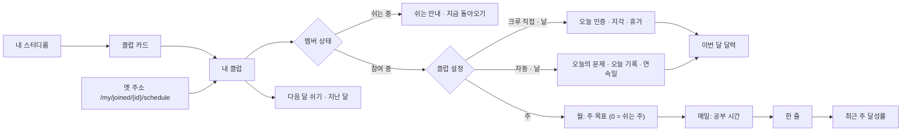

# 크루는 「내 클럽」에서 매일 인증하고 이번 달 기록을 볼 수 있다.

story_id: ST-044 · IA: IA-044 · 상태: 스펙작성중 (초안 — R2)

기준 프로토타입: 사용자 사이트 › 내 스터디룸 › 클럽 카드 › 내 클럽 (배포 전 — 로컬 `/proto/core/ko/my/clubs/{programId}`)

## 1. 기본설명

· **배경** — 클럽은 각자 정한 목표를 날마다(또는 주마다) 인증하며 한 달씩 이어 가는 챌린지형 모임이다 ([POL-0012](../../_registry/policies/POL-0012-club-cohort.md)). 모임 시각 · 회차 · 미팅이 없으므로 스터디 일정 화면(일정 · 출석 탭)을 쓰지 않고, 멤버가 매일 들어오는 「내 클럽」 한 화면을 둔다. 참여 이후 모델은 [클럽 모델 결정 (2026-11-25)](../../../docs/share/2026-11-25-club-own-model.md).

· **실제 운영을 따른다** — 지금까지 캡틴이 시트 · 디스코드에 사람 판단으로 적어 왔다. 세 클럽의 기록 방식과 2026-11-26 캡틴 답을 규칙으로 옮겼다 ([POL-0012 「진행 방식」](../../_registry/policies/POL-0012-club-cohort.md#진행-방식--세-클럽의-실제-운영을-따른다)).
  - 얼리버드 — 디스코드 주간 포스트에 각자 한 요일을 누적해 적는다. 괄호 요일은 지각. 앞에 보이는 숫자는 출석률
  - Daily LeetCode — 시트가 LeetCode 기록을 자동으로 읽어 연속일(스트릭)을 센다. 날마다 오늘의 문제가 있다
  - WEEKLY X — 해 단위 시트에 주 목표 시간 · 날마다 공부 시간 · 한 줄을 적고, 주 달성률(%)을 본다. 목표 0 은 쉬는 주
  - **합격선 · 자동 제명은 없다.** 휴가 · 방학으로 쉬어도 멤버로 남고 끝나면 돌아온다

· **설정이 화면을 정한다** — 칸 · 숫자는 클럽 이름이 아니라 클럽 설정(진행 방식)과 멤버 상태가 고른다. 새 진행 방식은 칸 하나와 설정 값 하나로 더한다.

### 진입·사용 흐름

### 완료 기준

1. 내 스터디룸의 클럽 카드 · 옛 스터디 일정 주소가 「내 클럽」으로 온다. 주간 일정에 클럽은 나오지 않는다
2. 주소는 클럽 하나(`programId`) — 달이 바뀌어도 같다
3. 요약 숫자는 클럽 설정의 「앞에 보이는 숫자」로 — 출석률 · 연속일 · 주 달성률. 합격선 · 달성 배지 없음
4. 얼리버드형 — 오늘 인증(제때 · 지각) · 하루 휴가(제한 없음) · 메모 · 인증 취소 · 달력
5. LeetCode형 — 자동 기록 · 오늘의 문제 · 연속일 · 달력. 크루 인증 버튼 없음
6. WEEKLY X형 — 월요일 주 목표(0 = 쉬는 주, 안 쓰면 이어 쓰기) · 날마다 공부 시간 · 주 한 줄(선택) · 최근 6주 달성률
7. 다음 달 쉬기 · 쉬는 중 안내 · 지금 돌아오기 — 쉬어도 멤버로 남는다
8. 지난 달 결과(완주 · 쉼 · 중단) · 연속 완주(쉰 달은 세지도 끊지도 않는다)

## 2. 화면명세

<!-- spec:start myclub -->

> 클럽에는 일정 · 회차 · 미팅이 없다. 스터디 일정 화면 대신 이 화면이다 — 내 스터디룸의 클럽 카드가 여기로 온다
>
> 주소는 클럽(STUDY_PROGRAM.ID) 하나다. 달이 바뀌어도 같은 주소다
>
> **칸 · 숫자는 클럽 설정과 멤버 상태가 고른다** — 클럽 이름으로 나누지 않는다. 얼리버드: 오늘 인증 · 달력 · 출석률 / Daily LeetCode: 자동 기록 · 달력 · 연속일 / WEEKLY X: 주 목표 · 공부 시간 · 한 줄 · 최근 주 · 주 달성률
>
> **합격선은 두지 않는다** — 출석률 · 연속일 · 주 달성률을 숫자로만 보여 준다. **자동 제명도 하지 않는다**
>
> 검토용 「오늘」(수 · 일 · 월)과 「상태」(참여 중 · 쉬는 중)는 프로토 도구다

### 1 — 머리

- **내용**: 「내 클럽 · 멤버」 · 클럽 이름 · 이번 달 · 진행 방식 한 줄
- **데이터**: `GET /api/clubs/{programId}/me` — 클럽 · 이번 기수 · 멤버 · 멤버 상태

#### 1-1 — 클럽 소개 · 규칙

- **동작**: 이번 기수의 공개 상세(모집 페이지)로 간다. 하루를 세는 기준 같은 규칙은 거기 규칙 글에 있다

### 2 — 요약 숫자

- **조건**: 참여 중
- **내용**: 클럽 설정의 앞에 보이는 숫자(`metric`)에 따라 고른 카드
- **정책**
  - 출석률(얼리버드): 이번 달 출석률 · 휴가 · 연속 완주
  - 연속일(Daily LeetCode): 연속일 · 이번 달 한 날 · 연속 완주
  - 주 달성률(WEEKLY X): 이번 주 · 지난 주 · 최근 4주 평균 · 연속 완주
  - 합격선 · 달성 배지는 없다 — 숫자만

#### 2-1 — 이번 달 출석률 / 연속일 / 이번 주

- **내용**
  - 출석률: 이번 달 %
  - 연속일: 오늘(안 했으면 어제)부터 거꾸로 이어진 날 수
  - 이번 주: {주차} · 달성률 % · 합계 / 목표. 목표 0 이면 「쉬는 주」
- **정책**
  - 출석률 = (했음 1 + 지각 0.5) ÷ 센 날. 센 날은 오늘까지(오늘은 기록이 있을 때만)에서 휴가를 뺀 날 — 기록 없는 날은 안 한 날(0)
  - 연속일은 하루 빠지면 다시 1부터. 달이 바뀌어도 이어진다
  - 주 달성률 = 주 합계 ÷ 목표 × 100, 소수 한 자리. 100 을 넘을 수 있다

#### 2-2 — 이번 달 한 날 / 지난 주

- **내용**
  - 연속일 클럽: 이번 달 한 날 / 오늘까지 날 수
  - 주 달성률 클럽: 지난 주 달성률 · 합계 / 목표

#### 2-3 — 최근 4주 평균

- **조건**: 주 달성률 클럽
- **정책**: 끝난 최근 4주의 달성률 평균. 쉬는 주는 뺀다

#### 2-4 — 휴가

- **조건**: 하루 휴가를 받는 클럽 (얼리버드)
- **내용**: 이번 달에 쓴 휴가 일수. 한도가 있는 클럽이면 「쓴 수 / 한도」
- **정책**: 한도는 클럽 설정 값이다. 없으면 제한 없음 — 지금 세 클럽은 제한이 없다

#### 2-5 — 연속 완주

- **내용**: 한 달을 끝까지 한 달이 몇 달 이어졌나
- **정책**: 쉰 달은 세지도 끊지도 않는다. 중단에서 끊긴다
- **데이터**: `CLUB_MONTH_RESULT` — 최근부터 `WITHDRAWN` 전까지의 `COMPLETED` 수

### 3 — 오늘 인증

- **조건**: 크루가 직접 「했다」를 남기는 클럽 (얼리버드)
- **내용**: 오늘 날짜. 인증했으면 값 · 메모와 「인증 취소」

#### 3-1 — 인증 버튼

- **동작**
  - 「오늘 했어요」 — 지각을 받는 클럽은 「목표 시간에 했어요」 · 「늦었지만 했어요」 둘
  - 인증한 날에는 「인증 취소」 — 그날 안에만
- **정책**
  - 지각을 받는지는 클럽 설정이다 — 얼리버드 시트의 괄호 요일 `(화)` 가 지각이다
  - 오늘 칸만 인증한다. 지난 날은 캡틴이 출석부에서 고친다
- **데이터**: `PUT /api/clubs/{programId}/me/checkins` — `date` · `result` · `note` → `CLUB_CHECKIN`(`SOURCE = CREW`)

#### 3-2 — 오늘 휴가

- **조건**: 하루 휴가를 받는 클럽
- **동작**: 오늘을 휴가로 남긴다 — 출석률 분모에서 빠진다
- **정책**: 한도가 있는 클럽이면 다 쓰면 누를 수 없다. 지금은 제한 없음

#### 3-3 — 메모 한 줄

- **내용**: 선택. 100자

### 4 — 자동 기록

- **조건**: 외부 기록을 자동으로 받는 클럽 (Daily LeetCode)
- **내용**: 「{외부 서비스} 기록을 자동으로 받아 옵니다」
- **정책**: 크루는 인증 버튼을 누르지 않는다. 기록이 틀리면 캡틴이 출석부에서 고친다 (지금 시트의 「어제 칸 스트릭 고치기」)
- **데이터**: `CLUB_CHECKIN`(`SOURCE = AUTO`) — 날짜는 클럽 규칙의 기준 시각(UTC)으로 센다

#### 4-1 — 오늘의 문제

- **조건**: 날마다 같은 문제가 있는 클럽
- **내용**: 그날 문제 제목

#### 4-2 — 오늘 기록

- **내용**: 「풀었음 · 연속 n일째」 또는 「아직 기록 없음」 — 풀면 반영된다는 안내

### 5 — 이번 달 기록

- **조건**: 날 단위 클럽
- **내용**
  - 월요일부터 시작하는 달력. 날마다 했음 · 지각 · 휴가 색, 기록 없는 날은 안 한 날, 오늘 테두리, 앞날은 흐리게
  - 범례는 클럽이 받는 값만

### 6 — 이번 주 목표

- **조건**: 주마다 목표를 쓰는 클럽 (WEEKLY X)
- **내용**: {주차} 목표 · 기간. 목표를 안 썼으면 「지난 목표를 이어 씁니다」, 0 이면 「쉬는 주」
- **정책**
  - 목표는 그 주 월요일 23:59까지 쓰고 고친다 (제안)
  - 안 쓰면 가장 가까운 지난 목표를 이어 쓴다 — 쉬는 주(0)는 건너뛴다. 처음은 신청 때 쓴 「목표하는 나의 X 시간」
  - **목표 0 = 쉬는 주** — 달성률 · 평균에 세지 않는다. 주 단위 클럽은 휴가 버튼 대신 이것을 쓴다

#### 6-1 — 목표 시간

- **조건**: 월요일
- **정책**: 0.5시간 단위 · 0 ~ 80시간

#### 6-2 — 목표 저장

- **조건**: 월요일
- **데이터**: `PUT /api/clubs/{programId}/me/weeks/{monday}` — `goalMinutes` → `CLUB_WEEK`

### 7 — 공부 시간

- **조건**: 매일 공부 시간을 남기는 클럽 (WEEKLY X)
- **내용**: 이번 주 월 ~ 일, 날마다 시간 · 분 칸. 앞날은 「-」
- **정책**: 이번 주 지난 날도 적고 고친다. 지난 주는 캡틴이 출석부에서 고친다 (제안)
- **데이터**: `PUT /api/clubs/{programId}/me/checkins` — `date` · `minutes` → `CLUB_CHECKIN.VALUE`

#### 7-1 — 이번 주 합계

- **내용**: 합계 / 목표 · 달성률 % 와 막대. 쉬는 주면 「쉬는 주예요 — 적어도 달성률에 세지 않아요」

#### 7-2 — 날마다 시간

### 8 — 이번 주 한 줄

- **조건**: 주마다 한 줄을 남기는 클럽 (WEEKLY X)
- **내용**: 다짐 · 회고 · 사정 무엇이든 한 줄 — 선택
- **정책**: 그 주 안에 언제든 쓰고 고친다. 내지 않아도 아무 영향이 없다

#### 8-1 — 한 줄 칸

- **정책**: 200자

#### 8-2 — 저장

- **데이터**: `PUT /api/clubs/{programId}/me/weeks/{monday}` — `note` → `CLUB_WEEK`

### 9 — 최근 주

- **조건**: 주 단위 클럽
- **내용**: 최근 6주 — 주차(해 기준 ISO 주차) · 기간 · 목표 · 합계 · 달성률 · 한 줄. 이번 주는 「진행 중」
- **정책**: 주는 월요일 ~ 일요일. 달이 아니라 해 기준 주차로 부른다 (지금 시트 그대로)

### 10 — 쉬어 가기

- **조건**: 참여 중
- **내용**: 휴가 · 방학으로 한 달을 쉬어도 멤버로 남고, 끝나면 다시 이어 간다는 안내

#### 10-1 — 다음 달 쉬기

- **동작**: 「{다음 달} 쉬기」 → 「{다음 달}은 쉽니다」 · 「쉬기 취소」
- **정책**
  - 이번 달 말일까지 정한다 (제안)
  - 쉬는 달은 완주에도 중단에도 세지 않는다. 다시 신청하지 않는다
- **데이터**: `PUT /api/clubs/{programId}/me/rest` — `month` → `CLUB_MEMBER` 쉬는 기간

### 11 — 쉬는 중

- **조건**: 이번 달을 쉬는 멤버
- **내용**: 「{이번 달}은 쉬어 갑니다」 · 「{다음 달} 1일부터 다시 이어 갑니다」. 기록 칸 · 요약 숫자는 닫는다

#### 11-1 — 지금 돌아오기

- **동작**: 쉬기를 끝내고 오늘부터 다시 기록한다 (제안)

### 12 — 지난 달

- **내용**: 달마다 완주 · 쉼 · 중단과 그 달 출석률(주 단위는 평균 달성률). 연속일 클럽은 결과만
- **데이터**: `CLUB_MONTH_RESULT`

<!-- spec:end myclub -->

### 상태별 화면

| 상태 | 무엇이 다른가 |
| --- | --- |
| 얼리버드 · 인증 전 | 「목표 시간에 했어요 · 늦었지만 했어요」 · 오늘 휴가 · 메모 칸 |
| 얼리버드 · 인증 뒤 | 값 배지 · 메모 · 「인증 취소」 |
| LeetCode · 오늘 기록 없음 / 있음 | 「아직 기록 없음」 안내 / 「풀었음 · 연속 n일째」 |
| WEEKLY X · 월요일 | 주 목표 입력이 열린다 |
| WEEKLY X · 목표 0 인 주 | 「쉬는 주」 — 달성률 · 평균에서 빠진다 |
| 쉬는 중 | 요약 숫자 · 기록 칸을 닫고 쉬는 안내 · 지난 달만 |
| 멤버가 아님 | 「참여 중인 클럽이 아닙니다」 |

## 3. 시스템 요건

### 개발 범위

기준일 2026-11-26 · `beta`

| 구분 | 대상 | 지금 | 할 일 |
| --- | --- | --- | --- |
| FE | core-front `/my/clubs/{programId}` | 없음 | 화면 · API 연결 (R2) |
| FE | core-front 내 스터디룸 | 클럽도 스터디 일정으로 간다 | 클럽 카드는 「내 클럽」으로 · 주간 일정에서 클럽 빼기 |
| BE | `GET /api/clubs/{programId}/me` | 스펙 없음 | 스펙 · 구현 |
| BE | `PUT /api/clubs/{programId}/me/checkins` | 스펙 없음 | 스펙 · 구현 |
| BE | `PUT /api/clubs/{programId}/me/weeks/{monday}` | 스펙 없음 | 스펙 · 구현 (`CLUB_WEEK` 표 필요) |
| BE | `PUT /api/clubs/{programId}/me/rest` | 스펙 없음 | 스펙 · 구현 (`CLUB_MEMBER` 쉬는 기간) |
| BE | LeetCode 기록 자동 수집 | 시트 스크립트 | 수집 방식 정하기 (지금 시트가 하는 일을 서버로) |
| 기획 | 클럽 설정 칸(`STUDY_PROGRAM`) | 제안 | 「진행 방식」 칸 확정 · 아래 미확정 |
| 기획 | 캡틴 출석부(ST-043) 출석률 | 기록 없는 날은 뺀다 | 「기록 없는 날 = 안 한 날」로 맞출지 |

### 데이터

- `CLUB_MEMBER` — 멤버는 나갈 때까지 남는다 (ST-042). **쉬는 기간**(시작 달 · 끝 달)을 둔다 — 쉬어도 멤버다
- `CLUB_CHECKIN` — 멤버 × 날짜. 날 단위는 `RESULT`(출석 · 지각 · 결석 · 휴가), 주 단위는 `VALUE`(분). `SOURCE = CREW | CAPTAIN | AUTO`. 캡틴의 출석부(ST-043)와 같은 표
- `CLUB_WEEK` (새 표 제안) — 멤버 × 그 주 월요일. 목표(분, 0 = 쉬는 주) · 한 줄
- `CLUB_MONTH_RESULT` — 멤버 × 달. 완주 · 쉼 · 중단 · 그 달 숫자
- 클럽 설정 — `STUDY_PROGRAM` 의 칸: 판정 단위(`day | week`) · 매일 남기는 것(`check | minutes`) · 앞에 보이는 숫자(`rate | streak | weekPercent`) · 지각 받음 · 하루 휴가 받음 · 휴가 한도(없으면 제한 없음) · 주 목표 · 주 한 줄 · 인증 출처(`crew | auto`) · 오늘의 문제

### 처리

- 날짜는 시간대 없는 그날이다. 하루를 언제부터 세나는 클럽 규칙 글에 적는다 (LeetCode 는 UTC)
- 출석률 = (출석 1 + 지각 0.5) ÷ 센 날. 휴가 · 쉬는 달은 빼고, 기록 없는 지난 날은 0 (제안)
- 연속일 = 오늘(안 했으면 어제)부터 거꾸로 이어진 날. 달을 넘어 이어진다
- 주 달성률 = 주 합계 ÷ 목표 × 100. 목표 0 이면 계산하지 않는다(쉬는 주). 목표를 안 쓰면 가장 가까운 0 아닌 지난 목표
- 주는 월 ~ 일, 해 기준 ISO 주차로 부른다
- 합격선 · 자동 제명이 없다 — 숫자로 멤버 상태를 바꾸지 않는다

### 퍼널·계측

- 단계: **재방문** — 매일 들어오는 화면이 생긴다
- OMTM 에 기대하는 변화: 클럽 멤버의 다음 달 유지율(연속 완주) ↑ · 쉬어 가기로 「중단 대신 쉼」 비율 ↑
- 이벤트 (제안 — 트래킹 플랜 반영은 구현 PR 에서)

| Amplitude | GA4 | 보내는 곳 |
| --- | --- | --- |
| `Club Checkin Recorded` | `club_checkin` | server |
| `Club Weekly Goal Set` | `club_weekly_goal_set` | server |
| `Club Rest Requested` | `club_rest` | server |

- 실험: 해당 없음

## 4. 미확정

- WEEKLY X 주 목표를 쓰는 기한 (제안: 월요일 23:59) · 지난 주 공부 시간을 크루가 고칠 수 있는 기한 (제안: 못 고침, 캡틴이)
- 쉬어 가기를 누가 정하나 (제안: 크루가 말일까지 · 캡틴도) · 쉬는 멤버를 정원에 넣나 (제안: 넣는다) · 몇 달까지 쉴 수 있나
- 출석률에서 기록 없는 지난 날을 0 으로 셀지 (제안: 0 — 스터디 산식과 다르다)
- LeetCode 기록 자동 수집 방식 · 오늘의 문제를 어디서 받나
