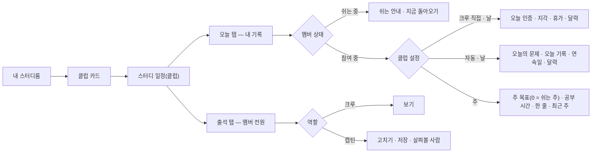
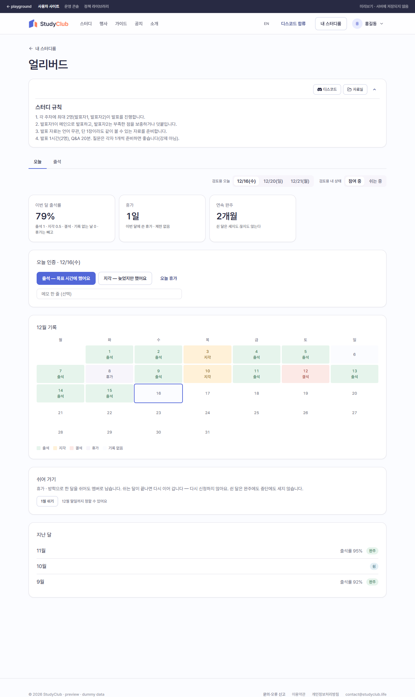
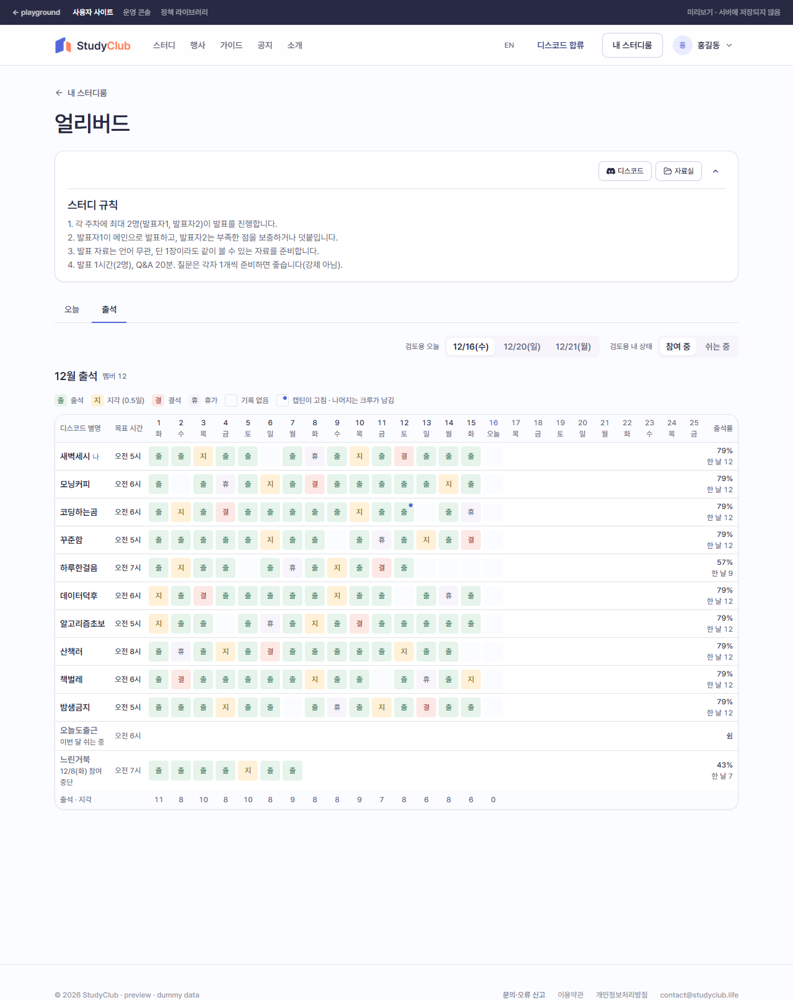
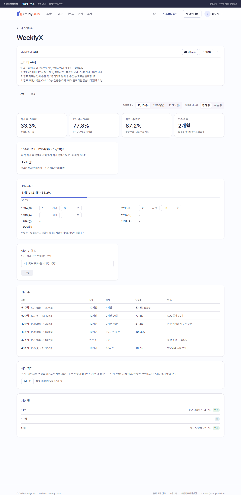
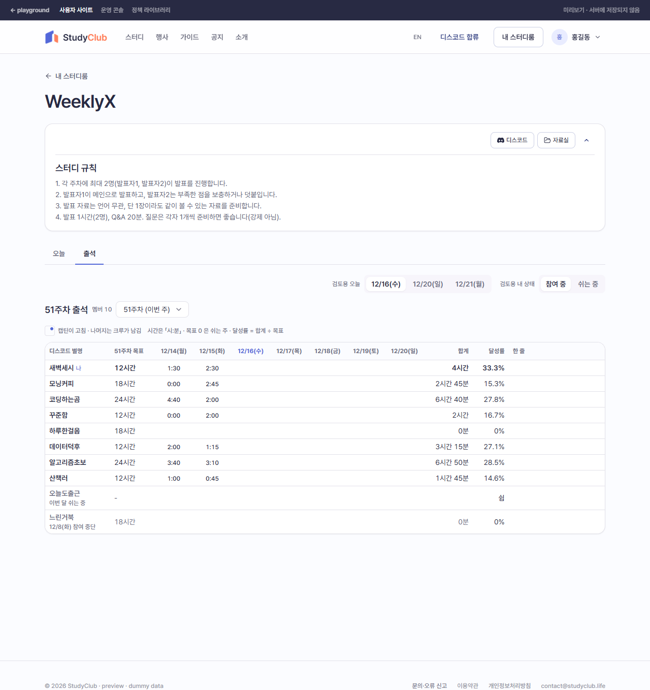
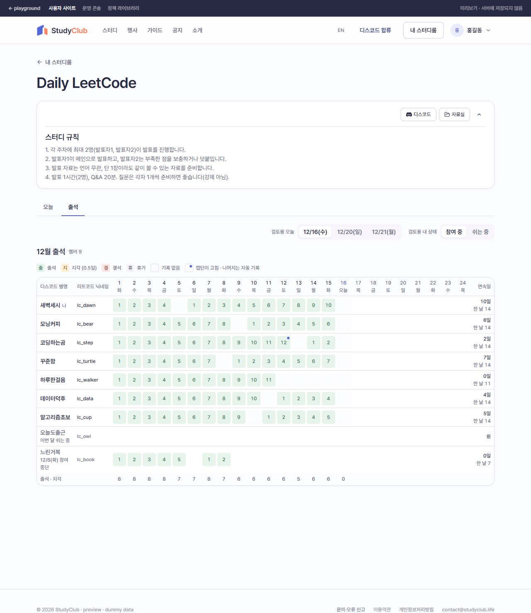

# 크루는 「내 클럽」에서 매일 인증하고 이번 달 기록을 볼 수 있다.

story_id: ST-044 · IA: IA-044 · 상태: 스펙작성중 (초안 — R2)

기준 프로토타입: 사용자 사이트 › 내 스터디룸 › 클럽 카드 › 스터디 일정(클럽) — 오늘 · 출석 탭 (배포 전 — 로컬 `/proto/core/ko/my/joined/{study_id}/schedule`)

## 1. 기본설명

· **배경** — 클럽은 각자 정한 목표를 날마다(또는 주마다) 인증하며 한 달씩 이어 가는 챌린지형 모임이다 ([POL-0012](../../_registry/policies/POL-0012-club-cohort.md)). 모임 시각 · 회차 · 미팅이 없다. 참여 이후 모델은 [클럽 모델 결정 (2026-11-25)](../../../docs/share/2026-11-25-club-own-model.md).

· **스터디와 같은 껍데기** — 클럽도 스터디 일정 화면(머리 · 규칙 카드 · 탭 줄)에 들어온다. 크루가 두 종류를 오가도 같은 자리에서 같은 일을 한다. 다른 것은 탭뿐이다.
  - 스터디: 일정 · 출석 · 회고 · 공지
  - 클럽: **오늘**(내 기록) · **출석**(멤버 전원의 판) · 공지
  - 규칙 카드에는 모임 시각 · 네비게이터 칸이 없다 — 바로가기 · 규칙 글은 같다
  - 출석 탭은 스터디처럼 **크루는 보고, 캡틴은 고친다**. 판은 운영 콘솔 출석부(ST-043)와 같은 부품 · 같은 기록이다

· **실제 운영을 따른다** — 지금까지 캡틴이 시트 · 디스코드에 사람 판단으로 적어 왔다. 세 클럽의 기록 방식과 2026-11-26 캡틴 답을 규칙으로 옮겼다 ([POL-0012 「진행 방식」](../../_registry/policies/POL-0012-club-cohort.md#진행-방식--세-클럽의-실제-운영을-따른다)).
  - 얼리버드 — 디스코드 주간 포스트에 각자 한 요일을 누적해 적는다. 괄호 요일은 지각. 앞에 보이는 숫자는 출석률
  - **출석 값은 스터디와 같다** — 출석 · 지각 · 결석 · 휴가 (2026-11-26). 날 단위 클럽 모두 같고, 크루는 출석 · 지각 · 휴가를 남기며 결석은 캡틴이 적는다
  - Daily LeetCode — 시트가 LeetCode 기록을 자동으로 읽어 연속일(스트릭)을 센다. 날마다 오늘의 문제가 있다
  - WEEKLY X — 해 단위 시트에 주 목표 시간 · 날마다 공부 시간 · 한 줄을 적고, 주 달성률(%)을 본다. 목표 0 은 쉬는 주
  - 서로의 기록을 본다 — 시트 · 포스트가 멤버 모두에게 열려 있다. 출석 탭이 이것을 옮긴다
  - **합격선 · 자동 제명은 없다.** 휴가 · 방학으로 쉬어도 멤버로 남고 끝나면 돌아온다

· **설정이 화면을 정한다** — 칸 · 숫자 · 판 모양은 클럽 이름이 아니라 클럽 설정(진행 방식)과 멤버 상태가 고른다. 새 진행 방식은 칸 하나와 설정 값 하나로 더한다.

### 진입·사용 흐름

### 완료 기준

1. 클럽 카드는 스터디와 같은 스터디 일정으로 간다. 탭은 오늘 · 출석 · 공지. 주간 일정에 클럽은 나오지 않는다
2. 규칙 카드에 모임 시각 · 네비게이터 칸이 없다
3. 오늘 탭 요약 숫자는 클럽 설정의 「앞에 보이는 숫자」로 — 출석률 · 연속일 · 주 달성률. 합격선 · 달성 배지 없음
4. 얼리버드형 — 오늘 인증(출석 · 지각) · 휴가(제한 없음) · 메모 · 인증 취소 · 달력. 값은 스터디와 같은 출석 · 지각 · 결석 · 휴가
5. LeetCode형 — 자동 기록 · 오늘의 문제 · 연속일 · 달력. 크루 인증 버튼 없음
6. WEEKLY X형 — 월요일 주 목표(0 = 쉬는 주, 안 쓰면 이어 쓰기) · 날마다 공부 시간 · 주 한 줄(선택) · 최근 6주 달성률
7. 다음 달 쉬기 · 쉬는 중 안내 · 지금 돌아오기 — 쉬어도 멤버로 남는다
8. 지난 달 결과(완주 · 쉼 · 중단) · 연속 완주(쉰 달은 세지도 끊지도 않는다)
9. 출석 탭 — 멤버 전원의 기록(디스코드 별명, 멤버에게만). 크루는 보기, 캡틴은 고치기 · 저장 · 살펴볼 사람

## 2. 화면명세

### 오늘 탭

<!-- spec:start myclub -->

<!-- spec:end myclub -->

### 출석 탭

<!-- spec:start clubboard -->

<!-- spec:end clubboard -->

### 상태별 화면

| 상태 | 무엇이 다른가 |
| --- | --- |
| 얼리버드 · 인증 전 | 「출석 · 지각」 · 오늘 휴가 · 메모 칸 |
| 얼리버드 · 인증 뒤 | 값 배지 · 메모 · 「인증 취소」 |
| LeetCode · 오늘 기록 없음 / 있음 | 「아직 기록 없음」 안내 / 「출석 · 연속 n일째」 |
| WEEKLY X · 월요일 | 주 목표 입력이 열린다 |
| WEEKLY X · 목표 0 인 주 | 「쉬는 주」 — 달성률 · 평균에서 빠진다 |
| 쉬는 중 | 오늘 탭: 요약 숫자 · 기록 칸을 닫고 쉬는 안내 · 지난 달만 / 출석 탭: 줄이 흐리고 「이번 달 쉬는 중」 |
| 출석 탭 · 크루 / 캡틴 | 보기 / 칸 고치기 · 저장 · 살펴볼 사람 |

## 3. 시스템 요건

### 개발 범위

기준일 2026-11-26 · `beta`

| 구분 | 대상 | 지금 | 할 일 |
| --- | --- | --- | --- |
| FE | core-front 스터디 일정 껍데기 | 스터디 탭만 | 종류별 탭(클럽: 오늘 · 출석 · 공지) · 규칙 카드에서 시간 · 네비게이터 칸 빼기 |
| FE | core-front 오늘 탭 · 출석 탭(클럽) | 없음 | 화면 · API 연결 (R2) |
| FE | core-front 내 스터디룸 | 주간 일정에 클럽이 섞인다 | 주간 일정에서 클럽 빼기 |
| BE | `GET /api/clubs/{programId}/me` | 스펙 없음 | 스펙 · 구현 |
| BE | `GET /api/clubs/{programId}/board?month=` | 스펙 없음 | 스펙 · 구현 — 멤버만 |
| BE | `PUT /api/clubs/{programId}/me/checkins` | 스펙 없음 | 스펙 · 구현 |
| BE | `PUT /api/clubs/{programId}/me/weeks/{monday}` | 스펙 없음 | 스펙 · 구현 (`CLUB_WEEK` 표 필요) |
| BE | `PUT /api/clubs/{programId}/me/rest` | 스펙 없음 | 스펙 · 구현 (`CLUB_MEMBER` 쉬는 기간) |
| BE | LeetCode 기록 자동 수집 | 시트 스크립트 | 수집 방식 정하기 (지금 시트가 하는 일을 서버로) |
| 기획 | 클럽 설정 칸(`STUDY_PROGRAM`) | 제안 | 「진행 방식」 칸 확정 · 아래 미확정 |

### 데이터

- `CLUB_MEMBER` — 멤버는 나갈 때까지 남는다 (ST-042). **쉬는 기간**(시작 달 · 끝 달)을 둔다 — 쉬어도 멤버다
- `CLUB_CHECKIN` — 멤버 × 날짜. 날 단위는 `RESULT`(출석 · 지각 · 결석 · 휴가), 주 단위는 `VALUE`(분). `SOURCE = CREW | CAPTAIN | AUTO` — 출석 판의 「캡틴이 고침」 표시가 이 값이다. 캡틴의 출석부(ST-043)와 같은 표
- `CLUB_WEEK` (새 표 제안) — 멤버 × 그 주 월요일. 목표(분, 0 = 쉬는 주) · 한 줄
- `CLUB_MONTH_RESULT` — 멤버 × 달. 완주 · 쉼 · 중단 · 그 달 숫자
- 클럽 설정 — `STUDY_PROGRAM` 의 칸: 판정 단위(`day | week`) · 매일 남기는 것(`check | minutes`) · 앞에 보이는 숫자(`rate | streak | weekPercent`) · 휴가 한도(없으면 제한 없음) · 주 목표 · 주 한 줄 · 인증 출처(`crew | auto`) · 오늘의 문제

### 처리

- 날짜는 시간대 없는 그날이다. 하루를 언제부터 세나는 클럽 규칙 글에 적는다 (LeetCode 는 UTC)
- 날 단위 값은 스터디와 같은 `PRESENT · LATE · ABSENT · EXCUSED`. 크루는 `ABSENT` 를 남길 수 없다
- 출석률 = (출석 1 + 지각 0.5) ÷ 센 날. 휴가 · 쉬는 달은 빼고, 결석 · 기록 없는 지난 날은 0 (제안)
- 연속일 = 오늘(안 했으면 어제)부터 거꾸로 출석 · 지각이 이어진 날. 휴가는 건너뛰고 결석 · 기록 없는 날에서 끊긴다. 달을 넘어 이어진다
- 주 달성률 = 주 합계 ÷ 목표 × 100. 목표 0 이면 계산하지 않는다(쉬는 주). 목표를 안 쓰면 가장 가까운 0 아닌 지난 목표
- 주는 월 ~ 일, 해 기준 ISO 주차로 부른다
- 출석 판(`board`)은 그 클럽 멤버에게만 준다 — 디스코드 별명 · 신청 값 · 기록 · 한 줄. 메일 · 실명은 주지 않는다
- 합격선 · 자동 제명이 없다 — 숫자로 멤버 상태를 바꾸지 않는다

### 퍼널·계측

- 단계: **재방문** — 매일 들어오는 화면이 생긴다
- OMTM 에 기대하는 변화: 클럽 멤버의 다음 달 유지율(연속 완주) ↑ · 쉬어 가기로 「중단 대신 쉼」 비율 ↑
- 이벤트 (제안 — 트래킹 플랜 반영은 구현 PR 에서)

| Amplitude | GA4 | 보내는 곳 |
| --- | --- | --- |
| `Club Checkin Recorded` | `club_checkin` | server |
| `Club Weekly Goal Set` | `club_weekly_goal_set` | server |
| `Club Rest Requested` | `club_rest` | server |

- 실험: 해당 없음

## 4. 미확정

- WEEKLY X 주 목표를 쓰는 기한 (제안: 월요일 23:59) · 지난 주 공부 시간을 크루가 고칠 수 있는 기한 (제안: 못 고침, 캡틴이)
- 쉬어 가기를 누가 정하나 (제안: 크루가 말일까지 · 캡틴도) · 쉬는 멤버를 정원에 넣나 (제안: 넣는다) · 몇 달까지 쉴 수 있나
- 출석률에서 기록 없는 지난 날을 0 으로 셀지 (제안: 0 — 스터디 산식과 다르다)
- 출석 판에서 한 줄을 멤버에게 보일지 (제안: 보인다 — 지금 시트처럼)
- LeetCode 기록 자동 수집 방식 · 오늘의 문제를 어디서 받나
