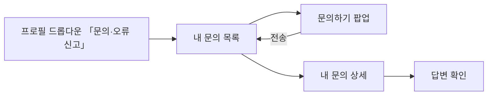

# 크루는 캡틴에게 문의/오류신고를 제출할 수 있다.

기준 프로토타입: 사용자 사이트 › 내 문의 — https://playground.studyclub.life/proto/core/ko/my/feedbacks

## 1. 기본설명

크루가 사이트를 쓰다 생긴 문의 · 개선 의견 · 오류를 캡틴에게 보내고, 캡틴의 답변을 받아 보는 자리다.
**로그인한 사람만 보낸다.** 보낸 것은 운영 콘솔 「문의·오류 신고」에 쌓인다 ([캡틴 조회](../captain-view-feedbacks/PRD.md)).

- 진입은 프로필 드롭다운 하나 — 플로팅 버튼 · 푸터 링크는 두지 않는다
- 가입 과정에서 막힌 사람을 위해 푸터에 운영 메일 주소를 **글자로만** 적는다 (`contact@studyclub.life`)
- 자기 문의를 지우는 길은 두지 않는다. 답변에 다시 묻는 기능도 없다

### 진입·사용 흐름

### 완료 기준

1. 프로필 드롭다운 「찜한 스터디」 아래, 구분선 위에 「문의·오류 신고」 — 누르면 내 문의 목록
2. 내 문의 목록 — 유형 · 제목 · 접수일 · 상태. 접수일 내림차순 고정, 20건씩. 줄을 누르면 상세
3. 상태는 둘 — 접수 · 답변 완료 (콘솔의 미확인·확인 = 접수, 완료 = 답변 완료)
4. [문의하기] → 팝업 — 유형(필수, 기본 선택 없음) · 제목(2~100자) · 내용(10~2000자, 평문) · 이미지 첨부(선택)
5. 유형이 「문의」면 디스코드 채널 안내와 링크. 전송은 그대로 허용
6. 전송하면 팝업이 닫히고 목록 맨 위에 「접수」로 선다. 「의견을 보내주셔서 감사합니다.」
7. 상세 — 유형 · 제목 · 접수 시각 · 상태 · 내가 쓴 내용 · 첨부 이미지 · 답변(없으면 「답변을 준비하고 있어요」)
8. 본인 것만 보인다. 남의 문의 · 없는 번호는 찾을 수 없음

---

## 2. 화면명세

> **화면**: 사용자 사이트 › 내 문의 목록 · 문의하기 팝업 · 내 문의 상세.

### 내 문의 목록

- **내용**: 제목 「내 문의」, 오른쪽에 [문의하기]. 표 — 유형(뱃지) · 제목 · 접수일 · 상태(뱃지)
- **동작**: 줄 어디를 눌러도 상세. 20건씩 페이지
- **정책**
  - 접수일 내림차순 고정
  - 제목은 한 줄로 자른다. 가리키면 전체 제목
  - 상태 뱃지 — 접수(회색) · 답변 완료(초록)
  - 캡틴 전용 메모 · 제출 환경은 보이지 않는다

### 문의하기 팝업

- **내용**: 유형(문의 · 개선 의견 · 오류 신고) · 제목 · 내용 · 이미지 첨부 · [전송]
- **동작**
  - 비거나 길이가 맞지 않으면 그 칸 아래 사유. 넘는 입력은 막고 글자수를 보인다
  - 이미지 — 눌러서 고르기 · 끌어 놓기 · ⌘V 붙여넣기. 3장까지, 장당 5MB, PNG · JPG · WEBP · GIF
  - 전송 중에는 버튼이 돌고 눌리지 않는다
- **정책**
  - 입력·설정 팝업 규칙(POL-0008) — X 와 [전송] 하나, 취소 없음. 닫으면 입력은 사라지고 묻지 않는다
  - 답변을 약속하는 문구는 쓰지 않는다
  - **함께 가는 정보는 브라우저·OS 와 화면 크기뿐이다.** 화면 경로는 모으지 않는다 — 목록을 거쳐 쓰므로 문제의 화면을 가리키지 않는다

### 내 문의 상세

- **내용**: ‹ 목록으로 · 유형 뱃지 · 제목 · 접수 시각 · 상태 · 내가 쓴 내용 · 첨부 이미지 · 답변(시각 · 내용)
- **정책**
  - 내용 · 답변은 평문 — HTML 로 해석하지 않고 줄바꿈만 살린다
  - 답변이 없으면 답변 자리에 회색으로 「답변을 준비하고 있어요」
  - 제출 환경은 보이지 않는다

### 상태별 화면

| 상태 | 화면 | 카피 |
| --- | --- | --- |
| 불러오는 중 | 표 자리 스켈레톤 | — |
| 문의 없음 | 빈 표와 문의하기 | `접수한 문의가 없습니다.` · `문의하기` |
| 목록 오류 | 안내와 다시 시도 | `불러오지 못했습니다. 다시 시도해 주세요.` |
| 전송 성공 | 팝업 닫힘, 초록 알림 | `의견을 보내주셔서 감사합니다.` |
| 전송 실패 | 팝업 유지, 빨간 알림 | `의견을 보내지 못했습니다. 다시 시도해 주세요.` · `다시 시도` |
| 너무 자주 보냄 | 빨간 알림 | `잠시 후 다시 시도해 주세요.` |
| 상세 없음 | 남의 것 · 없는 번호 | `찾을 수 없는 문의입니다.` |

---

## 3. 시스템 요건

### 개발 범위

> 2026-10-19 `beta` 기준. **지금 → 할 일**만 적는다.

| 구분 | 대상 | 지금 | 할 일 |
|---|---|---|---|
| FE | core-front 프로필 드롭다운 「문의·오류 신고」 | 없음 | 찜한 스터디 아래 · 구분선 위 (완료 기준 1) |
| FE | core-front `/my/feedbacks` 목록 · 문의하기 팝업 · `/my/feedbacks/{id}` 상세 | 없음 — 프로토만 있다 | 프로토 `proto/core/[locale]/my/feedbacks` 대로 (완료 기준 2~8) |
| FE | core-front 푸터 운영 메일 | 없음 | `contact@studyclub.life` 글자만 |
| BE | 문의 테이블 | 없음 | 유형 · 제목 · 내용 · 제출자(ACCOUNT_ID) · UA · 화면 크기 · 상태 · 회신 · 캡틴 전용 메모 · 완료 처리자 · 접수 시각 · `DELETED_AT` |
| BE | 이미지 첨부 | 없음 | 업로드(STORAGE_OBJECT) fileId 를 문의에 잇는다. 3장 · 장당 5MB |
| BE | `POST /api/feedbacks` · `GET /api/my/feedbacks(/{id})` | 없음 · **스펙 없음** | 스펙 → 구현. 아래 표 |

- **범위 밖** — 비로그인 제출 · 자기 문의 삭제 · 답변에 되묻기 · 화면 경로 수집

### API

| 메서드 | 경로 | 설명 |
|---|---|---|
| POST | `/api/feedbacks` | 제출 — **인증 필수**. type · title · content · images(fileId) · userAgent · viewport. 사용자 기준 rate limit |
| GET | `/api/my/feedbacks` | 내 문의 목록 — 본인 것만, 접수 시각 내림차순, offset · limit. 상태는 접수 · 답변 완료로 내려준다 |
| GET | `/api/my/feedbacks/{id}` | 내 문의 상세 — 본인 것만. 남의 것 · 없는 id 는 404. 회신(내용 · 시각) 포함, 캡틴 전용 메모 · UA · 화면 크기 제외 |

### 처리

| 경우 | 처리 |
|---|---|
| 짧은 시간에 반복 제출 | 사용자 기준 rate limit — `잠시 후 다시 시도해 주세요.` |
| 내용에 HTML | 문자 그대로 저장·출력 |
| 길이 초과 | 입력 단계에서 막고 글자수를 보인다 |
| 캡틴이 지운 문의(소프트 삭제) | 내 문의 목록·상세에서도 빠진다 |
