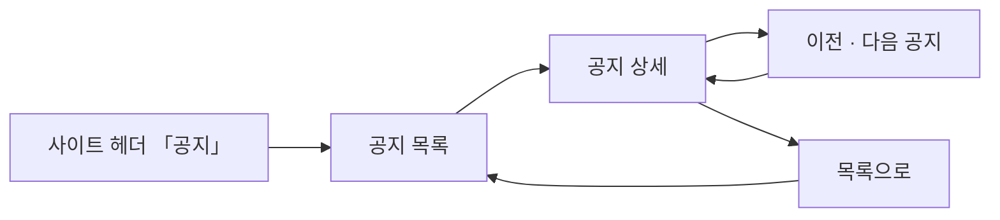

# 크루는 스터디클럽 공지를 확인할 수 있다.

기준 프로토타입: 사용자 사이트 › 공지 — https://playground.studyclub.life/proto/core/ko/notices

## 1. 기본설명

캡틴이 올린 사이트 공지를 읽는 자리다. 크루와 비로그인 방문자 모두 본다 — 로그인 없이 볼 수 있다.
[캡틴의 사이트 공지](../captain-post-notice/PRD.md)(ST-033)와 같은 데이터를 쓴다.

- 읽기 전용. 댓글·반응은 없다
- 공지는 등록되면 바로 공개된다. 초안·예약·비공개·고정 상태는 없다
- 새 공지를 알리는 뱃지·메일은 없다
- 작성자는 노출하지 않는다

### 진입·사용 흐름

### 완료 기준

1. 사이트 헤더 「공지」에서 목록으로 진입 — 로그인 없이
2. 목록 — 제목 · 게시일. 게시일 내림차순 고정, 10건씩. 줄을 누르면 상세
3. 상세 — 제목 · 게시일 · 본문
4. 본문은 평문 — 줄바꿈·공백 보존, HTML 로 해석하지 않음, 본문 속 URL 은 링크
5. 상세 아래 이전·다음 공지 — 이동할 공지의 제목 표시, 끝에서는 비활성
6. 상세 아래 「목록으로」
7. 삭제된 공지는 목록·상세·이전다음 어디에도 없음 — 주소로 들어오면 404
8. 작성자 비노출

---

## 2. 화면명세

> **화면**: 사용자 사이트 › 공지 목록 · 공지 상세.

### 공지 목록

- **내용**: 제목 · 게시일 한 줄씩. 작성자 · 분류 · 고정 표시 없음
- **모양**: 페이지 폭을 다 쓰는 게시판 — 카드로 감싸지 않는다. 가운데 한 덩어리로 두면 앱 화면처럼 보인다
- **동작**
  - 게시일 내림차순 고정. 정렬을 바꾸는 수단은 없다
  - 10건씩 페이지. 한 페이지에 다 들어가면 페이지 번호를 보이지 않는다
  - 줄 어디를 눌러도 상세로 간다
- **정책**
  - 제목은 남는 폭을 다 쓰고 한 줄로 자른다(말줄임). 게시일은 고정폭·줄바꿈 없음
  - 삭제된 공지는 목록에 없다 — 서버가 뺀다

### 공지 상세

- **내용**: 제목 · 게시일 · 본문. 아래에 다음 공지 · 이전 공지 두 줄, 「목록으로」
- **모양**: 목록과 같은 게시판 글 — 페이지 폭, 카드 없음. 본문 글줄만 읽기 폭으로 묶는다
- **본문**
  - 평문이다. 줄바꿈과 공백을 그대로 보존한다 (`white-space: pre-wrap`)
  - HTML 로 해석하지 않는다. 입력된 태그는 문자 그대로 보인다
  - **`http://` · `https://` 로 시작하는 주소는 링크로 바꾼다** — 새 탭으로 열린다. 문장 끝 마침표·쉼표·닫는 괄호는 주소에 넣지 않는다
  - 이미지 · 서식 · 표는 없다
  - 긴 공백 · 긴 주소가 들어와도 카드 밖으로 넘치지 않는다 — 단어 중간에서도 줄을 바꾼다
- **이전 · 다음**
  - 기준은 게시일 순서. 「다음」은 더 최신, 「이전」은 더 오래된 공지
  - 이동할 공지의 제목을 함께 보인다
  - 가장 최신 공지에서 「다음」, 가장 오래된 공지에서 「이전」은 비활성 — 「다음 공지가 없습니다」
  - 공지가 1건뿐이면 둘 다 비활성
- **제목**: 상세에서는 자르지 않고 전체를 보인다

### 상태별 화면

| 상태 | 화면 | 카피 |
| --- | --- | --- |
| 불러오는 중 | 목록 · 본문 자리 스켈레톤 | — |
| 목록 있음 | 제목 · 게시일 줄 | — |
| 공지 없음 | 빈 카드 | `등록된 공지가 없습니다.` |
| 오류 | 안내와 다시 시도 | `공지를 불러오지 못했습니다. 다시 시도해 주세요.` · `다시 시도` |
| 404 | 삭제된 공지 · 없는 id | 사이트 공통 404 |

### 비고

- 프로토는 mock 으로 그린다. 불러오는 중 · 오류 상태는 프로토에 없다

---

## 3. 시스템 요건

### 개발 범위

> 2026-10-18 `beta` 기준. **지금 → 할 일**만 적는다.

| 구분 | 대상 | 지금 | 할 일 |
|---|---|---|---|
| FE | core-front `/notices` 목록 | 없음 — 프로토만 있다 | 프로토 `proto/core/[locale]/notices` 대로. 비로그인 접근 허용 (완료 기준 1·2) |
| FE | core-front `/notices/{id}` 상세 | 없음 | 평문 · URL 링크 · 이전·다음 · 목록으로 (완료 기준 3~6) |
| BE | `GET /api/notices` · `GET /api/notices/{id}` | 없음 · **스펙 없음** | 스펙 → 구현. 삭제 건 제외, 상세는 404. [captain-post-notice](../captain-post-notice/PRD.md) 의 공지 테이블을 쓴다 |

- **범위 밖** — 댓글 · 반응 · 새 공지 뱃지 · 알림 메일 · 검색

### API

| 메서드 | 경로 | 설명 |
|---|---|---|
| GET | `/api/notices` | 목록 — 삭제되지 않은 것, 게시일 내림차순, 페이지. 제목 · 게시일. 작성자 없음. 비로그인 허용 |
| GET | `/api/notices/{id}` | 상세 — 제목 · 게시일 · 본문 + 이전·다음 공지의 id · 제목. 삭제·없는 id 는 404. 비로그인 허용 |

- 삭제 걸러내기는 **서버가 한다.** 프런트에서 거르지 않는다

### 처리

| 경우 | 처리 |
|---|---|
| 보던 공지가 열람 중 삭제됨 | 다음 조회에서 404 |
| 이전·다음 대상이 삭제됨 | 그 건을 건너뛰고 그다음 공지로 잇는다 — 서버가 계산한다 |
| 제목이 아주 김 | 목록은 한 줄 말줄임, 상세는 전체 |
| 본문에 긴 공백·줄바꿈 | 그대로 보이되 레이아웃은 깨지지 않는다 |
| 본문에 HTML 태그 | 글자 그대로 보인다 |
