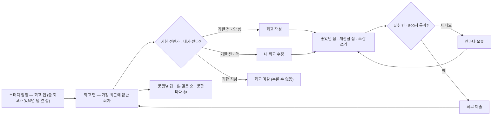

# 크루는 미팅이 끝나면 회고를 남기고 같은 반 회고에 공감할 수 있다.

story_id: ST-039 · IA: IA-040 · IA-041

기준 프로토타입: 내 스터디 › 스터디 일정 › 회고 탭 · 회고 작성

관련 결정: [POL-0001 역할과 권한](../../_registry/policies/POL-0001-roles.md)

## 1. 기본설명

### 진입·사용 흐름

### 완료 기준

1. 일정 표에는 회고 열이 없다 — 쓸 수 있는데 안 쓴 회고가 있으면 「회고」 탭 옆 점
2. 회고 탭 버튼 — 기한 전 안 씀 「회고 작성」 · 기한 전 씀 「내 회고 수정」 · 기한 뒤 「회고 마감」(비활성)
3. 회고 작성 — 좋았던 점 · 개선할 점(필수) · 소감(선택), 문항마다 500자 · 글자 수
4. 필수 칸 누락 시 칸별 오류 표시와 제출 차단
5. 제출 뒤 완료 토스트와 회고 탭의 그 회차로 이동
6. 기한 안 내 회고 수정 — 쓴 내용 채움, 받은 👍 유지
7. 회고 탭 회차 고르기 — 끝난 회차만, 처음엔 가장 최근 회차
8. 문항별 보기 하나 — 문항마다 답을 👍 많은 순으로
9. 마감 시각 확인 — 기한 전 「…까지」 · 기한 뒤 「… 마감」 (내 프로필 시간대 · 약칭). 「n명 중 m명 작성」은 네비게이터 · 캡틴만
10. 쓰기 전에도 같은 반 회고 열람 — 실명
11. 문항마다 👍 누르기 · 취소, 0 도 표시
12. 내 답의 👍 는 받은 수만 확인
13. 아직 안 썼으면 회고 작성 권유 문구 확인 (안 쓴 사람 이름은 크루에게 보이지 않음)
14. 기한이 지난 회차의 작성 · 수정 차단 안내
15. 끝난 미팅이 없을 때 안내 문구

---

## 2. 화면명세

> **화면**: 내 스터디 › 스터디 일정(일정 탭 회고 칸) · 회고 탭 · 회고 작성.
>
> 아래 번호별 명세는 프로토의 **설명 보기**에서 그대로 가져온다. 손으로 고치지 않는다 —
> 고치려면 화면 옆 `spec.ts` 를 고치고 `pnpm --filter playground export-specs` 를 돌린다.

<!-- spec:start retro -->

> 프로토 가정: 다른 참여자는 끝난 회차마다 열에 여섯 꼴로 썼고, 나는 가장 최근에 끝난 회차만 아직 안 썼다. 👍 수는 가정 값에 내가 누른 것을 더한다
>
> 내 회고와 내가 누른 👍 는 브라우저(localStorage)에만 남는다. 저장할 서버가 아직 없다

### 1 — 회고 탭 점

- **조건**: 내가 지금 쓸 수 있는데 아직 안 쓴 회차가 있을 때 (캡틴은 없다)
- **내용**: 스터디 탭 「회고」 글자 오른쪽 위에 작은 점. 화면 읽기 프로그램에는 「쓸 수 있는 회고 n개」
- **동작**: 회고를 쓰고 돌아오면 사라진다
- **정책**
  - 일정 표에는 회고 열을 두지 않는다 — 일정 · 출석 · 회고는 같은 높이의 탭이고, 출석도 일정 표에 넣지 않는다
  - 점이 일정 표의 「회고 작성」 버튼을 대신해 미팅 뒤 쓸 회고가 있다고 알린다

### 2 — 회고 탭

- **내용**: 스터디 일정의 탭 「일정 · 출석 · 회고」 중 회고
- **동작**: 주소는 …/schedule/retro?meeting={회차}. 회차를 고르면 주소가 바뀌어 새로고침해도 그 회차에 머문다
- **정책**: 회고 작성 페이지에 있어도 회고 탭이 선택된 채로 보인다

#### 2-1 — 회차 고르기

- **내용**: 미팅이 끝난 회차 목록. 처음 열면 가장 최근에 끝난 회차
- **동작**: 고르면 그 회차의 회고로 바뀐다

#### 2-3 — 마감 시각

- **내용**: 회차 고르기 오른쪽. 기한 전: 「MM.DD HH:mm 약칭까지」(예: 11.27 20:00 EST) · 지난 뒤: 「MM.DD HH:mm 약칭 마감」
- **정책**
  - 기한 = 다음 정규 회차 시작 시각
  - 마지막 회차는 다음 회차가 없어 미팅 종료 뒤 7일
  - 시각은 내 프로필 시간대 기준 — 일정 표와 같은 날짜가 나온다 (반 시간대가 아니라). 시간대 약칭을 붙인다
  - 회차마다 나오는 줄이라 작게 — 큰 안내 상자를 두지 않는다

#### 2-4 — 작성 수

- **조건**: 네비게이터 · 캡틴
- **내용**: 「n명 중 m명 작성」 — n은 그 회차 회고를 쓸 사람, m은 쓴 사람
- **정책**
  - 크루에게는 보이지 않는다 — 남이 썼는지는 크루가 알 필요가 없다
  - 쓸 사람 = 그 회차 시작 때 반에 있던 참여자. 그전에 참여를 중단한 사람은 뺀다

#### 2-5 — 회고 작성 · 내 회고 수정 · 회고 마감

- **조건**: 크루 · 네비게이터 (캡틴은 쓰지 않아 없다)
- **내용**
  - 기한 전 · 아직 안 씀: 「회고 작성」
  - 기한 전 · 이미 씀: 「내 회고 수정」
  - 기한 뒤: 「회고 마감」 — 누를 수 없다
- **동작**: 「회고 작성」은 빈 작성 페이지로, 「내 회고 수정」은 쓴 내용이 채워진 작성 페이지로 간다
- **정책**
  - 고쳐도 받은 👍 는 남는다
  - 삭제는 없다

### 3 — 회고 목록 (문항별)

- **내용**
  - 좋았던 점 · 개선할 점 · 소감 카드. 문항마다 답 수, 답마다 이름 · 답 · 👍
  - 내 답은 「나」 표시와 옅은 배경
  - 비운 사람은 따로 적지 않는다
  - 쓴 회고가 없으면 「아직 이 회차에 남긴 회고가 없어요.」
- **정책**
  - 문항별 하나만 둔다 — 한 사람씩 묶는 작성자별 보기는 두지 않는다
  - 순서: 누구나 👍 많은 순, 같으면 쓴 순서
  - 실명으로 보인다
  - 쓰기 전에도 같은 반 회고를 볼 수 있다
- **데이터**: GET /api/studies/{studyId}/meetings/{meetingId}/retros

#### 3-3 — 👍 공감

- **내용**
  - 문항마다 공감 수. 0 이어도 보인다
  - 내가 누른 문항은 누른 상태로 구분된다
  - 답 글 오른쪽
- **동작**: 누르면 +1, 다시 누르면 취소
- **정책**
  - 한 사람이 문항마다 한 번
  - 내 답에는 누르지 못하고 받은 수만 본다
  - 누른 사람 이름은 보이지 않는다 — 수만
  - 기한이 지나도 누를 수 있다
- **데이터**: PUT · DELETE /api/studies/{studyId}/meetings/{meetingId}/retros/{retroId}/likes/{section}

### 4 — 작성 권유

- **조건**: 기한 전이고 내가 아직 안 쓴 회차
- **내용**: 회고 목록 위에 「아직 회고를 작성하지 않았어요! 회고를 작성해 생각을 나누어 보아요.」
- **정책**
  - 안 쓴 사람의 이름은 크루에게 보이지 않는다 — 이름 목록은 네비게이터 · 캡틴의 작성 현황(작성 현황 1)에만
  - 기한이 지났거나 이미 썼으면 보이지 않는다

### 5 — 끝난 미팅 없음

- **조건**: 끝난 회차가 하나도 없을 때
- **내용**: 「아직 끝난 미팅이 없어요. 미팅이 끝나면 여기서 회고를 남기고 볼 수 있어요.」

### 6 — 쓸 수 없음

- **조건**: 작성 페이지를 열었는데 쓸 수 없을 때
- **내용**
  - 미팅 전: 「미팅이 끝나면 회고를 쓸 수 있어요.」
  - 기한 뒤: 「작성 기한이 지나 회고를 쓰거나 고칠 수 없어요.」
  - 캡틴: 「캡틴은 미팅 참여자가 아니라 회고를 쓰지 않아요.」
  - 「회고 목록으로」

### 7 — 작성 페이지 회차 정보

- **내용**: 회차 · 날짜(요일) · 제목 · 기한(2-3과 같은 문구) · 미팅 종료 시각(「미팅 종료 MM.DD HH:mm 약칭」)
- **정책**: 날짜 · 시각은 2-3 과 같이 내 프로필 시간대 기준

### 8 — 작성 폼

- **내용**
  - 1. 좋았던 점(필수) · 2. 개선할 점(필수) · 3. 소감(선택) — 문항마다 도움말 · 예시 · 글자 수
  - 수정이면 쓴 내용이 채워져 있고 제목이 「n회차 회고 수정」
- **동작**: 고친 칸의 오류는 고치는 즉시 사라진다
- **정책**
  - 문항마다 500자까지
  - 앞뒤 공백을 지우고 저장한다. 공백만 있으면 빈 칸이다
  - 필수 칸이 비면 「좋았던 점을 적어 주세요.」 · 「개선할 점을 적어 주세요.」
- **데이터**: PUT /api/studies/{studyId}/meetings/{meetingId}/retros/me — 처음이면 만들고 있으면 고친다

#### 8-1 — 취소 · 제출

- **내용**: 「취소」 · 「회고 제출」(수정이면 「수정 저장」)
- **동작**
  - 제출하면 「회고를 남겼어요.」(수정이면 「회고를 고쳤어요.」)를 띄우고 회고 탭의 그 회차로 간다
  - 기한이 지난 뒤 제출하면 「작성 기한이 지나 저장하지 못했어요.」를 띄우고 머문다
  - 취소는 저장하지 않고 회고 탭으로 간다

<!-- spec:end retro -->

### 상태별 화면

| 상태 | 화면 | 카피 |
|---|---|---|
| 기본 | 회고 탭 — 가장 최근에 끝난 회차 | 「n명 중 m명 작성」 |
| 빈 결과 | 끝난 회차가 없음 | 「아직 끝난 미팅이 없어요. 미팅이 끝나면 여기서 회고를 남기고 볼 수 있어요.」 |
| 빈 결과 | 그 회차에 쓴 회고 없음 | 「아직 이 회차에 남긴 회고가 없어요.」 |
| 검증 실패 | 작성 폼 칸 아래 | 「좋았던 점을 적어 주세요.」 · 「개선할 점을 적어 주세요.」 · 「500자까지 쓸 수 있어요.」 |
| 처리 실패 | 기한이 지난 뒤 제출 | 「작성 기한이 지나 저장하지 못했어요.」 |
| 권한 없음 | 작성 페이지 — 미팅 전 · 기한 뒤 | 「미팅이 끝나면 회고를 쓸 수 있어요.」 · 「작성 기한이 지나 회고를 쓰거나 고칠 수 없어요.」 |
| 완료 | 제출 · 수정 | 「회고를 남겼어요.」 · 「회고를 고쳤어요.」 |

### 비고

- 범위 밖: 반의 작성 현황([ST-040](../navigator-view-meeting-retros/PRD.md)) · 백오피스 모아보기([ST-041](../captain-collect-meeting-retros/PRD.md)) · 회고 알림 · 회고 삭제
- 미구현: 저장할 서버가 없어 내 회고와 👍 는 브라우저에만 남는다. 처리중 · 조회 실패 상태는 연동 시 함께 정의
- 구현 지시: 자동 갱신 없음 — 다른 사람의 새 회고 · 👍 는 다시 열 때 읽는다

---

## 3. 시스템 요건

### 개발 범위

기준일 2026-11-21 · `beta`

| 구분 | 대상 | 지금 | 할 일 |
|---|---|---|---|
| FE | core-front 회고 탭 점 · `/my/joined/{id}/schedule/retro` · `…/retro/write` | 없음 | 화면 · API 연결 |
| BE | `GET /api/studies/{studyId}/retros/status` | 스펙작성중 | 스펙 확정 · 구현 |
| BE | `GET /api/studies/{studyId}/meetings/{meetingId}/retros` | 스펙작성중 | 스펙 확정 · 구현 |
| BE | `PUT /api/studies/{studyId}/meetings/{meetingId}/retros/me` | 스펙작성중 | 스펙 확정 · 구현 |
| BE | `PUT · DELETE /api/studies/{studyId}/meetings/{meetingId}/retros/{retroId}/likes/{section}` | 스펙작성중 | 스펙 확정 · 구현 |
| 기획 | ZAPP 기획 「스터디 미팅 회고」 항목 | S-03 소감 · 👍 · 보기 전환이 기획 항목에 없음 | 항목 추가 |

### 데이터

| 필드 | 타입 | 필수 | 제약 · 뜻 |
|---|---|---|---|
| `good` | string | 예 | 앞뒤 공백 제거 뒤 1~500자 |
| `improve` | string | 예 | 앞뒤 공백 제거 뒤 1~500자 |
| `feeling` | string | 아니오 | 0~500자. 빈 문자열 = 남기지 않음 |
| `writtenAt` | datetime | 예 | 마지막으로 저장한 시각 — 화면에는 보이지 않고 목록 순서에만 쓴다 |
| 👍 | (회고, 문항, 누른 사람) | — | 한 사람이 문항마다 하나. 내 회고 · 빈 소감에는 없다 |

한 회차에 한 사람의 회고는 하나다 (회차 · 참여자 유일).

### 계산 규칙

단일 정의 위치: 서버 회고 서비스. 프로토는 `frontend/apps/playground/src/proto/core/lib/retros.ts`.

- **미팅 종료** = 회차 시작 + 진행 시간
- **기한** = 다음 정규 회차 시작. 마지막 회차는 미팅 종료 + 7일
- **쓸 수 있음** = 미팅 종료 ≤ 지금 < 기한
- **쓸 사람(n)** = 그 회차 시작 때 반에 있던 참여자. 그전에 참여를 중단한 사람은 뺀다
- **쓴 사람(m)** = 쓸 사람 중 그 회차 회고가 있는 사람

### 처리

- 작성 · 수정은 `PUT …/retros/me` 한 경로다. 없으면 만들고 있으면 고친다
- 서버가 기한을 다시 본다. 기한 밖이면 `409 RETRO_CLOSED`, 미팅 전이면 `409 RETRO_NOT_OPEN`
- 필수 누락 · 500자 초과는 `400`
- 고쳐도 받은 👍 는 남는다
- 👍 는 기한과 상관없이 누르고 취소한다. 같은 요청을 두 번 보내도 결과가 같다

### 권한

| 동작 | 허용 | 검증 |
|---|---|---|
| 회고 목록 보기 | 그 반 참여자 · 반 네비게이터 · 담당 캡틴 | 서버 |
| 내 회고 쓰기 · 고치기 | 그 회차의 쓸 사람 | 서버 |
| 👍 | 그 반 참여자 (자기 회고 제외) | 서버 |

### 퍼널·계측

- 단계: 재방문 — 미팅 뒤 사이트로 돌아오는 이유를 만든다
- 이벤트 (front, Amplitude): `Meeting Retro Submitted` (`study_id`, `meeting_id`, `is_edit`, `has_feeling`) · `Meeting Retro Liked` (`study_id`, `meeting_id`, `section`) — [트래킹 플랜](../../../specs/analytics/spec.md)
- 지표: 회차별 회고 작성률
- 실험: 해당 없음

### API

[meeting-retro 스펙](../../../specs/meeting-retro/spec.md)
