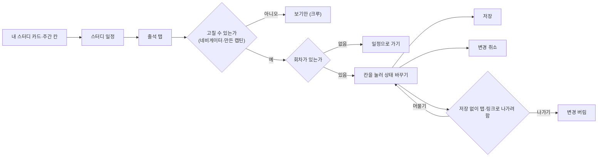
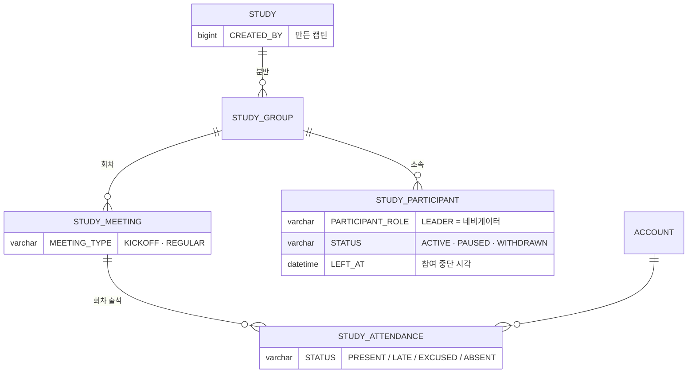

# 네비게이터는 스터디별 출석 상태를 수정할 수 있다.

기준 프로토타입: 스터디 일정 — 출석 탭, 캡틴·네비게이터로 볼 때 (playground 사용자 사이트 · 내 스터디 → 스터디 일정 → 출석)

관련 결정: [10-05 출석률 집계에서 하차·탈퇴를 다루는 방식](../../../docs/share/2026-10-05-attendance-withdrawn-logic.md) · [10-18 일정·출석 화면 피드백](../../../docs/share/2026-10-18-schedule-attendance-feedback.md)

화면 캡처 (2026-10-06): [네비게이터 출석부](../navigator-register-sessions/assets/3-navigator-attendance.jpg)

## 1. 기본설명

· **진입·사용 흐름**

· **완료 기준**

1. 내 분반 참여자 × 회차 출석 격자 조회
2. 칸 클릭으로 출석·지각·결석·휴가·미체크 전환
3. 저장으로 일괄 반영. 저장 전 변경 칸만 그 상태 색 테두리로 구분 (평소에는 테두리 없음)
4. 저장 전 변경 일괄 되돌리기
5. 미저장 상태로 이탈 시 재확인
6. 참여자별 출석률 실시간 재계산. 킥오프 제외
7. 내 분반 참여자만 표시. 캡틴은 정보 카드의 「백오피스 출석부」로 이동
8. 회차 없을 때 안내와 일정으로 가는 경로
9. 수정 권한: 네비게이터와 담당 캡틴. 그 외에는 조회 화면
10. 표 제목 「출석」 옆에는 전체 인원 N 만. 고른 인원은 작업 바의 「n명 선택」
11. KST · PDT 탭으로 회차 머리의 일자를 바꿔 본다. 칸 값은 바뀌지 않는다
12. 닉네임 · 디스코드 닉네임 · 발표 횟수(왼쪽)와 출석률(오른쪽)은 고정, 회차 열만 가로 스크롤
13. 제목 옆 「?」 로 발표(마이크) 표시 설명을 연다

## 2. 화면명세

> **화면**: 스터디 일정 — 출석 탭 (캡틴·네비게이터)

스터디 정보 카드 · 탭은 [회차 등록 PRD](../navigator-register-sessions/PRD.md) 11·12와 같다. 범위 안내 · 반 이름 · 진행 기간 · 조작 안내 · 회차 추가 버튼은 두지 않는다 — 탭 이름과 표가 이미 말해 준다.

### 1. 백오피스 출석부

- **내용**: 「백오피스 출석부」 버튼. 스터디 정보 카드 오른쪽 바로가기 줄의 맨 앞(「디스코드」 왼쪽)
- **동작**: 백오피스에서 그 스터디의 출석 탭으로 간다. 다른 반은 거기서 반 칩으로 골라 본다
- **정책**: 캡틴에게만 보인다. 네비게이터는 백오피스에 들어갈 수 없다. 정보 카드는 탭 위에 있어 일정 탭에서도 보인다
- **조건**: 그 스터디를 만든 캡틴일 때

### 1-1. 표 제목 줄

- **내용**: 왼쪽 제목 「출석」 · 옆에 「전체 N」 · 「?」(발표 표시 설명). 오른쪽에 KST · PDT 탭. 일정 탭 「일정」 제목 줄과 같은 모양
- **동작**
  - KST · PDT 를 바꾸면 회차 머리의 일자와 작업 바의 회차 목록이 그 시간대 날짜로 다시 보인다
  - 「?」 를 누르면 설명이 열린다: 칸 왼쪽 위 마이크 = 그 회차 발표자, 일정 탭 발표자1·2에서 가져옴, 「발표 횟수」 세는 법. 바깥을 누르거나 Esc 로 닫는다
- **정책**
  - N 은 표의 줄 수. 나 · 운영진 · 참여 중단한 사람을 모두 센다
  - 고른 사람 수는 제목에 두지 않는다. 작업 바(§3)의 「n명 선택」 하나뿐
  - 시간대 처음 값은 분반 시간대(탭에 없으면 KST). 일정 탭과 따로 고른다
  - 시간대는 보이는 것만 바꾼다. 칸 값 · 출석률 · 저장 값은 그대로
  - 「?」 설명은 늘 펼쳐 두지 않는다. 궁금한 사람만 연다
- **데이터**: 회차 시작 순간 `SCHEDULED_AT`(UTC) → 고른 시간대

### 2. 출석부

- **내용**
  - 참여자 × 회차 격자. 한 칸이 한 사람의 한 회차
  - 첫 열은 「킥오프」, 다음 열부터 「1회」 「2회」 …. 회차 머리 아래는 일자 `M/dd` 만 (§1-1 에서 고른 시간대). 시각은 일정 탭에 있다
  - 열 순서: 닉네임 → 디스코드 닉네임 → 발표 횟수 → 회차 칸들 → 출석률
  - 닉네임 열에는 닉네임만. 동명이인은 옆 「디스코드 닉네임」 열이 가른다. 디스코드 닉네임이 길면 말줄임, 가리키면 전체, 없으면 「-」
  - 닉네임 옆에 캡틴 · 네비게이터 역할 칩. 크루는 칩이 없다. 맨 위 줄은 나
  - 칸 값은 출석 · 지각 · 결석 · 휴가 중 하나. 체크하지 않았으면 옅은 회색 빈 칸(테두리 없음)
  - 발표자로 맡은 회차의 칸 왼쪽 위에 마이크 표시
- **동작**
  - 칸을 누를 때마다 출석 → 지각 → 결석 → 휴가 → 미체크 순으로 바뀐다
  - 칸에 마우스를 올리면 「눌러서 출석 → 지각 → 결석 → 휴가 → 미체크」. 저장 상태는 말하지 않는다. 테두리가 보여 준다
  - 눌러도 저장하지 않는다. 저장된 값과 다른 칸에만 그 상태 색 테두리(출석 초록 · 지각 주황 · 결석 빨강 · 휴가/미체크 회색). 사이트 포인트 색을 쓰지 않는다
  - 가로 스크롤은 회차 열만. 닉네임 · 디스코드 닉네임 · 발표 횟수는 왼쪽, 출석률은 오른쪽에 고정
- **정책**
  - 한 바퀴 돌면 미체크로 돌아온다. 잘못 누른 것을 되돌릴 수 있다
  - 바뀐 칸은 색만으로 구분하지 않는다. 스크린리더는 「출석 · 저장되지 않음」처럼 읽는다
  - 반 선택은 없다. 내 분반 하나만 보인다
  - 발표 표시 · 발표 횟수는 일정 탭의 발표자1·2에서 계산한다. 출석부에서 입력하지 않는다
  - 회차 칸은 상태와 상관없이 모두 같은 너비(중단 뒤 「-」 칸 포함). 출석률 열 너비도 고정
  - 닉네임과 킥오프 사이는 좁게, 남는 폭은 마지막 회차와 출석률 사이에 둔다
  - 출석률 · 빈 칸 「-」 은 가운데 정렬
  - 휴대폰 폭에서는 디스코드 닉네임 열을 숨기고 고정 열을 좁혀 회차 칸이 보이게 한다. 디스코드 닉네임은 닉네임 아래에 작은 회색 글씨로 둔다(동명이인을 누르지 않고도 가른다). 역할 칩 · 「참여 중단」 칩은 닉네임을 밀어내므로 휴대폰 폭에서 화면에서만 숨긴다. 스크린리더는 역할 · 참여 중단을 그대로 듣는다
  - 디스코드 닉네임은 같은 분반 참여자에게만 보인다. 같은 디스코드 서버에서 이미 서로 보이는 별명이다. 회원 탈퇴한 사람은 「-」. 글자로만 그린다 (→ share 10-18 「D6 근거와 범위」)
- **데이터**: `STUDY_ATTENDANCE` 내 분반의 회차 × 참여자 · `ACCOUNT.DISCORD_NICKNAME`(디스코드 닉네임)
- **조건**: 회차가 하나 이상일 때

### 2-1. 스터디를 중단한 사람

- **내용**: 흐린 이름 + 「참여 중단」 칩. 중단 시각 뒤에 시작하는 회차 칸은 「-」 (누를 수 없다)
- **정책**
  - 하차·제명을 가르지 않는다. 사유는 보이지도 저장하지도 않는다
  - 맨 아래 줄로 내린다. 줄을 지우지 않는다. 중단 전 출석은 남고 고칠 수 있다
  - 출석률은 중단 시각까지의 회차만 센다. 숫자는 회색 · 보통 굵기
- **데이터**: `STUDY_PARTICIPANT.STATUS = WITHDRAWN` · `LEFT_AT`

### 3. 작업 바

- **내용**: 출석부 카드 맨 위 한 줄([POL-0008 「표 맨 위 작업 바」](../../_registry/policies/POL-0008-screen-rules.md)). 왼쪽은 고른 사람에게 하는 일([참여 중단 PRD](../navigator-withdraw-participant/PRD.md) §2), 오른쪽은 「변경 취소 · 저장」. 변경 칸 수 · 안내 문구는 없다
- **동작**
  - 저장 → 바뀐 칸을 한 번에 반영한다. 화면에 결과 문구는 두지 않고, 스크린리더에만 「출석 n칸을 저장했습니다.」
  - 변경 취소 → 저장 전 값으로 되돌린다. 고친 것이 있을 때만 보인다
  - 저장 중에는 저장 · 변경 취소 · 칸이 잠긴다
  - 스크롤하면 사이트 머리 아래에 붙어 따라온다
  - 일괄 변경 드롭다운은 마우스로 고르면 바로, 키보드는 화살표로 옮긴 뒤 Enter 나 칸을 떠날 때 확정. Esc 는 미리 본 값을 버린다
- **정책**: 바뀐 칸이 없으면 저장을 누를 수 없다. 고른 사람이 없으면 왼쪽 드롭다운 · 버튼은 옅은 회색(비활성)
- **조건**: 캡틴 · 네비게이터

### 4. 나가기 확인

- **내용**: 창 제목 「저장하지 않은 변경이 있습니다」 · 본문 「저장을 누르지 않으면 고친 내용이 사라집니다. 나가기 전에 저장해 주세요.」 · 「저장하지 않고 나가기」 · 「이 화면에 머물기」
- **동작**: 저장하지 않은 칸이 있는 채로 일정 탭 · 「내 스터디」 링크를 누르면 뜬다
- **정책**: 새로고침 · 창 닫기는 브라우저 기본 안내를 쓴다

### 5. 회차 없음

- **내용**: 「아직 회차가 없습니다.」 · 「일정 탭에서 회차를 만들면 이 반의 출석부가 만들어집니다.」 · 「일정으로 가기」
- **동작**: 누르면 일정 탭으로 간다
- **조건**: 분반에 회차가 하나도 없을 때

### 상태별 화면

| 상태 | 화면 | 카피 |
| --- | --- | --- |
| 기본 | 출석부 (캡틴은 백오피스 출석부 버튼) | — |
| 고치는 중 | 바뀐 칸에 상태 색 테두리 · 작업 바 「저장」 활성 | `변경 취소` · `저장` |
| 처리중 | 저장 · 변경 취소 · 칸 잠김 | — |
| 완료 | 테두리 사라짐 · 「저장」 잠김 | - (스크린리더 `출석 n칸을 저장했습니다.`) |
| 나가기 확인 | 확인 창 | `저장하지 않은 변경이 있습니다` |
| 회차 없음 | 격자 대신 안내 | `아직 회차가 없습니다.` |
| 고칠 수 없음 | 보기 화면 ([crew-view-attendance-record](../crew-view-attendance-record/PRD.md)) | — |

### 데이터 관계

### 비고

- 범위 밖: 회차 추가·수정(일정 탭 — [회차 등록 PRD](../navigator-register-sessions/PRD.md)), 다른 반 출석부(백오피스 반 칩 — [captain-view-attendance-roster](../captain-view-attendance-roster/PRD.md)), 디스코드 출석 체크, 참여 중단([navigator-withdraw-participant](../navigator-withdraw-participant/PRD.md))
- 미구현: 저장은 브라우저에만 남는다
- 구현 지시: 칸 값 · 순환 · 저장 방식은 백오피스 출석부와 같은 컴포넌트를 쓴다. 다른 점은 보이는 참여자 범위와 머리 줄을 숨기는 것뿐이다
- 옛 출석 기록 주소 `/my/joined/{id}/attendance` 는 이 탭(`/my/joined/{id}/schedule/attendance`)으로 보낸다

## 3. 시스템 요건

### 개발 범위

> 2026-10-14 `beta` 기준. **지금 → 할 일**만 적는다. 다 끝나면 「할 일」이 모두 「없음」이 된다.
> FE 「지금」은 실제 앱의 화면과 데이터 연결(API · mock)까지 본 값이다 — 완료 기준 하나하나의 동작은 따로 확인하지 않았다.
> BE 「지금」은 스펙 엔드포인트 표의 상태 칸을 옮겨 적는다.

| 구분 | 대상 | 지금 | 할 일 |
|---|---|---|---|
| FE | core-front 스터디 일정 › 출석 편집 | 없음 — 스터디 일정 화면이 자리만 있다 | 백오피스 출석부와 같은 격자 컴포넌트로 만든다 |
| BE | `GET` · `POST /api/me/studies/{studyId}/attendances` | 구현완료 | 없음 |
| 기획 | 참여 중단자 줄 | 이 PRD 2-1 은 맨 아래 줄에 남긴다 · share 는 기본 뷰를 `ACTIVE` 만으로 정했다 | 어느 쪽인지 정한다 ([share 10-05](../../../docs/share/2026-10-05-attendance-withdrawn-logic.md)) |

#### 10-18 기획 변경: FE / BE 추가 작업

> 결정 전문은 [share 10-18 일정·출석 화면 피드백](../../../docs/share/2026-10-18-schedule-attendance-feedback.md). D# 는 그 문서의 결정 번호.

| 구분 | 할 일 | 결정 |
|---|---|---|
| FE | 작업 바를 출석부 카드 맨 위로 옮기고 스크롤 시 고정. 제목 옆은 「전체 N」 만 | D1 · D10 |
| FE | 「백오피스 출석부」 버튼을 정보 카드 바로가기 줄 맨 앞(「디스코드」 왼쪽)으로 | D4 |
| FE | 고정 열(닉네임 · 디스코드 닉네임 · 발표 횟수 / 출석률), 회차 칸 너비 통일, 회차 머리 일자만, 빈 칸 가운데 정렬 | D5 |
| FE | 기본 테두리 제거, 고친 칸만 상태 색 테두리 | D5 |
| FE | 「크루」 열 → 「닉네임」, 오른쪽 「디스코드 닉네임」 열 추가. 닉네임에 디스코드 닉네임을 붙이지 않음 | D6 |
| FE | 제목 옆 「?」 발표 표시 설명 팝오버 | D9 |
| FE | 탭 이름 「출석부」 → 「출석」 | D10 |
| BE | 출석 조회 응답 `participants[]` 에 `discordNickname` 추가 ([attendance 스펙](../../../specs/attendance/spec.md)에 필드 추가 후 구현) | D6 |

### 데이터

| 필드 | 값 |
| --- | --- |
| STUDY_ATTENDANCE.STATUS | `PRESENT` 출석 · `LATE` 지각 · `ABSENT` 결석 · `EXCUSED` 휴가. 읽을 때 null 이면 미체크 |

### 처리

- 저장은 바뀐 칸만 모아 한 요청으로 보낸다 (`updates[]`)
- 행이 없으면 만들고, 있으면 고친다
- 한 요청 전체를 한 트랜잭션으로 반영한다. 한 칸이라도 거절되면 아무것도 반영하지 않는다
- 서버는 각 칸의 회차·참여자가 그 스터디에 속하는지 검증한다. 아니면 400
- 같은 칸이 한 요청에 두 번 오면 400. 같은 칸을 동시에 고치면 나중 요청의 값이 남는다 (한 문장 upsert라 충돌 409는 없다 — [출석 스펙](../../../specs/attendance/spec.md))

### 계산 규칙 (단일 정의)

- 출석률 = (출석 × 1 + 지각 × 0.5) / 체크한 정규 회차. 휴가 · 미체크는 분모에서 뺀다. 분모가 0 이면 「-」
- 킥오프(`MEETING_TYPE = KICKOFF`)는 칸은 보이고 체크도 하지만 출석률에 넣지 않는다
- 참여 중단자는 `LEFT_AT` 까지의 회차만 센다
- 백오피스 출석부 · 내 스터디 출석률과 같은 식이다 — [attendance/spec.md](../../../specs/attendance/spec.md)

### API

| 메서드 | 경로 | 권한 |
| --- | --- | --- |
| GET | `/api/me/studies/{studyId}/attendances` | 그 분반 활성 참여자(조회) · 네비게이터 · 만든 캡틴 |
| POST | `/api/me/studies/{studyId}/attendances` | 그 분반 LEADER · 그 스터디를 만든 캡틴 |

계약은 [attendance/spec.md](../../../specs/attendance/spec.md).

### 권한

- 고치기: 그 분반의 `PARTICIPANT_ROLE = LEADER`, 그 스터디를 만든 캡틴(`STUDY.CREATED_BY`). 아니면 403
- 다른 캡틴(ADMIN)이 신청해 참여했으면 사용자 사이트에서는 크루다 — 고치기는 백오피스에서 한다
- 서버에서 검증한다. 화면에서 칸을 막는 것은 편의일 뿐이다

### 외부 연동

- 없음

### 현재 백엔드와 차이 (2026-10-06 `beta`)

- 캡틴 판정이 `SYSTEM_ROLE = ADMIN` 이면 누구나 통과 — 만든 캡틴으로 좁혀야 한다 (노션 #58)
- 출석률이 킥오프를 빼지 않고, 응답에 역할 · 참여 상태 · 중단 일자가 없다 (노션 #63)

## 4. 미확정

- 미체크로 되돌린 칸을 저장하는 방법 — 쓰기 API 는 네 값만 받는다
- ~~네비게이터 쓰기를 맡은 분반 칸으로 좁힐지~~ → 분반 단위. 타 분반 네비게이터는 403 ([authz-guards](../../../specs/authz-guards/spec.md) B, 2026-10-07)
- ~~캡틴(`SYSTEM_ROLE = ADMIN`)이 사용자 사이트에서 쓸 때의 권한 판정~~ → 그 스터디를 만든 캡틴만 고친다. 다른 캡틴은 크루 (2026-10-06)
