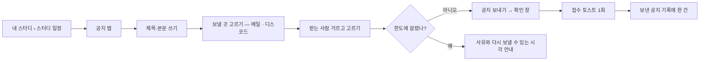

# 네비게이터는 스터디별 공지를 등록할 수 있다.

기준 프로토타입: 내 스터디 › 스터디 일정 › 공지 — https://playground.studyclub.life/proto/core/ko/my/joined

관련 결정: [POL-0010 스터디 공지 발송](../../_registry/policies/POL-0010-study-notice.md)

## 1. 기본설명

**네비게이터가 자기 반 팀원에게, 원할 때 메일과 디스코드로 공지를 보내는** 화면이다.
스터디 안에서 「이번 주 장소가 바뀌었다」 같은 말을 전하려고 디스코드에 직접 글을 쓰고 한 명씩 메일을 보내던 일을 한 곳에서 한다.

- **백오피스가 아니라 사용자 사이트다.** 네비게이터는 백오피스에 들어갈 수 없다. 내 스터디 › 스터디 일정의 새 탭 「공지」에 둔다
- 「등록」은 **게시판에 글을 올린다**가 아니라 **팀원에게 보낸다**로 정했다. 반 멤버가 읽는 공지 목록은 만들지 않는다 — 공지는 메일과 디스코드로 받는다
- 범위는 **내 반**이다. 받는 사람은 그 반의 참여 중·쉬는 중 멤버 중에서 고른다
- 사이트 전체 공지는 별개 기능이다 ([ST-033](../captain-post-notice/PRD.md)). 거기서는 메일을 보내지 않는다

### 진입·사용 흐름

### 완료 기준

1. 캡틴·네비게이터에게만 「공지」 탭이 보인다 (반 네비게이터 · 그 스터디를 만든 캡틴)
2. 제목(60자)·본문(1,500자)을 쓰고 글자 수가 보이며, 넘치면 말없이 자르지 않고 보내기를 막는다
3. 메일·디스코드 중 하나 이상을 고르고, 디스코드를 못 쓰는 이유는 보내기 전에 보인다
4. 받는 사람은 이 반의 참여 중·쉬는 중 멤버이고, 상태로 거른 목록에서 고르고 전체 선택할 수 있다. 거르기는 이미 고른 사람을 지우지 않는다
5. 보내기 전에 받는 사람 수·채널을 적은 확인 창으로 한 번 더 묻는다
6. 같은 반에서 1분 안 재발송과 하루 30회를 넘는 발송은 막고, 사유와 다시 보낼 수 있는 시각을 보여 준다
7. 보낸 공지 기록에 제목·본문·보낸 사람·시각·받은 사람 수와 채널별 결과(메일 대기·완료·실패, 디스코드 완료·건너뜀·실패)가 보인다
8. 디스코드를 연동하지 않은 사람은 목록에서 알아볼 수 있고, 멘션에서 빠져도 메일은 간다

---

## 2. 화면명세

> **화면**: 내 스터디 › 스터디 일정 › 공지 탭.
>
> 아래 번호별 명세는 프로토의 **설명 보기**에서 그대로 가져온다. 손으로 고치지 않는다 —
> 고치려면 화면 옆 `spec.ts` 를 고치고 `pnpm --filter playground export-specs` 를 돌린다.

<!-- spec:start notice -->

> 프로토 가정: 로그인 회원은 DDIA 2판 「수요일반」의 네비게이터다. 이 탭은 캡틴·네비게이터에게만 보인다. 반 멤버가 읽는 공지 목록은 없다
>
> 범위는 내 반뿐이다. 받는 사람도 이 반의 참여 중·쉬는 중 멤버만 후보다 (POL-0010)
>
> 메일 주소는 화면에 내려오지 않는다. 서버가 계정에서 읽어 보낸다
>
> 프로토는 서버가 없다. 한도·디스코드 가능 여부·메일 결과를 흉내 낸다 (메일은 30초 뒤 나간 것으로 보인다). 기록은 브라우저(localStorage)에만 남는다

### 1 — 공지 쓰기

- **내용**: 제목 · 본문 · 보낼 곳을 한 카드에 둔다. 아래에 받는 사람(2), 보내기 줄(3)이 이어진다
- **정책**: 한 번 보낸 공지는 고치거나 거두지 못한다. 보내기 전에 한 번 더 묻는다 (4)

#### 1-1 — 제목

- **내용**: 한 줄 입력. 오른쪽 아래에 「현재 글자 수 / 60」
- **정책**
  - 앞뒤 공백을 자른 뒤 1~60자
  - 메일 제목은 「[StudyClub] 스터디 이름 공지」로 고정이고, 이 제목은 본문 위에 큰 글씨로 들어간다

#### 1-2 — 본문

- **내용**: 여러 줄 입력, 내용만큼 늘어난다. 오른쪽 아래에 「현재 글자 수 / 1,500」
- **정책**
  - 앞뒤 공백을 자른 뒤 1~1,500자, 줄바꿈을 센다
  - 디스코드 메시지 한도(2,000자)에 앞머리를 더해도 넘지 않게 잡은 값이다
  - 한도를 넘으면 글자 수가 붉게 바뀌고 보내기가 꺼진다. 넘친 글을 말없이 자르지 않는다

#### 1-3 — 보낼 곳

- **내용**: 「메일」 · 「디스코드」 체크박스. 처음에는 메일만 골라져 있다
- **동작**
  - 둘 다 고를 수 있다
  - 모두 끄면 보내기가 꺼진다
- **정책**
  - 메일은 고른 사람마다 한 통씩 간다. 마케팅 수신 동의와 상관없다 (POL-0009)
  - 디스코드는 이 스터디의 로비 채널에 글 한 건을 올리고 고른 사람을 멘션한다 (POL-0010)

#### 1-4 — 디스코드를 못 쓸 때 안내

- **조건**: 디스코드를 쓸 수 없을 때
- **내용**: 디스코드 체크박스를 끄고, 아래에 사유를 한 줄로 적는다. 예: 「내 디스코드가 연동되어 있지 않아 보낼 수 없습니다.」
- **정책**
  - 사유는 서버가 내려준다(`discord.unavailableReason`): 봇 미연결 · 스터디 디스코드 채널 없음 · 보내는 사람 미연동
  - 말없이 건너뛰면 보냈다고 믿는다. 못 쓰는 이유를 보내기 전에 보여 준다
  - 메일은 디스코드와 상관없이 보낼 수 있다

### 2 — 받는 사람

- **내용**: 제목 「받는 사람」과 「N명 선택」. 아래에 상태 거르기(2-1), 전체 선택(2-2), 후보 목록(2-3)
- **정책**
  - 후보는 이 반의 참여 중·쉬는 중 멤버다. 중단·종료·삭제된 사람은 없다
  - 한 명도 고르지 않으면 보낼 수 없다. 한 번에 500명까지 고를 수 있다
  - 메일 주소는 보이지 않는다

#### 2-1 — 상태 거르기

- **내용**: 「전체 · 참여 중 · 쉬는 중」 세 칸. 각 칸에 사람 수
- **동작**: 고르면 목록이 그 상태의 사람만 보인다. **고른 체크는 거르기로 지워지지 않는다** (보이지 않는 사람도 그대로 받는다)
- **정책**
  - 처음에는 「전체」가 선택되어 있다
  - 거르기는 보이는 줄을 좁힐 뿐이다. 받는 사람 수는 2의 「N명 선택」이 모든 상태를 합쳐 센다

#### 2-2 — 전체 선택

- **내용**: 체크박스 하나, 라벨 「보이는 N명 모두 선택」
- **동작**
  - 누르면 지금 **보이는**(거른) 사람을 모두 고르거나 모두 푼다
  - 일부만 골라져 있으면 반쯤 채운 모양(indeterminate)이다
- **정책**: 거른 목록에서 누르면 보이지 않는 사람은 건드리지 않는다. 예: 「쉬는 중」만 보다가 전체 선택해도 참여 중인 사람의 선택은 그대로다

#### 2-3 — 후보 목록

- **내용**
  - 한 줄에 체크박스 · 이름 · 역할(네비게이터이면 칩) · 상태(쉬는 중이면 칩) · 「디스코드 미연동」 칩
  - 나(보내는 사람)도 목록에 있다
- **동작**: 줄을 누르면 체크가 켜지고 꺼진다
- **정책**
  - 처음에는 **참여 중(ACTIVE) 전원**이 골라져 있고 쉬는 중은 비어 있다
  - 「디스코드 미연동」 사람은 디스코드 멘션에서 빠진다. 글은 올라가지만 그 사람은 알림을 받지 못한다. 메일은 간다
  - 상태는 칩 글자로 적는다. 색만으로 가르지 않는다
- **데이터**: `recipients[]` — participantId · displayName · participantRole · participantStatus · discordLinked

### 3 — 보내기 줄

- **내용**: 오른쪽 끝 「공지 보내기」 버튼. 왼쪽에 한도 안내(3-1)

#### 3-1 — 발송 한도 안내

- **조건**: 끝난 스터디이거나, 한도에 걸렸거나, 남은 횟수가 5번 이하일 때
- **내용**
  - 남은 횟수가 적으면 「오늘 N번 더 보낼 수 있습니다.」 (5번 이하일 때만)
  - 끝난 스터디이면 「끝난 스터디라 새 공지를 보낼 수 없습니다.」 (다른 안내보다 먼저)
  - 직전 발송 1분 안이면 「방금 공지를 보냈습니다. HH:mm 이후에 다시 보낼 수 있습니다.」
  - 하루 한도를 넘었으면 「오늘 보낼 수 있는 횟수(30회)를 모두 썼습니다. 내일 다시 보낼 수 있습니다.」
- **정책**
  - 평소 쓰는 사람은 걸리지 않고 연타·스크립트만 막는다. 한도는 같은 반 기준: 직전 발송 뒤 1분, 하루(KST 0시 기준) 30회 (POL-0010)
  - 한도에 걸리면 보내기 버튼이 꺼지고 사유와 다시 보낼 수 있는 시각을 적는다. 쿨다운은 그 시각이 되면 화면이 스스로 다시 받아 버튼이 풀린다
  - 끝난 스터디(종료·마감)는 새 공지를 보낼 수 없다. 쿨다운·하루 한도보다 먼저 판정하고, 보낸 기록은 끝난 뒤에도 본다
  - 시각과 횟수는 서버가 내려준 값(`nextAvailableAt` · `remainingToday`)을 그린다. 화면에서 다시 계산하지 않는다

#### 3-2 — 보내기 버튼

- **내용**: 「공지 보내기」. 보내는 동안은 돌고 눌리지 않는다
- **동작**: 누르면 확인 창(4)이 열린다. 바로 보내지 않는다
- **정책**
  - 제목·본문이 길이 안에 있고, 보낼 곳이 하나 이상이고, 받는 사람이 한 명 이상이고, 한도에 안 걸렸을 때만 눌린다
  - 두 번 눌러 두 번 나가지 않게 보내는 동안 막는다

### 4 — 보내기 확인 창

- **내용**
  - 제목 「공지를 보낼까요?」
  - 본문에 받는 사람 수 · 보낼 곳 · 디스코드 멘션 대상 수(미연동 제외)를 적는다. 디스코드를 골랐는데 못 쓰면 「디스코드는 보내지 않습니다」를 적는다
  - 닫기(X) · 취소 · 보내기. 취소에 먼저 선다 (POL-0008)
- **동작**
  - 보내기를 누르면 서버가 접수한다. 접수되면 창을 닫고 토스트 「공지를 보냈습니다.」 한 번, 쓴 글을 비우고 기록(5)에 한 건이 맨 위에 생긴다
  - 접수는 보냈다는 뜻이 아니다. 메일이 나갔는지는 기록에서 본다
  - 서버가 한도로 거절하면(429) 창을 닫고 3-1 안내를 갱신한다. 글은 지우지 않는다
  - 요청이 닿지 못하면 「공지를 보내지 못했습니다. 다시 시도해 주세요.」 토스트를 띄우고 글과 선택을 그대로 둔다
- **정책**: 한 번 보낸 공지는 되돌릴 수 없다. 그래서 건수를 확인 창에 적는다 (세 명에게 보내려다 서른 명에게 보내지 않게)

### 5 — 보낸 공지 기록

- **내용**: 제목 「보낸 공지」. 최근 순으로 쌓인다. 20건씩 보이고 더 있으면 「더 보기」
- **정책**
  - 이 반이 보낸 공지만 보인다. 보낸 네비게이터·담당 캡틴만 본다. 반 멤버가 읽는 목록은 없다
  - 읽기 실패를 「0건」으로 보여 주지 않는다 (POL-0008)

#### 5-1 — 보낸 공지 한 건

- **내용**
  - 제목 · 보낸 사람 · 보낸 시각 · 받은 사람 수
  - 본문은 세 줄로 접어 보인다. 「모두 보기」를 누르면 펼친다
  - 메일 결과: 「메일 · 대기 N · 완료 N · 실패 N」 (메일을 안 골랐으면 이 줄이 없다)
  - 디스코드 결과: 「디스코드 · 완료(멘션 N명)」 · 「디스코드 · 건너뜀(사유)」 · 「디스코드 · 실패」 · 「디스코드 · 대기」 (안 골랐으면 이 줄이 없다)
- **정책**
  - 「완료」는 메일을 **보냈다**는 뜻이지 받았다는 뜻이 아니다 (POL-0009)
  - 건너뜀과 실패를 가른다. 건너뜀은 우리가 보내지 못한 것(연동 안 됨 등)이라 사유를 적고, 실패는 보냈는데 안 된 것이다
  - 시각은 보는 사람의 시간대로 적는다 (POL-0006)
  - 보낸 사람이 탈퇴했으면 「탈퇴한 회원」이고, 받은 사람들의 메일 이력에서도 보낸 사람 이름이 같이 바뀐다. 제목·본문은 그대로다
  - 디스코드 「대기」는 보낸 지 10분이 넘으면 「실패」로 보인다 (작업이 사라진 경우). 새 공지로 다시 보내면 된다
  - 고치기·삭제·다시 보내기는 없다
- **데이터**: `items[]` — noticeId · title · body · senderName · sentAt · recipientCount · email{pending,sent,failed} · discord{status,skipReason,mentionedCount}

#### 5-2 — 비었을 때

- **조건**: 보낸 공지가 없을 때
- **내용**: 「아직 보낸 공지가 없습니다.」
- **정책**: 비었을 때도 카드 높이를 지킨다 — 첫 공지를 보내면 화면이 들썩이지 않게

<!-- spec:end notice -->

### 비고

- **범위 밖** — 예약 발송 · 공지 수정·삭제·회수 · 반 멤버가 읽는 공지 목록 · 첨부파일 · 멤버별 수신 확인(읽음) · 스터디 전체(여러 반) 한 번에 보내기 · 디스코드 DM
- **디스코드는 DM이 아니라 스터디 채널 글 + 멘션이다.** 봇에 DM 기능이 없고, 스팸·DM 차단 처리가 따로 필요해서 정했다. 채널은 스터디 단위라 반 구분은 멘션이 한다
- **디스코드는 stage 에서 직접 보내 보며 디스코드 스쿼드와 맞춘다** — 보낼 채널 · 40명 초과 분할은 [스펙 미확정](../../../specs/study-notice/spec.md#미확정). 호출 주체는 정했다: 연동한 사람은 본인 ID, 연동하지 않은 사람은 시스템 ID(본문에 보낸 사람 이름)
- **미구현** — 서버 연동. 프로토는 서버 판정(한도·디스코드 가능 여부·메일 결과)을 흉내 낸다

---

## 3. 시스템 요건

### 개발 범위

> 2026-10-23 `study-notification` 브랜치 기준. **지금 → 할 일**만 적는다. 다 끝나면 「할 일」이 모두 「없음」이 된다.
> FE 「지금」은 실제 앱의 화면과 데이터 연결(API · mock)까지 본 값이다.
> BE 「지금」은 스펙 엔드포인트 표의 상태 칸을 옮겨 적는다.

| 구분 | 대상 | 지금 | 할 일 |
|---|---|---|---|
| FE | core-front 스터디 일정 › 공지 탭 (`/my/joined/{id}/schedule/notice`) | 구현완료 — 탭(캡틴·네비게이터만), 보내기 폼, 받는 사람 고르기, 확인 창, 기록, MSW 프리셋 | 없음. stage 에서 실제로 보내 보며 확인한다 |
| BE | `GET /api/studies/{studyId}/groups/{groupId}/notices/compose` | 구현완료 | 없음 |
| BE | `POST /api/studies/{studyId}/groups/{groupId}/notices` | 구현완료 | 없음 |
| BE | `GET /api/studies/{studyId}/groups/{groupId}/notices` | 구현완료 | 없음 |
| BE | `STUDY_NOTICE` · `STUDY_NOTICE_RECIPIENT` 테이블 · `NOTIFICATION.REFERENCE_ID` | 구현완료 — `V41`·`V42`(템플릿 시드 포함, `NOTIFICATION.SENDER_ACCOUNT_ID` 추가). 빈 MySQL 에 적용하고 `validate` 로 부팅까지 확인 | stage 는 Flyway 가 꺼져 있어 `V42` 의 템플릿 INSERT 를 손으로 한 번 넣는다 |
| 외부 | 디스코드 봇 `POST /api/v1/channels/{id}/msg` | 있음 — 백엔드 클라이언트 메서드도 있으나 부르는 곳이 없다 | 호출 주체 확정 (stage 에서 확인) |
| 기획 | 디스코드 스쿼드와 조율 | 미착수 | stage 에서 보내 보며 맞추고 `docs/share/` 에 한 건 |

### 데이터

| 테이블 | 용도 | 문서 |
|---|---|---|
| `STUDY_NOTICE` | 공지 한 건 — 제목·본문·채널·디스코드 결과 | [ERD](../../../docs/erd/STUDY_NOTICE.md) |
| `STUDY_NOTICE_RECIPIENT` | 받는 사람 한 명당 한 행 | 같음 |
| `NOTIFICATION` | 메일 결과 — 받는 사람마다 한 행, `REFERENCE_ID` 로 공지와 잇는다 | [ERD](../../../docs/erd/NOTIFICATION.md) |

### API

| 메서드 | 경로 | 설명 |
|---|---|---|
| GET | `/api/studies/{studyId}/groups/{groupId}/notices/compose` | 보내기 화면에 필요한 값 — 후보 · 디스코드 가능 여부 · 한도 |
| POST | `/api/studies/{studyId}/groups/{groupId}/notices` | 공지 보내기 — **접수까지만** 응답한다(보냈다는 뜻이 아니다) |
| GET | `/api/studies/{studyId}/groups/{groupId}/notices` | 보낸 공지 기록 — `offset` · `limit`(20) |

- 계약 전문은 [specs/study-notice/spec.md](../../../specs/study-notice/spec.md). 경로·필드가 이 문서와 다르면 **스펙이 정본**이다
- **판정은 서버가 내려준다** — `canSend` · `blockedReason` · `nextAvailableAt` · `remainingToday` · `discord.available` 를 화면이 날짜·횟수로 다시 계산하지 않는다
- 응답에 **이메일을 싣지 않는다.** 서버가 계정에서 읽어 보낸다

### 처리

| 경우 | 처리 |
|---|---|
| 직전 발송 1분 안 | 429 `STUDY_NOTICE_RATE_LIMITED`. 보내기를 끄고 `nextAvailableAt` 을 보여 준다 |
| 오늘 30회 초과 | 429 같음. 내일(KST 0시) 다시 |
| 받는 사람이 이 반의 참여 중·쉬는 중이 아님 | 400. **일부만 보내지 않고** 전체를 거절한다 |
| 메일 행 만들기 실패 | 공지 저장까지 모두 롤백한다 — 「공지는 있는데 메일 행이 없는」 상태를 만들지 않는다 |
| 디스코드를 못 씀 (봇 미연결 · 채널 없음 · 보내는 사람 미연동이면서 봇 ID 도 없음) | 건너뛰고 기록에 `SKIPPED` + 사유. 메일은 그대로 나간다 |
| 디스코드 봇이 거절·응답 없음 | 기록에 `FAILED`. 자동 재시도 없음 — 봇이 중복을 막지 않는다 |
| 받는 사람이 디스코드 미연동 | 그 사람만 멘션에서 빠진다. 메일은 간다 |
| 끝난 스터디 | compose 가 `canSend=false` · `STUDY_ENDED` 를 준다. 화면은 「끝난 스터디라 새 공지를 보낼 수 없습니다.」를 보여 주고 보내기를 끈다. 보내기를 그래도 부르면 409 `STUDY_ENDED`. 기록은 본다 |
| 디스코드 「대기」가 10분을 넘김 | 서버가 응답에서 「실패」로 내려준다 (작업이 사라진 경우). DB 값은 그대로이고 뒤늦게 끝나면 완료로 바로잡힌다 |
| 보낸 사람이 탈퇴 | 받은 사람들의 메일 이력에서 보낸 사람 이름이 「탈퇴한 회원」으로 바뀐다. 제목·본문은 그대로 |
| 받는 사람이 501명 이상 | 400. 한 번에 500명까지 |
| 쿨다운이 끝남 | 화면이 끝나는 시각에 맞춰 화면 값을 다시 받아 버튼을 푼다 |
| 요청이 서버에 닿지 못함 | 쓴 글과 선택을 그대로 두고 다시 시도를 띄운다 |

### 권한

| 누가 | 탭 | 보내기 · 기록 |
|---|---|---|
| 그 반의 네비게이터 | 보임 | 가능 |
| 그 스터디를 만든 캡틴 | 보임 | 가능 |
| 다른 반의 네비게이터 · 같은 반 크루 | 안 보임 | 403 |
| 다른 캡틴 | 크루로 본다 — 안 보임 | 403 |

[POL-0001](../../_registry/policies/POL-0001-roles.md) 「스터디 공지 발행」 · 서버 검증은 `@RequireCaptainOrNavigator(scope = GROUP)` + `assertCanEditGroup`.

### 외부 연동

- **메일**: 기존 `NOTIFICATION` 아웃박스 → 폴러(30초) → SES. 이벤트 타입 `STUDY_NOTICE` 만 더한다. 제목 `[StudyClub] {스터디 이름} 공지` ([메일 규칙](../../../docs/mail-templates/README.md))
- **디스코드**: 기존 봇의 메시지 보내기를 쓴다. 새 봇 엔드포인트는 만들지 않는다

### 현재 백엔드와 차이

- 공지 발송은 새 기능이라 어긋나는 것은 없다
- `ErrorCode.STUDY_NOTICE_RATE_LIMITED(429)` 를 새로 두었다
- 봇은 #343 이후 호출자 검사를 하지 않아 길드 네비게이터 역할(DSC-08)이 없어도 보낼 수 있다. 다만 stage 의 봇이 그 버전인지, `DISCORD_BOT_ID` 가 설정돼 있는지 확인해야 한다

## 4. 미확정

- 디스코드 호출 주체와 보낼 채널 — stage 확인 후 디스코드 스쿼드와 확정 ([스펙](../../../specs/study-notice/spec.md#미확정))
- 메일 SES 카테고리: 지금 `NOTIFY`, 공지 성격이면 `news`
- 사이트 공지(ST-033)의 「알림 메일」과의 관계
