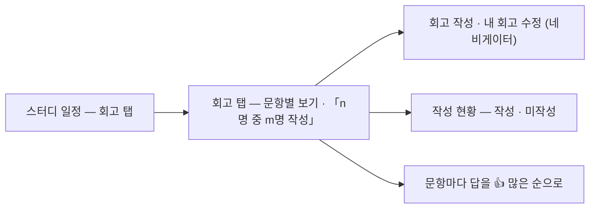

# 네비게이터는 반의 회차별 회고 작성 현황을 볼 수 있다.

story_id: ST-040 · IA: IA-010 · IA-040

기준 프로토타입: 내 스터디 › 스터디 일정 › 회고 탭 — 네비게이터 · 담당 캡틴으로 들어갔을 때

관련 결정: [POL-0001 역할과 권한](../../_registry/policies/POL-0001-roles.md)

## 1. 기본설명

회고를 읽고 쓰는 화면은 크루와 같다 ([ST-039](../crew-write-meeting-retro/PRD.md)). 이 Story 는 그 화면에 붙는 **작성 현황**이다.
캡틴(담당 캡틴)도 같은 화면으로 들어오지만 미팅 참여자가 아니라 회고를 쓰지 않는다.

### 진입·사용 흐름

### 완료 기준

1. 회고 탭 작성 현황 — 참여자마다 작성 · 미작성 구분, 「n명 중 m명 작성」 (크루에게는 둘 다 보이지 않는다)
2. 문항별 보기의 👍 많은 순 정렬 (크루와 같다)
3. 네비게이터 본인의 회고 작성 · 수정 (크루와 같은 규칙)
4. 캡틴에게는 작성 버튼이 없다 — 미팅 참여자가 아니라 쓰지 않는다

---

## 2. 화면명세

> **화면**: 내 스터디 › 스터디 일정 — 네비게이터 · 담당 캡틴.
>
> 아래 번호별 명세는 프로토의 **설명 보기**에서 그대로 가져온다. 손으로 고치지 않는다 —
> 고치려면 화면 옆 `spec.ts` 를 고치고 `pnpm --filter playground export-specs` 를 돌린다.

<!-- spec:start retro-lead -->

> 프로토 가정: 다른 참여자는 끝난 회차마다 열에 여섯 꼴로 썼고, 나는 가장 최근에 끝난 회차만 아직 안 썼다. 👍 수는 가정 값에 내가 누른 것을 더한다
>
> 내 회고와 내가 누른 👍 는 브라우저(localStorage)에만 남는다. 저장할 서버가 아직 없다
>
> 프로토 가정: 로그인 회원은 DDIA 2판 「수요일반」의 네비게이터, AI 논문 스터디 「목요일반」의 캡틴이다

### 1 — 작성 현황 목록

- **내용**
  - 그 회차의 참여자마다 「작성」 · 「미작성」
  - 작성 수(「n명 중 m명 작성」)도 네비게이터 · 캡틴만 본다 — 회고 탭 2-4
- **정책**
  - 쓴 사람이 앞, 안 쓴 사람이 뒤
  - 쓸 사람 = 그 회차 시작 때 반에 있던 참여자. 그전에 참여를 중단한 사람은 뺀다
  - 네비게이터 자신도 쓸 사람에 들어간다. 캡틴은 미팅 참여자가 아니라 들어가지 않는다

### 2 — 문항별 답 순서

- **내용**: 문항마다 답을 👍 많은 순으로 놓는다. 정렬을 알리는 문구는 따로 두지 않는다
- **정책**
  - 👍 수가 같으면 쓴 순서
  - 크루도 같은 순서다 (회고 3)

<!-- spec:end retro-lead -->

### 상태별 화면

| 상태 | 화면 | 카피 |
|---|---|---|
| 기본 | 회고 탭 작성 현황 | 「n명 중 m명 작성」 · 참여자마다 「작성」 · 「미작성」 |
| 권한 없음 | 캡틴이 작성 페이지를 열었을 때 | 「캡틴은 미팅 참여자가 아니라 회고를 쓰지 않아요.」 |

### 비고

- 범위 밖: 다른 반 작성 현황(캡틴은 백오피스 [ST-041](../captain-collect-meeting-retros/PRD.md)) · 안 쓴 사람에게 알리기 · 회고로 다음 미팅 메모 남기기

---

## 3. 시스템 요건

### 개발 범위

기준일 2026-11-21 · `beta`

| 구분 | 대상 | 지금 | 할 일 |
|---|---|---|---|
| FE | core-front 회고 탭 작성 현황 | 없음 | 화면 · API 연결 |
| BE | `GET /api/studies/{studyId}/meetings/{meetingId}/retros` 응답의 `targets` · `missing` | 스펙작성중 | 스펙 확정 · 구현 |
| BE | `GET /api/studies/{studyId}/retros/status` | 스펙작성중 | 스펙 확정 · 구현 |

### 계산 규칙

- 쓸 사람 · 쓴 사람은 [ST-039 §3 계산 규칙](../crew-write-meeting-retro/PRD.md#계산-규칙)과 같다. 네비게이터도 쓸 사람이다
- 👍 많은 순 — 같으면 내 답이 앞, 나머지는 쓴 순서

### 권한

| 동작 | 허용 | 검증 |
|---|---|---|
| 작성 현황 보기 | 반 네비게이터 · 그 스터디의 담당 캡틴 | 서버 |
| 회고 쓰기 | 네비게이터 (쓸 사람) | 서버 — 캡틴은 `403` |

### 퍼널·계측

해당 없음

### API

[meeting-retro 스펙](../../../specs/meeting-retro/spec.md)
