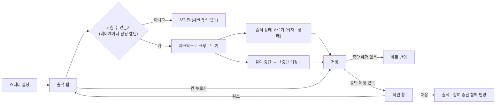
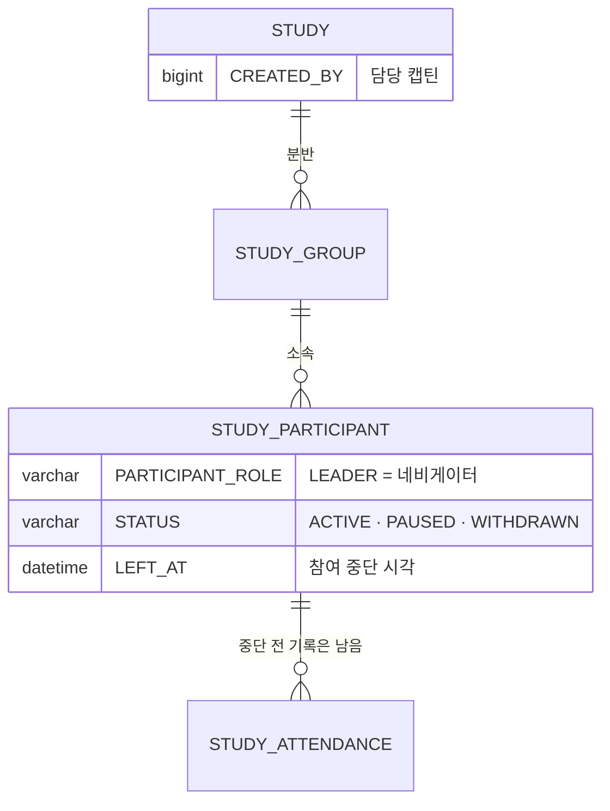

# 네비게이터는 참여자를 스터디에서 제명할 수 있다.

기준 프로토타입: 스터디 일정 — 출석 탭, 캡틴·네비게이터로 볼 때 (playground 사용자 사이트 · 내 스터디 → 스터디 일정 → 출석)
관련 결정: [10-14 백오피스 신청자 탭 정리](../../../docs/share/2026-10-14-class-title-and-captain-applies.md) · [10-18 일정·출석 화면 피드백](../../../docs/share/2026-10-18-schedule-attendance-feedback.md)

## 1. 기본설명

· **진입·사용 흐름**

· **완료 기준**

1. 출석부의 줄 맨 왼쪽 체크박스로 사람을 고른다. 머리 칸 체크박스로 전체 선택 · 해제한다. 나 · 캡틴 · 네비게이터도 골라진다
2. 고른 사람의 한 회차 칸을 같은 출석 상태로 한 번에 바꾼다. 「출석 상태」 드롭다운에서 마우스로 고르는 순간(키보드는 화살표로 옮긴 뒤 Enter 를 누르거나 칸을 떠날 때) 바뀐다(「출석 적용」 버튼 없음)
3. 고른 사람을 「중단 예정」으로 둔다. 바로 반영하지 않는다. 그 줄 전체가 옅은 빨강이 되고 닉네임 옆에 되돌리기 아이콘이 붙는다
4. 「저장」 한 번에 출석 변경과 참여 중단이 함께 반영된다. 하나라도 실패하면 둘 다 반영되지 않는다
5. 중단 예정이 있으면 저장 전에 확인 창이 뜬다. 창은 중단할 사람 이름 · 바뀐 출석 칸 수와 네 가지를 말한다: 지금까지 출석은 남는다 · 지금 뒤에 시작하는 회차는 「-」이고 출석률에서 빠진다 · 디스코드 채널 · 드라이브 링크를 볼 수 없고 앞으로 맡은 회차의 발표자에서 빠진다 · 다시 참여시킬 수 없다
6. 반영되면 중단한 줄이 맨 아래로 내려가 「참여 중단」 칩이 붙는다. **저장한 시각 뒤에 시작하는 회차** 칸은 「-」, 출석률은 그 앞 회차로 다시 계산된다. 중단 전 출석 기록은 지워지지 않는다
7. 반영되면 **저장한 시각 뒤에 시작하는 회차**의 발표자1 · 발표자2 칸에서 그 사람이 빠진다(빈 칸). 이미 시작한 회차의 발표 기록은 남는다
8. 「변경 취소」는 출석 변경과 중단 예정을 모두 되돌린다
9. 고른 사람 중 나 · 담당 캡틴 · 네비게이터가 한 명이라도 있으면 「참여 중단」이 잠기고 그 이유가 보인다. 출석 일괄 변경은 그대로 된다. 이미 중단한 줄에는 체크박스가 없다. 다시 참여시킬 수 없다
10. 크루 화면에는 체크박스 · 작업 바가 없다
11. 처리하지 못하면 확인 창이 남고 창 안에 오류 문구가 보인다 (프로토 미구현)

## 2. 화면명세

> **화면**: 스터디 일정 — 출석 탭 (캡틴·네비게이터)

격자 · 칸 순환 · 나가기 확인은 [출석 상태 수정 PRD](../navigator-edit-attendance/PRD.md) 와 같다. 이 문서는 그 위에 붙는 것과 저장이 달라지는 것만 쓴다.

### 1. 체크박스

- **내용**: 줄마다 닉네임 왼쪽의 체크박스. 머리 칸 「닉네임」 왼쪽에 전체 선택 체크박스
- **동작**
  - 줄 체크박스로 한 사람씩 고른다
  - 전체 선택은 활동 중인 사람(나 · 캡틴 · 네비게이터 포함)을 모두 고르거나 모두 푼다. 일부만 골랐으면 「일부 선택(−)」 표시
  - 고른 수는 작업 바의 「n명 선택」 하나로만 보인다. 표 제목 옆에는 「전체 N」 만
- **정책**
  - 나 · 담당 캡틴 · 네비게이터 줄에도 있다. 운영진의 출석도 한 번에 바꾼다. 참여 중단만 막는다 (§2)
  - 이미 중단한 줄에는 체크박스가 없다. 닉네임 열은 자리를 비워 맞춘다
  - 크루로 참여한 다른 캡틴은 크루 줄이다
  - 스크린리더는 「건우 선택」 · 「전체 선택」으로 읽는다
- **조건**: 그 분반의 네비게이터이거나 담당 캡틴일 때

### 2. 선택 (표 맨 위 작업 바 왼쪽)

- **내용**: 출석부 카드 맨 위 한 줄([POL-0008 「표 맨 위 작업 바」](../../_registry/policies/POL-0008-screen-rules.md)). 왼쪽이 선택, 오른쪽이 「변경 취소 · 저장」. 스크롤하면 사이트 머리 아래에 붙어 따라온다
  - 「n명 선택」: 고르기 전에도 「0명 선택」으로 보인다
  - 회차 고르기(「N회 · M/dd」, 시각 없음) · 「출석 상태」 고르기(출석 · 지각 · 결석 · 휴가 · 미체크)
  - 「참여 중단」: 배경 없이 테두리 · 글씨만 빨강
  - 「선택 해제」 (고른 뒤)
  - 「중단 예정 n명」 (중단 예정이 있을 때, 빨간 글씨)
  - 잠김 안내 (정책 참고)
- **동작**
  - 「출석 상태」에서 상태를 마우스로 고르는 순간(키보드는 화살표로 옮긴 뒤 Enter 를 누르거나 칸을 떠날 때) 고른 사람들의 그 회차 칸이 그 상태로 바뀐다. 「적용」 버튼은 없다. 드롭다운은 다시 「출석 상태」로 돌아온다. 저장 전 변경이라 칸에 상태 색 테두리가 생기고 저장을 눌러야 반영된다
  - 참여 중단 → 고른 사람들을 「중단 예정」으로 두고 선택을 푼다. 바로 반영하지 않는다
  - 선택 해제 → 고른 것을 모두 푼다
- **정책**
  - 회차는 오늘 이전 마지막 회차(방금 끝난 회차)가 먼저 골라져 있다
  - 고른 사람이 없으면 드롭다운 · 「참여 중단」은 잠기고 옅은 회색(비활성 색)이다. 한 명이라도 고르면 살아난다
  - 고른 사람 중 나 · 담당 캡틴 · 네비게이터가 있으면 「참여 중단」을 잠그고 줄 끝(「선택 해제」 뒤)에 「네비게이터는 참여 중단할 수 없습니다. 캡틴에게 문의하세요.」. 운영진을 선택에서 빼면 다시 누를 수 있다. 운영진의 역할은 백오피스에서 캡틴이 바꾼다
  - 결과 문구는 화면에 두지 않는다. 스크린리더만 「2명의 4회 칸을 휴가(으)로 바꿨습니다. 저장해야 반영됩니다.」 · 「2명을 중단 예정으로 표시했습니다. 저장해야 반영됩니다.」
- **조건**: 캡틴 · 네비게이터

### 3. 중단 예정 줄

- **내용**: 줄 전체(고정 열 포함)를 옅은 빨강으로 칠한다. 칩은 붙이지 않는다. 닉네임 옆에 되돌리기 아이콘 하나
- **동작**
  - 되돌리기 아이콘을 누르면 그 사람만 중단 예정에서 뺀다
  - 아이콘에 마우스를 올리거나 키보드로 고르면 바탕 · 아이콘이 진해지고 오른쪽에 「중단 예정 취소」 말풍선이 바로 뜬다
- **정책**
  - 칩을 쓰지 않는다. 좁은 닉네임 칸에서 닉네임이 가려진다 (2026-10-18 기획 결정)
  - 몇 명이 중단 예정인지는 작업 바의 「중단 예정 n명」 한 곳에만
  - 줄은 그 자리에 둔다. 칸도 그대로 고칠 수 있다. 저장 전까지는 아직 참여 중이다
  - 중단 예정이 있으면 「저장」이 풀린다 (바뀐 출석 칸이 없어도)
  - 스크린리더는 「건우 중단 예정 취소」로 읽는다
- **데이터**: 화면 상태. 저장 때 `withdrawals[]` 로 나간다

### 4. 저장 · 확인 창

- **내용**
  - 작업 바 오른쪽 「변경 취소 · 저장」은 지금과 같다
  - 중단 예정이 있을 때 저장을 누르면 확인 창
    - 제목 「○○ 님의 참여를 중단하고 저장할까요?」 / 「n명의 참여를 중단하고 저장할까요?」
    - 「참여 중단 건우, 지호」 · 「출석 n칸」(바뀐 칸이 있을 때)
    - 지금까지의 출석 기록은 그대로 남습니다.
    - 지금 뒤에 시작하는 회차는 「-」로 비고 출석률에서 빠집니다.
    - 더는 스터디 디스코드 채널 · 드라이브 링크를 볼 수 없고, 앞으로 맡은 회차의 발표자에서 빠집니다.
    - 중단한 뒤에는 다시 참여시킬 수 없습니다.
    - 버튼 「취소」 · 「저장」(빨강)
- **동작**
  - 중단 예정이 없으면 확인 창 없이 지금처럼 바로 저장한다
  - 확인하면 출석과 참여 중단을 한 요청으로 반영한다. 중단한 줄은 맨 아래로 내려가고 「참여 중단」 칩이 붙는다
  - 화면 결과 문구는 없다. 스크린리더만 「출석 1칸을 저장하고 2명의 참여를 중단했습니다.」
  - 취소 · Esc · 바깥 누르기는 아무것도 반영하지 않는다. 중단 예정과 바뀐 칸은 그대로 남는다. 처음 포커스는 「취소」
  - 변경 취소 → 바뀐 출석 칸과 중단 예정을 모두 되돌린다
- **정책**
  - 되돌릴 수 없는 일이 저장에 섞이므로, 중단 예정이 있을 때만 확인 창을 띄운다
  - 하차 · 제명을 가르지 않는다. 사유를 묻지도 남기지도 않는다
  - 중단 시각은 저장한 순간이다. 지난 날짜로 소급하지 않는다
  - 저장한 시각 뒤에 시작하는 회차의 발표자1 · 발표자2 칸에서 그 사람을 뺀다(빈 칸). 다른 크루가 「신청」할 수 있게 된다 (2026-10-18 기획 결정)
  - 이미 시작한 회차의 발표자 칸은 그대로 남고 일정 탭에 「이름 (참여 종료)」로 보인다. 발표 기록이다
  - 중단당한 사람에게 따로 알리지 않는다 (미확정 — §4)
- **데이터**: `STUDY_ATTENDANCE` upsert + `STUDY_PARTICIPANT.STATUS` `ACTIVE` → `WITHDRAWN` · `LEFT_AT` + `STUDY_MEETING.PRESENTER1/2_PARTICIPANT_ID` (그 뒤 회차) → null

### 5. 중단한 사람의 줄

[출석 상태 수정 PRD](../navigator-edit-attendance/PRD.md) §2-1 그대로다: 흐린 이름 · 「참여 중단」 칩 · 맨 아래 줄 · 중단 뒤 칸 「-」 · 회색 출석률. 체크박스가 없다. 일정 탭 발표자 드롭다운에서 고를 수 없다. 중단 뒤 회차의 발표자 칸에서는 빠지고, 지난 회차 칸만 「이름 (참여 종료)」로 남는다.

### 상태별 화면

| 상태 | 화면 | 카피 |
| --- | --- | --- |
| 기본 | 줄 왼쪽 체크박스 (나 · 운영진 포함) | — |
| 선택 전 | 작업 바 드롭다운 · 버튼 옅은 회색(잠김) | `0명 선택` |
| 선택 | 표 맨 위 작업 바 활성 | `n명 선택` · `출석 상태` · `참여 중단` · `선택 해제` |
| 운영진 섞임 | 「참여 중단」 잠김 + 이유 | `네비게이터는 참여 중단할 수 없습니다. 캡틴에게 문의하세요.` |
| 고치는 중 | 바뀐 칸 상태 색 테두리 · 중단 예정 줄 옅은 빨강 + 되돌리기 아이콘 · 「저장」 활성 | `중단 예정 n명` · `중단 예정 취소`(말풍선) · `변경 취소` · `저장` |
| 확인 | 확인 창 (중단 예정이 있을 때만) | `n명의 참여를 중단하고 저장할까요?` |
| 처리중 | 저장 · 변경 취소 · 칸 · 체크박스 잠김 | — |
| 완료 | 중단한 줄 맨 아래 · 「참여 중단」 칩 | — (스크린리더 `출석 n칸을 저장하고 m명의 참여를 중단했습니다.`) |
| 실패 | 확인 창 유지 · 창 안 오류 (프로토 미구현) | `저장하지 못했습니다. 잠시 뒤 다시 시도해 주세요.` |
| 크루 | 체크박스 · 작업 바 없음 | - |

### 데이터 관계

### 비고

- 범위 밖: 크루 스스로의 하차, 회원 탈퇴([crew-leave](../crew-leave/PRD.md)), 네비게이터 지정 · 해제(백오피스 — [captain-view-attendees](../captain-view-attendees/PRD.md)), 디스코드 채널 권한 회수
- 미구현: 프로토는 브라우저에만 남는다(`sc_participant_left`). 출석과 중단을 따로 저장한다(서버는 한 요청). 처리중 · 실패 화면 없음. 프로토는 브라우저 시간대로 회차 시각과 견준다
- 구현 지시: 체크박스 · 작업 바 · 확인 창은 출석 격자 컴포넌트의 선택 속성(`onWithdraw`)을 넘길 때만 나온다. 사용자 사이트 출석 탭과 백오피스 출석 탭이 둘 다 넘긴다. 백오피스도 같은 참여 중단을 한다([captain-view-attendance-roster](../captain-view-attendance-roster/PRD.md) §2)

## 3. 시스템 요건

### 개발 범위

> 2026-10-14 `beta` 기준. **지금 → 할 일**만 적는다. 다 끝나면 「할 일」이 모두 「없음」이 된다.
> FE 「지금」은 실제 앱의 화면과 데이터 연결(API · mock)까지 본 값이다 — 완료 기준 하나하나의 동작은 따로 확인하지 않았다.
> BE 「지금」은 스펙 엔드포인트 표의 상태 칸을 옮겨 적는다.

| 구분 | 대상 | 지금 | 할 일 |
|---|---|---|---|
| FE | core-front 스터디 일정 › 출석부 참여 중단 | 없음 — 스터디 일정 화면이 자리만 있다 | [출석 수정](../navigator-edit-attendance/PRD.md#개발-범위)과 같은 화면에서 만든다 |
| BE | `POST /api/studies/{studyId}/attendances` (`withdrawals[]`) | 스펙작성중 — 백엔드 요청에 `withdrawals` 가 없다 | 스펙 확정 → 구현 |
| 기획 | 저장 경로 | 이 PRD 와 [study-participant 스펙](../../../specs/study-participant/spec.md)은 옛 경로 `/api/studies/{studyId}/attendances` 를 적었다. 출석 API 는 #241 · #244 에서 `/api/me/…` · `/api/admin/…` 로 나뉘었다 | 어느 경로에 `withdrawals[]` 를 더할지 정하고 스펙 · PRD 경로를 고친다 |

#### 10-18 기획 변경: FE / BE 추가 작업

> 결정 전문은 [share 10-18 일정·출석 화면 피드백](../../../docs/share/2026-10-18-schedule-attendance-feedback.md). D# 는 그 문서의 결정 번호.

| 구분 | 할 일 | 결정 |
|---|---|---|
| FE | 「출석 적용」 버튼 제거. 「출석 상태」 드롭다운에서 고르면 바로 고른 사람의 칸에 반영 | D2 |
| FE | 작업 바를 출석부 카드 맨 위로, 스크롤 시 고정. 고른 사람이 없으면 드롭다운 · 버튼 옅은 회색(비활성) | D1 · D13 |
| FE | 중단 예정 줄: 칩 대신 줄 전체 옅은 빨강 + 되돌리기 아이콘(호버 · 포커스 말풍선 「중단 예정 취소」), 작업 바에 「중단 예정 n명」 | D8 |
| FE | 확인 창 문구 「앞으로 맡은 회차의 발표자에서 빠집니다.」로 변경. 저장 후 일정을 다시 불러 발표자 칸 반영 | D7 |
| BE | `withdrawals[]` 처리와 같은 트랜잭션에서, 저장 시각 뒤에 시작하는 회차의 `PRESENTER1/2_PARTICIPANT_ID` 가 중단자면 null. 시작한 회차는 그대로 ([study-participant 스펙](../../../specs/study-participant/spec.md)에 규칙 추가 후 구현) | D7 |

### API

| 메서드 | 경로 | 권한 |
| --- | --- | --- |
| POST | `/api/studies/{studyId}/attendances` (`updates[]` + `withdrawals[]`) | 출석: 기존 출석 쓰기 권한 · 중단: 대상과 같은 분반의 네비게이터 · 담당 캡틴 |

새 엔드포인트 없이 출석 저장 요청에 `withdrawals[]` 를 더한다. 계약은 [study-participant/spec.md](../../../specs/study-participant/spec.md).

### 처리

- 출석 upsert 와 참여 중단을 **한 트랜잭션**으로 반영한다. 하나라도 거절되면 아무것도 반영하지 않는다
- 중단: `STATUS = WITHDRAWN` · `LEFT_AT = now()`. 출석 행은 지우지 않는다
- 이미 `WITHDRAWN` 이면 그대로 둔다. `LEFT_AT` 을 덮어쓰지 않는다
- 같은 트랜잭션에서 그 분반의 회차 중 `SCHEDULED_AT > LEFT_AT` 인 회차의 `PRESENTER1_PARTICIPANT_ID` · `PRESENTER2_PARTICIPANT_ID` 가 중단자면 null 로 비운다. 시작한 회차는 건드리지 않는다
- 이 트랜잭션은 회차 수정 · 발표 신청과 같은 분반 잠금을 먼저 쥔다([회차 스펙](../../../specs/study-meeting/spec.md) 잠금 순서). 동시에 들어온 발표 신청이 중단자를 다시 넣지 못한다. 「뒤 회차」는 잠금을 얻은 뒤의 서버 시각으로 가른다. 관리자 저장도 같은 규칙 · 같은 잠금
- 대상이 나 · 네비게이터 · 담당 캡틴이면 거절. `DELETED`(회원 탈퇴) · `COMPLETED` 는 바꾸지 않는다. 끝난 스터디(`ENDED` · `CLOSED`)도 바꾸지 않는다
- 되돌리는 API 는 두지 않는다

### 계산 규칙

- 출석률은 `SCHEDULED_AT <= LEFT_AT` 인 회차만 센다 — [attendance/spec.md](../../../specs/attendance/spec.md) `upper_bound` 와 같다. 시각으로 견주므로 같은 날 뒤 회차도 빠진다

### 권한

- 중단: 대상과 **같은 분반**의 네비게이터(명부에 살아 있음) · 담당 캡틴(`STUDY.CREATED_BY`). 아니면 403 — 출석 쓰기와 같은 분반 단위([authz-guards](../../../specs/authz-guards/spec.md) B)
- 크루로 참여한 다른 캡틴은 크루다 — 403
- 서버에서 검증한다. 화면에서 체크박스를 숨기는 것은 편의일 뿐이다

### 보안 · 개인정보

- 감사 로그에 호출자 ID · 대상 명부 행 ID · 동작 · 시각만 남긴다. 이름 · 이메일은 남기지 않는다
- 중단된 사람은 디스코드 채널 · 드라이브 링크를 받지 않는다 ([my-studies](../../../specs/my-studies/spec.md) `relation = WITHDRAWN`)

### 외부 연동

- 없음

## 4. 미확정

- 중단당한 사람에게 알림(메일 · 디스코드 DM)을 보낼지
- 디스코드 채널 권한까지 회수할지 — 지금은 링크만 감춘다
- 잘못 중단했을 때 되살리는 길 — 사용자 사이트에는 두지 않기로 했다(2026-10-07). 백오피스에서 캡틴이 되살릴지는 정하지 않았다
- 회차 머리 칸 「전원 출석」 같은 한 회차 일괄 버튼을 둘지 — 지금은 체크박스 + 「출석 상태」 일괄 변경으로 한다
