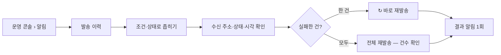

# 캡틴은 알림 발송 이력을 조회할 수 있다.

기준 프로토타입: 운영 콘솔 › 알림 › 발송 이력 — https://playground.studyclub-plusplus.com/proto/console/notifications

## 1. 기본설명

**무엇이 어디로 나갔고 지금 어떤 상태인가**를 보는 자리다. 회원이 「메일을 못 받았다」고 할 때
운영진이 처음 여는 화면이다.

조회가 기본이고, **실패한 건만 다시 보낼 수 있다.**
알림 템플릿과 같은 화면의 두 탭이다 ([알림 템플릿](../notification-template/PRD.md)).

### 진입·사용 흐름

### 완료 기준

1. 최근 순 조회 — 요청 시각 · 알림 조건 · 채널 · 수신 주소 · 상태 · 발송 시각
2. 조건·상태 드롭다운과 조건에 걸린 건수 확인
3. 상태 문구 표기 — 색만으로 가르지 않음
4. 수신 주소 가림과 줄별 펼침
5. 조회 실패와 0건 구분
6. 실패 건 재발송 — 한 건은 바로, 묶음은 확인 후
7. 재발송 진행 표시와 결과 알림 1회

---

## 2. 화면명세

> **화면**: 운영 콘솔 › 알림 › 발송 이력.
>
> 아래 번호별 명세는 프로토의 **설명 보기**에서 그대로 가져온다. 손으로 고치지 않는다 —
> 고치려면 화면 옆 `spec.ts` 를 고치고 `pnpm --filter playground export-specs` 를 돌린다.

<!-- spec:start history -->

> 사이드바는 「알림」 하나다. 템플릿과 발송 이력은 **화면 안 탭**으로 가른다 — 사이드바를 두 단으로 만들면 다른 메뉴와 깊이가 달라져 훑기 어렵다
>
> **실패한 건을 다시 보내는 것 말고는 조회만 한다.** 발송 취소·실패 사유 상세는 없다 — API 가 주지 않는 것을 화면이 지어내면 운영자는 없는 수단을 찾는다
>
> 알림 템플릿은 별개 화면이다. 이 이력에서 템플릿을 열어도 **지금 등록된 문구**이지 그때 나간 원문이 아니다
>
> 프로토는 서버가 없다. 불러오는 사이의 화면을 보여주려고 지연만 흉내 낸다

### 1 — 거르는 칸

- **내용**: 알림 조건 · 상태 두 축. 고르기 전에는 축 이름만 보인다 ([POL-0008](https://github.com/StudyClub-PlusPlus/studyclub-engineering/blob/beta/01-planning/_registry/policies/POL-0008-screen-rules.md))
- **동작**: 고르면 첫 페이지로 돌아간다 — 3페이지를 보던 중에 거르면 그 페이지가 없을 수 있다
- **정책**
  - 거르는 축은 **등록된 템플릿의 조건**에서 온다 — 선택지를 따로 관리하지 않는다 ([POL-0009](https://github.com/StudyClub-PlusPlus/studyclub-engineering/blob/beta/01-planning/_registry/policies/POL-0009-notification.md))
  - 전체일 때는 상태 조건을 서버에 보내지 않는다

#### 1-1 — 총 건수

- **내용**: 지금 조건에 걸린 전체 건수
- **정책**: 화면에 보이는 20건이 아니라 **조건 전체**의 수다 — 페이지를 넘기지 않고도 규모를 안다

#### 1-2 — 전체 재발송

- **조건**: 상태를 「실패」로 거르고, 걸린 건이 한 건이라도 있을 때
- **내용**: 거른 실패 건을 한 번에 다시 보낸다
- **동작**
  - 누르면 **몇 건인지 적은 창으로 다시 묻는다.** 바로 보내지 않는다
  - 확인 창은 닫기(X) · 취소 · 재발송이고, **취소에 먼저 선다** ([POL-0008](https://github.com/StudyClub-PlusPlus/studyclub-engineering/blob/beta/01-planning/_registry/policies/POL-0008-screen-rules.md))
  - 보내는 대상은 **거른 조건에 걸린 실패 건 전체**다 — 보고 있는 페이지의 20건이 아니다
  - 보내는 동안 이 버튼도 돌고 눌리지 않는다
- **정책**
  - **실패만 걸렀을 때만 세운다** — 다른 조건에서 묶어 보내면 이미 나간 건까지 섞여 같은 메일이 두 번 간다
  - 건수를 확인 창에 적는다 — 세 건을 보내려다 삼백 건을 보내는 일이 생긴다

### 2 — 이력 표

- **내용**: 요청 시각 · 알림 조건 · 채널 · 수신 주소 · 상태 · 발송 시각
- **동작**
  - 요청 시각 내림차순 고정. 열 머리를 눌러 정렬하지 않는다
  - 행을 눌러도 아무 일도 없다 — 상세 화면이 없다
  - **실패한 건에만 재발송이 선다** — 상태 뱃지 옆 아이콘 하나다. **한 건은 묻지 않는다**: 누른 그 줄에서 무엇이 나가는지가 이미 보인다
  - 누른 아이콘은 **돌기 시작하고 눌리지 않는다.** 끝이 확인될 때까지 돈다 — 두 번 눌러 두 번 나가지 않게
  - **서버가 접수한 뒤에** 그 줄이 「대기」로 바뀐다. 미리 바꾸면 닿지 못했을 때 보낸 적 없는 건이 보낸 것처럼 남는다
  - 수신 주소는 **서버가 가린 값을 그대로** 적는다 — 펼치는 길을 두지 않는다
- **정책**
  - **수신 주소는 서버가 가린 값을 그대로 쓴다** — 전체 주소를 내려받는 길도, 화면에서 펼치는 길도 두지 않는다. 운영자가 알림의 수신 회원을 알아야 하면 그때 따로 정한다
  - **거르는 조건에서 벗어난 줄을 그 자리에서 치우지 않는다.** 상태만 바꿔 두고 다음에 읽을 때 빠진다 — 누르자마자 사라지면 방금 무엇을 눌렀는지, 그래서 어떻게 됐는지 볼 수 없다
  - **재발송을 칼럼으로 두지 않는다** — 대부분의 줄이 빈 칼럼 하나를 표 끝에 세우고, 무엇을 다시 보내는지가 상태와 떨어져 읽힌다. 자리를 내주려 실패 뱃지만 「실패」로 줄인다
  - 상태는 **문구와 색을 함께** 쓴다. 색만으로 가르면 색을 못 가리는 사람이 읽을 수 없다
  - 상태에 **「발송」을 앞에 붙이지 않는다** — 열 이름이 이미 무엇의 상태인지 말한다. 「완료」는 **보냈다는 뜻**이지 받았다는 뜻이 아니다. 수신함 도착·읽음은 알 수 없다
  - 모르는 상태값이 오면 원문 코드를 회색으로 그대로 적는다. 빈칸으로 두지 않는다
  - 시각은 **보는 사람의 시간대**로 적는다. 어느 시간대 기준인지는 **표 위에서 한 번만** 밝히고, 각 줄에는 시각만 적는다 ([POL-0006](https://github.com/StudyClub-PlusPlus/studyclub-engineering/blob/beta/01-planning/_registry/policies/POL-0006-timezone.md)). 읽을 수 없는 값이면 원문을 그대로 둔다
  - id·템플릿 id 는 화면에 내보내지 않는다 — 운영자가 쓸 일이 없다
  - **재발송은 실패 건을 고치지 않는다.** 그 기록은 그대로 두고 새 건을 만든다 — 지우면 언제 왜 실패했는지가 사라지고, 같은 행을 고쳐 쓰면 한 번에 나간 건과 두 번 만에 나간 건을 가릴 수 없다
  - 성공·대기·처리 중인 건에는 재발송을 두지 않는다 — 같은 메일이 두 번 간다
- **데이터**: `createdAt` · `eventType` · `recipientType` · `recipientValue`(가린 주소) · `status` · `sentAt`

#### 2-1 — 끝난 뒤 알리는 말

- **내용**
  - 요청이 닿지 못함 — 「재발송을 요청하지 못했습니다. 다시 시도해 주세요.」와 다시 시도
  - 한 건 성공 — 「재발송에 성공했습니다.」 / 한 건 실패 — 「발송에 실패했습니다.」
  - 묶음 전부 성공 — 「12건 재발송에 성공했습니다.」
  - 묶음 일부 성공 — 「9건 재발송에 성공했습니다. 실패: 3건」
  - 묶음 전부 실패 — 「발송에 실패했습니다. 실패: 12건」
- **정책**
  - **결과는 토스트로 한 번만 알린다. 창으로 띄우지 않는다** — 끝난 일을 다음 일 하려고 또 닫게 만들지 않는다
  - **접수된 뒤에는 끝을 모아 한 번만 알린다** — 건마다 띄우면 열두 통을 보내고 열두 번 읽어야 한다
  - 요청이 닿지 못했으면 **한 건도 나가지 않은 것**이다. 상태는 「실패」 그대로 두고 아이콘을 되살린다. 묶음도 같다
  - **끝을 끝내 알 수 없으면 아무 말도 하지 않는다** — 스피너만 거두고 상태는 그대로 둔다. 지어낸 결과를 적으면 틀린 말이 된다

### 3 — 페이지 이동

- **조건**: 이력이 두 페이지 이상일 때
- **내용**: 이전 · 페이지 번호 · 다음
- **동작**
  - 한 페이지 20건 고정
  - 첫 페이지에서는 이전이, 마지막에서는 다음이 눌리지 않는다
  - 보던 페이지가 사라졌으면 첫 페이지로 돌아간다
- **정책**: 0건이거나 한 페이지뿐이면 이 줄을 아예 그리지 않는다 — 넘길 것이 없는데 「1」만 남으면 넘길 것이 있는 줄 안다

### 4 — 상태별 화면

- **내용**
  - 읽는 중 — 표 자리에 20줄의 빈 칸. 거르는 칸과 전체 재발송은 눌리지 않는다
  - 이력 없음 — 「아직 알림 발송 이력이 없습니다.」
  - 거른 결과 없음 — 「선택한 조건의 발송 이력이 없습니다.」와 전체 보기
  - 실패 — 「발송 이력을 불러오지 못했습니다. 다시 시도해 주세요.」와 다시 시도
- **정책**
  - **읽기 실패를 「0건」으로 보여주지 않는다** — 없는 것과 못 읽은 것은 다른 일이고, 운영자가 할 일도 다르다
  - 비었을 때도 표 자리의 높이를 지킨다 — 상태가 바뀔 때마다 화면이 들썩이지 않게

<!-- spec:end history -->

### 비고

- **범위 밖** — 발송 취소 · 실패 사유 상세 · 도착·읽음 여부 · 성공률 통계 · CSV 내려받기.
  **API 가 주지 않는 것을 화면이 지어내면 운영자는 없는 수단을 찾는다**
- **시도 이력은 남기지 않는다** — 재발송은 그 줄을 다시 보내는 일이라, 알림 하나에 줄 하나다
  ([POL-0009](../../_registry/policies/POL-0009-notification.md))
- **다음에 붙을 것** — 예약 발송이 붙으면 「발송 취소」 상태가 생긴다(보내기 전에 보낼 이유가 없어진 건).
  발송 실패와 구분해 적고, 지금 거르는 선택지에는 미리 넣지 않는다
- **미구현** — 서버 연동. 프로토는 mock 으로 그린다

---

## 3. 시스템 요건

### 개발 범위

> 2026-10-14 `beta` 기준. **지금 → 할 일**만 적는다. 다 끝나면 「할 일」이 모두 「없음」이 된다.
> FE 「지금」은 실제 앱의 화면과 데이터 연결(API · mock)까지 본 값이다 — 완료 기준 하나하나의 동작은 따로 확인하지 않았다.
> BE 「지금」은 스펙 엔드포인트 표의 상태 칸을 옮겨 적는다.

| 구분 | 대상 | 지금 | 할 일 |
|---|---|---|---|
| FE | back-office-front 「알림」 › 발송 이력 탭 (`/notifications`) | 구현완료 — 사이드바 「알림」 한 메뉴, 알림 템플릿 / 발송 이력 두 탭 | 없음 |
| BE | `GET /api/admin/notifications` | 구현완료 — 행마다 `canResend`·`?ids=` 포함 | 없음. 수신 주소는 서버가 가린 값이다 — 전체 주소 여부는 [share](../../../docs/share/2026-10-11-notification-resend.md) 에서 확인 중 |
| BE | 재발송 `POST /api/admin/notifications/resend` | 구현완료 — 그 줄을 `PENDING` 으로 되돌리고 `accepted`·`skipped` 를 돌려준다 | 없음. 기획은 위 이력 표 정책의 「재발송은 실패 건을 고치지 않는다. 새 건을 만든다」를 「그 줄을 되돌린다」로 고친다 |

### API

| 메서드 | 경로 | 설명 |
|---|---|---|
| GET | `/api/admin/notifications` | 발송 이력 — `status` · `eventType` · `offset` · `limit`(20) |
| POST | `/api/admin/notifications/resend` | 실패 건 재발송 — `ids[]`. 한 건도 묶음도 같은 경로. **접수까지만** 응답한다(보냈다는 뜻이 아니다). 그 건들의 상태는 `PENDING` 이 된다 |
| GET | `/api/admin/notifications?ids=` | 재발송한 건의 **끝(`SENT`·`FAILED`)을 쫓는다.** 쫓는 주기와 포기 시점은 개발이 정한다 |

- 응답: `items[]`(`createdAt` · `eventType` · `recipientType` · `recipientValue`(**전체 주소**. 가리는 일은 화면이 한다) ·
  `status` · `sentAt`) + `total`. `id` · `templateId` 는 받되 화면에 쓰지 않는다
- 거르는 선택지는 **등록된 템플릿의 조건**에서 온다 — 따로 관리하지 않는다
- 권한: 캡틴 ([POL-0001](../../_registry/policies/POL-0001-roles.md)). 라우팅만으로 막지 않고 서버가 검증한다

### 처리

| 경우 | 처리 |
|---|---|
| `sentAt` 이 없는데 상태가 `SENT` | 발송 시각 자리에 `—`. 오류로 다루지 않는다 |
| `offset` 이 `total` 을 넘김 | 첫 페이지로 되돌린다 |
| 같은 조건을 연달아 부름 | 앞선 요청을 버리고 마지막 응답만 반영한다 |
| `createdAt` 을 읽을 수 없음 | 원문 문자열을 그대로 적는다 |
| 모르는 `status` | 원문 코드를 회색 배지로 적는다 |
| 재발송 요청이 서버에 닿지 못함 | **한 건도 나가지 않은 것**으로 다룬다 — 상태는 `FAILED` 그대로, 누른 자리를 되살리고 다시 시도를 띄운다 |
| 끝을 끝내 확인하지 못함 | 스피너만 거두고 상태는 그대로 둔다. **아무 말도 하지 않는다** |
