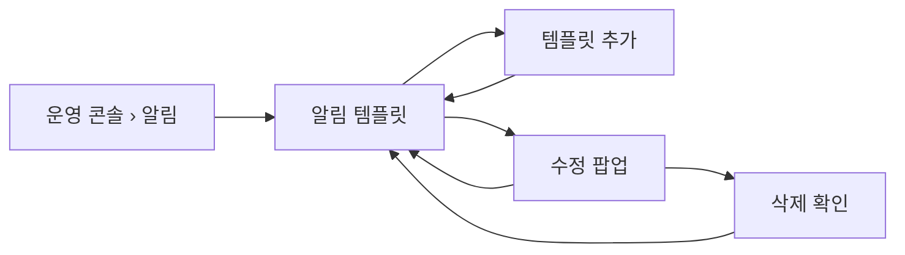

# 캡틴은 알림 템플릿을 추가, 수정, 삭제할 수 있다.

기준 프로토타입: 운영 콘솔 › 알림 › 알림 템플릿 — https://playground.studyclub.life/proto/console/notifications/templates

## 1. 기본설명

회원에게 **무엇을 보내는지**를 정하는 자리다. 조건이 곧 그 알림의 이름이고, 같은 조건에 템플릿을
여럿 둘 수 있다 ([POL-0009](../../_registry/policies/POL-0009-notification.md)).

발송 이력과 같은 화면의 두 탭이다. 사이드바는 「알림」 하나다
([발송 이력 조회](../notification-history/PRD.md)).

### 진입·사용 흐름

### 완료 기준

1. 등록된 템플릿 목록 — 알림 조건 · 채널 · 제목 · 마지막 수정
2. 템플릿 추가 — 알림 조건 · 제목 · 본문
3. 템플릿 수정 — 목록에서 조건을 누르면 값이 채워진 팝업. 조건 · 제목 · 본문 모두 변경 가능. 치환 변수 원문 그대로
4. 템플릿 삭제 — 수정 팝업 안, 확인 단계 후 삭제. 되돌리기 없음. 지난 발송 이력 유지
5. 알림 조건 둘 — 회원가입 · 회원 탈퇴. 같은 조건에 템플릿 여럿 가능

---

## 2. 화면명세

> **화면**: 운영 콘솔 › 알림 › 알림 템플릿.
>
> 아래 번호별 명세는 프로토의 **설명 보기**에서 그대로 가져온다. 손으로 고치지 않는다 —
> 고치려면 화면 옆 `spec.ts` 를 고치고 `pnpm --filter playground export-specs` 를 돌린다.

<!-- spec:start template -->

> 문구를 **보고, 더하고, 고치고, 지운다.** 추가 팝업이 곧 편집 팝업이다 — 전문을 보는 화면을 따로 두지 않는다
>
> 발송 이력과 같은 화면의 두 탭이다 — 사이드바 「알림」 하나 아래 들어간다

### 1 — 제목과 탭

- **내용**: 제목 「알림」. 그 아래 알림 템플릿 · 발송 이력 두 탭, 그 줄 오른쪽 끝에 템플릿 추가
- **정책**
  - 지금 등록된 문구가 무엇인지 보는 자리다 — 특정 발송 건에 쓰인 그때 원문이 아니다
  - **추가는 이 탭에서만 선다** — 발송 이력으로 넘어가면 같이 사라진다. 지금 보는 것과 지금 할 수 있는 일을 한 줄에서 읽게 한다

### 2 — 템플릿 추가

- **내용**: 탭 줄 오른쪽 끝
- **동작**: 누르면 창이 열린다. 추가하면 목록 맨 위에 선다
- **정책**
  - **나가는 알림이 늘 때마다 코드를 고치지 않게 한다** — 문구는 운영자가 더한다
  - 등록한 날이 곧 마지막 수정일이다 — 비어 있는 경우를 만들지 않는다
- **데이터**: `POST /api/admin/notification-templates` — 미구현

#### 2-1 — 추가·수정 팝업

- **내용**: 알림 조건 · 제목 · 본문. 추가는 빈 칸으로, 수정은 값이 채워진 채 열린다
- **동작**
  - 제목·본문이 비어 있으면 추가·저장되지 않는다
  - 저장하면 그 템플릿의 마지막 수정이 바뀐다
- **정책**
  - **조건이 곧 그 알림의 이름이다** — 이름을 따로 받지 않는다. 따로 두면 「가입 환영」이라는 템플릿이 탈퇴 때 나가는 일이 생긴다
  - 조건은 고르는 것이고, 저장되는 이벤트 코드는 그 선택이 정한다 — 코드를 직접 적지 않는다
  - **같은 조건에 템플릿을 여럿 둘 수 있다** — 그 조건이 생기면 모두 나간다. 목록에서는 조건과 제목으로 구분한다
  - 수정에서도 조건을 바꿀 수 있다
  - **팝업의 제목·본문 칸이 곧 전문이다** — 보기용·수정용 두 모양으로 보여주지 않는다. 치환 변수(`{{nickname}}`)와 줄바꿈은 원문 그대로
  - 쓸 수 있는 치환 변수를 칸 아래에 적는다 — 「`{{nickname}}` 으로 닉네임 삽입」
  - **채널을 고르게 하지 않는다** — 지금 보낼 수 있는 것은 메일뿐이다. 디스코드가 열리면 그때 칸을 더한다
- **데이터**: `PUT /api/admin/notification-templates/{id}` — 미구현

#### 2-2 — 템플릿 삭제

- **내용**: 수정 팝업 왼쪽 아래. 누르면 같은 팝업이 확인 단계로 바뀐다
- **동작**: 확인 단계 — 조건과 제목, 결과 안내. 취소가 기본 선택이고, 삭제하면 목록에서 빠진다
- **정책**
  - **목록 행에 삭제 버튼을 두지 않는다** — 스치듯 눌러 지우는 사고가 난다. 저장 버튼과도 떨어뜨린다
  - **되돌릴 수 없다** — 확인 단계가 막는다. 필요하면 다시 추가한다
  - 지우면 그 문구로는 더 이상 메일이 나가지 않는다. **지난 발송 이력은 남는다**
- **데이터**: `DELETE /api/admin/notification-templates/{id}` — 미구현

### 3 — 템플릿 목록

- **내용**: 알림 조건 · 채널 · 제목 · 마지막 수정
- **동작**: 조건을 누르면 수정 팝업이 열린다. 템플릿이 없으면 빈 표 문구
- **정책**
  - **마지막 수정은 늘 값이 있다** — 등록한 날이 첫 수정일이라 「수정된 적 없음」이라는 상태가 없다
  - 채널 열은 지금 모두 「메일」이다 — 다른 채널이 생기면 그때 값이 갈린다
- **데이터**: `GET /api/admin/notification-templates` — 구현완료

<!-- spec:end template -->

### 비고

- 이 화면은 **지금 등록된 문구**를 보여준다. 특정 발송 건에 쓰인 그때 원문이 아니다 —
  그때 원문은 어디에서도 볼 수 없다
- 목록·전문 보기는 실제 운영 콘솔에 이미 붙어 있다 (전문 보기는 수정 팝업으로 바뀐다). 프로토는 mock 으로 그린다 — 무엇이 남았는지는 [개발 범위](#개발-범위)

---

## 3. 시스템 요건

### 개발 범위

> 2026-10-14 `beta` 기준. **지금 → 할 일**만 적는다. 다 끝나면 이 표는 「할 일」이 모두 「없음」이 된다.

| 구분 | 대상 | 지금 | 할 일 |
|---|---|---|---|
| FE | back-office-front `/notification-templates` 목록 | 있음 — 이벤트 · 채널 · 제목 · 마지막 수정 | 열 이름 「이벤트」 → 「알림 조건」 (완료 기준 1) |
| FE | back-office-front `/notification-templates/[id]` 전문 | 있음 — 단건 API 없이 목록에서 고른다 | 없앰 — 목록에서 조건을 누르면 수정 팝업 (완료 기준 3) |
| FE | 사이드바 「알림」 하나 · 템플릿 / 발송 이력 두 탭 | 없음 — 사이드바에 「알림 템플릿」만 | 「알림」 아래 두 탭으로 묶기. 프로토 주소는 `/notifications/templates` · `/notifications` |
| FE | 템플릿 추가 버튼 · 추가 팝업 | 없음 | 프로토 `proto/console/notifications/templates` 대로. 모든 조건을 선택지로 (완료 기준 2·5) |
| FE | 수정 팝업 · 삭제 확인 | 없음 | 추가 팝업과 같은 폼, 값이 채워진 채. 삭제는 팝업 안 확인 단계 (완료 기준 3·4) |
| BE | `GET /api/admin/notification-templates` | 구현완료 — `AdminNotificationController` · 통합 테스트 있음 | 없음 |
| BE | `POST /api/admin/notification-templates` | 없음 · **스펙 없음** | [notification 스펙](../../../specs/notification/spec.md)에 계약부터 쓴다 → 구현 |
| BE | `PUT` · `DELETE /api/admin/notification-templates/{id}` | 없음 · **스펙 없음** | 스펙 → 구현. 삭제해도 발송 이력은 남긴다 — 이력이 템플릿을 참조하면 끊기지 않게 |
| BE | 같은 조건 템플릿 여럿 | 없음 — `UNIQUE(EVENT_TYPE, CHANNEL)` 제약, 발송은 한 건 | 제약 제거 마이그레이션 · 조건 발생 시 그 조건의 템플릿 모두 발송 (완료 기준 5) |
| BE | 알림 조건 「회원 탈퇴」 | 없음 — `NotificationEventType` 이 `USER_REGISTERED` 하나뿐. 탈퇴는 이벤트를 내지 않는다 | 탈퇴 이벤트 발행 · `USER_WITHDRAWN`(가칭) 추가 · 리스너 (완료 기준 4) |

- **범위 밖** — 메일 외 채널, 삭제 되돌리기
- 조건이 코드의 enum 이라, 「템플릿을 더하면 알림이 는다」([아래](#템플릿이-곧-알림이다))는 **새 조건마다 BE 이벤트가 먼저** 있어야 성립한다

### API

| 메서드 | 경로 | 설명 |
|---|---|---|
| GET | `/api/admin/notification-templates` | 템플릿 목록 — 조건 · 채널 · 제목 · 본문 · 마지막 수정 |
| POST | `/api/admin/notification-templates` | 템플릿 추가 — 조건 · 제목 · 본문 (채널은 메일 고정) |
| PUT | `/api/admin/notification-templates/{id}` | 템플릿 수정 — 조건 · 제목 · 본문. 마지막 수정 갱신 |
| DELETE | `/api/admin/notification-templates/{id}` | 템플릿 삭제 — 발송 이력은 남는다 |

- 권한: 캡틴 ([POL-0001](../../_registry/policies/POL-0001-roles.md)). 라우팅만으로 막지 않고 서버가 검증한다
- 알림 스펙의 `/back-office/notifications` 는 **구 경로**다 ([specs/notification](../../../specs/notification/spec.md))

### 처리

| 경우 | 처리 |
|---|---|
| 이미 템플릿이 있는 조건 | 그대로 고를 수 있다 — 같은 조건에 여럿 둔다 |
| 삭제한 템플릿의 지난 발송 | 이력에 남는다. 그 문구는 더 이상 볼 수 없다 |
| 마지막 수정 시각이 없음 | 있을 수 없다 — 등록한 때가 곧 첫 수정이다 |
| 모르는 조건 코드 | 코드를 그대로 적는다. 빈칸으로 두지 않는다 |

### 템플릿이 곧 알림이다

백엔드는 `EVENT_TYPE` 코드로 알림을 구분하지만, **운영자에게는 알림 조건만 보인다.** 템플릿을 더하면
보낼 수 있는 알림이 늘어나는 구조여야 한다 — 기획이 정한 고정 목록을 코드에 박아 두면 새 알림마다
개발을 기다리게 된다 ([POL-0009](../../_registry/policies/POL-0009-notification.md)).
