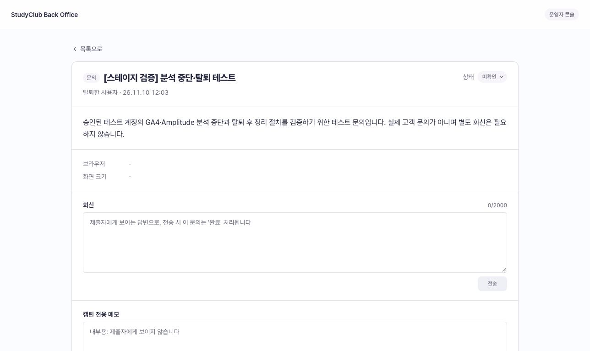

# GA4·Amplitude 분석 개인정보 운영

적용 범위는 GA4와 Amplitude다. 문의 화면은 그대로 사용한다. Clarity는 이번 변경 대상이 아니다.
계약은 [분석 스펙](../specs/analytics/spec.md), 테이블은 [ACCOUNT_ANALYTICS](erd/ACCOUNT_ANALYTICS.md)을 따른다.

## 배포 전에 준비할 설정

실제 값은 공개 저장소·문서·명령 이력에 넣지 않고 기존 비밀정보 관리 경로로 주입한다.

| 설정 | 용도 |
|---|---|
| `ANALYTICS_HMAC_KEY` | 안전한 난수로 만든 32바이트 이상 서버 전용 키. 브라우저에 배포하지 않는다 |
| `ANALYTICS_HMAC_KEY_VERSION` | 기본 `v1`. 새로 생성하는 ID에 붙는 키 버전 |
| `APP_ENV` | 환경별 ID 분리. 운영에서는 `production`, 스테이지에서는 `stage` |
| `GA4_PROPERTY_ID` | 삭제할 GA4 속성의 숫자 ID. `G-...` 측정 ID와 다르다 |
| `GA4_DELETION_SERVICE_ACCOUNT_EMAIL` | 해당 속성에 삭제 권한을 부여한 서비스 계정 |
| `GA4_DELETION_PRIVATE_KEY` | 서비스 계정의 PKCS8 개인키. 실제 줄바꿈 또는 `\n` 지원 |
| `AMPLITUDE_API_KEY` / `AMPLITUDE_SECRET_KEY` | 같은 Amplitude 프로젝트의 수집 키와 삭제용 비밀키 |
| `AMPLITUDE_DELETION_ENDPOINT` | 기본 미국 API. EU 프로젝트만 해당 지역 URL로 설정 |
| `ANALYTICS_DELETION_ENABLED` | 기본 `true`. 일시 중지해도 DB의 작업은 남는다 |

프론트의 기존 GA4·Amplitude 공개 키와 서버의 수집·삭제 대상이 같은 속성/프로젝트인지 확인한다. HMAC 키가 없으면 **회원 분석**은 비활성화한다. 익명 방문 분석은 별도로 동작한다.
GA4 Admin API 활성화와 서비스 계정의 속성 권한, Amplitude 삭제 권한을 배포 전에 시험한다. 두 도구의 실제 보관 설정이 방침의 최대 14개월과 맞는지도 확인한다.
GA4 웹 스트림의 향상된 측정에서 **브라우저 기록 변경에 따른 자동 페이지 조회를 끈다**. 앱의 PageViewTracker가 조회를 보내므로 켜 두면 중복된다.

DB에는 V57 마이그레이션으로 ACCOUNT_ANALYTICS 한 테이블을 추가한다. `ACCOUNT`에는 컬럼을 추가하지 않는다. 운영/로컬은 Flyway, 스테이지는 기존 규약대로 Hibernate update만 사용한다.

## 회원번호 보호와 키 교체

계정 생성 또는 최초 분석 설정 조회 때 `HMAC-SHA256(key, studyclub:환경:회원번호)`를 계산한다.
`버전_결과`를 회원별 분석 설정에 저장한다. 이후 이벤트마다 HMAC을 다시 계산하지 않고 저장한 값을 사용한다.
원문 회원번호는 GA4·Amplitude의 user ID, 서버 insert ID, GA 서버용 client ID에 넣지 않는다.
HMAC 결과는 계정과 연결 가능하므로 개인정보로 관리한다.

키를 교체해도 이미 저장된 ID는 바꾸지 않는다. 새로운 계정만 새 키·버전을 사용한다.
키 유출 시에는 기존 외부 ID 삭제 및 새 ID 발급을 별도 계획해야 한다. 기존 설정 행을 일괄 지워 재발급하면 과거 삭제 대상을 잃는다.

## 기존 문의를 처리하는 방법

1. 문의 본문에서 본인의 분석 중단 요청인지 확인한다.
2. ADMIN 인증으로 `POST /api/admin/feedbacks/{feedbackId}/analytics-opt-out`을 호출한다. 본문은 없다. 사용자·관리자 문의 화면에 버튼을 추가하지 않는다.
3. 응답의 `enabled: false`, `canOptOut: false`, `optedOutAt`을 확인한다. 같은 문의를 재실행해도 중단 시각·감사 기록은 중복되지 않는다. 문의의 상태·회신·메모는 바꾸지 않는다.
4. 기존 `GET /api/admin/feedbacks/{feedbackId}`의 `analytics`에서 수집 상태와 서비스별 진행을 확인한다. HMAC ID와 브라우저 번호는 응답에 노출하지 않는다.
5. 기존 문의로 결과를 안내한다. **수집 중단·외부 삭제 접수·외부 삭제 완료를 구분한다.**

기존 인증된 API 도구를 사용한다. 인증 정보를 공개 문서나 명령 이력에 복사하지 않는다. 별도 삭제 목록·강제 완료 API는 없다. 탈퇴한 작성자는 중단 API가 404를 반환하며 탈퇴 흐름에서 시작한 자동 삭제를 확인한다.

## 브라우저·서버 중단 범위

서버는 전송과 중단·탈퇴를 같은 회원 행 잠금 아래 처리한다. 중단 확정 뒤 시작하는 서버 전송은 막힌다.
브라우저는 허용 상태를 조회하고 GA client ID를 등록한 뒤 수집한다. 활성 탭은 30초마다 재확인하고 기존 허용은 45초 후 만료한다. 숨겨진 탭·통신 실패는 중단하며 복귀·로그인 변경 때 다시 확인한다.
Amplitude 대기 이벤트도 전송 직전에 상태를 검사하며 디스크에 대기열을 보관하지 않는다. 현재 브라우저의 중단 상태는 로그아웃 후에도 유지한다.
다른 기기는 동기화 시차가 있다. 새 브라우저의 로그인 전 익명 방문을 기존 중단 회원으로 식별하지는 못한다. 쿠키 차단만으로 서버 분석이 중단된다고 안내하지 않는다.

## 탈퇴와 외부 삭제

탈퇴 트랜잭션에서 분석 중단을 저장하고 ACCOUNT를 삭제한다. ACCOUNT_ANALYTICS는 외부 삭제에 필요한 동안 유지한다. 탈퇴 플래그는 추가하지 않는다.
커밋 뒤 기존 정리 스케줄러에 첫 실행을 예약한다. 브라우저 허용 유효기간을 고려해 중단 후 90초에 실행한다. 30일을 기다리지 않는다.
실패하거나 서버가 재시작되면 기존 `cleanup`이 이어서 처리한다. 기본은 서버 시작 60초 후, 이후 작업 종료부터 하루 간격이다. 문의로 중단한 회원과 탈퇴한 회원 모두 대상이다.
한 번에 100개씩 회원번호 순서로 처리하므로 앞쪽 실패가 뒤쪽 대상을 막지 않는다. HTTP는 DB 트랜잭션 밖에서 실행하고 서비스별 결과를 따로 저장한다. 다중 인스턴스에서는 동일 외부 요청이 반복될 수 있다.

| 서비스 | 저장 상태 | 자동 처리 |
|---|---|---|
| GA4 | NOT_REQUESTED → REQUESTED | HMAC userId·서버 clientId·등록된 모든 브라우저 clientId의 접수 응답을 확인. 일부 실패면 다음 일일 실행에서 전체 재요청 |
| Amplitude | NOT_REQUESTED → REQUESTED → DONE | 프로젝트 범위 v1 API 접수 시 반환한 내부 ID·요청 시각을 보관. 일일 조회에서 해당 요청의 모든 ID가 done이면 완료 |

식별자를 만든 적 없는 계정은 두 서비스 모두 DONE(삭제할 대상 없음)으로 처리한다. 반면 외부 API의 빈 응답·대상 없음·권한 오류는 자동 완료로 간주하지 않고 식별자를 보존한다.

**로컬 정리 조건은 GA4의 모든 식별자 삭제 접수와 Amplitude 완료 확인이다.** 충족하면 활성 회원은 식별자를 비우고 회원번호·중단 시각·최종 상태를 남긴다. 탈퇴 회원은 분석 행을 제거한다. GA4의 실제 삭제가 끝났다고 주장하는 조건이 아니다. 이미 Google에 접수한 삭제는 로컬 식별자 정리와 별개로 진행된다. 활성 회원의 GA4 상태는 REQUESTED로 남는다.

Google 응답은 접수 시각만 제공한다. 별도 완료 조회 API가 없으므로 DONE으로 바꾸거나 운영자에게 강제 완료 처리를 요구하지 않는다. 실제 완료 증빙이 필요한 문의는 Google 지원 절차로 별도 확인한다. 방침에 30일 내 완료를 보장하지 않는다.
Amplitude의 `USER_NOT_FOUND` 등 미해결 상태는 운영자가 프로젝트·권한·실제 전송 여부를 조사한다. 설정을 고치면 다음 일일 작업에서 재시도한다. 무조건 완료로 바꾸는 API는 없다.

`cleanup.enabled=false` 또는 `ANALYTICS_DELETION_ENABLED=false`이면 초기 예약과 일일 삭제를 모두 끈다. 수집 중단은 유지된다. 공통 `cleanup`의 실패·대기 지표와 서비스별 오류 분류 로그를 확인한다. 식별자·응답 원문·비밀키는 로그에 남기지 않는다.
**미처리 건이 있으면 GA 속성·Amplitude 프로젝트를 바꾸지 않는다.** 이번 최소 구조는 과거 프로젝트 설정을 행별로 보관하지 않는다.

## 검증과 배포

- ADMIN/일반 회원 권한, 중복 중단, 트랜잭션 롤백, 탈퇴 후 자동 처리, 한 서비스 실패 시 다른 서비스 진행, 재시도, 로컬 식별자 정리를 자동 테스트한다.
- 외부 API 계약은 로컬 HTTP 응답으로 검증한다. 실제 서비스의 삭제·완료 여부 검증을 대신하지 않는다.
- 별도 테스트 속성·프로젝트에서 HMAC 일치, 중단 뒤 브라우저/서버 전송, GA clientId 삭제 범위를 검증한다. GA_CLIENT_IDS는 검증 전까지 유지한다. 현재 stage 브라우저 GA는 꺼져 있으므로 별도 테스트 빌드 설정이 필요하다.
- V57은 배포 전 신규 마이그레이션이다. 이미 초기 2테이블 초안을 수동 적용한 환경이 있다면 데이터 확인 후 별도 이관이 필요하다. Hibernate update는 이전 테이블·컬럼을 제거하지 않는다.

## 로컬 검증 결과 (2026-11-08)

- 백엔드 전체 `clean check :api:bootJar`: 1355개 테스트, 실패·오류 0, 조건부 테스트 1개 제외. 이전 빌드 결과를 제거한 최종 실행 기준이다.
- 사용자 프론트: 301개 테스트 통과, TypeScript 검사 통과. 플레이그라운드 production 빌드·화면명세 일치·디자인 기준선·개발 범위 검사 통과.
- 임시 MySQL 8: 빈 DB에 V56까지 전체 마이그레이션 적용 후 Hibernate validate와 서버 시작 성공. 검증 컨테이너는 종료했다.
- 문의 미리보기에서 분석 영역·버튼 제거 확인. 실제 Google·Amplitude 삭제 요청은 실행하지 않았다. 비밀키와 권한을 준비한 뒤 테스트 프로젝트 검증이 필요하다.

## 공식 자료

- [Google 삭제 접수 API](https://developers.google.com/analytics/devguides/config/admin/v1/rest/v1alpha/properties/submitUserDeletion): 응답은 `deletionRequestTime`.
- [Google 사용자 탐색과 삭제](https://support.google.com/analytics/answer/9283607?hl=en): 사용자 ID와 브라우저 ID의 연결은 서비스가 관리한다. UI에서 요청한 영구 삭제는 화면에서 사라진 뒤에도 최대 63일이 걸릴 수 있다.
- [Amplitude User Privacy API](https://amplitude.com/docs/apis/analytics/user-privacy): 프로젝트 범위 삭제, 요청한 날짜·내부 ID를 기준으로 진행 조회.

## 스테이지 반영 준비 (2026-11-09)

최신 develop에 분석 기능 변경분만 적용했다. 스테이지의 인증 갱신은 명시적으로 선택하는 방식이므로 분석 설정 조회·브라우저 등록에서도 갱신을 사용하도록 맞췄다. 해당 재시도 테스트 2개를 추가했다.
develop의 웹 푸시 마이그레이션이 V56을 사용하고 있어, 아직 배포하지 않은 분석 마이그레이션은 V57로 배정했다.
로컬 백엔드 1,374개 테스트에서 실패·오류 0, 조건부 1개 제외. 사용자 프론트 기존 301개와 백오피스 496개 테스트, 두 앱 lint/typecheck 통과. 실제 배포·외부 연동 검증은 별도로 기록한다.

## 스테이지 검증 결과 (2026-11-09)

[PR #443](https://github.com/StudyClub-PlusPlus/studyclub-engineering/pull/443)을 develop에 병합했다. 반영 커밋은 `897b13a8`이다.
백엔드·사용자 프론트·백오피스 배포가 모두 성공했고, CI의 빈 MySQL 마이그레이션 및 Hibernate validate도 통과했다.

- 실제 스테이지 점검 8건 통과: 서버 헬스, 공개 스터디 조회, 사용자 홈·방침·관리자 진입 화면, 미인증 분석 설정 조회·브라우저 등록·관리자 중단 요청의 401 차단.
- 로그인한 브라우저에서 새 분석 설정 API와 주기적 재조회가 200으로 응답했다. `userId: null`, `enabled: false`, `optedOutAt: null`이었다. 현재 구현상 HMAC 키가 준비되지 않은 상태에 해당한다. 서버 비밀 설정 자체는 접근 권한이 없어 직접 확인하지 않았다.
- 위 비활성 상태로 화면을 이동하고 재조회하는 동안 GA4·Amplitude 브라우저 요청이 관찰되지 않았다. 분석 중단 API를 실행한 결과나 서버의 외부 통신을 검증한 것은 아니다.
- 방침의 HMAC·문의 중단 안내와 쿠키 거부 시 분석 제외 문구 제거를 확인했다. 상단 개정일과 제16조 날짜가 달라 제16조를 동일한 날짜로 수정했다.
- 새 탭에서 방침·홈 화면을 확인했으며 브라우저 오류는 관찰되지 않았다.

남은 검증: 기존 비밀정보 관리 경로에서 스테이지 HMAC 키와 각 서비스의 테스트 프로젝트·삭제 권한을 준비하고, 별도 테스트 계정으로 관리자 중단·중복 실행·탈퇴·초기 삭제 요청·일일 재시도·완료 후 정리를 확인한다. 현재 로그인된 계정의 중단·탈퇴는 실행하지 않았다. GA4 브라우저 수집은 기존 stage 설정에서 꺼져 있으므로 별도 테스트 빌드가 필요하다. 실제 외부 삭제 성공이나 완료는 아직 검증하지 않았다.

## 스테이지 추가 검증 결과 (2026-11-10)

사용자가 탈퇴를 허용한 테스트 계정과 기존 ADMIN 계정으로 실제 스테이지 API·화면을 확인했다. 저장된 스테이지 DB 연결로 결과를 읽었으며 DB를 직접 수정하지 않았다. 테스트 계정은 검증 마지막에 실제 탈퇴했다. 계정 식별자·인증 정보는 이 문서에 남기지 않는다.

| 확인한 동작 | 실제 결과 |
|---|---|
| 분석 테이블 반영 | `ACCOUNT_ANALYTICS`의 10개 컬럼 확인 |
| 본인 분석 설정 조회 | 200 및 `no-store`. HMAC ID가 없고 회원 분석 비활성 |
| 잘못된 브라우저 ID·빈 입력 | 400. 유효한 형식도 분석 비활성 상태에서는 DB에 저장하지 않음 |
| 중단 API 권한 | 일반 회원 403, ADMIN이 존재하지 않는 문의를 지정하면 404 |
| 문의를 통한 관리자 중단 | 승인된 테스트 계정이 작성한 검증용 문의로 실행. 200 및 중단 시각 저장 |
| 반복 중단 | 네 차례 호출 후 DB 중단 시각 유지, 감사 기록 한 건. 문의 본문·상태·회신·메모 유지 |
| 로그아웃·재로그인 | 실제 Google 재인증 후 새 세션에서도 같은 중단 시각·비활성 상태 유지 |
| 중단 후 브라우저 등록 | 200으로 비활성 설정 반환. 브라우저 ID 미저장 |
| 실제 탈퇴 | 사용자 탈퇴 화면에서 실행 후 비로그인 홈으로 이동 |
| 탈퇴 후 DB 정리 | 계정·로그인 수단·동의 이력·분석 행이 모두 제거됨. 분석 행은 직접 지우지 않고 자동 처리됨 |
| 탈퇴 후 이전 세션 | 본인 조회 401, 분석 조회·브라우저 등록 404. 분석 행이 다시 생성되지 않음 |
| 탈퇴 후 문의 | 관리자 조회 200, 화면에 ‘탈퇴한 사용자’ 표시. 중단 API는 404. 기존 중단 감사 기록 한 건 유지 |

**이번 실제 탈퇴 검증은 외부 분석 식별자를 만든 적 없는 계정의 흐름이다.** 두 서비스의 `DONE`은 ‘삭제할 식별자 없음’을 의미하며, GA4·Amplitude에서 실제 삭제가 완료됐다는 증거가 아니다. 이미 중단한 뒤 탈퇴했으므로 중단 직후 90초 예약 시간도 별도로 측정하지 않았다.

반복 처리의 중복 방지는 DB와 감사 기록으로 확인했다. 첫 두 응답의 완전 일치 검사는 통과하지 않았으나 당시 응답 원문을 보관하지 않아 차이를 확정하지 못했다. 이후 두 응답은 일치했다. 첫 응답의 시각 직렬화와 DB 저장 정밀도 차이 여부는 별도 확인이 필요하다.

남은 검증은 HMAC ID 생성 및 브라우저·서버의 실제 수집, 수집 중인 계정의 중단 전환, 실제 외부 삭제 접수·완료 조회, 실패 후 일일 재시도다. 스테이지 HMAC 설정과 별도 테스트 속성·프로젝트 및 삭제 권한을 준비해야 한다. 서버의 비밀 설정 값은 직접 확인하지 않았으며, 이번에는 GA4·Amplitude의 실제 삭제 요청을 검증하지 않았다.

## beta 반영 준비 (2026-11-10)

최신 beta `d40c5e2c`를 기준으로 스테이지에서 검증한 분석 기능을 적용했다. beta의 로그아웃·탈퇴 시 갱신 토큰 정리와 캡틴 탈퇴 시 스터디 작성자 연결 해제를 유지했다. beta의 공통 HTTP 함수는 401 응답에 자동 갱신하므로, 스테이지 전용 옵션만 제외하고 분석 설정·브라우저 등록의 갱신 재시도 테스트는 유지했다.

beta는 V56을 갱신 토큰 테이블에 사용한다. 분석 테이블은 스테이지와 동일한 V57을 사용하며 번호 중복 검사를 통과했다. 스테이지에만 있는 웹 푸시 변경은 이 PR에 포함하지 않았다.

beta 기준 로컬 검증: 백엔드 `check :api:bootJar` 성공(전체 1,356개, 실패·오류 0, 조건부 제외 1개). 사용자 프론트 307개·백오피스 501개 테스트와 두 앱의 lint/typecheck 통과. 패키지 설치 스크립트는 실행하지 않고 설치된 검사 도구를 직접 실행했다. 실제 MySQL 마이그레이션 적용 검사는 PR CI에서 다시 확인한다.
