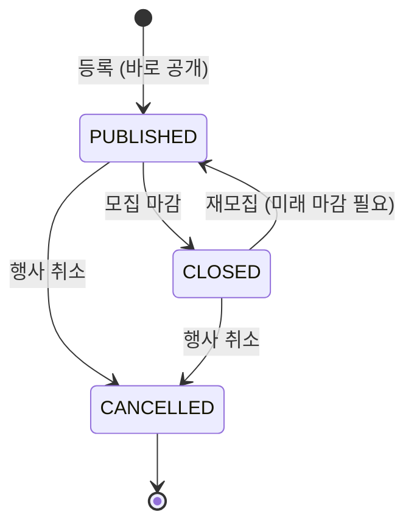

# CLUB_EVENT — 행사

캡틴이 백오피스에서 등록하는 크루 행사 한 건. 등록하면 바로 크루에게 공개된다(`PUBLISHED`). 참여 방식별 정원·장소·링크는 [CLUB_EVENT_CHANNEL](./CLUB_EVENT_CHANNEL.md), 신청 질문은 [CLUB_EVENT_QUESTION](./CLUB_EVENT_QUESTION.md). 신청 테이블은 신청 스펙(crew-apply-event)에서 만든다.

> 스펙: [event](../../specs/event/spec.md) · 마이그레이션 `V59__create_club_event.sql` · 엔티티 `com.studyclub.domain.event.ClubEvent` (애그리거트 루트)

## 컬럼

| 컬럼 | 타입 | NULL | 설명 |
|---|---|---|---|
| ID | BIGINT PK | N | 응답의 `eventId` |
| TITLE | VARCHAR(60) | N | 행사명. 앞뒤 공백을 지운 1~60자 (UTF-16 길이) |
| SUMMARY | VARCHAR(120) | N | 한 줄 소개 1~120자 |
| DESCRIPTION | TEXT | N | 모집 상세 1~5,000자(앱이 본다). 서식 없는 글 — HTML 로 해석하지 않는다 |
| TIME_ZONE | VARCHAR(64) | N | 행사 기준 IANA 시간대. `Asia/Seoul` · `America/Toronto` · `America/New_York` · `America/Los_Angeles` 중 하나 |
| STARTS_AT | DATETIME(6) | N | 시작 시각 (UTC, 분 단위) |
| ENDS_AT | DATETIME(6) | Y | 종료 시각. 없으면 `TIME_ZONE` 기준 시작일 다음 날 00:00 이 종료 판정 시각(`effectiveEndsAt`) |
| DEADLINE_AT | DATETIME(6) | N | 신청 마감. `≤ STARTS_AT` |
| CONFIRMATION | VARCHAR(20) | N | `AUTO`(신청 즉시 참가 확정) / `REVIEW`(확인 대기로 접수) |
| STATUS | VARCHAR(20) | N | 저장 상태 `PUBLISHED` / `CLOSED` / `CANCELLED` — 아래 상태 |
| PUBLISHED_AT | DATETIME(6) | N | 공개 시각. 등록 즉시 공개라 등록 시각과 같다. 수정이 바꾸지 않는다 |
| VERSION | BIGINT | N | 동시 수정 방지 버전. 등록 0, 수정 저장마다 +1, 상태 전환으로 `STATUS` 가 실제로 바뀔 때 +1 (Q14 · N3). JPA `@Version` 이 아니다 — 화면이 보낸 값과 행 잠금 뒤 비교한다 |
| CREATED_BY | BIGINT | N | 등록한 캡틴. [ACCOUNT](./ACCOUNT.md) ID 참조 (FK 없음) |
| CREATE_IDEMPOTENCY_KEY | VARCHAR(36) | N | 등록 요청의 `Idempotency-Key`(UUID v4, 소문자). 같은 계정의 같은 키 재시도는 이 행을 돌려준다 (N1) |
| CREATED_AT / UPDATED_AT | DATETIME(6) | N | `BaseEntity` |

## 관계

- N : 1 [ACCOUNT](./ACCOUNT.md) — 등록한 캡틴(`CREATED_BY`). ID 참조뿐 FK 는 없다(애그리거트 간 참조). 탈퇴로 계정이 지워져도 행사는 남는다
- 1 : N [CLUB_EVENT_CHANNEL](./CLUB_EVENT_CHANNEL.md) — 참여 방식. 애그리거트 안, FK 있음(`ON DELETE CASCADE`). 1~2행
- 1 : N [CLUB_EVENT_QUESTION](./CLUB_EVENT_QUESTION.md) — 현재 신청 질문. 애그리거트 안, FK 있음(`ON DELETE CASCADE`). 0~20행
- 1 : N 신청 (신청 스펙에서 정한다) — 별도 애그리거트. 신청이 `CLUB_EVENT_ID` 로 이 행을 참조한다

## 상태 — STATUS

운영자가 바꾸는 값만 저장한다. 등록은 `PUBLISHED` 를 만들고, 수정(`PUT`)은 상태를 바꾸지 않는다. 전환(모집 마감 · 재모집 · 행사 취소)은 상태 전환 스펙의 일이다.

- `CANCELLED` 는 되돌릴 수 없고 조회 전용이다 — 수정은 409 `EVENT_CANCELLED`
- `DRAFT` 는 없다 (초안 기능 제외, Q1·Q2)

### 표시 상태 (저장하지 않음)

화면의 상태 칩은 `ClubEvent.displayStatus(now, seatCounts)` 가 요청마다 계산한다. 위에서부터 먼저 맞는 값을 쓴다.

| 값 | 조건 |
|---|---|
| `CANCELLED` | `STATUS = CANCELLED` |
| `ENDED` | `now ≥ effectiveEndsAt` |
| `RECRUITMENT_CLOSED` | `STATUS = CLOSED` 또는 `now ≥ DEADLINE_AT` 또는 `now ≥ STARTS_AT` |
| `FULL` | 모든 참여 방식의 잔여석 0 (잔여석 = 정원 − 확인 대기 − 참가 확정) |
| `RECRUITING` | 그 밖 |

정원 마감을 저장하지 않으므로 자리가 생기면 저절로 모집 중으로 돌아간다 (Q11).

## 제약

- `uk_club_event_created_by_idempotency (CREATED_BY, CREATE_IDEMPOTENCY_KEY)` — 같은 계정 · 같은 키의 동시 등록 중 하나만 만들어진다
- `idx_club_event_starts_at_id (STARTS_AT, ID)` — 운영 목록 정렬(`STARTS_AT DESC, ID DESC`)
- **행 잠금 규칙**: 같은 행사의 정원 · 확정 방식 · 참여 방식을 읽고 판단하거나 바꾸는 트랜잭션(행사 수정 · 상태 전환 · 신청 제출 · 참가자 처리 · 종료 자동 처리)은 첫 조회로 이 행을 `SELECT … FOR UPDATE` 한다 (`ClubEventRepository.findByIdForUpdate`). 신청 수는 잠금 뒤에 센다
- 물리 삭제하지 않는다. 행사를 내리는 길은 취소(`CANCELLED`)뿐이다 — 그래서 하위 행 `ON DELETE CASCADE` 는 운영에서 타지 않는 마지막 방어선이다
- `ENDS_AT > STARTS_AT ≥ DEADLINE_AT` 과 글자 수 · 시간대 허용 값은 엔티티(`EventDraft`)가 지킨다
