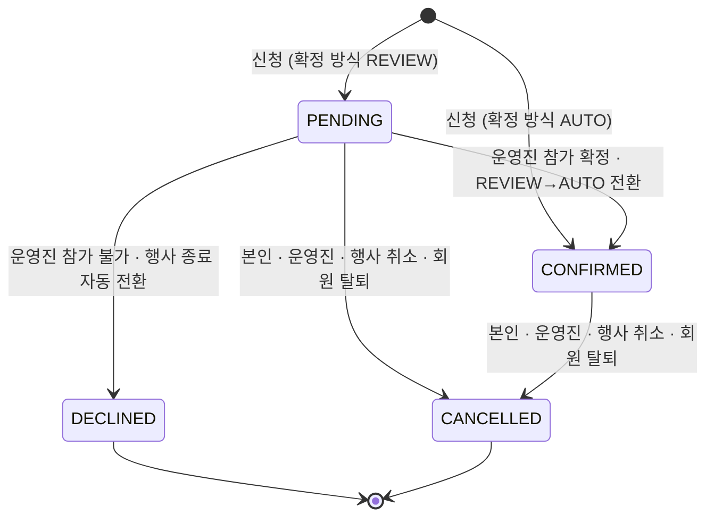

# CLUB_EVENT_REGISTRATION — 행사 신청

크루 한 명의 행사 신청 한 건. 운영진 처리(참가 확정 · 참가 불가 · 개별 취소 · 종료 자동 전환)와 크루 신청 · 본인 취소가 **함께 쓰는 공통 테이블**이다. 취소한 크루가 다시 신청하면 이전 행을 남기고 새 행이 생긴다.

> 스펙: [event-registration](../../specs/event-registration/spec.md) (크루 쪽) · event-participant (운영진 쪽, PR #479) · 마이그레이션 `V62__create_club_event_registration.sql` · 엔티티 `com.studyclub.domain.event.registration.ClubEventRegistration` (애그리거트 루트)

## 컬럼

| 컬럼 | 타입 | NULL | 설명 |
|---|---|---|---|
| ID | BIGINT PK | N | 응답의 `registrationId` |
| CLUB_EVENT_ID | BIGINT | N | [CLUB_EVENT](./CLUB_EVENT.md) ID 참조. **FK 없음** (다른 애그리거트) |
| ACCOUNT_ID | BIGINT | N | 신청한 [ACCOUNT](./ACCOUNT.md) ID 참조. FK 없음. 탈퇴로 계정이 지워져도 값은 남아 「탈퇴한 회원」으로 보인다 |
| CHANNEL | VARCHAR(20) | N | `ONLINE` / `OFFLINE` |
| STATUS | VARCHAR(20) | N | `PENDING`(확인 대기) / `CONFIRMED`(참가 확정) / `DECLINED`(참가 불가) / `CANCELLED`(신청 취소) |
| CANCEL_REASON | VARCHAR(30) | Y | `STATUS = CANCELLED` 일 때만. `SELF_CANCELLED`(본인) / `ADMIN_CANCELLED`(운영진 개별) / `ACCOUNT_DELETED`(회원 탈퇴) / `EVENT_CANCELLED`(행사 취소 — 취소 안내 메일 대상) |
| STATUS_CHANGED_AT | DATETIME(6) | Y | 마지막 상태 전이 시각. 접수 그대로면 NULL |
| STATUS_CHANGED_BY | BIGINT | Y | 마지막 상태를 바꾼 계정(캡틴 · 본인). 시스템 처리(종료 자동 전환 · 탈퇴)면 NULL. FK 없음 |
| APPLICANT_TIME_ZONE | VARCHAR(64) | Y | 신청 당시 신청자 `ACCOUNT.TIME_ZONE` 사본. 화면의 표시 시간대가 아니다. 계정에 시간대가 없었으면 NULL |
| QUESTIONS_SNAPSHOT | JSON | N | 신청 당시 질문 사본 `[{questionId, label, type, required, options}]` (`SORT_ORDER` 순). 질문 없는 행사면 `[]` |
| ANSWERS_SNAPSHOT | JSON | N | 답 `{"<questionId>": ["…"]}`. 값은 언제나 문자열 배열, 답하지 않은 질문은 키가 없다 |
| SUBMIT_IDEMPOTENCY_KEY | VARCHAR(36) | N | 신청 제출의 `Idempotency-Key` (UUID). 같은 계정 · 같은 키의 재시도는 이 행을 그대로 돌려준다 |
| CREATED_AT / UPDATED_AT | DATETIME(6) | N | `BaseEntity`. `CREATED_AT` 이 신청 시각 |

닉네임 · 이메일은 **복사하지 않는다.** 필요할 때 `ACCOUNT` 에서 읽는다 — 탈퇴 때 지울 곳이 늘지 않고, 운영자가 보는 주소와 메일이 나가는 주소가 갈리지 않는다.

## 관계

- N : 1 [CLUB_EVENT](./CLUB_EVENT.md) — ID 참조만. 행사 쪽은 신청 테이블을 직접 모르고 포트 `ClubEventRegistrationPort` 로 묻는다 (실제 어댑터 `ClubEventRegistrationAdapter`, api 모듈)
- N : 1 [ACCOUNT](./ACCOUNT.md) — ID 참조만
- [CLUB_EVENT_QUESTION](./CLUB_EVENT_QUESTION.md) 을 **물지 않는다** — 질문 · 답은 신청 당시 사본이다

## 상태

- 자리를 차지하는 것(유효 인원)은 `PENDING` + `CONFIRMED`. 참가 불가 · 취소는 자리를 반환한다
- `DECLINED` · `CANCELLED` 는 끝 상태다. 되살리지 않는다
- 같은 행사에 같은 계정의 `PENDING` · `CONFIRMED` · `DECLINED` 행이 있으면 새 신청을 받지 않는다 (앱이 잠금 뒤 확인). 취소만 있으면 다시 신청할 수 있다
- 한 행을 바꾸는 전이는 엔티티 메서드(`confirm` · `decline` · `cancelByAdmin` · `cancelBySelf`)로, 여러 행을 한 번에 바꾸는 전이(일괄 확정 · 탈퇴)는 저장소의 `WHERE STATUS …` 조건부 갱신으로 한다. 어느 쪽이든 그 행사 행 잠금 아래에서다

## 제약 · 인덱스

- `uk_club_event_registration_account_submit_key (ACCOUNT_ID, SUBMIT_IDEMPOTENCY_KEY)` — 같은 신청 시도의 재시도가 새 행을 만들지 않게
- `idx_club_event_registration_event_channel_status (CLUB_EVENT_ID, CHANNEL, STATUS)` — 방식 · 상태별 수 (정원 · 잔여석 · 표시 상태 · 일괄 확정)
- `idx_club_event_registration_event_created (CLUB_EVENT_ID, CREATED_AT, ID)` — 참가자 목록 정렬 · 페이지
- `idx_club_event_registration_account_event (ACCOUNT_ID, CLUB_EVENT_ID)` — 중복 신청 확인 · 내 행사 · 탈퇴
- `idx_club_event_registration_status_event (STATUS, CLUB_EVENT_ID)` — 종료 자동 전환의 대상 고르기
- `UNIQUE(CLUB_EVENT_ID, ACCOUNT_ID)` 는 **없다** — 재신청이 새 행이라 걸면 재신청이 막힌다

## 잠금

- 같은 행사의 신청을 읽고 판단하거나 바꾸는 트랜잭션은 [CLUB_EVENT](./CLUB_EVENT.md) 행 잠금 뒤에 이 테이블을 읽는다
- 신청 제출과 회원 탈퇴는 **`ACCOUNT` → `CLUB_EVENT`** 순서로 잠근다. 탈퇴는 그 계정 신청이 걸린 행사를 ID 오름차순으로 모두 잠근 뒤, 종료 전 · 취소 안 된 행사의 유효 신청을 `ACCOUNT_DELETED` 로 바꾼다 (메일 · 도메인 이벤트 없음)
