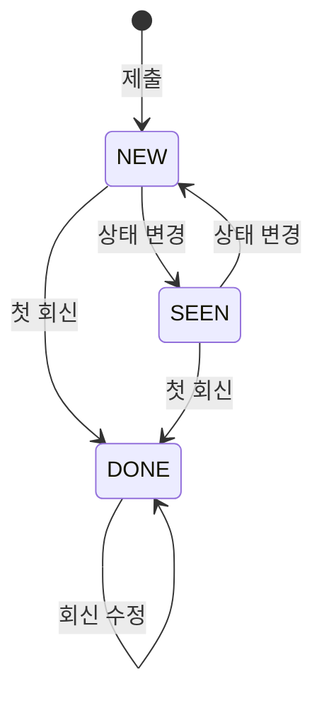

# FEEDBACK — 문의·오류 신고

크루가 사이트 「내 문의」에서 보낸 문의 · 개선 의견 · 오류 신고 한 건과, 캡틴의 처리(상태 · 회신 · 캡틴 전용 메모)가 한 행이다. 첨부 이미지는 [FEEDBACK_IMAGE](./FEEDBACK_IMAGE.md).

> 스펙: [feedback](../../specs/feedback/spec.md) · 마이그레이션 `V51__feedback.sql`

## 컬럼

| 컬럼 | 타입 | NULL | 설명 |
|---|---|---|---|
| ID | BIGINT PK | N | |
| ACCOUNT_ID | BIGINT | N | 제출자. ID 참조([ACCOUNT](./ACCOUNT.md), FK 없음). 탈퇴로 ACCOUNT 행이 지워지면 가리키는 행이 없다 → 운영 화면 「탈퇴한 사용자」 |
| TYPE | VARCHAR(20) | N | `QUESTION` / `IDEA` / `BUG` (문의 · 개선 의견 · 오류 신고) |
| TITLE | VARCHAR(100) | N | 2~100자 |
| CONTENT | VARCHAR(2000) | N | 10~2000자. 평문 — 받은 글자 그대로 |
| BROWSER | VARCHAR(60) | Y | 「Chrome 141 · macOS」. 서버가 User-Agent 를 줄인 값. 원문은 저장하지 않는다 |
| VIEWPORT_WIDTH | INT | Y | 제출 때 화면 너비(CSS px) |
| VIEWPORT_HEIGHT | INT | Y | 〃 높이 |
| STATUS | VARCHAR(20) | N | `NEW` / `SEEN` / `DONE` (미확인 · 확인 · 완료) |
| DONE_BY_ACCOUNT_ID | BIGINT | Y | 첫 회신을 보낸 캡틴 = 완료 처리자. ID 참조(FK 없음) |
| REPLY_CONTENT | VARCHAR(2000) | Y | 캡틴 회신. 수정하면 이 값만 바뀐다 |
| REPLIED_AT | DATETIME(6) | Y | 첫 회신 시각. 수정해도 그대로 |
| ADMIN_MEMO | VARCHAR(2000) | Y | 캡틴 전용 메모. 제출자에게 보이지 않는다 |
| CREATED_AT / UPDATED_AT | DATETIME(6) | N | `BaseEntity`. `CREATED_AT` 이 접수 시각 |

## 관계

- N : 1 [ACCOUNT](./ACCOUNT.md) — 제출자(`ACCOUNT_ID`) · 완료 처리자(`DONE_BY_ACCOUNT_ID`). ID 참조뿐 FK 는 없다(애그리거트 간 참조)
- 1 : N [FEEDBACK_IMAGE](./FEEDBACK_IMAGE.md) — 애그리거트 안, FK 있음

## 상태 — STATUS

**완료는 회신으로만 된다.** `STATUS = DONE ⇔ REPLY_CONTENT 있음 ⇔ DONE_BY_ACCOUNT_ID 있음` 을 엔티티(`Feedback`)가 지킨다. 제출자에게는 `NEW`·`SEEN` 이 「접수」, `DONE` 이 「답변 완료」로 보인다.

- 회신 없이 `DONE` 으로 바꾸면 `409 FEEDBACK_REPLY_REQUIRED`, 회신 뒤 상태를 바꾸면 `409 FEEDBACK_ALREADY_ANSWERED`

## 제약

- 인덱스 `idx_feedback_account_created (ACCOUNT_ID, CREATED_AT)` — 내 문의 목록 · rate limit(계정당 60초 1건 · 24시간 20건)
- 인덱스 `idx_feedback_created (CREATED_AT)` — 운영 목록 정렬
- 삭제 컬럼은 없다. 첫 답변(`REPLIED_AT`)부터 1년, 미답변은 접수(`CREATED_AT`)부터 1년 후 행을 물리 삭제한다. 서버가 하루에 한 번 확인한다. 회신·메모 수정과 탈퇴는 기한을 바꾸지 않는다 ([보유 기간 결정](../share/2026-10-31-feedback-retention.md))
- 탈퇴 때는 첨부 이미지만 먼저 파기하고 문의 행은 위 기한까지 남긴다 — [user-leave](../../specs/user-leave/spec.md)
