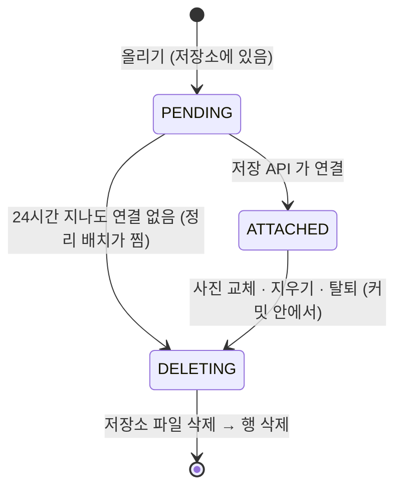

# STORAGE_OBJECT — 올린 파일의 주인·용도·위치·상태

오브젝트 스토리지에 올린 파일 하나가 행 하나. 파일은 저장소(지금은 S3)에 있고, 이 테이블은 「누가 어떤 용도로 어디에 올렸고 지금 쓰이고 있나」 만 안다. 사진 주소 자체는 기능 쪽 칼럼(`ACCOUNT.PROFILE_IMG_URL`, `STUDY.THUMBNAIL_URL`)에 적는다.

> 스펙: [profile-image](../../specs/profile-image/spec.md)

## 컬럼

| 컬럼 | 타입 | NULL | 설명 |
|---|---|---|---|
| ID | BIGINT PK | N | 파일 번호. 저장 API 가 이 번호를 받아 연결한다 |
| ACCOUNT_ID | BIGINT | N | 올린 사람. ID 참조([ACCOUNT](./ACCOUNT.md), FK 없음). 연결할 때 「올린 사람 = 요청한 사람」 확인에 쓴다 |
| PURPOSE | VARCHAR(20) | N | `PROFILE` / `STUDY_THUMBNAIL` / `FEEDBACK`(문의 첨부, [FEEDBACK_IMAGE](./FEEDBACK_IMAGE.md)). 폴더를 정하고, 연결할 때 칸과 맞는지 본다 |
| PROVIDER | VARCHAR(20) | N | 파일이 있는 저장소. `S3` / `R2`. 지금은 `S3` 만 쓴다. 지우기가 이 값으로 저장소 구현을 고른다 |
| OBJECT_KEY | VARCHAR(512) UK | N | 저장소 안의 위치. `gigs/profiles/<UUID>.webp` 꼴. 교체·지우기가 주소에서 키를 뽑아 이 행을 찾는다 |
| CONTENT_TYPE | VARCHAR(40) | N | 판정한 형식. `image/jpeg` / `image/png` / `image/webp` |
| SIZE | BIGINT | N | 메타데이터를 지운 뒤 저장한 바이트 수 |
| STATUS | VARCHAR(20) | N | `PENDING` / `ATTACHED` / `DELETING` |
| ATTACHED_AT | DATETIME(6) | Y | 연결 시각. `PENDING` 이면 NULL |
| CREATED_AT / UPDATED_AT | DATETIME(6) | N | `BaseEntity`. `CREATED_AT` 이 「하루 지난 PENDING」 판정 기준 |

## 관계

- N : 1 [ACCOUNT](./ACCOUNT.md), ID 참조뿐 FK 는 없다(애그리거트 간 참조 — database-guide.md 외래키 정책). 탈퇴 시 그 계정의 `PENDING` 행과 `PROFILE`·`FEEDBACK` 용도의 `ATTACHED` 행을 `DELETING` 으로 넘기고 커밋 뒤 지운다.
- 기능 쪽 테이블과는 잇지 않는다. `ACCOUNT.PROFILE_IMG_URL`·`STUDY.THUMBNAIL_URL` 에 적힌 주소에서 키를 뽑아 `OBJECT_KEY` 로 찾는다.

## 상태 — STATUS

상태를 바꾸는 쿼리는 전부 지금 상태를 조건에 건 UPDATE 다. 연결은 `STATUS='PENDING'` 일 때만, 정리 배치의 찜하기도 `STATUS='PENDING'` 일 때만 바뀐다. 그래서 배치와 연결이 같은 행을 동시에 잡아도 한쪽만 이긴다.

## 저장소 이관

다른 오브젝트 스토리지로 옮길 때는 파일을 복사한 뒤 행의 `PROVIDER` 와 기능 쪽 칼럼의 주소 접두어를 바꾼다. 행 단위라 두 저장소가 한동안 같이 있어도 된다. 키는 그대로 가져간다.

## 제약

- 인덱스 `idx_storage_object_status_created (STATUS, CREATED_AT)` — 정리 배치가 하루 지난 `PENDING` 을 찜할 때. `idx_storage_object_account_status (ACCOUNT_ID, STATUS)` — 올리기 전 그 계정의 `PENDING` 수(상한 20)를 셀 때.
- `OBJECT_KEY` UNIQUE — 키는 UUID 라 저장소가 바뀌어도 겹칠 일이 없지만, 주소 → 행 조회가 하나만 돌아오게 보장한다.
- 물리 삭제한다. 파일이 저장소에서 사라지면 행이 남아 있을 이유가 없다. `DELETING` 은 「지우는 중」 표시이지 보존 상태가 아니다.

정리 작업은 시작 지연 1분, 실행 완료 후 하루 간격이다. 만료 PENDING 예약과 DELETING 재시도를 100건씩 처리한다. [공통 정리 스펙](../../specs/data-retention/spec.md).
