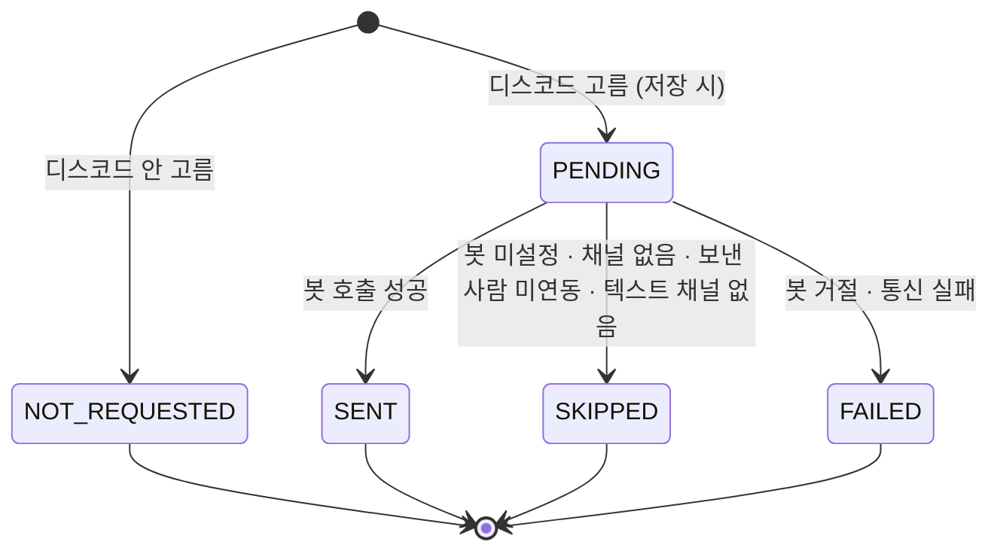

# STUDY_NOTICE — 스터디 공지 발송 기록

네비게이터(또는 담당 캡틴)가 **한 반의 팀원에게 보낸 공지** 한 건. 제목·본문·채널과 디스코드 결과를 남긴다.
메일 결과는 여기 두지 않고 [NOTIFICATION](./NOTIFICATION.md) 행(받는 사람마다 하나)에서 센다.

> 스펙: [study-notice](../../specs/study-notice/spec.md) · 정책: [POL-0010](../../01-planning/_registry/policies/POL-0010-study-notice.md)

## 컬럼 — STUDY_NOTICE

| 컬럼 | 타입 | NULL | 설명 |
|---|---|---|---|
| ID | BIGINT PK | N | |
| STUDY_ID | BIGINT | N | ID 참조([STUDY](./STUDY.md)). 반에서 도출되지만 조회·권한 확인을 줄이려 둔다 |
| STUDY_GROUP_ID | BIGINT | N | ID 참조([STUDY_GROUP](./STUDY_GROUP.md)). 공지는 반 단위다 |
| SENDER_ACCOUNT_ID | BIGINT | N | ID 참조([ACCOUNT](./ACCOUNT.md)). 탈퇴로 `ACCOUNT` 가 사라지면 되짚을 수 없다 — 기록에는 「탈퇴한 회원」 |
| TITLE | VARCHAR(60) | N | |
| BODY | TEXT | N | 1,500자 이하 (애플리케이션 검증) |
| SEND_EMAIL | BOOLEAN | N | 메일을 골랐는가 |
| SEND_DISCORD | BOOLEAN | N | 디스코드를 골랐는가 |
| DISCORD_STATUS | VARCHAR(20) | N | 아래. `SEND_DISCORD=false` 면 `NOT_REQUESTED` |
| DISCORD_SKIP_REASON | VARCHAR(30) | Y | `SKIPPED` 일 때만 |
| CREATED_AT / UPDATED_AT | DATETIME(6) | N | `BaseEntity`. `CREATED_AT` 이 보낸 시각이다 |

인덱스: `(STUDY_GROUP_ID, CREATED_AT)` — 기록 목록과 발송 한도(직전 발송 · 오늘 횟수)가 같은 인덱스를 탄다.

## 컬럼 — STUDY_NOTICE_RECIPIENT

받는 사람 한 명당 한 행. 애그리거트 안이라 외래키를 둔다.

| 컬럼 | 타입 | NULL | 설명 |
|---|---|---|---|
| ID | BIGINT PK | N | |
| NOTICE_ID | BIGINT FK → STUDY_NOTICE | N | |
| ACCOUNT_ID | BIGINT | N | ID 참조([ACCOUNT](./ACCOUNT.md)). 보낸 시점 명부의 사람 |
| DISCORD_MENTIONED | BOOLEAN | N | 디스코드 글에서 멘션됐는가. 봇이 글을 올린 뒤에 표시한다 — 보내기 전·건너뜀·실패는 false |
| CREATED_AT / UPDATED_AT | DATETIME(6) | N | `BaseEntity` |

`UNIQUE(NOTICE_ID, ACCOUNT_ID)`.

## 관계

- N : 1 [STUDY_GROUP](./STUDY_GROUP.md) · [STUDY](./STUDY.md) · [ACCOUNT](./ACCOUNT.md) — 모두 ID 참조뿐이다 (애그리거트 간, FK 없음)
- 1 : N STUDY_NOTICE_RECIPIENT — 같은 애그리거트, FK
- 1 : N [NOTIFICATION](./NOTIFICATION.md) — `NOTIFICATION.REFERENCE_ID` = `STUDY_NOTICE.ID`, `EVENT_TYPE=STUDY_NOTICE`. 메일을 골랐을 때 받는 사람마다 한 행. FK 없음

## 상태 — DISCORD_STATUS

| 값 | 뜻 |
|---|---|
| `NOT_REQUESTED` | 디스코드를 고르지 않았다 |
| `PENDING` | 골랐고 아직 보내지 않았다 (커밋 직후 ~ 비동기 호출 전) |
| `SENT` | 봇이 글을 올렸다 |
| `SKIPPED` | 보내지 않고 건너뛰었다. `DISCORD_SKIP_REASON` 에 사유 |
| `FAILED` | 봇을 불렀으나 거절·시간 초과. 자동 재시도 없음 (봇이 중복을 막지 않는다) |

`DISCORD_SKIP_REASON`: `BOT_NOT_CONFIGURED` · `NO_DISCORD_CHANNEL` · `SENDER_NOT_LINKED` · `NO_TEXT_CHANNEL`.
**`PENDING` 이 보낸 지 10분을 넘기면** 서버가 응답에서만 `FAILED` 로 내려준다 (DB 값은 그대로 — 서버 재시작 · 비동기 큐 넘침으로 작업이 사라진 경우를 「대기」로 굳히지 않으려는 것이다). 작업이 뒤늦게 끝나면 그때 `SENT` 로 기록된다.

`SKIPPED`(우리가 못 보낸 것)와 `FAILED`(보냈는데 안 된 것)를 가른다 — 운영자가 할 일이 다르다.

## 마이그레이션

`V40__study_notice.sql` (domain). 메일 쪽 `NOTIFICATION.REFERENCE_ID` 와 템플릿 시드는 `V41__study_notice_email.sql` (notification).
