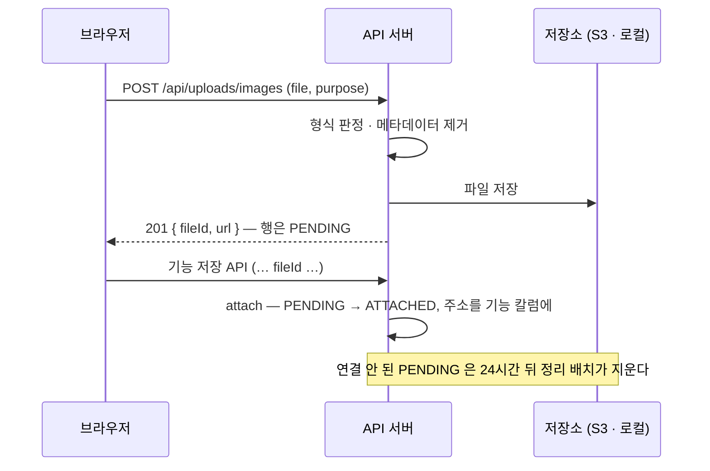

# 이미지 업로드 — 새 화면에 붙이는 법

> 이미지가 필요한 기능(프로필 사진·스터디 썸네일·배너…)은 전부 이 길 하나를 쓴다. 새로 만들지 않는다.
> 계약 정본: [specs/profile-image/spec.md](../../specs/profile-image/spec.md) · 버킷·공개 폴더: [s3-storage.md](../s3-storage.md)
> 갱신: 2026-10-16

## 한 줄 요약

**파일을 먼저 올려 번호(`fileId`)를 받고, 기능 쪽 저장 API 가 그 번호를 받아 연결한다.**
올리는 시점에 붙일 대상이 없어도(스터디 등록 폼) 같은 길을 쓸 수 있게 올리기와 연결을 나눴다.



| 상태 | 뜻 | 누가 바꾸나 |
|---|---|---|
| `PENDING` | 올렸지만 아직 어디에도 안 붙음 | 올리기 |
| `ATTACHED` | 기능 칼럼에 주소가 들어감 | 기능 쪽 저장 API (`uploadService.attach`) |
| `DELETING` | 지우는 중 — 커밋 뒤 파일 → 행 순으로 지운다 | 교체·지우기·탈퇴·정리 배치 |

## 규칙 (서버가 강제한다)

- jpeg · png · webp, **5MB**. 형식은 파일 앞 바이트로 판정한다 — 확장자·브라우저 `Content-Type` 은 안 믿는다
- 위치·기기 정보(EXIF 등)는 서버가 지운다. jpeg 회전 값만 남긴다
- 연결 안 한 파일이 계정당 **20개**면 더 못 올린다. 24시간 지나면 정리 배치가 지운다
- 기능 API 는 **주소 문자열을 받지 않는다. `fileId` 만 받는다** — 주소를 받으면 외부 이미지·추적 픽셀을 꽂을 수 있다

## 프론트 — 훅 하나

`@studyclub/ui` 의 `useImageUpload` 가 고르기 · 브라우저 검사(형식·5MB) · 올리는 중 잠금 · 오류 문구를 맡는다.
서버 호출(`upload`)은 앱이 넘긴다 — 앱마다 http 클라이언트가 따로라서다.

```tsx
import { useImageUpload } from '@studyclub/ui';
import { uploadImage } from '@/lib/upload'; // POST /api/uploads/images 한 줄

const thumb = useImageUpload({
  purpose: 'STUDY_THUMBNAIL',
  upload: uploadImage,
  // 올린 뒤 할 일. 폼이면 값에 넣고, 즉시 저장이면 저장 API 를 부른다. 끝날 때까지 잠금이 유지된다
  onUploaded: ({ fileId, url }) => {
    setValue('thumbnailFileId', fileId);
    setPreview(url);
  },
  // 선택. 401·403 처럼 앱이 직접 처리하면 null 을 돌려 문구를 안 띄운다
  onError: (err) => (err instanceof ApiError ? err.message : '사진을 올리지 못했습니다'),
});

<input {...thumb.inputProps} className='hidden' aria-label='썸네일 파일' />
<button type='button' onClick={thumb.pick} disabled={thumb.isUploading}>
  {thumb.isUploading ? '올리는 중' : '이미지 고르기'}
</button>
{thumb.error && <p role='alert'>{thumb.error}</p>}
```

- 즉시 저장 예: core-front 마이페이지 프로필 사진 — `apps/core-front/src/features/profile/ProfileCard.tsx`
- 앱에 `lib/upload.ts` 가 없으면(back-office 등) 만든다 — `http<UploadedImage>('/api/uploads/images', { method: 'POST', body })` 한 줄

## 백엔드 — 새 용도를 붙일 때

1. **용도 추가** — `StoragePurpose` 에 enum 하나. 폴더는 반드시 `gigs/` 아래 (`gigs/` 밖은 CloudFront 가 403 이다).
   프론트 `ImagePurpose` 타입에도 같은 이름을 추가한다
2. **저장 API 는 `fileId` 를 받는다** — 요청 DTO 에 `Long fileId`. 주소 문자열 필드를 만들지 않는다
3. **연결은 기능 서비스의 트랜잭션 안에서**
   ```java
   StorageObject attached = uploadService.attach(fileId, accountId, StoragePurpose.STUDY_THUMBNAIL, now);
   entity.setThumbnailUrl(uploadService.publicUrl(attached));
   ```
   번호가 없음·남의 것·용도 다름·이미 연결됨이면 같은 400 이 난다 (사유를 구분하지 않는다)
4. **교체·지우기** — 옛 주소의 행을 찜하고 커밋 뒤 지운다. S3 호출을 트랜잭션 안에서 하지 않는다
   ```java
   Optional<StorageObject> old = uploadService.markDeletingByUrl(entity.getThumbnailUrl(), accountId, now);
   entity.setThumbnailUrl(newUrl); // 또는 null
   uploadService.deleteAfterCommit(old.stream().toList());
   ```
   `markDeletingByUrl` 은 **올린 사람**이 다르면 찜하지 않는다 — 남의 파일을 지우지 않게. 그래서 스터디 썸네일처럼
   여러 운영자가 고치는 자원은, A 가 올린 썸네일을 B 가 바꾸면 옛 파일이 안 지워지고 남는다. 이런 용도를 붙일 때는
   주인 조건을 어떻게 할지(자원 단위 권한으로 확인 등) 먼저 정한다 — 아직 정하지 않았다
5. **탈퇴** — 이미 처리돼 있다. 그 계정이 올린 파일은 용도와 상관없이 전부 지운다

## 로컬 개발 — 키 없이

로컬은 **기본이 로컬 저장소**다 (`.env.example` · docker compose 에 `STORAGE_LOCAL_ENABLED=true`).
파일은 로컬 폴더에 쓰고 API 가 `/local-storage/<키>` 로 내준다. S3 키 없이 올리기·연결·지우기가 끝까지 돈다.

| 하고 싶은 것 | 설정 |
|---|---|
| 키 없이 개발 (기본) | `STORAGE_LOCAL_ENABLED=true` |
| stage S3 로 실연동 확인 | `STORAGE_LOCAL_ENABLED=false` + S3 키 4개 + `S3_PUBLIC_BASE_URL` (인프라 담당자에게 요청) |
| 폴더 바꾸기 | `STORAGE_LOCAL_DIR` (기본 `<임시 폴더>/studyclub-storage`) |
| 호스트 `bootRun` 인데 포트가 8080 이 아님 | `STORAGE_LOCAL_PUBLIC_BASE_URL=http://localhost:<포트>/local-storage` |

- stage·production 은 이 값을 켜지 않는다. 기본값(꺼짐)이라 키가 빠지면 503 으로 드러난다
- 로컬 저장소로 올린 행은 `PROVIDER=LOCAL` 이다. 로컬 DB 를 stage 로 옮기지 않는다

## 응답 코드

| 코드 | 언제 | 화면 |
|---|---|---|
| 201 | 올리기 성공 | — |
| 400 | 형식·크기·빈 파일·깨진 이미지·용도 없음·PENDING 20개·번호 연결 실패 | 서버 문구를 그대로 |
| 401 | 로그인 만료 | 재로그인 |
| 403 | 온보딩 미완료 | 온보딩으로 |
| 503 | 저장소 설정 없음 (운영 키 누락) | 잠시 후 다시 |

## 하지 말 것

- 브라우저 → S3 직접 올리기(서명 주소). 형식 검사와 메타데이터 제거를 서버가 해야 한다
- 기능 API 에 이미지 주소 문자열 받기
- 저장소 호출을 `@Transactional` 안에서 하기 — 네트워크를 기다리는 동안 DB 잠금을 잡는다
- 용도 폴더를 `gigs/` 밖에 두기
