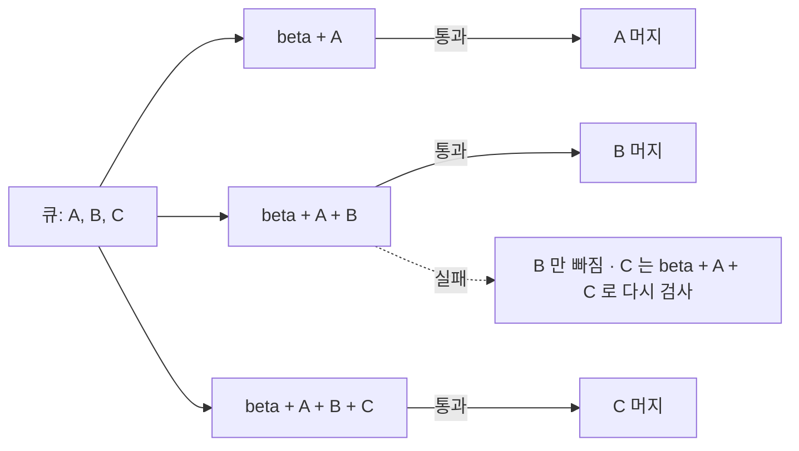

# beta 머지 큐 — PR 이 beta 에 들어가는 길

2026-11-23 부터 beta 는 "최신 상태 유지(strict)" 대신 **GitHub 머지 큐**로 머지한다. develop · main 은 그대로다.

## 작성자가 하는 일

1. 리뷰 · 검사가 끝나면 PR 에서 **Merge when ready** 를 한 번 누른다
2. 끝. 머지되거나, 실패해서 큐에서 빠지면 GitHub 알림이 온다
3. 빠졌으면 원인(검사 실패 · git 충돌)을 고치고 다시 누른다

**Update branch 는 누르지 않아도 된다.** 머지 큐는 PR 을 모아 뒀다가 나중에 머지하는 보관함이 아니다 — 누르면 몇 분 안에 머지된다. 아직 넣기 싫은 PR 은 누르지 않고 열어 둔다.

## 예전에는 무엇이 불편했나

리뷰가 끝난 PR A · B · C 를 머지한다고 하자. 예전 규칙은 "최신 beta 위에서 검사가 통과한 PR 만 머지" 였다.

1. A 를 머지한다. beta 가 바뀌어서 B · C 는 낡은 상태(out-of-date)가 된다
2. B 작성자가 Update branch 를 누른다. 검사가 처음부터 다시 돌고, 끝날 때까지 기다렸다가 머지한다
3. 그 사이 beta 가 또 바뀌어서 C 는 또 낡았다. C 도 Update → 재검사 → 기다림을 한 번 더 한다

C 는 검사를 3번 돌렸지만 의미 있는 건 마지막 1번뿐이다. 그리고 그동안 사람이 계속 들여다봐야 했다.
열린 PR 이 n 개면 한 바퀴 머지하는 동안 Update 를 최대 n(n−1)/2 번 누른다 (5개면 10번).

머지 큐에서는 A · B · C 작성자가 Merge when ready 를 한 번씩만 누르고 자리를 떠난다. 최신 beta 에 맞추고 다시 검사하는 일을 GitHub 이 미리, 동시에 한다.

## 큐 안에서 일어나는 일

PR A · B · C 가 차례로 큐에 들어오면 GitHub 이 조합을 미리 만들어 **동시에** 검사한다.

- 조합은 임시 브랜치 `gh-readonly-queue/beta/...` 에서 검사되고, 이때 워크플로에 `merge_group` 이벤트가 들어온다
- B 의 검사는 "A 가 들어간 뒤의 beta" 를 미리 가정했으므로 A 가 머지돼도 B 가 낡지 않는다
- 머지는 squash — PR 하나가 beta 커밋 하나

| | 예전 (strict) | 머지 큐 |
|---|---|---|
| PR 3개 머지에 사람이 누르는 횟수 | 머지 3 + Update 3 | Merge when ready 3 |
| 검사 횟수 | A 1 · B 2 · C 3 | 각 1 |
| 검사 순서 | 하나 끝나야 다음 | 동시 (최대 5) |

## 왜 strict 를 껐나

strict 는 Flyway 번호 충돌(두 PR 이 같은 `V26` 을 추가 — git 충돌 없이 둘 다 통과하고 머지 뒤 부팅에서 터짐)을 머지 전에 잡으려고 켰다(2026-10-03). 그런데 누가 머지할 때마다 나머지 PR 이 낡아 Update → 재검사 → 머지를 반복해야 했다.
머지 큐도 앞 PR 과 합친 상태에서 `version-lint` 를 돌리므로 같은 충돌을 잡는다. 그래서 strict 는 필요 없다.

## 착각하기 쉬운 것

- 머지 큐가 git 충돌을 풀어 주지는 않는다. 같은 줄을 고친 충돌은 작성자가 풀고 다시 넣는다. 없어지는 건 충돌도 없는데 최신으로 맞추려고 하던 Update 반복이다
- 모아 뒀다가 나중에 한꺼번에 머지하는 기능이 아니다. 누르는 순간이 곧 "반영해도 된다" 는 뜻이다

## 지켜야 할 것

- **필수 체크 워크플로에는 `merge_group:` 트리거가 있어야 한다.** 없으면 큐가 그 체크를 영원히 기다린다. 지금 필수 체크는 `version-lint`(`migration-version.yaml`) 하나다
- 필수 체크를 늘릴 때는 그 워크플로에도 `merge_group:` 을 넣는다. `merge_group` 에는 paths 필터가 안 먹는다
- `backend-migration-check` 의 verify(약 2분)는 필수가 아니다(2026-11-23 결정). SQL 오류는 beta push 에서 잡힌다
- 진짜 git 충돌은 큐가 풀어 주지 않는다 — 작성자가 풀고 다시 넣는다

## 설정 위치

beta 룰셋 `beta-merge-queue` 는 인프라 terraform 이 관리한다(화면에서 바꾸면 다음 apply 때 되돌아간다). 급히 끄려면 인프라 담당자에게 룰셋 비활성화를 요청한다.
