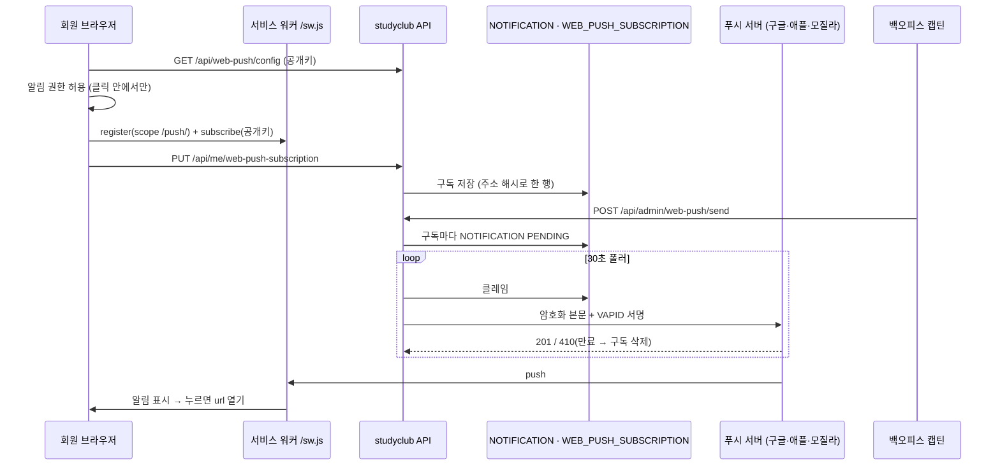

# 웹 푸시 흐름

앱 없이 브라우저로 알림을 받는 길. 계약은 [specs/web-push/spec.md](../../specs/web-push/spec.md) 가 정본이고, 여기는 기능을 가로지르는 경로와 운영 메모다.

## 한 장 그림

## 되는 것 · 안 되는 것 (2026-11 기준)

| 환경 | 받나 |
|---|---|
| 안드로이드 크롬·삼성 인터넷 | 설치 안 해도 받는다 |
| PC 크롬·엣지·파이어폭스·사파리 | 받는다 |
| iPhone·iPad 사파리 탭 | **못 받는다.** 공유 → 홈 화면에 추가 → 홈 화면의 StudyClub 으로 열어야 한다 (iOS 16.4+) |
| 카카오톡·인스타 안 브라우저 | 못 받는다 |

- 도달 보장이 없다. 꼭 가야 하는 알림은 메일과 같이 보낸다.
- 권한을 한 번 거부하면 사이트가 다시 물을 수 없다 — 브라우저 설정에서만 푼다. 그래서 켜기 버튼을 누를 때만 묻는다.

## 확인하는 법 (stage)

1. stage 백엔드에 VAPID 키 3개를 넣는다 (환경별 다른 키)
2. V56 의 템플릿 INSERT 를 stage DB 에 한 번 적용한다 (stage 는 Flyway off)
3. 캡틴 계정으로 stage 사이트 마이페이지 → 「알림 켜기」
4. stage 백오피스 → 알림 → 푸시 보내기 → 「나에게 (테스트)」
5. 30초 안에 알림이 오고, 발송 이력에 「웹 푸시 · 기기 #N · 완료」가 남는다

실패면 발송 이력의 실패 줄이 원인을 남긴다 — `INVALID_RECIPIENT`(구독 만료·해제) · `PROVIDER_ERROR`(키 불일치 등 푸시 서버 거절) · `TEMPLATE_MISSING`(2번 누락).

## 다른 서비스

같은 구조를 다른 서비스도 쓴다. 이 서비스는 **자기 백엔드가 직접 보내는** 방식이다.
