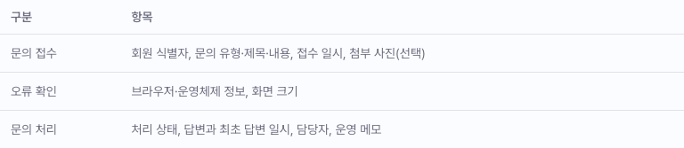
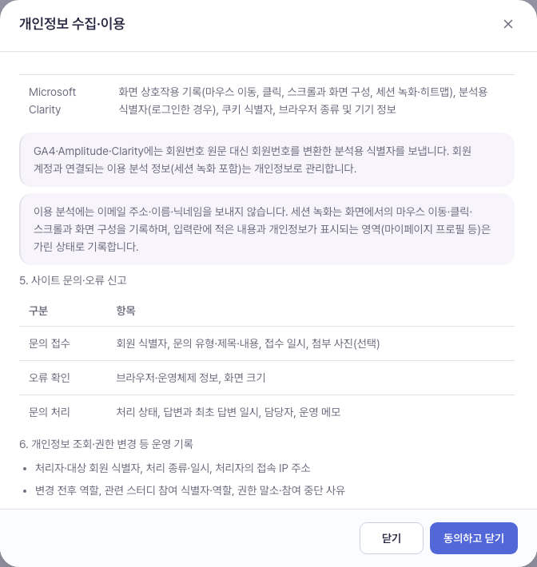
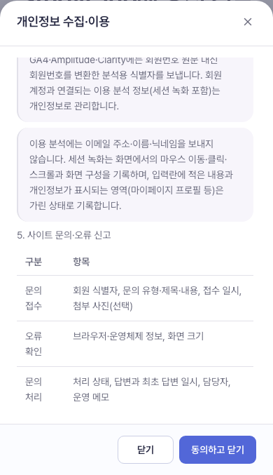

# 약관·개인정보처리방침 스테이징 검증

- 확인일: 2026-11-26
- 환경: <https://stage.studyclub.life>
- 문안 커밋: `ac8238eebf513123d4ad317f767a948447be8831`
- 스테이징 커밋: `78291ee7783e0a4849e83e236471089b4033e484`
- [빌드·배포 결과](https://github.com/StudyClub-PlusPlus/studyclub-engineering/actions/runs/45878461845): 성공

스테이징의 기존 개발 내용을 유지하기 위해 `develop` 위에 이번 문안 변경만 적용했다.
아래 검증은 배포 완료 후 실제 스테이징 화면에서 진행했다.

## 결과

| 확인 내용 | 결과 |
|---|---|
| `/ko/terms`, `/ko/privacy`, `/en/terms`, `/en/privacy` | PC 1280px·모바일 390px에서 모두 HTTP 200 |
| 약관 17개 조항·방침 16개 조항 | 모든 본문·표가 수정 브랜치의 문안과 일치. 영어 경로의 기존 한국어 본문 제공 방식 포함 |
| 표시 날짜 | 약관 2026-09-10·방침 2026-11-08 유지 |
| 모바일 표시 | 페이지 전체의 가로 넘침 없음. 문의 항목 표 표시 확인 |
| 하단 약관·방침 링크 | PC·모바일에서 각 페이지로 이동 확인 |
| 온보딩 약관·방침 ‘보기’ | PC·모바일에서 배포된 전체 문안과 일치 |
| 온보딩 ‘닫기’ | 동의하지 않은 상태 유지 |
| 온보딩 ‘동의하고 닫기’ | 선택한 항목만 체크. 나이 확인·마케팅 동의는 자동 체크되지 않음 |
| 화면 실행 오류 | 검증 중 JavaScript 실행 오류 없음 |

온보딩은 별도 브라우저에 가상의 로그인 상태를 준비하여 배포된 화면을 확인했다.
실제 OAuth 로그인, 신규 회원가입 제출, 동의 기록의 서버 저장은 이번 검증 범위가 아니다.
가입·변경 요청은 전송하지 않았다. 실제 회원정보나 인증 토큰을 캡처에 사용하지 않았다.

## 로컬 검사

- core-front 기존 테스트: 65개 파일, 372개 테스트 통과.
- core-front 및 의존 패키지 lint·TypeScript 검사: 7개 작업 통과.
- 변경 문안 Prettier 검사 및 `check-component-drift.mjs` 통과.
- 기존 동의 버전 1.0, 분석 도구 안내, 보관기간 표 유지 확인.

## 화면

### 문의 수집 항목

### 온보딩 개인정보 동의 창 — PC

### 온보딩 개인정보 동의 창 — 모바일

## 검증 범위

이 기록은 문안·화면·동의 선택 동작의 검증이다.
실제 AWS 접근 제한, 과거 첨부파일의 공개 경로, 보관기간 경과 후 삭제를 다시 검증한 것은 아니다.
국외 이전 등 최종 공개 전에 확인할 사항은 [문안 검토 기록](../../legal/legal-placeholders.md)에 유지한다.
