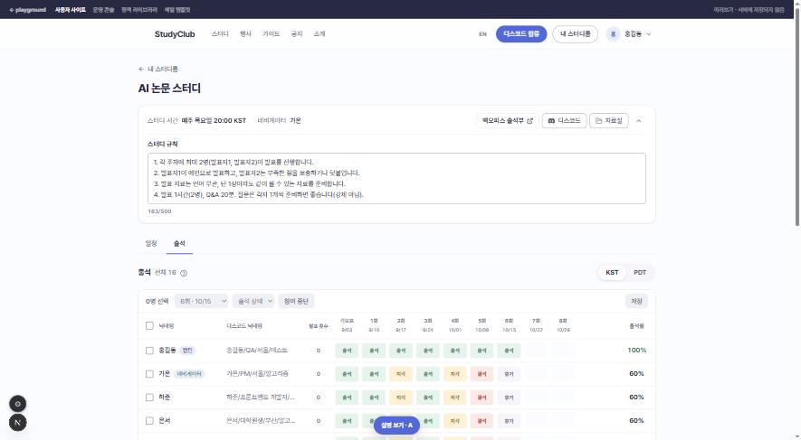
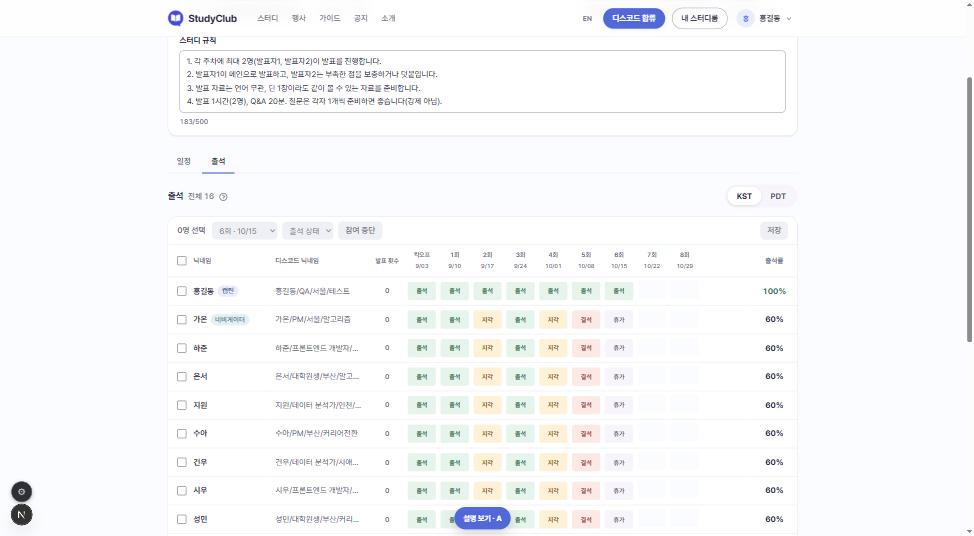
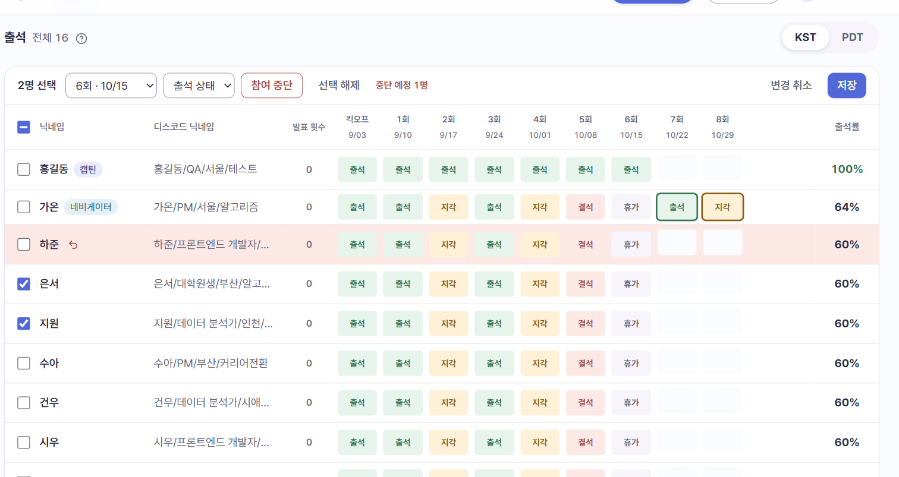
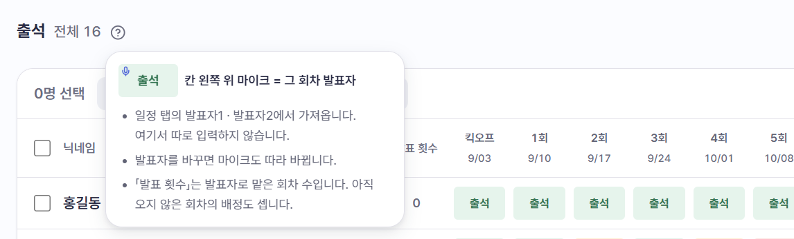
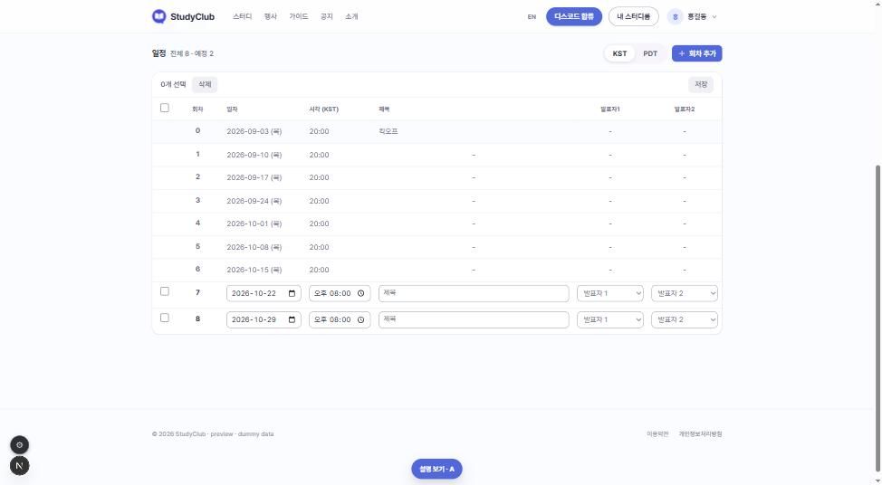
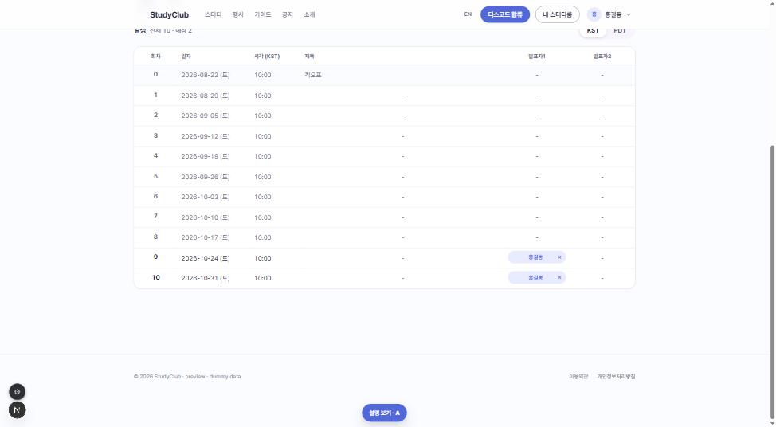
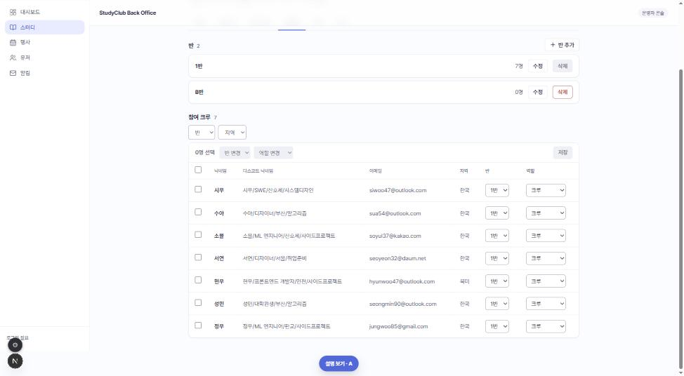
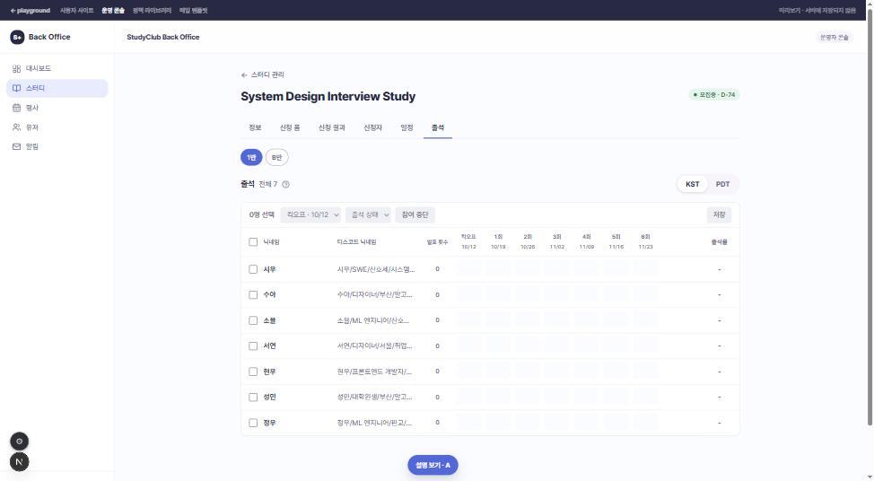
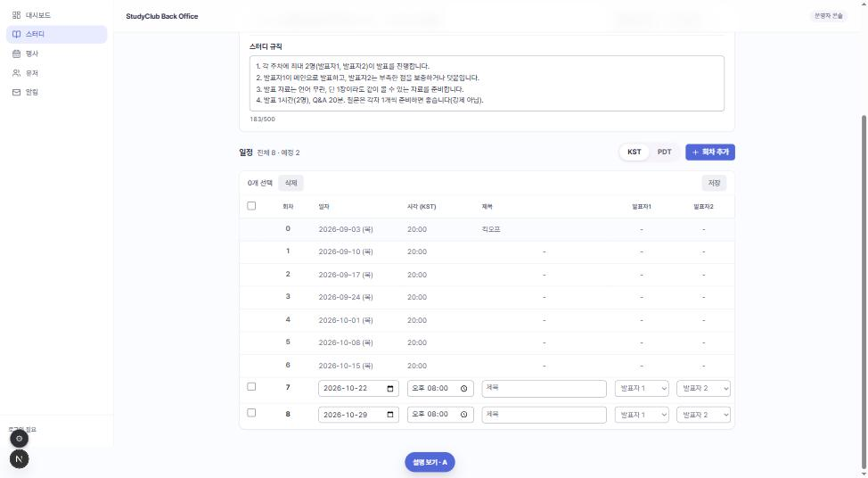

# 일정 · 출석 화면 피드백 반영: 작업 바는 표 위, 「적용」 버튼 없음, 백오피스 출석은 반 칩으로

## 미리 알아야 할 것

- **스터디 일정 화면**(사용자 사이트): 스터디 참여자가 보는 화면이다. 탭이 둘이다. 「일정」(회차 표)과 「출석」(출석 격자). 캡틴 · 네비게이터는 고치고, 크루는 본다.
- **스터디 운영 화면**(백오피스): 캡틴이 스터디 하나를 관리하는 화면이다. 이번에 바뀐 탭은 「신청자」 · 「일정」 · 「출석」이다.
- **작업 바**: 표에서 여러 줄을 체크박스로 고른 뒤 한 번에 처리하는 한 줄짜리 막대다. 왼쪽은 「n명 선택 · 반 변경 · 참여 중단」 같은 일, 오른쪽은 「변경 취소 · 저장」이다. 규칙은 [POL-0008](../../01-planning/_registry/policies/POL-0008-screen-rules.md)에 있다.
- **반**: 한 스터디 안에서 모이는 시간이 다른 묶음이다. 반마다 회차와 출석부가 따로 있다.
- **참여 중단**: 네비게이터나 캡틴이 크루를 스터디에서 빼는 일이다. 출석부에서 고르고 저장할 때 반영된다. 되돌리지 않는다.
- **FE / BE**: FE 는 화면(core-front · back-office-front), BE 는 서버(API · DB)다.

## 화면 캡처 (playground, 2026-10-18)

| | |
|---|---|
| 사용자 사이트 출석: 정보 카드 「백오피스 출석부」 · 작업 바 · 고정 열 |  |
| 아무도 고르지 않았을 때 작업 바 옅은 회색 |  |
| 고른 상태 · 중단 예정 줄 · 고친 칸 상태 색 테두리 |  |
| 「?」 발표 표시 설명 |  |
| 일정 탭(캡틴): 제목 「일정」 · 작업 바 맨 위 · 빈 칸 「-」 가운데 |  |
| 일정 탭(크루): 신청 칩과 내 이름 칩 같은 너비 |  |
| 백오피스 신청자: 「닉네임」 · 작업 바 맨 위 · 「적용」 없음 |  |
| 백오피스 출석: 반 칩 |  |
| 백오피스 일정: 제목 · 발표자 열 축소, 가로 스크롤 없음 |  |

## 한 줄 요약

일괄 수정 바를 모든 표에서 **표 맨 위**로 옮기고 **「적용」 버튼을 없앤다.** 백오피스 출석은 **반 칩으로 한 반씩** 본다. 출석 격자는 **닉네임 · 디스코드 닉네임 열**과 **고정 열**을 갖고, **참여 중단하면 그 뒤 회차의 발표자에서 빠진다.** 서버 할 일은 둘(D6 · D7), 나머지는 화면 일이다.

## 왜: 지금 뭐가 문제인가

화면을 실제로 써 본 피드백이다 (2026-10-17 ~ 18).

- 작업 바가 표 **아래**에 있으니 긴 표에서 바를 찾으려고 내려가야 했다. 백오피스 출석은 반마다 표를 이어 붙여서 **바가 표마다 하나씩** 붙었다. 어느 바가 어느 표 것인지 흐려졌다.
- 「반 변경」 드롭다운을 고르고 다시 「적용」을 눌러야 했다. 한 번이면 될 일을 두 번 했다.
- 출석 격자는 회차가 많으면 가로로 밀리면서 이름과 출석률이 사라졌다. 칸마다 테두리가 있어 **무엇을 고쳤는지** 안 보였다.
- 이름 칸에 「지원 (지원/데이터 분석가/…)」처럼 디스코드 닉네임이 붙어 이름이 잘렸다. 「중단 예정」 칩도 같은 칸에 들어가 이름을 가렸다.
- 참여를 중단한 사람이 **앞으로 할 회차의 발표자**로 남아 있었다. 네비게이터가 하나씩 지워야 했다.

비유하면, 장부의 「도장 찍는 칸」을 장부 맨 뒤에서 맨 앞으로 옮기고, 도장을 찍으면 따로 확인 도장을 또 찍던 것을 한 번으로 줄인 것이다.

## 정해진 것

| # | 결정 | 화면 |
|---|---|---|
| D1 | 일괄 수정 작업 바는 표 카드 **맨 위**. 스크롤하면 위에 붙어 따라온다 | 일정 · 출석 · 신청자(참여 크루) |
| D2 | **「적용」 · 「출석 적용」 버튼을 없앤다.** 드롭다운에서 마우스로 고르는 순간(키보드는 화살표로 옮긴 뒤 Enter 를 누르거나 칸을 떠날 때) 고른 줄에 저장 전 변경으로 얹힌다. 「참여 중단」 버튼은 그대로 | 출석 · 신청자 |
| D3 | 백오피스 출석은 **반 칩으로 한 반씩**. 모든 반을 잇는 전체 보기는 없다 | 백오피스 출석 |
| D4 | 「백오피스 출석부」 버튼(캡틴만)은 스터디 정보 카드 바로가기 줄 **맨 앞, 「디스코드」 왼쪽** | 사용자 사이트 일정 · 출석 |
| D5 | 출석 격자: 닉네임 · 디스코드 닉네임 · 발표 횟수(왼쪽)와 출석률(오른쪽) **고정**, 회차 열만 가로 스크롤. 회차 칸 너비 통일. 회차 머리는 **일자만**. 칸은 평소 테두리 없음, **고치고 저장 전인 칸만 그 상태 색** 테두리(출석 초록 · 지각 주황 · 결석 빨강 · 휴가/미체크 회색). 빈 칸 「-」 가운데 | 출석(사용자 사이트 · 백오피스) |
| D6 | 「크루」 열 → **「닉네임」**, 오른쪽에 **「디스코드 닉네임」 열**. 닉네임에 디스코드 닉네임을 붙이지 않는다 | 출석 |
| D7 | 참여 중단을 저장하면 **저장 시각 뒤에 시작하는 회차의 발표자1 · 2에서 빠진다.** 이미 시작한 회차의 발표 기록은 남는다 | 출석 → 일정 |
| D8 | 중단 예정 줄은 칩 대신 **줄 전체를 옅은 빨강**. 닉네임 옆 되돌리기 아이콘(가리키면 「중단 예정 취소」 말풍선), 작업 바에 「중단 예정 n명」 | 출석 |
| D9 | 출석 제목 옆 **「?」**: 누르면 마이크(발표) 표시와 발표 횟수 설명 | 출석 |
| D10 | 이름 정리: 사용자 사이트 탭 「출석부」 → **「출석」**, 일정 표 제목 「회차」 → **「일정」**, 참여 크루 표 「이름」 → **「닉네임」**. 표 제목 옆에는 **전체 개수만**, 고른 수는 작업 바에만 | 일정 · 출석 · 신청자 |
| D11 | 발표 「신청」 버튼과 내 이름 칩의 **너비를 같게**(칸 너비). 빈 칸 「-」 · 회차 · 발표자 열 가운데 정렬 | 일정 |
| D12 | 백오피스 일정 표는 제목 · 발표자 열을 좁혀 **가로 스크롤 없이** 들어가게 | 백오피스 일정 |
| D13 | 아무도 고르지 않았을 때 작업 바 드롭다운 · 버튼은 **옅은 회색(비활성)**, 한 명이라도 고르면 살아난다 | 출석 · 신청자 · 일정(삭제) |

### D6 디스코드 닉네임을 크루에게도 보이는 근거와 범위

- **근거**: 디스코드 닉네임은 스터디클럽 디스코드 서버의 별명이다. 같은 서버 멤버끼리는 디스코드에서 이미 서로 보인다. 출석부는 같은 분반 참여자에게만 보인다. 그래서 새로 넓어지는 노출이 아니라고 본다. 다만 전에는 동명이인일 때만 괄호로 보였고, 이제는 늘 보인다
- **값**: 신청할 때 받은 서버 별명(`ACCOUNT.DISCORD_NICKNAME`, 예 「홍길동/SWE/산호세/시스템디자인」). 이메일 · 디스코드 계정 ID 는 여전히 내리지 않는다
- **회원 탈퇴(`DELETED`)한 사람**: `discordNickname = null`(화면 「-」). 탈퇴하면 별명을 파기하는 [회원 탈퇴 스펙](../../specs/user-leave/spec.md)과 맞춘다
- **참여 중단(`WITHDRAWN`)한 사람**: 계정이 남아 있으니 그대로 보인다. 지난 출석 줄의 주인을 알아볼 수 있어야 한다
- **로그**: 응답 값을 로그 · 감사 로그에 남기지 않는다 ([보안 가이드 §PII](../backend-development-guide/security-guide.md))
- **그리기**: 본인이 마음대로 넣는 글자다. FE 는 글자로만 그린다(HTML · 마크다운으로 해석하지 않는다)

### D7 발표자 비우기의 순서

- 참여 중단 트랜잭션은 회차 수정 · 발표 신청과 **같은 분반 잠금을 먼저 쥔다** ([회차 스펙](../../specs/study-meeting/spec.md)의 「분반 잠금 → 권한 판정 → 회차 잠금」 순서). 그래야 저장과 동시에 들어온 발표 신청이 중단자를 다시 넣지 못한다
- 「뒤에 시작하는 회차」는 잠금을 얻은 뒤의 서버 시각(`LEFT_AT`)으로 가른다
- 사용자 사이트(`/api/me/…`)와 관리자(`/api/admin/…`) 저장이 같은 규칙 · 같은 잠금을 쓴다
- 한 요청의 `withdrawals[]` 는 **요청한 분반 소속만** 받는다. 다른 분반 명부 행이 섞이면 400. 관리자 경로도 같다 (잠금은 늘 분반 하나, 2026-10-18 결정)

그대로 두는 것: 백오피스 일정 탭의 스터디 시간 「수정」은 지금처럼 둔다.

## 영향: 누가 무엇을 해야 하나

**기획**: 할 일 없음. PRD 7건(용어만 고친 crew-joined-studies 까지 8건)과 POL-0008 에 반영했다. 프로토는 playground 에 있다.

**FE** (PR #278 에 이미 들어 있는 것은 뺐다. 신청 칩 너비 · 일정 표 가운데 정렬(D11)과 `TableActionBar` 위치 옵션은 #278 에 있어 할 일 없음. #278 머지 뒤 playground 세 표의 `className` 덮어쓰기를 그 옵션으로 바꾼다)

| 앱 | 할 일 | 결정 |
|---|---|---|
| back-office-front | 일정 · 출석 · 참여 크루 표의 작업 바를 표 카드 맨 위로, 스크롤 시 고정 (core-front 일정 · 출석은 #278 에 있음) | D1 |
| packages/ui | 일괄 변경 드롭다운을 ui 부품으로: ui `Select` 에 비활성 회색(`disabled-bg` · `disabled-fg`)을 넣고, 키보드 안전 확정(마우스 즉시 · 화살표는 미리보기 · Enter/칸 떠남 확정)을 가진 일괄 선택 부품을 만든다. 프로토 `BulkSelect` 가 동작 정본. core-front · back-office-front 가 각자 다시 만들지 않게 | D2 · D13 |
| packages/ui | 「?」 설명 팝오버와 「중단 예정 취소」 즉시 말풍선을 ui 부품(팝오버 · 툴팁)으로. 휴대폰 폭에서 화면 밖으로 나가지 않게(폭 상한) | D8 · D9 |
| core-front · back-office-front | 「적용」 · 「출석 적용」 버튼 제거. 마우스로 고르면 바로 반영, 키보드(화살표)는 Enter · 칸 떠남에 확정, Esc 는 미리 본 값을 버림, 반영 뒤 처음 글로 되돌리기. 프로토 `BulkSelect` 참고 | D2 |
| back-office-front | 출석 탭 반 칩(한 반씩), 반 전환 시 미저장 확인 | D3 |
| core-front | 정보 카드 바로가기 줄 맨 앞(「디스코드」 왼쪽)에 「백오피스 출석부」(캡틴). 지금은 탭 줄 오른쪽 「백오피스 출석 (전체 참여자)」 | D4 |
| core-front | 출석 격자 남은 것: 빈 칸 기본 점선 테두리 제거(고친 빈 칸은 brand 대신 중립 테두리) · 참여 중단 칸 너비를 회차 칸과 같게 · 출석률 「-」 가운데 · 휴대폰 폭은 디스코드 닉네임을 닉네임 아래에, 칩 숨김. 고정 열 · 일자만 · 상태 색 테두리는 #278 에 있음 | D5 |
| back-office-front | 출석 격자: 고정 열 · 칸 너비 · 일자만 · 상태 색 테두리 · 가운데 정렬 | D5 |
| core-front · back-office-front | 「크루」 → 「닉네임」 열, 오른쪽 「디스코드 닉네임」 열 (BE 응답 필드가 오면 연결) | D6 |
| core-front · back-office-front | 참여 중단 저장 뒤 일정 다시 불러오기. 확인 창 문구 「앞으로 맡은 회차의 발표자에서 빠집니다.」 | D7 |
| core-front · back-office-front | 중단 예정 줄 표시(「중단 예정」 칩 대신 옅은 빨강 · 되돌리기 아이콘 · 「중단 예정 n명」) | D8 |
| core-front · back-office-front | 출석 제목 옆 「?」 설명 팝오버 | D9 |
| core-front · back-office-front | core-front: 일정 표 제목 「회차」 → 「일정」. back-office-front: 탭 「출석」 · 일정 표 제목 「일정」 · 신청자 열 「닉네임」 · 제목 옆 전체 개수만. core-front 탭 「출석」 · 제목 옆 전체 개수는 #278 에 있음 | D10 |
| back-office-front | 일정 표 제목 · 발표자 열 폭 축소 | D12 |
| back-office-front | 작업 바 비활성 회색 (core-front 는 #278 에서 아무도 안 고르면 바 안 컨트롤이 비활성) | D13 |

**BE**

| 대상 | 할 일 | 결정 |
|---|---|---|
| `GET /api/me/studies/{studyId}/attendances` · `GET /api/admin/studies/{studyId}/attendances` | 응답 `participants[]` 에 `discordNickname`(`ACCOUNT.DISCORD_NICKNAME`) 추가. `DELETED` 는 null, 로그에 남기지 않음. [attendance 스펙](../../specs/attendance/spec.md)의 「닉네임만 내린다」 규칙을 이 결정으로 고쳐 적고 시작한다 (위 「D6 근거와 범위」) | D6 |
| 출석 저장의 `withdrawals[]` (사용자 사이트 · 관리자) | 분반 잠금을 먼저 쥐고, 같은 트랜잭션에서 그 분반 회차 중 `SCHEDULED_AT > LEFT_AT` 인 회차의 `PRESENTER1/2_PARTICIPANT_ID` 가 중단자면 null. 시작한 회차는 그대로. [study-participant 스펙](../../specs/study-participant/spec.md) 처리 6번(지금은 반대로 적혀 있음)과 테스트 시나리오에 성공 · 동시 신청 · 다른 분반 섞임 400 케이스를 더하고 시작한다 (위 「D7 순서」) | D7 |

PRD 마다 §3 「개발 범위」 아래 **「10-18 기획 변경: FE / BE 추가 작업」** 표에 같은 내용을 그 화면 기준으로 나눠 적었다.
