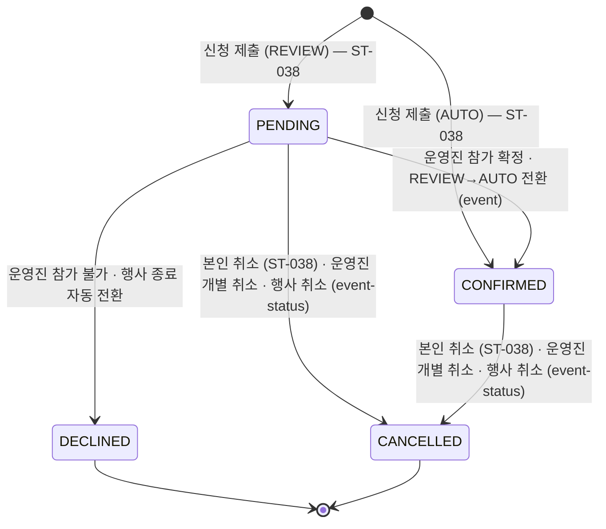

# 행사 참가자 API Spec: 캡틴이 신청자를 보고 참가를 처리한다

> ERD: [CLUB_EVENT_REGISTRATION](../../docs/erd/CLUB_EVENT_REGISTRATION.md) (`V62__create_club_event_registration.sql`, 공통 신청 PR #516. 아래 「데이터 모델: CLUB_EVENT_REGISTRATION」), [ACCOUNT](../../docs/erd/ACCOUNT.md), [ADMIN_AUDIT_LOG](../../docs/erd/ADMIN_AUDIT_LOG.md), 행사 테이블은 [CLUB_EVENT](../../docs/erd/CLUB_EVENT.md) (V59)
> 생성일: 2026-11-18 · 리뷰 반영: 2026-11-19 (PR #479 리뷰 P1~P6 · 탈퇴·메일 예약 동시성 · PR #509 행사 취소 행동 분석) · 확정: 2026-11-25 (PR #516 · #517 병합 뒤 `beta` 코드와 대조)
> 상태: 구현중 — 구현 계획 [plan](./plan.md) · [tasks](./tasks.md). BE 구현 PR(event-mail 과 한 PR). back-office-front 연결(FE PR #528)과 stage 확인 뒤 구현완료
>
> Story PRD:
> - [캡틴은 행사를 등록하고 신청자의 참가를 확정할 수 있다](../../01-planning/stories/captain-manage-events/PRD.md) (ST-037) §6 「참가자」 P1~P6 · §3 데이터와 처리 규칙 · 「행사 취소 행동 분석」 · 「후속 구현 합의」
> - 경계: [크루는 행사에 신청하고 참가 확정 상태를 확인할 수 있다](../../01-planning/stories/crew-apply-event/PRD.md) (ST-038) §3 · §4 · §5 — 신청 테이블을 함께 쓴다. 크루 신청 스펙은 [event-registration](../event-registration/spec.md) (PR #517 에서 구현)
>
> 기준 스펙: [event](../event/spec.md) (잠금 · 정원 · 신청 질문의 보존 · 판정 메서드) · [event-status](../event-status/spec.md) (행사 취소가 바꾸는 신청) · [admin-users](../admin-users/spec.md#이메일-보기) (이메일 보기 규약)
> 기준 프로토타입: playground `/proto/console/events/{id}` 참가자 탭 (`EventAdminDetail.tsx`)
> 판정 로직의 근거: `frontend/apps/playground/src/proto/events/model.ts` (`transition` 의 `DECIDE` · `ADMIN_CANCEL` · `canManageEventRegistrations` · `occupiesSeat`) · `EventWorkspace.tsx` → `settleEndedRegistrations`

## 엔드포인트 목록

**백오피스: `/api/admin/events/{eventId}/registrations` (`AdminClubEventRegistrationController`, 캡틴만)**

| Method | Path | 설명 | 인증 | 상태 |
|--------|------|------|------|------|
| GET | /api/admin/events/{eventId}/registrations | 참가자 탭: 전체 신청 이력(재신청 전 취소 이력 포함), 최신 신청순. 이메일은 마스킹, 행별 처리 가능 여부 | O (ADMIN) | 구현중 |
| GET | /api/admin/events/{eventId}/registrations/{registrationId} | 신청서: 신청 당시 질문 사본과 답변 | O (ADMIN) | 구현중 |
| POST | /api/admin/events/{eventId}/registrations/{registrationId}/email-reveals | 신청자 한 명의 이메일 원본 보기. 볼 때마다 감사 로그 | O (ADMIN) | 구현중 |
| PATCH | /api/admin/events/{eventId}/registrations/{registrationId} | 참가 확정 · 참가 불가 · 운영진 개별 취소 | O (ADMIN) | 구현중 |

행사 종료 때 남은 확인 대기 신청을 참가 불가로 바꾸는 일은 엔드포인트가 아니라 스케줄러다 (아래 「행사 종료 시 확인 대기 자동 전환」).

상태: `스펙작성중` → `스펙확정` → `구현중` → `구현완료`

---

## 먼저 읽을 것

### 이 스펙이 다루는 것과 안 다루는 것

| 다룬다 | 다루지 않는다 | 닿는 곳 |
|---|---|---|
| 운영진이 보는 신청 목록 · 신청서 · 이메일 보기 · 참가 확정 · 참가 불가 · 개별 취소 · 종료 시 자동 참가 불가 | 크루 신청 제출 · 본인 취소 · 내 신청 내역 · 사이트 행사 조회 ([event-registration](../event-registration/spec.md), ST-038) | 신청 테이블 `CLUB_EVENT_REGISTRATION` (V62, ST-038 과 공동) |
| | 모집 마감 · 재모집 · 행사 취소 ([event-status](../event-status/spec.md)) | 행사 취소의 `CANCEL_REASON = EVENT_CANCELLED` |
| | 자동 메일 템플릿 · 발송 ([event-mail](../event-mail/spec.md)) | 이 스펙의 처리가 발행하는 도메인 이벤트 |
| | 확정 방식 전환의 일괄 확정 ([event](../event/spec.md#확정-방식-전환-수정의-연관-효과)) | 같은 `ClubEventRegistrationsConfirmedEvent` 를 쓴다 |

### 인가

- [event 「인가」](../event/spec.md#인가) 와 같다. `@RequireAdmin` 으로 캡틴(`SYSTEM_ROLE = ADMIN`)만. 토큰 없으면 401, ADMIN 아니면 403. 401 · 403 을 404 보다 먼저 본다
- 신청이 그 행사의 것인지(`CLUB_EVENT_REGISTRATION.CLUB_EVENT_ID = eventId`)는 서버가 확인한다. 다른 행사의 `registrationId` 를 붙이면 404 다. 경로의 두 ID 를 따로 믿지 않는다
- 버튼 숨김은 표시용이다. 서버가 요청마다 다시 판정한다

### 시각

- 응답의 모든 절대 시각은 UTC ISO 8601. 화면은 운영자 프로필 시간대로 바꿔 보여 준다 (PRD §7 「운영자 프로필 시간대로 변환」)
- 시각이 걸린 판정(`now ≥ effectiveEndsAt`)은 서버 시각으로 한다

### 신청 상태

PRD §3 「신청 상태: 확인 대기, 참가 확정, 참가 불가, 신청 취소」. 저장 상태 `CLUB_EVENT_REGISTRATION.STATUS` 하나로 둔다.

| 값 | 화면 | 자리 | 뜻 |
|---|---|---|---|
| `PENDING` | 확인 대기 | 차지 | 운영진 확인 방식(`REVIEW`)으로 접수 |
| `CONFIRMED` | 참가 확정 | 차지 | 자동 확정 접수 · 운영진 확정 · 확정 방식 전환 |
| `DECLINED` | 참가 불가 | 반환 | 운영진 참가 불가 · 행사 종료 시 자동 전환 |
| `CANCELLED` | 신청 취소 | 반환 | 본인 취소 · 운영진 개별 취소 · 행사 취소 (`CANCEL_REASON` 으로 구분) |



- `DECLINED` · `CANCELLED` 는 끝 상태다. 되살리지 않는다. 취소한 크루가 다시 신청하면 **새 행**이 생긴다 (crew-apply-event §3 「취소 후에는 모집 중이면 재신청 가능」, PRD §6 「취소된 이전 신청과 최신 신청을 각각 표시」)
- 유효 인원(자리 차지) = `PENDING` + `CONFIRMED` ([event 「정원과 잔여석」](../event/spec.md#정원과-잔여석)). 참가 확정은 자리를 유지하고, 참가 불가·취소는 자리를 반환한다 (PRD §6). 잔여석이 생기면 `displayStatus` 는 요청마다 다시 계산되어 조건이 맞으면 `RECRUITING` 으로 돌아간다 (event Q11). 따로 전환하는 처리는 없다

### 처리 가능 여부: `canManageRegistrations`

운영진 처리(확정 · 참가 불가 · 개별 취소)는 **행사가 취소되지 않았고 종료 전**일 때만 된다. 행사 시작 뒤·신청 마감 뒤라도 종료 전이면 된다 (PRD §6 「행사 시작 후에도 종료 전까지 신청 상태에 따라 가능한 처리 버튼 표시」 · 「마감 후 취소 요청도 처리」 · 「종료·취소된 행사의 신청은 조회만 가능」).

계산: `ClubEvent.canManageRegistrations(now)` = `STATUS ≠ CANCELLED` ∧ `now < effectiveEndsAt` (프로토 `canManageEventRegistrations` 와 같은 식. [event](../event/spec.md) 의 `canEdit(now)` 와 식이 같지만 근거 규칙(§2 편집 · §6 참가자 처리)이 달라 따로 둔다).

행별 판정 (프로토 `EventAdminDetail` 처리 열):

| 신청 상태 | `canConfirm` | `canDecline` | `canCancel` | 화면 |
|---|---|---|---|---|
| `PENDING` | `canManageRegistrations` | `canManageRegistrations` | `canManageRegistrations` | 참가 확정 · 참가 불가 · 신청 취소 |
| `CONFIRMED` | false | false | `canManageRegistrations` | 신청 취소만 (PRD §6 「확정자는 신청 취소만 표시」) |
| `DECLINED` · `CANCELLED` | false | false | false | 처리 완료 |

- 세 값이 모두 false 면 화면은 「처리 완료」를 그린다. 화면이 `status` 와 행사 시각으로 다시 판정하지 않는다
- 계산: `ClubEventRegistration.canConfirm(manageable)` · `canDecline(manageable)` · `canCancelByAdmin(manageable)` (아래 「이미 있는 것과 이 스펙이 더하는 것」). `manageable` 은 같은 응답의 `canManageRegistrations` 한 값을 모든 행에 넘긴다

---

## 참가자 목록

### 기본 정보

- **Method**: GET
- **Path**: `/api/admin/events/{eventId}/registrations`
- **인증**: 필요 (`@RequireAdmin`)
- **설명**: 그 행사의 **모든 신청 행**을 최신 신청순으로. 같은 크루가 취소 후 다시 신청했으면 취소된 이전 행과 최신 행이 각각 나온다 (PRD §6). 종료·취소 행사도 조회한다

### Path Parameters

| 이름 | 타입 | 설명 |
|------|------|------|
| eventId | Long | 행사 ID |

### Query Parameters

| 이름 | 타입 | 필수 | 기본 | 설명 |
|------|------|------|------|------|
| offset | Integer | N | 0 | 0 이상 |
| limit | Integer | N | 20 | 1 ~ 100. 화면은 20 고정 |

- 정렬: `CREATED_AT DESC, ID DESC` 고정. 프로토는 새 신청을 `unshift` 로 맨 앞에 넣어 최신 신청이 위다 (`transition` APPLY). 같은 시각이면 나중에 만든 행이 위
- 페이지 (P1): 화면은 한 페이지 20건씩, API 는 기본 20 · 최대 100. 정원이 방식마다 최대 10,000명이라 한 응답에 전부 싣지 않는다. 화면은 `total` 을 「전체 신청 이력 N건」으로 보이고, `total ≤ 20` 이면 페이지 이동을 숨긴다
- 페이지 이동 모양은 운영 행사 목록과 같다: `?page=N` 을 `offset = (N-1) × 20` 으로 바꿔 부른다 ([event 「운영 행사 목록」](../event/spec.md#운영-행사-목록))
- 취소 · 재신청 이력은 각각 한 행이다. 페이지당 개수 선택 · 검색 · 상태 필터는 이번 범위가 아니다
- 상태 필터·검색은 이번 범위가 아니다 (PRD 에 없다)

### Request Body

없음

### Response — 200

```json
{
  "canManageRegistrations": true,
  "pendingCount": 1,
  "items": [
    {
      "registrationId": 312,
      "accountId": 48,
      "nickname": "수현",
      "accountDeleted": false,
      "maskedEmail": "s***@naver.com",
      "channel": "ONLINE",
      "status": "PENDING",
      "createdAt": "2026-11-20T03:14:00Z",
      "canConfirm": true,
      "canDecline": true,
      "canCancel": true
    },
    {
      "registrationId": 298,
      "accountId": 48,
      "nickname": "수현",
      "accountDeleted": false,
      "maskedEmail": "s***@naver.com",
      "channel": "OFFLINE",
      "status": "CANCELLED",
      "createdAt": "2026-11-19T11:02:00Z",
      "canConfirm": false,
      "canDecline": false,
      "canCancel": false
    },
    {
      "registrationId": 251,
      "accountId": 17,
      "nickname": null,
      "accountDeleted": true,
      "maskedEmail": null,
      "channel": "OFFLINE",
      "status": "CANCELLED",
      "createdAt": "2026-11-18T09:40:00Z",
      "canConfirm": false,
      "canDecline": false,
      "canCancel": false
    }
  ],
  "total": 3,
  "offset": 0,
  "limit": 20
}
```

같은 크루(`accountId = 48`)가 오프라인으로 신청했다가 취소하고 온라인으로 다시 신청한 경우다. 세 번째 행(`registrationId: 251`)은 종료 전 행사에서 신청한 뒤 탈퇴해 자동 취소된 크루다 (아래 「탈퇴한 크루의 신청」). 종료 뒤 탈퇴한 경우라면 기존 상태를 유지하지만, 종료된 행사라 `canCancel` 은 `false` 다.

| 필드 | 타입 | NULL | 설명 | 소스 |
|------|------|------|------|------|
| canManageRegistrations | Boolean | N | 이 행사에서 지금 참가자를 처리할 수 있나. false 면 화면은 조회 전용 | 계산: `ClubEvent.canManageRegistrations(now)` |
| pendingCount | Integer | N | 확인 대기 신청 수. 참가자 탭 배지 「확인 대기 N」 | 계산: `COUNT(STATUS = PENDING)` — 운영 상세 `seats[].pending` 합과 같은 쿼리(`ClubEventRegistrationPort.countActiveSeats`) |
| items[].registrationId | Long | N | 신청 ID. 신청서·이메일 보기·처리의 경로 값 | CLUB_EVENT_REGISTRATION.ID |
| items[].accountId | Long | N | 신청한 계정 ID. 탈퇴해도 값은 남는다 (ID 참조) | CLUB_EVENT_REGISTRATION.ACCOUNT_ID |
| items[].nickname | String | Y | 닉네임. 탈퇴한 계정이면 null — 화면은 「탈퇴한 회원」, 이메일 칸과 눈 아이콘을 숨긴다 (P3) | ACCOUNT.NICKNAME (현재 값) |
| items[].accountDeleted | Boolean | N | 계정이 지워졌나 (탈퇴) | 계산: ACCOUNT 행 없음 |
| items[].maskedEmail | String | Y | 가린 이메일. 앞 1자 + `***` + `@` 이후. 원본은 [이메일 보기](#이메일-보기) 로만. 탈퇴한 계정이면 null | 계산: ACCOUNT.EMAIL 마스킹 ([security-guide](../../docs/backend-development-guide/security-guide.md#마스킹-기준), admin-users 와 같은 함수) |
| items[].channel | String | N | `ONLINE` · `OFFLINE` | CLUB_EVENT_REGISTRATION.CHANNEL |
| items[].status | String | N | `PENDING` · `CONFIRMED` · `DECLINED` · `CANCELLED` | CLUB_EVENT_REGISTRATION.STATUS |
| items[].createdAt | String | N | 신청 시각, UTC | CLUB_EVENT_REGISTRATION.CREATED_AT |
| items[].canConfirm | Boolean | N | 참가 확정 버튼 | 계산: 위 「행별 판정」 |
| items[].canDecline | Boolean | N | 참가 불가 버튼 | 계산: 위 「행별 판정」 |
| items[].canCancel | Boolean | N | 신청 취소 버튼 | 계산: 위 「행별 판정」 |
| total | Long | N | 그 행사의 전체 신청 행 수. 화면 「전체 신청 이력 N건」 | 계산: COUNT |
| offset | Integer | N | 요청 값 | — |
| limit | Integer | N | 요청 값 | — |

- 이메일은 **서버가 가린다.** 원본을 응답에 싣고 화면이 가리는 방식은 쓰지 않는다 (PRD §6 「기존 운영 콘솔 규칙으로 기본 마스킹」, [admin-users](../admin-users/spec.md) · [notification 「수신 주소는 서버가 가린 채로」](../notification/spec.md#get-apiadminnotifications)). 필드 이름을 `maskedEmail` 로 두어 원본으로 착각하지 않게 한다
- 닉네임·이메일은 **현재 계정 값**을 읽는다. 신청 행에 스냅샷하지 않는다 (아래 데이터 모델 「연락처를 신청 행에 두지 않는 이유」)
- 페이지 한 번에 `ACCOUNT` 를 ID 묶음으로 한 번 읽는다 (N+1 금지)
- 판정 필드와 페이지 메타를 한 객체에 둔다. 페이지 envelope 은 `items` · `total` · `offset` · `limit` 을 **포함**해야 한다는 규칙([endpoint-convention 「응답 포맷」](../../docs/backend-development-guide/api/endpoint-convention.md#응답-포맷))이라 판정 필드를 더해도 계약과 어긋나지 않는다
- `offset ≥ total` 이면 `items = []`, `total` 은 실제 값

**신청서 답변을 목록에 싣지 않는 이유**

| | 목록에 싣기 | 단건 GET 으로 떼기 (채택) |
|---|---|---|
| 응답 크기 | 행마다 질문 최대 20개 사본 + 장문 답변. 100행이면 수백 KB | 목록은 짧다 |
| 개인정보 | 답변(자유 서술)이 화면을 열 때마다 통째로 내려간다 | `답변 보기` 를 누른 한 명 것만 |
| 프로토 | `답변 보기` 버튼이 행마다 있고 누르면 창을 연다. 버튼은 질문이 없어도 보인다(창에 「추가 질문이 없는 신청서입니다」) | 버튼을 누를 때 한 번 부른다. 그래서 `hasQuestions` 같은 필드도 필요 없다 |

### Error Responses

| 상태 | errorCode | 조건 |
|------|-----------|------|
| 400 | INVALID_INPUT | `offset < 0` · `limit` 이 1~100 밖 |
| 401 | UNAUTHORIZED | 토큰 없음 |
| 403 | FORBIDDEN | ADMIN 아님 |
| 404 | NOT_FOUND | `eventId` 없음 |

### 프론트엔드 사용처

- back-office-front 행사 상세 「참가자」 탭 (아직 없음). `features/events/queries.ts` → `useEventRegistrations(eventId, page)`
- 근거 시안: `frontend/apps/playground/src/proto/events/EventAdminDetail.tsx` 참가자 표 · 탭 배지 `확인 대기 N` · 「전체 신청 이력 N건」

---

## 신청서 조회

### 기본 정보

- **Method**: GET
- **Path**: `/api/admin/events/{eventId}/registrations/{registrationId}`
- **인증**: 필요 (`@RequireAdmin`)
- **설명**: 신청 당시 저장한 질문 사본과 답변. 이후 행사 질문을 고치거나 지워도 바뀌지 않는다 (PRD §4 「기존 신청은 신청 당시 질문·답변을 유지하며 현재 행사 질문으로 덮어쓰지 않음」, §6 「신청 당시 질문과 답변 조회」, [event 「신청 질문의 보존」](../event/spec.md#신청-질문의-보존))

### Path Parameters

| 이름 | 타입 | 설명 |
|------|------|------|
| eventId | Long | 행사 ID |
| registrationId | Long | 신청 ID (`items[].registrationId`) |

### Query Parameters · Request Body

없음

### Response — 200

```json
{
  "registrationId": 312,
  "nickname": "수현",
  "accountDeleted": false,
  "channel": "ONLINE",
  "status": "PENDING",
  "createdAt": "2026-11-20T03:14:00Z",
  "questions": [
    {
      "questionId": "q_7f3a",
      "label": "참여 동기",
      "type": "TEXTAREA",
      "required": true,
      "options": [],
      "answer": ["한 해 동안 함께한 크루를 만나고 싶어요."]
    },
    {
      "questionId": "q_91c2",
      "label": "관심 주제",
      "type": "CHECKBOX",
      "required": false,
      "options": ["AI", "커리어", "네트워킹"],
      "answer": ["AI", "네트워킹"]
    }
  ]
}
```

| 필드 | 타입 | NULL | 설명 | 소스 |
|------|------|------|------|------|
| registrationId | Long | N | | CLUB_EVENT_REGISTRATION.ID |
| nickname | String | Y | 창 제목 「{닉네임} 신청서」. 탈퇴면 null | ACCOUNT.NICKNAME |
| accountDeleted | Boolean | N | | 계산: ACCOUNT 행 없음 |
| channel | String | N | | CLUB_EVENT_REGISTRATION.CHANNEL |
| status | String | N | | CLUB_EVENT_REGISTRATION.STATUS |
| createdAt | String | N | UTC | CLUB_EVENT_REGISTRATION.CREATED_AT |
| questions | Array | N | 신청 당시 질문 순서 그대로. 질문 없는 행사였으면 `[]` — 화면은 「추가 질문이 없는 신청서입니다」 | CLUB_EVENT_REGISTRATION.QUESTIONS_SNAPSHOT (JSON) |
| questions[].questionId | String | N | 신청 당시 질문 키 (`CLUB_EVENT_QUESTION.QUESTION_KEY` 사본) | QUESTIONS_SNAPSHOT |
| questions[].label | String | N | 신청 당시 질문 제목 | QUESTIONS_SNAPSHOT |
| questions[].type | String | N | `TEXT` · `TEXTAREA` · `RADIO` · `CHECKBOX` | QUESTIONS_SNAPSHOT |
| questions[].required | Boolean | N | | QUESTIONS_SNAPSHOT |
| questions[].options | String[] | N | 신청 당시 선택지. TEXT·TEXTAREA 는 `[]` | QUESTIONS_SNAPSHOT |
| questions[].answer | String[] | N | 답. 언제나 배열이다: TEXT·TEXTAREA·RADIO 는 0~1개, CHECKBOX 는 0~N개. 답하지 않은 선택 질문은 `[]` — 화면은 「답변 없음」, CHECKBOX 는 `, ` 로 이어 그린다 | CLUB_EVENT_REGISTRATION.ANSWERS_SNAPSHOT (JSON) 를 questionId 로 맞춘 값 |

- 답을 질문 안에 넣어 내려 준다. 프로토는 `questions` 와 `answers[questionId]` 를 따로 들고 화면이 맞추지만, 서버가 한 번 맞춰 주면 화면이 키를 다시 대조하지 않는다
- 답의 타입을 `String | String[]` 로 섞지 않고 배열 하나로 고정한다. Java·Zod 양쪽에서 타입이 갈리지 않는다
- 현재 행사 질문(`CLUB_EVENT_QUESTION`)을 조인해 다시 그리지 않는다. 그 방식은 event 스펙이 금지했다
- 이메일은 싣지 않는다 (목록에 마스킹 값이 이미 있고, 원본은 이메일 보기로만)
- 종료·취소 행사의 신청서도 조회한다

### Error Responses

| 상태 | errorCode | 조건 |
|------|-----------|------|
| 401 | UNAUTHORIZED | 토큰 없음 |
| 403 | FORBIDDEN | ADMIN 아님 |
| 404 | NOT_FOUND | `eventId` 없음 · `registrationId` 없음 · 그 신청이 이 행사 것이 아님 |

### 프론트엔드 사용처

- back-office-front 참가자 탭 `답변 보기` 창 (아직 없음). `useEventRegistration(eventId, registrationId)` — 창을 열 때만 부른다
- 근거 시안: `EventAdminDetail.tsx` 「{name} 신청서」 Modal

---

## 이메일 보기

### 기본 정보

- **Method**: POST
- **Path**: `/api/admin/events/{eventId}/registrations/{registrationId}/email-reveals`
- **인증**: 필요 (`@RequireAdmin`)
- **설명**: 신청자 한 명의 이메일 원본. 돌려줄 때마다 `ADMIN_AUDIT_LOG` 에 `EMAIL_REVEAL` 한 행을 남긴다. 규약은 [admin-users 「이메일 보기」](../admin-users/spec.md#이메일-보기) 와 같다

**왜 POST 인가** (admin-users 와 같다). 이 요청은 「보기」라는 사건을 하나 기록한다. GET 으로 두면 프리페치·재시도·링크 미리보기만으로 감사 기록이 쌓이거나, 반대로 캐시가 응답을 대신해 기록 없이 원본이 보일 수 있다. POST 는 브라우저와 라이브러리가 알아서 부르지 않는다.

### Path Parameters

| 이름 | 타입 | 설명 |
|------|------|------|
| eventId | Long | 행사 ID |
| registrationId | Long | 신청 ID |

### Query Parameters · Request Body

없음

### 처리 규칙

한 트랜잭션 안에서:

1. 신청이 없거나 그 행사의 것이 아니면 `404 NOT_FOUND`. 감사 기록을 남기지 않는다
2. 신청의 `ACCOUNT_ID` 로 계정을 읽는다. 계정이 없으면(탈퇴) `404 NOT_FOUND`. 감사 기록을 남기지 않는다 (P3)
3. `ADMIN_AUDIT_LOG` 에 `(ACTOR_ACCOUNT_ID = 요청자, ACTION = EMAIL_REVEAL, TARGET_ACCOUNT_ID = 신청자 ACCOUNT_ID, ACTOR_IP = 요청 IP)` 한 행을 쓴다. 보관 규칙(`RETENTION_POLICY` · `EXPIRES_AT`, 조회 1년)은 admin-users 와 같은 경로로 채운다 ([data-retention](../data-retention/spec.md))
4. 이메일 원본을 돌려준다

- **기록이 안 남으면 이메일도 안 나간다.** 3 이 실패하면 트랜잭션이 롤백되고 `500 INTERNAL_ERROR` 다
- 응답 헤더 `Cache-Control: no-store`. 원본이 브라우저·프록시 캐시에 남지 않게 한다
- 횟수 제한은 두지 않는다 (admin-users 와 같다). 누가 몇 번 봤는지는 감사 로그로 남는다
- 행사 행을 잠그지 않는다. 신청 상태를 바꾸지 않는 읽기 + 감사 기록이라 [event 잠금 규칙](../event/spec.md#같은-행사에-쓰는-요청의-처리-순서) 의 대상이 아니다
- 종료·취소 행사의 신청도 볼 수 있다 (PRD §6 「종료·취소된 행사의 신청은 조회만 가능」 — 보기는 조회다)
- `ACTION` 은 회원 목록과 같은 `EMAIL_REVEAL` 을 그대로 쓴다 (P4). 감사 로그가 답하려는 질문(「누가 언제 이 사람의 이메일을 봤나」)이 같다. 어느 화면에서 봤는지 · 행사 ID · 신청 ID 를 위한 필드는 더하지 않고, 이메일 원문도 기록하지 않는다. 보관·파기는 기존 조회 기록 규칙(`AUDIT_ACCESS_V1` 1년, 2년 설정이면 `AUDIT_ACCESS_TWO_YEARS_V1`) 그대로다 ([data-retention](../data-retention/spec.md)). [ADMIN_AUDIT_LOG ERD](../../docs/erd/ADMIN_AUDIT_LOG.md) 의 `EMAIL_REVEAL` 설명에 행사 참가자 목록의 조회를 이 PR 에서 더했다

### Response — 200

```json
{ "registrationId": 312, "accountId": 48, "email": "suhyeon@example.com" }
```

| 필드 | 타입 | NULL | 설명 | 소스 |
|------|------|------|------|------|
| registrationId | Long | N | | CLUB_EVENT_REGISTRATION.ID |
| accountId | Long | N | | CLUB_EVENT_REGISTRATION.ACCOUNT_ID |
| email | String | N | 이메일 원본 | ACCOUNT.EMAIL |

### Error Responses

| 상태 | errorCode | 조건 |
|------|-----------|------|
| 401 | UNAUTHORIZED | 토큰 없음·무효, 또는 토큰의 계정이 없음 |
| 403 | FORBIDDEN | ADMIN 아님. 감사 기록 없음 |
| 404 | NOT_FOUND | `eventId` · `registrationId` 없음, 그 행사 신청이 아님, 신청자 계정이 없음(탈퇴). 감사 기록 없음 |
| 500 | INTERNAL_ERROR | 감사 기록 실패 — 원본을 보내지 않는다 |

### 프론트엔드 사용처

- back-office-front 참가자 탭 이메일 칸 눈 아이콘. 동작은 [admin-users 이메일 보기 「프론트엔드 사용처」](../admin-users/spec.md#이메일-보기) 와 같다: 누르면 버튼을 막고 「확인 중…」, 성공하면 **그 행만** 원본과 가림 아이콘. 가림은 API 를 부르지 않고 화면 메모리에서 지운다. 다시 펼치면 다시 부른다(다시 기록된다). 원본은 쿼리 캐시·URL·localStorage 에 두지 않는다. 화면을 다시 열면 마스킹 (PRD §6)
- `accountDeleted = true` 인 행은 눈 아이콘을 그리지 않는다
- `useRevealRegistrationEmail()` mutation 신설
- 근거 시안: `EventAdminDetail.tsx` `EventEmail` (프로토는 원본을 들고 있다가 가린다. 실제 앱은 위 규약대로 서버가 가린다)

---

## 참가 처리

### 기본 정보

- **Method**: PATCH
- **Path**: `/api/admin/events/{eventId}/registrations/{registrationId}`
- **인증**: 필요 (`@RequireAdmin`)
- **설명**: 신청 한 건을 참가 확정 · 참가 불가 · 운영진 개별 취소로 바꾼다. 바꾸면 신청자에게 자동 메일 예약(`NOTIFICATION` 행)을 같은 트랜잭션에 만든다

### Path Parameters

| 이름 | 타입 | 설명 |
|------|------|------|
| eventId | Long | 행사 ID |
| registrationId | Long | 신청 ID |

### Query Parameters

없음

### Request Body

```json
{ "status": "CONFIRMED" }
```

| 필드 | 타입 | 필수 | 검증 | 근거 |
|------|------|------|------|------|
| status | String | Y | `CONFIRMED` · `DECLINED` · `CANCELLED` 중 하나. `PENDING` 은 받지 않는다 (400) | PRD §6 「확인 대기자를 참가 확정 또는 참가 불가로 처리」 · 「확인 대기·참가 확정 신청을 개별 취소」, `transition` `DECIDE` · `ADMIN_CANCEL` |

- 행사 `version` 은 받지 않는다. 참가 처리는 신청 행만 바꾸므로 `CLUB_EVENT.VERSION` 을 올리지 않는다 ([event 「동시 수정 방지: 버전」](../event/spec.md#동시-수정-방지-버전-q14-결정) 「신청 제출·참가 처리는 … `version` 을 올리지 않는다」). 같은 신청을 두 캡틴이 동시에 처리하는 경우는 아래 5·6 의 상태 검사가 막는다
- 참가 불가·개별 취소의 사유 입력은 없다 (P6). 확인창에서 처리한 뒤 각각의 기본 자동 메일 템플릿으로 안내한다

### 처리 순서

인가(401 · 403)와 본문 검증(400)을 통과한 뒤, 한 트랜잭션에서 아래 순서로 처리한다. 먼저 걸리는 것 하나만 응답하고, 실패하면 아무것도 바꾸지 않는다.

| # | 단계 | 실패 | 근거 |
|---|---|---|---|
| 1 | `CLUB_EVENT` 행을 쓰기 잠금으로 읽는다 (`SELECT … FOR UPDATE`, **트랜잭션의 첫 조회**). 없으면 | 404 `NOT_FOUND` | [event 「같은 행사에 쓰는 요청의 처리 순서」](../event/spec.md#같은-행사에-쓰는-요청의-처리-순서) — 「운영진의 참가자 처리」는 이 잠금을 잡는 요청으로 등록되어 있다 |
| 2 | 잠금 뒤 읽은 `STATUS = CANCELLED` | 409 `EVENT_CANCELLED` | PRD §6 「종료·취소된 행사의 신청은 조회만 가능」, `transition` 「종료되거나 취소된 행사의 신청은 처리할 수 없습니다」 |
| 3 | 잠금 뒤 읽은 값으로 `now ≥ effectiveEndsAt`. **시작 후·신청 마감 후라도 종료 전이면 통과** | 409 `EVENT_ENDED` | 같은 곳, `canManageEventRegistrations` |
| 4 | 신청을 읽는다. 없거나 `CLUB_EVENT_ID ≠ eventId` | 404 `NOT_FOUND` | — |
| 5 | `CONFIRMED` · `DECLINED` 요청인데 신청이 `PENDING` 이 아니다 | 409 `EVENT_REGISTRATION_STATUS_NOT_ALLOWED` | `transition` DECIDE 「현재 상태에서는 처리할 수 없습니다」 |
| 6 | `CANCELLED` 요청인데 신청이 `PENDING` · `CONFIRMED` 가 아니다 | 409 `EVENT_REGISTRATION_STATUS_NOT_ALLOWED` | `transition` ADMIN_CANCEL 「취소할 수 없는 신청입니다」(`occupiesSeat`) |
| 7 | 상태를 바꾼다. 조건부 갱신(`UPDATE … SET STATUS = ? WHERE ID = ? AND STATUS = ?(읽은 상태)`)이나 엔티티 전이 메서드(`confirm()` · `decline()` · `cancelByAdmin()`)로. 개별 취소는 `CANCEL_REASON = ADMIN_CANCELLED`. 모두 `STATUS_CHANGED_AT = now` · `STATUS_CHANGED_BY = 요청자` | — | PRD §6 · §1 「이전 개별 취소·참가 불가자는 (취소 안내 대상에서) 제외」 |
| 8 | 바뀐 신청에 대해 도메인 이벤트를 트랜잭션 안에서 발행한다 (아래 표) | — | [domain-events](../domain-events/spec.md) |
| 9 | 커밋 직전 `BEFORE_COMMIT` 구독자가 신청자에게 보낼 `NOTIFICATION` 행을 같은 트랜잭션에 저장한다. 템플릿·변수·실패 처리는 [event-mail 「자동 메일」](../event-mail/spec.md#자동-메일-신청-상태-알림) 이 정한다. 그 다음 커밋, 커밋 뒤 폴러가 실제 발송(SES) | — | event 「확정 방식 전환」 과 같은 방식 |

- 4 는 1 의 잠금 뒤에 읽는다. 크루 본인 취소(ST-038)·확정 방식 전환의 일괄 확정·종료 자동 처리·행사 취소도 같은 행사 잠금을 먼저 잡으므로, 신청 행 상태는 이 트랜잭션 동안 바뀌지 않는다. 7 의 조건부 갱신은 잠금 규칙을 따르지 않는 경로가 생겨도 이미 바뀐 신청을 다시 바꾸지 않게 하는 두 번째 방어선이다 (event 「이미 바뀐 신청을 다시 바꾸지 않도록 … 조건부 갱신도 함께 쓴다」)
- 7 의 조건부 갱신에서 바뀐 행이 0 이면 409 `EVENT_REGISTRATION_STATUS_NOT_ALLOWED` 로 끝내고 아무것도 바꾸지 않는다
- 참가 확정은 정원을 다시 검사하지 않는다. `PENDING` 이 이미 자리를 차지하고 있다 (event 「자동 확정으로 바꿔도 정원은 다시 검사하지 않는다」 와 같은 이유)
- 같은 상태로 다시 보내는 요청(확정된 신청에 다시 확정)은 5 에서 409 다. 프로토와 같다. 화면은 409 를 받으면 목록을 다시 읽는다

| 요청 | 발행하는 이벤트 | 자동 메일 조건 | 비고 |
|---|---|---|---|
| `CONFIRMED` | `ClubEventRegistrationsConfirmedEvent` (`club_event.registrations_confirmed`, 있음) — `registrationIds = [이 신청]` | `EVENT_REGISTRATION_CONFIRMED` | event 의 `REVIEW → AUTO` 일괄 확정과 같은 이벤트다. 「확인 대기 신청을 참가 확정으로 바꿨다」는 같은 사실이라 구독자 하나가 둘 다 받는다 |
| `DECLINED` | `ClubEventRegistrationsDeclinedEvent` (`club_event.registrations_declined`, 신규) — `registrationIds = [이 신청]`, `cause = ADMIN` | `EVENT_REGISTRATION_DECLINED` | 행사 종료 자동 전환도 같은 이벤트(`cause = EVENT_ENDED`) |
| `CANCELLED` | `ClubEventRegistrationsCancelledEvent` (`club_event.registrations_cancelled`, 있음. PR #517 이 본인 취소용으로 만들었고 `Cause.ADMIN` 도 들어 있다) — `registrationIds = [이 신청]`, `cause = ADMIN` | `EVENT_REGISTRATION_CANCELLED` | 크루 본인 취소(ST-038)도 같은 이벤트(`cause = SELF`)를 쓴다. 분석 구독자도 이 이벤트를 받는다 (아래 「퍼널·계측」). **행사 취소([event-status](../event-status/spec.md))와 탈퇴(`ACCOUNT_DELETED`)는 발행하지 않는다** — 행사 취소는 수동 취소 안내 메일로 대신하고, 탈퇴는 메일을 받을 사람이 없다 |

- 새로 만드는 것은 `ClubEventRegistrationsDeclinedEvent` 하나다. 모양은 이미 있는 `ClubEventRegistrationsCancelledEvent` 와 같게 둔다: `record (EventMeta meta, Long clubEventId, List<Long> registrationIds, Cause cause)`, `Cause` 는 `ADMIN` · `EVENT_ENDED`, 패키지 `com.studyclub.domain.event`, `aggregateType = club_event`, `aggregateId = clubEventId`, actor = 처리한 캡틴(종료 자동 전환은 null). 페이로드에 연락처·답변을 싣지 않는다
- 확정은 원인 구분이 필요 없어 기존 `ClubEventRegistrationsConfirmedEvent(meta, clubEventId, registrationIds)` 를 그대로 쓴다 (`of(clubEventId, List.of(id), actor)`)
- [domain-events 「이벤트」](../domain-events/spec.md#이벤트) 표에 `club_event.registrations_declined` 줄을 더하고, 기존 `club_event.registrations_cancelled` 줄의 「운영진 개별 취소(`ADMIN`)는 event-participant 가 더한다」를 구현됨으로 고치는 일은 구현 PR 에서 한다. ops 알림은 보내지 않는다 (운영자 본인의 처리다)
- 메일 행 생성이 DB 오류 등으로 실패하면 예외를 삼키지 않고 처리 전체를 롤백한다 (`BEFORE_COMMIT` 규칙). **그 조건의 템플릿이 없을 때만** 예외로, 처리는 커밋하고 메일만 건너뛴 뒤 누락 경보를 남긴다 ([event-mail M2](../event-mail/spec.md#템플릿이-없을-때-m2))
- 이 API 는 `CLUB_EVENT` 만 잠그고 `ACCOUNT` 는 잠그지 않는다. 메일 수신자 계정은 잠금 뒤 일반 조회로 읽고, 없으면(탈퇴) 그 사람 메일은 만들지 않는다 (아래 「탈퇴한 크루의 신청」 잠금 순서)

### Response — 200

본문은 [참가자 목록](#참가자-목록) 의 `items[]` 한 행과 같다 (바뀐 `status` 와 다시 계산한 `can*`).

```json
{
  "registrationId": 312,
  "accountId": 48,
  "nickname": "수현",
  "accountDeleted": false,
  "maskedEmail": "s***@naver.com",
  "channel": "ONLINE",
  "status": "CONFIRMED",
  "createdAt": "2026-11-20T03:14:00Z",
  "canConfirm": false,
  "canDecline": false,
  "canCancel": true
}
```

- 잔여석·배지(`seats[]` · `pendingCount` · `displayStatus`)는 응답에 싣지 않는다. 화면은 성공하면 운영 상세와 참가자 목록을 다시 읽는다 (잔여석이 생겨 `FULL → RECRUITING` 이 될 수 있다, event Q11)

### Error Responses

| 상태 | errorCode | 조건 | 화면 안내 |
|------|-----------|------|------|
| 400 | INVALID_INPUT | `status` 누락 · `PENDING` · 허용 밖 값 | |
| 401 | UNAUTHORIZED | 토큰 없음 | |
| 403 | FORBIDDEN | ADMIN 아님 | |
| 404 | NOT_FOUND | `eventId` · `registrationId` 없음, 그 행사 신청이 아님 | 목록 다시 읽기 |
| 409 | EVENT_CANCELLED | 취소된 행사 | 상세·목록 다시 읽기 → 조회 전용 |
| 409 | EVENT_ENDED | 종료된 행사 | 상세·목록 다시 읽기 → 조회 전용 |
| 409 | EVENT_REGISTRATION_STATUS_NOT_ALLOWED | 지금 신청 상태로는 그 처리를 할 수 없다 (다른 캡틴이 먼저 처리 · 크루가 먼저 취소 · 종료 자동 전환이 먼저 돎) | 「현재 상태에서는 처리할 수 없습니다」 + 목록 다시 읽기 |

- `EVENT_REGISTRATION_STATUS_NOT_ALLOWED` 는 PR #516 이 이미 만든 `ErrorCode` 다 (409, 기본 문구 「현재 신청 상태에서는 처리할 수 없습니다.」, `ClubEventRegistration.confirm` · `decline` · `cancelByAdmin` 이 던진다). 화면이 목록을 다시 읽는다는 점에서 일반 `CONFLICT` 와 행동이 같지만, 행사 쪽 409(`EVENT_CANCELLED` · `EVENT_ENDED`: 탭 전체를 조회 전용으로)와 신청 한 줄의 409 를 화면이 구분해야 해서 둔다. 크루 본인 취소(ST-038)도 같은 코드를 쓴다
- `EVENT_CANCELLED` · `EVENT_ENDED` 는 PR #478 의 코드를 쓰고 상황 문구(「취소된 행사의 신청은 처리할 수 없습니다.」 등)를 넘긴다

### 프론트엔드 사용처

- back-office-front 참가자 탭 처리 열 (아직 없음). `useDecideRegistration()` mutation. 참가 불가 · 신청 취소는 확인 창 뒤에 부른다 (PRD §6 「참가 불가 처리 전 확인 창」, 프로토 두 확인 창)
- 근거 시안: `EventAdminDetail.tsx` 처리 열 · `model.ts` `transition` DECIDE · ADMIN_CANCEL

---

## 행사 종료 시 확인 대기 자동 전환

PRD §6 P2 「실제 서비스는 1분 주기 서버 작업으로 종료 시 남은 확인 대기만 참가 불가로 전환하고 기존 참가 불가 메일 예약. 확정자는 유지. 조회는 읽기 전용이며 종료 시각부터 참가자 처리 금지」, crew-apply-event §4. 프로토는 브라우저 실행 중 1분 주기와 다시 열 때 `settleEndedRegistrations` 를 돌리는 시안이다. 서버는 **1분 주기 스케줄러만** 쓴다 (P2).

### 실행 방식

| | 주기 스케줄러 (채택) | 조회 때 지연 정산 (쓰지 않음) |
|---|---|---|
| 동작 | `ClubEventEndSettlementScheduler` 가 1분마다 대상 행사를 골라 처리 | 운영 상세·참가자 목록·크루 조회가 부를 때 그 행사를 처리 |
| 메일 | 아무도 화면을 열지 않아도 종료 직후 나간다 | 누군가 열 때까지 안 나간다 |
| GET 의 성격 | GET 은 읽기만 한다 | GET 이 잠금을 잡고 쓴다. 프리페치·재시도가 쓰기가 된다 |
| 지연 | 종료 뒤 최대 약 1분(+처리 시간) 동안 `PENDING` 이 보인다. 그동안 `canManageRegistrations = false` 라 처리 버튼은 이미 없다 | 없음 |

- 스케줄러만 둔다. 화면 조회(운영 상세 · 참가자 목록 · 크루 조회)는 신청 상태를 바꾸지 않는다
- 종료 직후 반영까지 최대 약 1분 동안 목록에 `PENDING` 이 보이는 것은 허용한다. 운영진의 참가 처리(확정 · 참가 불가 · 개별 취소)는 `effectiveEndsAt` 부터 **바로** 막힌다 — `canManageRegistrations = false`, 요청은 409 `EVENT_ENDED` (위 「참가 처리」 처리 순서 3)
- `PENDING` 만 `DECLINED` 로 바꾼다. `CONFIRMED` 신청은 그대로 둔다

### 처리 순서

1. **대상 고르기** (잠금 없이, 짧은 읽기 트랜잭션): `STATUS ≠ CANCELLED` ∧ `STARTS_AT ≤ now` ∧ `PENDING` 신청이 1건 이상인 행사 ID 를 고른다. `effectiveEndsAt` 은 컬럼이 아니라 계산값이라(`ENDS_AT` 또는 시간대 기준 시작일 다음 날 00:00) SQL 로 바로 거르지 않고, 고른 행사마다 `ClubEvent.effectiveEndsAt()` 으로 `now ≥ effectiveEndsAt` 인 것만 남긴다. `effectiveEndsAt > STARTS_AT` 이 언제나 성립하므로 `STARTS_AT ≤ now` 가 후보를 충분히 좁힌다
2. **행사마다 새 트랜잭션**에서:
   1. `CLUB_EVENT` 행을 쓰기 잠금으로 읽는다 (**트랜잭션의 첫 조회**). 없으면 건너뛴다
   2. 잠금 뒤 읽은 값으로 `STATUS = CANCELLED` 면 건너뛴다
   3. 잠금 뒤 읽은 값으로 `now < effectiveEndsAt` 이면 건너뛴다 — 1 에서 고른 뒤 캡틴이 종료 시각을 늘려 저장했을 수 있다 ([event 「같은 행사에 쓰는 요청의 처리 순서」](../event/spec.md#같은-행사에-쓰는-요청의-처리-순서) 의 예)
   4. 그 행사의 `PENDING` 신청 ID 를 읽고 조건부 갱신(`UPDATE … SET STATUS = 'DECLINED' … WHERE CLUB_EVENT_ID = ? AND STATUS = 'PENDING'`)으로 바꾼다. `STATUS_CHANGED_AT = now`, `STATUS_CHANGED_BY = NULL`(시스템). 바꾼 신청이 0 이면 커밋하고 끝
   5. 바꾼 신청 ID 로 `ClubEventRegistrationsDeclinedEvent(cause = EVENT_ENDED, actor = null)` 를 발행한다
   6. `BEFORE_COMMIT` 구독자가 바뀐 신청마다 기존 참가 불가 안내(`EVENT_REGISTRATION_DECLINED`) `NOTIFICATION` 행을 같은 트랜잭션에 저장한다. 수신자 계정이 없으면 그 사람 몫은 건너뛴다. 그 다음 커밋
   7. `EVENT_REGISTRATION_DECLINED` 템플릿이 없으면(M2) 상태 전환은 그대로 커밋하고 메일만 건너뛰며 누락 경보를 남긴다. 다음 주기에 같은 신청을 다시 처리하지 않는다 (이미 `DECLINED`)
3. 한 행사의 트랜잭션이 DB 오류 등으로 실패하면 그 행사만 롤백하고 에러 로그(`clubEventId` 만, 연락처 없음)를 남긴 뒤 다음 행사로 간다. 다음 주기에 다시 시도한다

- 2-4 는 행사 애그리거트가 신청 애그리거트에 시키는 일이라 `ClubEventRegistrationPort` 에 `List<Long> declinePendingRegistrationsForEventEnd(Long eventId)` 를 더한다. 바꾼 신청 ID 를 돌려주고, 기존 `confirmPendingRegistrations(eventId, actorAccountId)` 와 같은 모양에서 행위자만 뺐다 (시스템 처리라 `STATUS_CHANGED_BY = NULL`). 어댑터는 기존 `findIdsByClubEventIdAndStatus` · `changeStatusWhere` 를 그대로 쓴다
- 대상 고르기(1)는 V62 의 `idx_club_event_registration_status_event (STATUS, CLUB_EVENT_ID)` 로 `PENDING` 신청이 있는 행사 ID 를 먼저 고르고, 그 행사들을 `ClubEventRepository.findAllById` 로 읽어 `STATUS ≠ CANCELLED` ∧ `STARTS_AT ≤ now` ∧ `now ≥ effectiveEndsAt()` 로 거른다. 새 인덱스는 필요 없다
- 서버가 여러 대면 스케줄러가 인스턴스마다 돈다. 두 인스턴스가 같은 행사를 고르면 2-1 의 잠금이 줄을 세우고, 늦은 쪽은 2-4 에서 바꿀 `PENDING` 이 없어 아무것도 하지 않는다. 메일이 두 번 생기지 않는다 (분산 락 불필요. [notification 「스케줄러 중복 실행 방지」](../notification/spec.md#한계--후속) 와 같은 판단)
- 잠금은 행사 하나씩 짧게 잡는다. 대상 행사를 한 트랜잭션에 묶지 않는다
- 이미 종료된 행사의 `DECLINED` 전환은 정원·`displayStatus` 에 영향이 없다 (종료가 먼저 판정된다)

### 겹치는 요청

| 겹친 요청 | 종료 처리가 먼저 | 상대가 먼저 |
|---|---|---|
| 종료 처리 ↔ 행사 수정의 종료 시각 연장 | 이미 종료라 수정이 409 `EVENT_ENDED` (event 처리 순서 3) | 연장이 커밋된다. 종료 처리는 2-3 에서 건너뛴다 |
| 종료 처리 ↔ 종료 직전 운영진 참가 확정 | 종료 뒤라 참가 처리가 409 `EVENT_ENDED` | 확정이 커밋된다. 종료 처리는 그 신청을 `PENDING` 이 아니라서 건드리지 않는다 |
| 종료 처리 ↔ 행사 취소 | 종료 뒤라 취소가 409 `EVENT_ENDED` | 취소가 커밋된다. 종료 처리는 2-2 에서 건너뛴다 |

---

## 데이터 모델: CLUB_EVENT_REGISTRATION

신청 테이블은 공통 신청 PR #516 이 만들었다 (P5). **정본은 [CLUB_EVENT_REGISTRATION ERD](../../docs/erd/CLUB_EVENT_REGISTRATION.md) 와 `V62__create_club_event_registration.sql`** 이고, 이 절은 이 스펙이 그 테이블에서 무엇을 쓰는지만 적는다. 이 스펙의 구현은 컬럼 · 인덱스를 더하지 않는다.

신청은 행사와 **다른 애그리거트**다 ([event 「데이터 모델 제안」](../event/spec.md#데이터-모델-제안) 「신청은 별도 애그리거트(ID 참조)」). 엔티티는 `com.studyclub.domain.event.registration.ClubEventRegistration`(루트), 저장소는 같은 패키지의 `ClubEventRegistrationRepository` 다.

| 컬럼 (V62) | 이 스펙이 쓰는 곳 |
|---|---|
| ID · CLUB_EVENT_ID · ACCOUNT_ID · CHANNEL · STATUS · CREATED_AT | 참가자 목록 · 신청서 · 참가 처리. `CLUB_EVENT_ID = eventId` 로 경로의 두 ID 를 맞춘다 |
| CANCEL_REASON | 개별 취소가 `ADMIN_CANCELLED` 를 적는다. 값 목록은 `ClubEventRegistrationCancelReason` (`SELF_CANCELLED` · `ADMIN_CANCELLED` · `ACCOUNT_DELETED` · `EVENT_CANCELLED`). 운영자가 입력하는 사유는 없다 (P6) |
| STATUS_CHANGED_AT · STATUS_CHANGED_BY | 참가 처리는 처리한 캡틴, 종료 자동 전환은 NULL(시스템) |
| QUESTIONS_SNAPSHOT · ANSWERS_SNAPSHOT | 신청서 조회. JSON 사본을 그대로 읽는다 |
| APPLICANT_TIME_ZONE · SUBMIT_IDEMPOTENCY_KEY | 이 스펙은 쓰지 않는다 (event-mail 의 개인별 일정 · ST-038 신청 제출) |

**인덱스 (V62 에 이미 있다, 추가 마이그레이션 없음)**

| 이름 | 컬럼 | 이 스펙이 쓰는 곳 |
|---|---|---|
| `idx_club_event_registration_event_channel_status` | `(CLUB_EVENT_ID, CHANNEL, STATUS)` | `pendingCount`(`countActiveSeats`) · 참가 처리 뒤 잔여석 · 종료 전환의 `PENDING` ID 읽기 |
| `idx_club_event_registration_event_created` | `(CLUB_EVENT_ID, CREATED_AT, ID)` | 참가자 목록 `ORDER BY CREATED_AT DESC, ID DESC` · `offset`/`limit` · `total` |
| `idx_club_event_registration_status_event` | `(STATUS, CLUB_EVENT_ID)` | 종료 자동 전환의 대상 고르기 (`STATUS = 'PENDING'` 인 행사 ID) |
| `idx_club_event_registration_account_event` | `(ACCOUNT_ID, CLUB_EVENT_ID)` | 탈퇴 처리 (PR #516 구현됨) |

- `UNIQUE(CLUB_EVENT_ID, ACCOUNT_ID)` 는 없다. 재신청하면 취소된 이전 행을 남기고 새 행을 만든다 (PRD §6, crew-apply-event §3). 중복 신청 제한은 신청 제출이 계정 · 행사 행 잠금 뒤 확인으로 막는다 ([event-registration](../event-registration/spec.md#신청-제출))
- 질문·답 사본은 JSON 한 칸씩이다. 신청이 `CLUB_EVENT_QUESTION` 을 FK 로 물지 않는다 (event 스펙). 이 스펙은 신청서 조회의 응답 모양만 고정한다

**연락처를 신청 행에 두지 않는 이유**

- crew-apply-event §5 는 「로그인 계정의 닉네임과 이메일을 신청 정보에 자동으로 포함」이라 적었다. V62 는 닉네임·이메일을 **신청 행에 복사하지 않고** 조회 때 `ACCOUNT` 에서 읽는다 (P3)
- 이유: 복사본이 있으면 탈퇴 때 지울 곳이 하나 더 생기고([user-leave](../user-leave/spec.md)), 운영자가 보는 주소가 메일이 실제로 나가는 주소(`NOTIFICATION.RECIPIENT_VALUE` 는 발송 행 만들 때 `ACCOUNT.EMAIL` 을 읽는다)와 갈릴 수 있다. 스터디 신청·반 공지도 같은 방식이다 (study-notice 「메일 주소는 서버가 `ACCOUNT` 에서 읽어 아웃박스 행에 스냅샷」)
- 신청 시 「이메일이 비었거나 형식이 틀리면 신청을 막는다」(crew-apply-event §5)는 제출 검사라 ST-038 이 한다 (`EVENT_APPLICANT_EMAIL_INVALID`)

### 이미 있는 것과 이 스펙이 더하는 것

PR #516 · #517 이 `beta` 에 넣은 코드를 기준으로 나눈다. 이 스펙의 구현 PR 은 「더한다」 칸만 만든다.

| 종류 | 이미 있다 (재사용) | 더한다 |
|---|---|---|
| 신청 엔티티 `ClubEventRegistration` | `confirm(actor, now)` · `decline(actor, now)` (`PENDING` 만) · `cancelByAdmin(actor, now)` (`PENDING`·`CONFIRMED` 만, `ADMIN_CANCELLED`) — 지금 상태가 아니면 409 `EVENT_REGISTRATION_STATUS_NOT_ALLOWED` · `isActive()` | 행별 판정 `canConfirm(manageable)` · `canDecline(manageable)` · `canCancelByAdmin(manageable)` (위 「행별 판정」) |
| 신청 저장소 `ClubEventRegistrationRepository` | `countGroupedByEvent` · `findIdsByClubEventIdAndStatus(eventId, status)` · `changeStatusWhere(ids, from, to, actor, now)` (조건부 벌크 갱신) | 참가자 목록 페이지 조회(저장소 조각 `ClubEventRegistrationPageQuery.findPageByClubEventId(eventId, offset, limit)`)와 `countByClubEventId(eventId)` · 종료 전환 대상 `findDistinctClubEventIdsByStatus(PENDING)` |
| 행사 엔티티 `ClubEvent` | `effectiveEndsAt()` · `canEdit(now)` (식은 같지만 근거가 다르다) · `getStatus()` | `canManageRegistrations(now)` |
| 행사 저장소 `ClubEventRepository` | `findByIdForUpdate(id)` (행사 한 행 `PESSIMISTIC_WRITE`) | — |
| 포트 `ClubEventRegistrationPort` (domain) · 어댑터 `ClubEventRegistrationAdapter` (api) | `countActiveSeatsByEventIds` · `countActiveSeats` · `confirmPendingRegistrations(eventId, actorAccountId)` | `declinePendingRegistrationsForEventEnd(eventId)` |
| 도메인 이벤트 (`com.studyclub.domain.event`) | `ClubEventRegistrationsConfirmedEvent(meta, clubEventId, registrationIds)` · `ClubEventRegistrationsCancelledEvent(meta, clubEventId, registrationIds, cause)` — `Cause.ADMIN` 이 이미 있다 | `ClubEventRegistrationsDeclinedEvent(meta, clubEventId, registrationIds, cause)` (`Cause.ADMIN` · `EVENT_ENDED`, 이름 `club_event.registrations_declined`) |
| 분석 `AnalyticsEventListener` (api) | `onEventRegistrationsCancelled` — `cancel_type` 을 `cause` 이름의 소문자로 보낸다. `ADMIN` 이면 `admin` 이 그대로 나간다 | 없음. 개별 취소가 `Cause.ADMIN` 으로 발행하기만 하면 된다 |
| 감사 로그 `AdminAuditLog` · `AdminAuditRecorder` (domain · api) | `AdminAuditLog.emailReveal(actor, target)` · `EMAIL_REVEAL` 보관 규칙(`AUDIT_ACCESS_V1` · `AUDIT_ACCESS_TWO_YEARS_V1`) · 접속 주소 채우기 | 없음 (P4) |
| 오류 코드 | `EVENT_CANCELLED` · `EVENT_ENDED` · `EVENT_REGISTRATION_STATUS_NOT_ALLOWED` | 없음 |
| 탈퇴 `AccountDeletionService` (api) | `cancelEventRegistrations` — 계정 잠금 뒤 그 계정 신청이 걸린 모든 행사를 ID 오름차순으로 잠그고 종료 전 · 취소 아닌 행사의 유효 신청을 `ACCOUNT_DELETED` 로 바꾼다. 이벤트 · 메일 없음 | 없음 (아래 「탈퇴한 크루의 신청」 은 이미 구현됐다) |

**`ClubEventRegistrationPort` 연결**

행사 애그리거트는 신청 테이블을 직접 모른다. 포트 `ClubEventRegistrationPort` 는 domain 의 `com.studyclub.domain.event` 에 있고, 실제 어댑터 **`com.studyclub.api.event.ClubEventRegistrationAdapter`** 가 신청 저장소로 답한다 (PR #516 이 임시 `EmptyClubEventRegistrationAdapter` 를 지웠다). 어댑터가 api 모듈에 있는 이유: 신청 엔티티 · 저장소는 domain 의 `com.studyclub.domain.event.registration` 에 있지만 스프링 빈은 api · notification 패키지만 스캔한다. 예전 초안이 적은 「어댑터를 `com.studyclub.domain.event.registration` 에 둔다」는 이 이유로 따르지 않았다.

| 포트 메서드 | 상태 | 어댑터의 동작 | 부르는 곳 |
|---|---|---|---|
| `countActiveSeatsByEventIds(eventIds)` | 있음 (PR #516) | `countGroupedByEvent` 한 번 → `EventSeatCounts` 맵 | 운영 목록 · 사이트 목록 |
| `countActiveSeats(eventId)` | 있음 (PR #516) | 같은 쿼리를 행사 하나로 | 운영 상세 · 수정 · 이 스펙의 `pendingCount` |
| `confirmPendingRegistrations(eventId, actorAccountId)` | 있음 (PR #516) | `PENDING` ID 를 읽고 `changeStatusWhere(…, PENDING → CONFIRMED)` → 바꾼 ID | 행사 수정 `REVIEW → AUTO` |
| `cancelActiveRegistrationsForEventCancellation(eventId, actorAccountId)` | 신규 ([event-status](../event-status/spec.md#행사-취소가-신청에-하는-일)) | 유효 신청을 `CANCELLED` · `EVENT_CANCELLED` 로 → 바꾼 ID | 행사 취소 |
| `countCancellationRecipients(eventId)` | 신규 ([event-status](../event-status/spec.md#운영-상세에-더하는-판정-필드)) | 계정이 남은 취소 안내 대상 수 (S5) | event-status 판정 필드 |
| `declinePendingRegistrationsForEventEnd(eventId)` | 신규 (이 스펙) | `confirmPendingRegistrations` 와 같은 모양으로 `PENDING → DECLINED`, `STATUS_CHANGED_BY = NULL` → 바꾼 ID | 종료 자동 전환 |

- 운영진 개별 처리(이 스펙의 PATCH)와 크루 제출·본인 취소(ST-038)는 포트가 아니라 신청 저장소·엔티티 메서드를 api 서비스가 직접 부른다. 포트는 「행사가 신청에게 묻고 시키는 것」만 담는다 (포트 주석과 같다)
- [event-mail](../event-mail/spec.md#자동-메일-신청-상태-알림) 의 자동 메일 구독자(`ClubEventRegistrationEmailListener`)가 `ClubEventRegistrationsConfirmedEvent` · `…CancelledEvent` · 이 스펙의 `…DeclinedEvent` · ST-038 의 `ClubEventRegistrationSubmittedEvent` 를 함께 받는다

### 공통 신청 테이블 PR (P5) — 완료

PR #516 이 마이그레이션(V62) · ERD · 엔티티 · 저장소 · 실제 포트 어댑터 · 탈퇴 단계를 넣었고, PR #517 이 ST-038 의 API 를 구현했다. 이 스펙의 API 는 그 위에서 구현한다 ([plan](./plan.md) · [tasks](./tasks.md)).

## 탈퇴한 크루의 신청

P3 결정. 탈퇴는 `ACCOUNT` 행을 물리 삭제한다 ([user-leave](../user-leave/spec.md)). 신청 행은 `ACCOUNT_ID` 만 가진 ID 참조라 그대로 남는다.

### 탈퇴할 때 신청에 하는 일

| 신청 · 행사 | 탈퇴 뒤 |
|---|---|
| 종료 전(`now < effectiveEndsAt`)이고 취소되지 않은 행사의 `PENDING` · `CONFIRMED` 신청 | `CANCELLED`, `CANCEL_REASON = ACCOUNT_DELETED`, `STATUS_CHANGED_BY = NULL`. 자리를 반환한다. **자동 취소 메일 · 분석 이벤트를 만들지 않는다** (받을 사람이 없다) |
| 종료된 행사 · 취소된 행사의 신청 | 그대로 (이력 유지. 취소된 행사의 `EVENT_CANCELLED` 행도 그대로) |
| 처리 완료된 신청 (`DECLINED` · 기존 `CANCELLED`) | 그대로 |

- 신청 당시 질문·답 사본(`QUESTIONS_SNAPSHOT` · `ANSWERS_SNAPSHOT`)은 스터디 신청(`STUDY_APPLICATION`)과 같은 보관 · 비식별 기준을 따른다: 행은 남기고 `ACCOUNT_ID` 는 ID 참조로 둔다. 계정이 사라지면 되짚을 수 없다 ([user-leave](../user-leave/spec.md) 「`answers` 는 그대로」). 자유 서술 답에 연락처 등 개인정보가 들어 있을 수 있는 점은 스터디 신청과 같은 기준으로 다룬다 — 기준이 바뀌면 두 테이블에 함께 적용한다
- 닉네임 · 이메일은 신청 행에 복사하지 않는다 (위 「연락처를 신청 행에 두지 않는 이유」)

### 조회

- 참가자 목록 · 신청서: 계정이 없으면 `accountDeleted = true` · `nickname = null` · `maskedEmail = null`. 화면은 「탈퇴한 회원」으로 보이고 이메일 칸과 눈 아이콘을 숨긴다 (PRD §6 P3, user-leave 「조회 계층은 이 ID 로 `ACCOUNT` 조회가 실패하면 "탈퇴한 회원"으로 표시」)
- 이메일 보기: 404 `NOT_FOUND`, 감사 기록 없음

### 잠금 순서

PR #508 R1, PR #479 리뷰 「탈퇴와 메일 예약의 동시 처리」.


탈퇴는 `ACCOUNT` 행 잠금이 첫 조회다 ([user-leave](../user-leave/spec.md)). 행사 쪽 작업이 거꾸로 `CLUB_EVENT → ACCOUNT` 를 잠그면 교착(AB-BA)이 생긴다. 그래서 잠금은 언제나 **`ACCOUNT` → `CLUB_EVENT`** 순서다.

| 작업 | 먼저 | 다음 | `ACCOUNT` |
|---|---|---|---|
| 회원 탈퇴 (`AccountDeletionService.cancelEventRegistrations`, PR #516 구현) | 탈퇴 계정 `ACCOUNT` 쓰기 잠금 (기존 첫 조회) | 그 계정 신청이 걸린 **모든** `CLUB_EVENT` 를 ID 오름차순으로 쓰기 잠금 — 유효 신청뿐 아니라 이미 `CANCELLED` 인 행사(취소 안내 대상 `EVENT_CANCELLED` 행)까지 포함 | 잠근다 |
| 크루 신청 제출 (ST-038) | 요청자 `ACCOUNT` 쓰기 잠금 | 그 행사 `CLUB_EVENT` | 잠근다 (탈퇴와 같은 순서) |
| 이 스펙의 참가 처리 · 종료 자동 전환 · event-status 상태 전환 · event-mail 메일 예약 · 행사 수정 | — | 그 행사 `CLUB_EVENT` | **잠그지 않는다.** 잠금 뒤 일반 조회로 읽고, 없으면 그 사람 메일을 만들지 않는다 |

탈퇴 트랜잭션의 순서 (계정 잠금 바로 뒤, 기존 알림 비식별화보다 먼저):

1. 그 계정 신청이 걸린 `CLUB_EVENT_ID` 를 행사 상태와 관계없이 모은다. 계정 잠금 뒤라 새 신청이 끼어들 수 없다 (크루 신청 제출도 같은 계정 잠금을 먼저 잡는다)
2. 그 행사 행들을 ID 오름차순으로 쓰기 잠금한다
3. 위 표대로 종료 전 · 취소 안 된 행사의 유효 신청을 `ACCOUNT_DELETED` 로 바꾼다 (조건부 갱신)
4. 기존 단계가 이 계정의 `NOTIFICATION` 을 정리한다: `PENDING` → `CANCELLED`, 주소·`PAYLOAD.nickname` 비식별 ([user-leave 「알림 비식별화」](../user-leave/spec.md#알림-비식별화))
5. 계정을 지우고 커밋한다

결과:

| 먼저 행사 잠금을 얻은 쪽 | 결과 |
|---|---|
| 메일 예약 · 참가 처리 · 종료 자동 전환 (자동 메일 행을 만든다) | 그 트랜잭션이 커밋한 뒤 탈퇴가 행사 잠금을 얻는다. 방금 만든 `NOTIFICATION` 까지 4 단계에서 `CANCELLED` · 비식별된다 |
| 탈퇴 | 탈퇴가 커밋한 뒤 행사 쪽 작업이 잠금을 얻는다. 그 작업은 잠금 뒤 처음 일반 조회로 `ACCOUNT` 를 읽으므로(MySQL 의 읽기 시점이 그때 정해진다) 계정이 없음을 보고 새 예약을 만들지 않는다 |

- 행사 쪽 작업은 잠금 **전에** `ACCOUNT` · 신청을 일반 조회로 읽지 않는다 (event 「잠금 전에 일반 `SELECT` 로 먼저 읽지 않는다」 와 같은 이유)
- 이 순서는 [event](../event/spec.md) 의 「첫 조회로 `CLUB_EVENT` 행」 규칙에 탈퇴 · 크루 신청 제출 두 예외를 더한다. [event 스펙 잠금 표](../event/spec.md#같은-행사에-쓰는-요청의-처리-순서) 에 「회원 탈퇴 (`ACCOUNT` → `CLUB_EVENT` 잠금 순서)」 · 「크루 신청 제출」 행으로 반영했다

## 퍼널·계측

PRD §3 「행사 취소 행동 분석」(PR #509) 을 따른다.

- **퍼널 단계**: 활성화 뒤 행동 (신청 철회). 운영진의 참가 확정 · 참가 불가 · 취소는 활성화를 새로 만들거나 되돌리지 않는다 (최초 활성화는 ST-038 의 첫 신청)
- **이벤트**: 운영진 개별 취소(`ADMIN_CANCELLED`)가 서버에 커밋된 뒤 신청 1건마다 Amplitude **신청 취소 완료** 1건. 참가 확정 · 참가 불가 · 종료 자동 전환 · 탈퇴 취소(`ACCOUNT_DELETED`)는 보내지 않는다
- **이름·속성 ([analytics](../analytics/spec.md) 트래킹 플랜에 있음)**: `Event Registration Cancelled`, `event_id` · `registration_id` · `channel`(`online`·`offline`) · `cancel_type = admin`. 본인 취소(`self`, ST-038) · 행사 전체 취소(`event_cancelled`, [event-status](../event-status/spec.md#퍼널계측))와 같은 이벤트·속성. GA4 는 보내지 않는다
- **보내는 곳·대상**: server, 사용자는 신청자 (처리한 캡틴이 아니다)
- **시점·전달**: `ClubEventRegistrationsCancelledEvent(cause = ADMIN)` 을 `AFTER_COMMIT` · `@Async` 분석 구독자가 받아 보낸다. 실패는 삼키고 취소 · 자동 메일 예약을 되돌리지 않는다. 롤백된 처리는 커밋이 없어 보내지 않는다
- **중복 방지**: `insert_id = event_registration_cancelled_{registrationId}` (자연키에서 결정적). 같은 신청은 한 번만 취소된다
- **개인정보**: 이메일 · 이름 · 닉네임 · 신청 답변을 보내지 않는다. 수집 중단 · 탈퇴 계정은 [analytics](../analytics/spec.md) 의 기존 규칙대로 보내지 않는다
- **OMTM 기대 변화**: 없음 (관찰용). 실험(A/B) 없음
- 트래킹 플랜의 `Event Registration Cancelled` 줄(`cancel_type` = `self` · `admin` · `event_cancelled`)은 PR #517 이 이미 넣었다. `AnalyticsEventListener.onEventRegistrationsCancelled` 가 `cause` 이름을 소문자로 보내므로 개별 취소가 `Cause.ADMIN` 으로 발행하면 코드 추가 없이 `admin` 이 나간다. 이름 · 속성 변경이 없어 트래킹 플랜 표는 고치지 않는다

## 근거와 PRD·프로토·레포 규약의 차이

| 항목 | PRD · 프로토 | 이 스펙 |
|---|---|---|
| 이메일 마스킹 | 프로토는 원본을 들고 화면이 가린다 (`maskEmail`) | 서버가 가린 `maskedEmail` 만 준다. 원본은 행별 `POST …/email-reveals` + 감사 로그 (admin-users 규약) |
| 목록 크기 | 프로토는 전체를 한 표에 | 화면 20건씩, API 기본 20 · 최대 100 (P1) |
| 신청서 답 | 프로토는 목록 행에 질문·답이 함께 있다 | 단건 GET 으로 뗐다. 답은 질문 안에 `String[]` 하나로 |
| 종료 전환 | 프로토는 브라우저 실행 중 1분 주기와 다시 열 때 | 서버 1분 주기 스케줄러만. 조회는 읽기 전용 (P2) |
| 처리 판정 | 프로토는 화면이 `canManageEventRegistrations` · `occupiesSeat` 를 계산 | 서버가 `canManageRegistrations` · 행별 `canConfirm` · `canDecline` · `canCancel` 을 준다 |
| 닉네임·이메일 | crew-apply-event §5 「신청 정보에 자동으로 포함」 | 신청 행에 복사하지 않고 `ACCOUNT` 에서 읽는다 (P3) |
| 탈퇴 | 프로토 없음 | 종료 전 유효 신청을 `ACCOUNT_DELETED` 로 취소, `ACCOUNT → CLUB_EVENT` 잠금 순서 (P3, PR #508 R1) |
| 같은 처리 재요청 | 프로토도 막는다 | 409 `EVENT_REGISTRATION_STATUS_NOT_ALLOWED` |

## 결정 기록 (PR #479 리뷰)

리뷰: 2026-11-18, PR #479 P1~P6 · 인라인 「탈퇴와 메일 예약의 동시 처리」 (PRD §6 · 「후속 구현 합의」 반영 PR #484). 잠금 순서: PR #508 R1. 행동 분석: PR #509.

| 결정 | 내용 | 반영한 곳 |
|---|---|---|
| P1 | 화면 20건씩, API 기본 20 · 최대 100. 최신 신청순, 취소·재신청 이력 각각 표시. 「전체 신청 이력 N건」, 20건 이하면 페이지 이동 숨김. 페이지 이동은 운영 목록과 같게, 개수 선택·검색·필터 없음 | 「참가자 목록」 Query Parameters |
| P2 | 1분 주기 서버 작업만, 조회는 상태를 바꾸지 않음. 남은 `PENDING` 만 `DECLINED`, 기존 참가 불가 메일. 잠시 `PENDING` 으로 보이는 것 허용, 참가 처리는 종료 시각부터 금지. 잠금 뒤 취소·종료 재확인. 템플릿 없으면 전환은 하고 누락 경보, DB 오류는 그 행사 롤백 후 다음 주기 재시도 | 「행사 종료 시 확인 대기 자동 전환」 |
| P3 | 탈퇴 시 종료 전 유효 신청을 `ACCOUNT_DELETED` 로 취소·자리 반환, 자동 메일 없음. 종료·취소 행사와 처리 완료 이력 유지. 「탈퇴한 회원」 표시, 이메일·눈 아이콘 숨김. 질문·답은 스터디 신청 기준, 닉네임·이메일 복사 없음. 탈퇴와 메일 예약의 순서는 취소 안내 대상까지 보장 | 「탈퇴한 크루의 신청」, 데이터 모델 `CANCEL_REASON` |
| P4 | 기존 `EMAIL_REVEAL` 재사용. 화면·행사·신청 구분 필드 없음, 원문 기록 없음, 기존 보관·파기 규칙. ERD 설명에 행사 참가자 조회 포함 | 「이메일 보기」, [ADMIN_AUDIT_LOG ERD](../../docs/erd/ADMIN_AUDIT_LOG.md) |
| P5 | 신청 구조 합의 뒤 공통 PR(마이그레이션 · ERD · 엔티티 · 저장소 · 실제 포트 어댑터, #478 임시 어댑터 교체, 탈퇴 · 신청 당시 시간대 · 질문·답 보존 · 재신청 규칙)을 먼저 머지하고 각자 API 구현. 효승님 작성 · 동일님 리뷰, 동일님이 먼저 시작하면 반대 | 「공통 신청 테이블 PR」 |
| P6 | 운영자 사유 입력 없음. 확인창 뒤 기본 자동 템플릿, 종료 자동 참가 불가도 같은 안내. 행사 전체 취소의 운영자 작성 안내는 유지. 내부 `CANCEL_REASON` 구분 유지 | 「참가 처리」, 데이터 모델 `CANCEL_REASON` |
| 탈퇴·메일 동시성 | 예약이 먼저면 탈퇴가 그 예약까지 정리, 탈퇴가 먼저면 새 예약 없음. 취소된 행사의 안내 대상 행사도 잠근다 | 「잠금 순서」 |
| #509 | 운영진 개별 취소가 커밋된 뒤 신청자 기준 취소 완료 분석 이벤트. 활성화는 건드리지 않음 | 「퍼널·계측」 |
