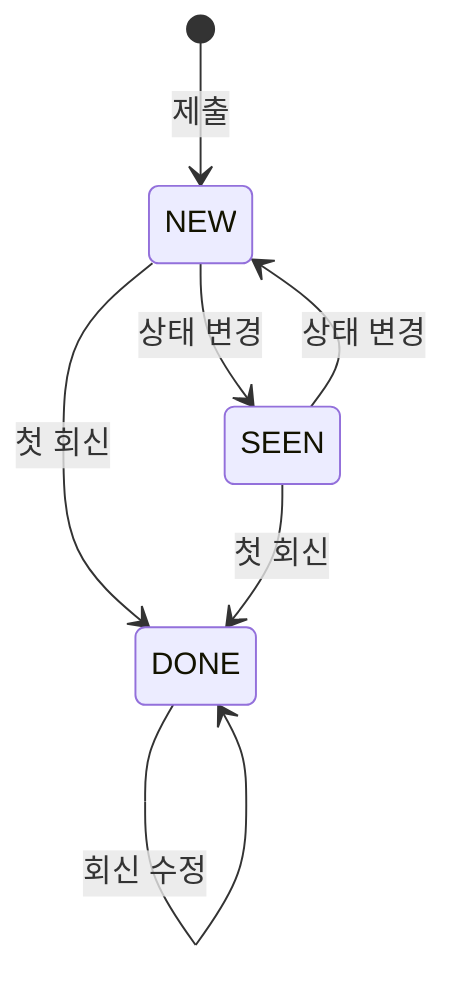

# 문의·오류 신고 API Spec — 크루 제출 · 내 문의 · 운영 콘솔 처리

> ERD: [FEEDBACK](../../docs/erd/FEEDBACK.md) (신규) · [FEEDBACK_IMAGE](../../docs/erd/FEEDBACK_IMAGE.md) (신규) · [STORAGE_OBJECT](../../docs/erd/STORAGE_OBJECT.md) · [ACCOUNT](../../docs/erd/ACCOUNT.md)
> 생성일: 2026-10-25
> 갱신: 2026-10-31 — 첫 회신 HTML 메일 알림 구현. [회신 알림](#회신-알림) 참고. 첫 답변일부터 1년·미답변은 접수일부터 1년 후 [자동 삭제](#보유-기간-만료-시-자동-삭제) 추가.
> 갱신: 2026-10-26 — PR #341 리뷰 반영. 플로팅 버튼 없음 · 상태는 회신과 묶는다 · `DELETED_AT` 없음 · 회신 알림은 아래 2026-10-31 갱신 참고 · rate limit 60초 1건 + 24시간 20건 · GIF 제외 · 이미지는 공개 폴더로 시작 · 탈퇴 때 첨부 이미지 파기 · 온보딩 필수 유지 ([결정 기록](#결정-기록))
> 상태: 구현중 — `feat/feedback-impl` (마이그레이션 `V51__feedback.sql`)
>
> Story PRD:
> - [크루는 캡틴에게 문의/오류신고를 제출할 수 있다](../../01-planning/stories/crew-submit-feedback/PRD.md)
> - [캡틴은 유저가 제출한 문의/오류신고를 조회할 수 있다](../../01-planning/stories/captain-view-feedbacks/PRD.md)
>
> 정책: [POL-0001 역할과 권한](../../01-planning/_registry/policies/POL-0001-roles.md) — `/api/admin/**` 은 캡틴. [POL-0007 회원 데이터와 탈퇴](../../01-planning/_registry/policies/POL-0007-account-data.md) — 탈퇴 때 첨부 이미지 파기
> 관련: [profile-image/spec.md](../profile-image/spec.md) — 이미지는 공용 업로드(`POST /api/uploads/images`)로 올리고 번호로 잇는다. [user-leave/spec.md](../user-leave/spec.md) — 탈퇴 처리에 첨부 이미지 파기를 더한다. [authz-guards/spec.md](../authz-guards/spec.md) — 인가는 어노테이션으로만
> 기준 프로토타입: playground 사용자 사이트 › 내 문의 (`frontend/apps/playground/src/proto/core/components/{Feedback,MyFeedback}.tsx`) · 운영 콘솔 › 문의·오류 신고 (`proto/console/components/{FeedbacksTable,FeedbackDetail}.tsx`) · 데이터 모양 `proto/lib/feedback.ts`. **PRD 와 프로토가 다르면 프로토를 따른다** (최신본)

## 엔드포인트 목록

| Method | Path | 설명 | 인증 | 상태 |
|--------|------|------|------|------|
| POST | /api/feedbacks | 문의·오류 신고 제출 — 이미지 번호를 잇고, 계정 기준 rate limit | O (`@RequireOnboarding`) | 구현중 |
| GET | /api/me/feedbacks | 내 문의 목록 — 본인 것만, 접수 시각 내림차순, 페이지 | O (`@RequireOnboarding`) | 구현중 |
| GET | /api/me/feedbacks/{feedbackId} | 내 문의 상세 — 본인 것만, 회신 포함 | O (`@RequireOnboarding`) | 구현중 |
| GET | /api/admin/feedbacks | 운영 목록 — 유형·상태·검색·페이지, 걸러진 뒤 총 건수 | O (`@RequireAdmin`) | 구현중 |
| GET | /api/admin/feedbacks/{feedbackId} | 운영 상세 — 제출 환경·회신·캡틴 전용 메모 포함 | O (`@RequireAdmin`) | 구현중 |
| PATCH | /api/admin/feedbacks/{feedbackId} | 상태 · 회신 · 캡틴 전용 메모 중 하나를 바꾼다. 첫 회신은 상태를 완료로 | O (`@RequireAdmin`) | 구현중 |

상태: `스펙작성중` → `스펙확정` → `구현중` → `구현완료`

---

## 먼저 읽을 것 — 용어와 저장 값

화면은 PRD 의 이름을 쓰고, API 는 **DB enum 값 그대로** 주고받는다. 화면 이름으로 바꾸는 일은 각 앱의 라벨 맵 한 곳에서 한다.

### 유형 — `FEEDBACK.TYPE`

| 화면 | API·DB 값 | 프로토 값 |
|---|---|---|
| 문의 | `QUESTION` | `question` |
| 개선 의견 | `IDEA` | `idea` |
| 오류 신고 | `BUG` | `bug` |

고르는 순서는 문의 · 개선 의견 · 오류 신고 (프로토 `FEEDBACK_TYPES`). 순서는 화면이 정한다.

### 상태 — 회신과 묶는다

| 운영 콘솔 | `FEEDBACK.STATUS` | 제출자(내 문의) | `/api/me` 응답 `status` |
|---|---|---|---|
| 미확인 | `NEW` | 접수 | `RECEIVED` |
| 확인 | `SEEN` | 접수 | `RECEIVED` |
| 완료 | `DONE` | 답변 완료 | `ANSWERED` |

**`DONE` 은 회신으로만 된다.** 그래서 `DONE` ⇔ 회신이 있다. 제출자가 보는 「답변 완료」와 실제 답변이 늘 같다 (PR #341 리뷰).



| 지금 | 할 수 있는 것 | 막는 것 |
|---|---|---|
| 회신 전 (`NEW` · `SEEN`) | `NEW` ↔ `SEEN` 변경 · 첫 회신(→ `DONE`) · 메모 | 상태만 `DONE` 으로 — 409 `FEEDBACK_REPLY_REQUIRED` 「답변을 작성한 후 완료할 수 있어요.」 |
| 회신 뒤 (`DONE`) | 회신 수정(상태 그대로) · 메모 | 상태 변경 — 409 `FEEDBACK_ALREADY_ANSWERED` |

- 판정은 엔티티 한 곳 — `Feedback.changeStatus(next)` 가 위 표대로 막고, `Feedback.selectableStatuses()` 가 지금 고를 수 있는 상태를 낸다. 운영 상세 응답의 `selectableStatuses` 가 그 값이다 ([판정은 서버가 내려준다](../../docs/backend-development-guide/api/endpoint-convention.md#판정은-서버가-내려준다))
- **제출자 상태는 서버가 바꿔서 준다** — `계산: Feedback.submitterStatus()`. `/api/me` 응답에 `NEW`·`SEEN`·`DONE` 을 내려보내지 않는다

### 진입점

API 는 어디서 팝업을 여는지와 상관없다. 화면 쪽 결정만 적어 둔다.

| 진입 | 결정 |
|---|---|
| 푸터 「문의·오류 신고」 링크 → `/my/feedbacks?write=1` (팝업이 바로 열림, 비로그인이면 로그인으로) | **둔다** — 프로토 `Footer.tsx` 그대로 (2026-10-25) |
| 「내 문의」 목록의 [문의하기] | 둔다 (PRD · 프로토 같음) |
| 오른쪽 아래 플로팅 버튼 | **두지 않는다** — 푸터로 대신한다 (PR #341 리뷰) |
| 프로필 드롭다운 「문의·오류 신고」 | 두지 않는다 — 프로토가 푸터로 옮겼다 (`NavAuth.tsx` 주석) |

### 인가 — authz-guards 를 따른다

[authz-guards](../authz-guards/spec.md) 대로 권한은 어노테이션으로만 건다. 서비스 안에서 권한 검사를 다시 하지 않는다.

- `FeedbackController`(`/api/feedbacks` · `/api/me/feedbacks`, 크루 관객 하나) — 메서드에 `@RequireOnboarding`
- `AdminFeedbackController`(`/api/admin/feedbacks`) — 클래스에 `@RequireAdmin`
- 「본인 것만」은 권한이 아니라 **조회 조건**이다 — `WHERE ID = ? AND ACCOUNT_ID = 요청자`. 남의 것은 403 이 아니라 404 (있는지조차 알리지 않는다)

**온보딩 전 계정은 쓰지 못한다** (PR #341 리뷰에서 「온보딩 전에도 열자」는 제안이 있었고, 이번에는 유지하기로 했다).

- 온보딩이 이용약관 · **개인정보 수집·이용 동의** · 만 14세 이상 확인을 받는 단계다. 그 전에 문의 본문 · 스크린샷 · 브라우저 정보를 받으면 동의 전 수집이 된다
- 공용 업로드(`UploadController`)가 클래스 단위 `@RequireOnboarding` 이다. 열려면 공용 업로드를 풀거나(프로필 · 썸네일까지 같이 열림) 문의 전용 업로드를 새로 둬야 한다
- 온보딩에서 막힌 사람은 푸터의 운영 메일(`contact@studyclub.life`)로 연락한다 (사용자 PRD)
- 다시 열자면 [후속](#후속-개발) 참고

### 기획 문서와 다른 곳

| 기획 (PRD) | 이 스펙 | 이유 |
|---|---|---|
| 사용자 PRD — 경로 `GET /api/my/feedbacks(/{id})` | `GET /api/me/feedbacks(/{id})` | 본인 리소스는 이미 `/api/me` 아래에 있다 (`/api/me/studies` · `/api/me/discord`). PR #341 리뷰 합의 |
| 사용자 PRD — 진입은 프로필 드롭다운, 푸터 링크 없음 | 푸터 링크만 | 프로토가 최신본 (2026-10-25). 플로팅 버튼도 두지 않는다 (리뷰) |
| 사용자 PRD — 이미지 PNG · JPG · WEBP · **GIF** | **PNG · JPG · WEBP** | 공용 업로드의 `ImageSanitizer` 가 GIF 를 판정·메타데이터 제거하지 못한다. 필요해지면 그때 더한다 (리뷰) |
| 사용자 PRD — 제출 본문에 `userAgent` | 본문에 받지 않고 **요청 헤더 `User-Agent`** 를 서버가 「브라우저 · OS」로 줄여 저장. 원문은 저장하지 않는다 | 브라우저가 늘 보내는 값이라 화면이 따로 실을 필요가 없다. PRD 의 「브라우저·OS 와 화면 크기뿐」을 저장 단계에서 지킨다 — 원문 UA 에는 기기 모델명 등 더 많은 정보가 있다 |
| 운영 PRD — 상태는 미확인 · 확인 · 완료, 고르면 바로 저장 | 완료는 회신으로만. 회신 뒤에는 상태를 바꾸지 못한다 | 제출자의 「답변 완료」와 실제 답변을 맞춘다 (리뷰) — [상태](#상태--회신과-묶는다) |
| 운영 PRD — 처리 「삭제 — 소프트 삭제」 | 수동 삭제 API 도 `DELETED_AT` 컬럼도 없다 | 두 화면 모두 삭제 버튼이 없다. 보유 기간 만료 시에는 서버가 물리 삭제한다 |
| 운영 PRD — 회신 알림 「문의 회신」 | 첫 회신에 HTML 메일을 예약한다. 수정은 다시 보내지 않는다 | 2026-10-31 후속 구현 — [회신 알림](#회신-알림) |
| 운영 PRD — 목록 `submitterNickname` · `doneBy` | `submitter: { nickname }` · `doneBy: { nickname } \| null` | 「완료가 아님」(`doneBy = null`)과 「완료한 캡틴이 탈퇴함」(`doneBy.nickname = null`)을 가르기 위해 |

---

## 데이터 모델

### FEEDBACK (신규)

| 컬럼 | 타입 | NULL | 설명 |
|---|---|---|---|
| ID | BIGINT PK | N | |
| ACCOUNT_ID | BIGINT | N | 제출자. ID 참조([ACCOUNT](../../docs/erd/ACCOUNT.md), FK 없음 — 애그리거트 간 참조). 탈퇴로 ACCOUNT 행이 지워지면 이 값이 가리키는 행이 없다 → 「탈퇴한 사용자」 |
| TYPE | VARCHAR(20) | N | `QUESTION` / `IDEA` / `BUG` |
| TITLE | VARCHAR(100) | N | 2~100자, 앞뒤 공백 자른 뒤 |
| CONTENT | VARCHAR(2000) | N | 10~2000자. 평문 — 받은 글자 그대로 저장한다 (HTML 이스케이프·제거 없음) |
| BROWSER | VARCHAR(60) | Y | 「Chrome 141 · macOS」 꼴. 요청 헤더 `User-Agent` 를 서버가 줄인 값. 헤더가 없거나 모르는 값이면 NULL |
| VIEWPORT_WIDTH | INT | Y | 제출 때 화면 너비(CSS px). 화면이 안 보냈으면 NULL |
| VIEWPORT_HEIGHT | INT | Y | 〃 높이 |
| STATUS | VARCHAR(20) | N | `NEW` / `SEEN` / `DONE`. 처음은 `NEW`. `DONE` 은 첫 회신으로만 |
| DONE_BY_ACCOUNT_ID | BIGINT | Y | 첫 회신을 보낸 캡틴 = 완료 처리자. `STATUS ≠ DONE` 이면 NULL. ID 참조(FK 없음) |
| REPLY_CONTENT | VARCHAR(2000) | Y | 캡틴 회신. 10~2000자. 수정하면 이 값만 바뀐다 |
| REPLIED_AT | DATETIME(6) | Y | **첫** 회신 시각. 수정해도 그대로 |
| ADMIN_MEMO | VARCHAR(2000) | Y | 캡틴 전용 메모. 0~2000자. 빈 문자열은 NULL 로 저장 |
| CREATED_AT / UPDATED_AT | DATETIME(6) | N | `BaseEntity`. `CREATED_AT` 이 「접수 시각」 |

- 인덱스 `idx_feedback_account_created (ACCOUNT_ID, CREATED_AT)` — 내 문의 목록과 rate limit 의 「최근 n초 안 내 제출 수」
- 인덱스 `idx_feedback_created (CREATED_AT)` — 운영 목록 정렬. 유형·상태 필터는 건수가 적어 인덱스 없이 시작한다
- `STATUS = DONE ⇔ REPLY_CONTENT IS NOT NULL ⇔ REPLIED_AT IS NOT NULL ⇔ DONE_BY_ACCOUNT_ID IS NOT NULL` — 엔티티 메서드가 지킨다 (DB CHECK 는 두지 않는다)
- 삭제 컬럼(`DELETED_AT`)은 두지 않는다 — 보유 기간이 끝나면 행을 물리 삭제한다. 수동 삭제 API 는 없다

### FEEDBACK_IMAGE (신규)

| 컬럼 | 타입 | NULL | 설명 |
|---|---|---|---|
| ID | BIGINT PK | N | |
| FEEDBACK_ID | BIGINT | N | `fk_feedback_image_feedback` — 애그리거트 **안**이라 FK 를 건다 |
| STORAGE_OBJECT_ID | BIGINT | N | 연결한 업로드 행. ID 참조(FK 없음) — 탈퇴 때 이 행을 `DELETING` 으로 |
| IMAGE_URL | VARCHAR(512) | N | 공개 주소 스냅샷 (`ACCOUNT.PROFILE_IMG_URL` 과 같은 방식) |
| DISPLAY_ORDER | INT | N | 0부터. 요청 배열 순서 |
| CREATED_AT / UPDATED_AT | DATETIME(6) | N | `BaseEntity` |

- `UNIQUE(FEEDBACK_ID, DISPLAY_ORDER)`. 한 건에 최대 3행 — 엔티티가 지킨다
- 인덱스 `idx_feedback_image_storage_object (STORAGE_OBJECT_ID)` — 탈퇴 때 지울 행을 찾는다

### STORAGE_OBJECT — 용도 하나 추가

- `StoragePurpose.FEEDBACK("gigs/feedbacks")` 를 더한다. **공개 폴더**(CloudFront `gigs/`)다 — 비공개는 [후속](#후속-개발)
- 화면은 `POST /api/uploads/images?purpose=FEEDBACK` 로 먼저 올리고 받은 `fileId` 를 제출 본문에 싣는다. 형식 jpeg · png · webp, 장당 5MB(`spring.servlet.multipart.max-file-size`), 계정당 연결 안 된 업로드 20개 상한은 기존 그대로

---

## 문의·오류 신고 제출

### 기본 정보

- **Method**: POST
- **Path**: `/api/feedbacks`
- **인증**: 필요 (`@RequireOnboarding`)
- **설명**: 로그인한 크루가 문의 · 개선 의견 · 오류 신고를 보낸다. 이미지 번호를 이 건에 잇고, 「미확인」으로 접수한다

### Path Parameters

없음

### Query Parameters

없음

### Request Headers

| 이름 | 필수 | 설명 |
|---|---|---|
| User-Agent | N | 브라우저가 늘 보낸다. 서버가 「브라우저 · OS」로 줄여 `BROWSER` 에 저장. 원문은 저장하지 않는다 |

### Request Body

```json
{
  "type": "BUG",
  "title": "모바일에서 출석 체크 버튼이 안 눌려요",
  "content": "아이폰 사파리에서 오늘 출석 버튼을 눌러도 반응이 없습니다.\n데스크톱에서는 됩니다.",
  "imageFileIds": [812, 813],
  "viewport": { "width": 390, "height": 844 }
}
```

| 필드 | 타입 | 필수 | 규칙 |
|---|---|---|---|
| type | String | Y | `QUESTION` \| `IDEA` \| `BUG`. 기본값 없음 (화면도 기본 선택 없음) |
| title | String | Y | 앞뒤 공백을 자른 뒤 2~100자 |
| content | String | Y | 앞뒤 공백을 자른 뒤 10~2000자. 줄바꿈 그대로 |
| imageFileIds | Long[] | N | 0~3개, 중복 없음. 없으면 `[]` 과 같다 |
| viewport | Object | N | 제출 때 `window.innerWidth` · `innerHeight` |
| viewport.width | Integer | Y (viewport 가 있으면) | 1~10000 |
| viewport.height | Integer | Y (viewport 가 있으면) | 1~10000 |

- 글자 수는 Java `String.length()` (UTF-16 단위)로 센다 — 화면의 `string.length` 와 같은 단위라 화면이 막은 길이와 서버가 막는 길이가 어긋나지 않는다
- `content` 는 평문이다. `<b>` 같은 글자를 지우거나 바꾸지 않고 그대로 저장한다 (PRD 「내용에 HTML — 문자 그대로 저장·출력」). 출력할 때 이스케이프는 화면 몫 — React 기본 출력이면 된다
- 화면 경로(URL)는 받지 않는다 (PRD — 목록을 거쳐 쓰므로 문제의 화면을 가리키지 않는다)

### 처리 규칙

한 트랜잭션 안에서:

1. **rate limit** — 이 계정의 `FEEDBACK` 중 (가) `CREATED_AT > now - 60초` 가 1건 이상이거나 (나) `CREATED_AT > now - 24시간` 이 20건 이상이면 429 `TOO_MANY_REQUESTS`. 값은 설정(`feedback.rate-limit.*`)으로 둔다
2. 본문 검증 (위 표). 하나라도 틀리면 400, 아무것도 저장하지 않는다
3. `FEEDBACK` INSERT — `STATUS = NEW`, `BROWSER = 파싱(User-Agent)`, `VIEWPORT_* = viewport`
4. `imageFileIds` 를 순서대로 `UploadService.attach(fileId, 요청자, FEEDBACK, now)` → `FEEDBACK_IMAGE` INSERT. 번호가 없든 · 남의 것이든 · 용도가 다르든 · 이미 연결됐든 · 만료됐든 400 하나 (기존 attach 와 같은 문구 「업로드한 사진을 찾을 수 없습니다. 다시 올려 주세요.」). 하나라도 실패하면 전체 롤백 — 앞에서 연결한 번호도 `PENDING` 으로 남는다

- 동시에 두 번 누르면 1 의 COUNT 가 둘 다 0 을 볼 수 있다 — 화면이 전송 중 버튼을 막고(PRD), 두 건이 들어가도 해가 없어 잠금은 걸지 않는다
- `User-Agent` 파싱은 프로토 `describeAgent()` 와 같은 규칙으로 서버에 둔다 (Edge → Firefox → Chrome → Safari 순, OS 는 iOS · Android · macOS · Windows). 모르는 값이면 NULL — 라이브러리를 새로 들이지 않는다 (AGENT.md 외부 라이브러리 합의)

### Response — 201

방금 만든 건을 [내 문의 목록](#내-문의-목록)의 한 줄과 같은 모양으로 준다. 화면은 다시 조회하지 않고 이 값을 목록 맨 위에 넣는다 (PRD 완료 기준 6).

```json
{
  "id": 241,
  "type": "BUG",
  "title": "모바일에서 출석 체크 버튼이 안 눌려요",
  "status": "RECEIVED",
  "createdAt": "2026-10-25T08:12:40Z"
}
```

| 필드 | 타입 | NULL | 설명 | 소스 |
|------|------|------|------|------|
| id | Long | N | | FEEDBACK.ID |
| type | String | N | | FEEDBACK.TYPE |
| title | String | N | | FEEDBACK.TITLE |
| status | String | N | 늘 `RECEIVED` | 계산: `Feedback.submitterStatus()` |
| createdAt | String | N | 접수 시각. UTC ISO 8601 | FEEDBACK.CREATED_AT |

### Error Responses

| 상태 | errorCode | 조건 |
|------|-----------|------|
| 400 | INVALID_INPUT | `type` 없음·모르는 값, `title`·`content` 길이 밖, `imageFileIds` 4개 이상·중복, `viewport` 값 범위 밖, 이미지 번호를 이을 수 없음 |
| 401 | UNAUTHORIZED | 토큰 없음·무효, 또는 토큰의 계정이 없음(탈퇴) |
| 403 | ONBOARDING_REQUIRED | 온보딩 전 계정 (`@RequireOnboarding`) |
| 429 | TOO_MANY_REQUESTS | 60초 안에 이미 보냈거나 24시간 안에 20건을 보냈음 — **새 ErrorCode** (HTTP 429, 기본 문구 「잠시 후 다시 시도해 주세요.」) |

화면 처리 (PRD 상태별 화면):
- 400 · 5xx · 네트워크 오류 → 팝업 유지, 빨간 알림 「의견을 보내지 못했습니다. 다시 시도해 주세요.」 + 다시 시도
- 429 → 팝업 유지, 빨간 알림 「잠시 후 다시 시도해 주세요.」
- 201 → 팝업 닫기, 초록 알림 「의견을 보내주셔서 감사합니다.」

### 프론트엔드 사용처

- `frontend/apps/core-front/src/` — 문의하기 팝업 (신규). 프로토 `proto/core/components/Feedback.tsx` 의 `FeedbackDialog` 를 옮긴다: 입력 검증 · 글자 수 · 이미지 고르기 · 끌어 놓기 · ⌘V 붙여넣기 · 3장 · 5MB. 형식은 PNG · JPG · WEBP 만. 이미지는 고르는 즉시 `POST /api/uploads/images?purpose=FEEDBACK` 로 올리고 `fileId` 를 모은다
- `frontend/apps/core-front/src/components/Footer.tsx` — 「문의·오류 신고」 링크 (`/my/feedbacks?write=1`) · 운영 메일 `contact@studyclub.life` 글자 (프로토 `Footer.tsx`)

---

## 내 문의 목록

### 기본 정보

- **Method**: GET
- **Path**: `/api/me/feedbacks`
- **인증**: 필요 (`@RequireOnboarding`)
- **설명**: 요청자가 보낸 문의를 접수 시각 내림차순으로 준다. 캡틴 전용 메모 · 제출 환경은 주지 않는다

### Path Parameters

없음

### Query Parameters

| 이름 | 타입 | 필수 | 기본값 | 설명 |
|------|------|------|--------|------|
| offset | Integer | N | 0 | 0 이상 |
| limit | Integer | N | 20 | 1 ~ 100. 화면은 20 고정 |

### 정렬

`CREATED_AT DESC, ID DESC` 고정. 정렬 파라미터는 받지 않는다.

### Request Body

없음

### Response — 200

```json
{
  "items": [
    {
      "id": 241,
      "type": "BUG",
      "title": "모바일에서 출석 체크 버튼이 안 눌려요",
      "status": "RECEIVED",
      "createdAt": "2026-10-25T08:12:40Z"
    },
    {
      "id": 198,
      "type": "QUESTION",
      "title": "클럽이랑 스터디는 뭐가 다른가요",
      "status": "ANSWERED",
      "createdAt": "2026-10-12T16:40:00Z"
    }
  ],
  "total": 2,
  "offset": 0,
  "limit": 20
}
```

| 필드 | 타입 | NULL | 설명 | 소스 |
|------|------|------|------|------|
| items | Array | N | 이 페이지의 건. 없거나 `offset` 이 범위 밖이면 `[]` | |
| items[].id | Long | N | 상세 경로 값 | FEEDBACK.ID |
| items[].type | String | N | `QUESTION` \| `IDEA` \| `BUG` | FEEDBACK.TYPE |
| items[].title | String | N | 화면은 한 줄로 자르고 가리키면 전체 | FEEDBACK.TITLE |
| items[].status | String | N | `RECEIVED` \| `ANSWERED` | 계산: `Feedback.submitterStatus()` |
| items[].createdAt | String | N | 접수 시각. UTC ISO 8601. 화면은 날짜만 적는다 | FEEDBACK.CREATED_AT |
| total | Long | N | 내 건 전체 수 | 계산: COUNT |
| offset | Integer | N | 요청 값 그대로 | |
| limit | Integer | N | 요청 값 그대로 | |

- 조회 조건: `ACCOUNT_ID = 요청자`
- `offset ≥ total` 이면 `items: []` 와 실제 `total` (에러 아님)

### Error Responses

| 상태 | errorCode | 조건 |
|------|-----------|------|
| 400 | INVALID_INPUT | `offset < 0`, `limit` 이 1~100 밖 |
| 401 | UNAUTHORIZED | 토큰 없음·무효, 또는 토큰의 계정이 없음(탈퇴) |
| 403 | ONBOARDING_REQUIRED | 온보딩 전 계정 |

화면 처리: 불러오는 중 스켈레톤 · 0건 「접수한 문의가 없습니다.」 + 문의하기 · 실패 「불러오지 못했습니다. 다시 시도해 주세요.」 (실패를 0건으로 보이지 않는다)

### 프론트엔드 사용처

- `frontend/apps/core-front/src/app/[locale]/my/feedbacks/page.tsx` (신규) — 프로토 `MyFeedback.tsx` 의 목록. `?write=1` 이면 팝업을 바로 연다

---

## 내 문의 상세

### 기본 정보

- **Method**: GET
- **Path**: `/api/me/feedbacks/{feedbackId}`
- **인증**: 필요 (`@RequireOnboarding`)
- **설명**: 요청자가 보낸 건 하나와 캡틴 회신. 캡틴 전용 메모 · 제출 환경 · 완료 처리자는 주지 않는다

### Path Parameters

| 이름 | 타입 | 설명 |
|------|------|------|
| feedbackId | Long | FEEDBACK.ID |

### Query Parameters

없음

### Request Body

없음

### Response — 200

```json
{
  "id": 198,
  "type": "QUESTION",
  "title": "클럽이랑 스터디는 뭐가 다른가요",
  "content": "모집 중인 목록에 클럽과 스터디가 섞여 있는데 차이를 모르겠습니다.",
  "status": "ANSWERED",
  "createdAt": "2026-10-12T16:40:00Z",
  "images": [
    { "url": "https://d27gz6v6wvae1d.cloudfront.net/studyclub/gigs/feedbacks/2f1c….webp" }
  ],
  "reply": {
    "content": "스터디는 기수마다 정해진 기간에 함께 진도를 나가는 모임이고, 클럽은 기간 없이 매달 이어지는 모임이에요.",
    "repliedAt": "2026-10-13T02:30:00Z"
  }
}
```

| 필드 | 타입 | NULL | 설명 | 소스 |
|------|------|------|------|------|
| id | Long | N | | FEEDBACK.ID |
| type | String | N | | FEEDBACK.TYPE |
| title | String | N | | FEEDBACK.TITLE |
| content | String | N | 평문. 화면은 HTML 로 해석하지 않고 줄바꿈만 살린다 | FEEDBACK.CONTENT |
| status | String | N | `RECEIVED` \| `ANSWERED` | 계산: `Feedback.submitterStatus()` |
| createdAt | String | N | 접수 시각. UTC ISO 8601. 화면은 시각까지 | FEEDBACK.CREATED_AT |
| images | Array | N | 첨부 순서대로. 없으면 `[]` | FEEDBACK_IMAGE (`DISPLAY_ORDER`) |
| images[].url | String | N | | FEEDBACK_IMAGE.IMAGE_URL |
| reply | Object | Y | 회신이 없으면 null — 화면은 회색 「답변을 준비하고 있어요」. `status = ANSWERED` 이면 늘 있다 | |
| reply.content | String | N | 평문. 수정됐으면 수정된 내용 | FEEDBACK.REPLY_CONTENT |
| reply.repliedAt | String | N | **처음** 보낸 시각. UTC ISO 8601 | FEEDBACK.REPLIED_AT |

- 조회 조건: `ID = feedbackId AND ACCOUNT_ID = 요청자`

### Error Responses

| 상태 | errorCode | 조건 |
|------|-----------|------|
| 400 | INVALID_INPUT | `feedbackId` 가 숫자가 아님 |
| 401 | UNAUTHORIZED | 토큰 없음·무효, 또는 토큰의 계정이 없음(탈퇴) |
| 403 | ONBOARDING_REQUIRED | 온보딩 전 계정 |
| 404 | NOT_FOUND | 없는 번호 · 남의 것 — 둘을 가르지 않는다. 화면 「찾을 수 없는 문의입니다.」 |

### 프론트엔드 사용처

- `frontend/apps/core-front/src/app/[locale]/my/feedbacks/[id]/page.tsx` (신규) — 프로토 `MyFeedback.tsx` 의 상세

---

## 운영 목록

### 기본 정보

- **Method**: GET
- **Path**: `/api/admin/feedbacks`
- **인증**: 필요 (`@RequireAdmin`)
- **설명**: 접수된 문의·오류 신고를 유형 · 상태 · 검색으로 거르고 페이지로 준다. `total` 은 **걸러진 뒤 전체 수**

### Path Parameters

없음

### Query Parameters

| 이름 | 타입 | 필수 | 기본값 | 설명 |
|------|------|------|--------|------|
| type | String | N | — | `QUESTION` \| `IDEA` \| `BUG`. 없으면 전체 |
| status | String | N | — | `NEW` \| `SEEN` \| `DONE`. 없으면 전체 |
| q | String | N | — | 제목 **또는** 내용 부분 일치, 대소문자 무시. 앞뒤 공백을 자르고 빈 문자열이면 조건 없음. 최대 100자. `%`·`_` 는 글자로 취급 (LIKE 이스케이프) |
| offset | Integer | N | 0 | 0 이상 |
| limit | Integer | N | 20 | 1 ~ 100. 화면은 20 고정 |

- 모든 조건은 AND. `q` 안의 제목·내용은 OR
- 검색 지연(400ms)과 「무엇이든 바꾸면 1페이지」는 화면 몫

### 정렬

`CREATED_AT DESC, ID DESC` 고정. 열 머리 정렬 없음 (PRD).

### Request Body

없음

### Response — 200

```json
{
  "items": [
    {
      "id": 241,
      "createdAt": "2026-10-25T08:12:40Z",
      "type": "BUG",
      "title": "모바일에서 출석 체크 버튼이 안 눌려요",
      "submitter": { "nickname": "도윤" },
      "status": "NEW",
      "doneBy": null
    },
    {
      "id": 198,
      "createdAt": "2026-10-12T16:40:00Z",
      "type": "QUESTION",
      "title": "클럽이랑 스터디는 뭐가 다른가요",
      "submitter": { "nickname": null },
      "status": "DONE",
      "doneBy": { "nickname": "세린" }
    }
  ],
  "total": 24,
  "offset": 0,
  "limit": 20
}
```

| 필드 | 타입 | NULL | 설명 | 소스 |
|------|------|------|------|------|
| items | Array | N | 이 페이지의 건. 없거나 `offset` 이 범위 밖이면 `[]` | |
| items[].id | Long | N | | FEEDBACK.ID |
| items[].createdAt | String | N | 접수 시각. UTC ISO 8601 | FEEDBACK.CREATED_AT |
| items[].type | String | N | | FEEDBACK.TYPE |
| items[].title | String | N | 화면은 한 줄로 자르고 가리키면 전체 | FEEDBACK.TITLE |
| items[].submitter | Object | N | 제출자. 늘 있다 (로그인해야 보낸다) | |
| items[].submitter.nickname | String | Y | **null 이면 탈퇴** — 화면 「탈퇴한 사용자」 | ACCOUNT.NICKNAME (계산: `ACCOUNT_ID` 로 찾은 행이 없으면 null) |
| items[].status | String | N | `NEW` \| `SEEN` \| `DONE` | FEEDBACK.STATUS |
| items[].doneBy | Object | Y | 완료 처리자(첫 회신을 보낸 캡틴). **완료가 아니면 null** — 화면 「-」 | |
| items[].doneBy.nickname | String | Y | null 이면 그 캡틴이 탈퇴 — 화면 「탈퇴한 사용자」 | ACCOUNT.NICKNAME (`DONE_BY_ACCOUNT_ID`) |
| total | Long | N | 걸러진 뒤 전체 수 — 화면 「총 n건」 | 계산: COUNT |
| offset | Integer | N | 요청 값 그대로 | |
| limit | Integer | N | 요청 값 그대로 | |

- 닉네임은 한 페이지의 `ACCOUNT_ID` · `DONE_BY_ACCOUNT_ID` 를 모아 `ACCOUNT` 를 한 번에 읽는다 (N+1 금지 — [jpa-guide](../../docs/backend-development-guide/jpa-guide.md))
- 0건 · 걸러서 0건 문구는 화면이 조건 유무로 고른다 (「접수된 문의·오류 신고가 없습니다.」 / 「조건에 맞는 문의·오류 신고가 없습니다.」 + 전체 보기)

### Error Responses

| 상태 | errorCode | 조건 |
|------|-----------|------|
| 400 | INVALID_INPUT | `type`·`status` 가 모르는 값, `q` 100자 초과, `offset < 0`, `limit` 이 1~100 밖 |
| 401 | UNAUTHORIZED | 토큰 없음·무효, 또는 토큰의 계정이 없음(탈퇴) |
| 403 | FORBIDDEN | 요청자가 `ADMIN` 이 아님 |

### 프론트엔드 사용처

- `frontend/apps/back-office-front/src/app/feedbacks/page.tsx` (신규) — 프로토 `proto/console/components/FeedbacksTable.tsx`
- `frontend/apps/back-office-front/src/components/Sidebar.tsx` — 「문의·오류 신고」(말풍선) 공지 아래 · 알림 위

---

## 운영 상세

### 기본 정보

- **Method**: GET
- **Path**: `/api/admin/feedbacks/{feedbackId}`
- **인증**: 필요 (`@RequireAdmin`)
- **설명**: 목록 한 줄 + 내용 · 첨부 이미지 · 제출 환경 · 회신 · 캡틴 전용 메모 · 지금 고를 수 있는 상태

### Path Parameters

| 이름 | 타입 | 설명 |
|------|------|------|
| feedbackId | Long | FEEDBACK.ID |

### Query Parameters

없음

### Request Body

없음

### Response — 200

```json
{
  "id": 241,
  "createdAt": "2026-10-25T08:12:40Z",
  "type": "BUG",
  "title": "모바일에서 출석 체크 버튼이 안 눌려요",
  "submitter": { "nickname": "도윤" },
  "status": "NEW",
  "doneBy": null,
  "selectableStatuses": ["NEW", "SEEN"],
  "content": "아이폰 사파리에서 오늘 출석 버튼을 눌러도 반응이 없습니다.\n데스크톱에서는 됩니다.",
  "images": [
    { "url": "https://d27gz6v6wvae1d.cloudfront.net/studyclub/gigs/feedbacks/9a0e….webp" }
  ],
  "browser": "Safari 26 · iOS",
  "viewport": { "width": 390, "height": 844 },
  "reply": null,
  "adminMemo": null
}
```

목록 항목의 필드(`id` · `createdAt` · `type` · `title` · `submitter` · `status` · `doneBy`)는 [운영 목록](#운영-목록)과 같다. 더해지는 것:

| 필드 | 타입 | NULL | 설명 | 소스 |
|------|------|------|------|------|
| selectableStatuses | String[] | N | 상태 드롭다운에서 지금 고를 수 있는 값. 회신 전 `["NEW","SEEN"]`, 회신 뒤 `[]`. 화면은 여기 없는 값을 고를 수 없게 그린다 — 회신 전 「완료」는 막고 「답변을 작성한 후 완료할 수 있어요.」, 회신 뒤에는 드롭다운을 잠근다 | 계산: `Feedback.selectableStatuses()` |
| content | String | N | 평문 — 문자 그대로 출력 | FEEDBACK.CONTENT |
| images | Array | N | 없으면 `[]` — 화면은 칸을 두지 않는다 | FEEDBACK_IMAGE (`DISPLAY_ORDER`) |
| images[].url | String | N | | FEEDBACK_IMAGE.IMAGE_URL |
| browser | String | Y | 「Chrome 141 · macOS」. 모르면 null — 화면 「-」 | FEEDBACK.BROWSER |
| viewport | Object | Y | 화면이 안 보냈으면 null. 화면은 「390 × 844」 로 적는다 | |
| viewport.width | Integer | N | | FEEDBACK.VIEWPORT_WIDTH |
| viewport.height | Integer | N | | FEEDBACK.VIEWPORT_HEIGHT |
| reply | Object | Y | 회신 전이면 null — 화면은 입력칸과 「전송」. 있으면 읽기 전용과 「수정」 | |
| reply.content | String | N | | FEEDBACK.REPLY_CONTENT |
| reply.repliedAt | String | N | 처음 보낸 시각 | FEEDBACK.REPLIED_AT |
| adminMemo | String | Y | 캡틴 전용 메모. 없으면 null | FEEDBACK.ADMIN_MEMO |

### Error Responses

| 상태 | errorCode | 조건 |
|------|-----------|------|
| 400 | INVALID_INPUT | `feedbackId` 가 숫자가 아님 |
| 401 | UNAUTHORIZED | 토큰 없음·무효 |
| 403 | FORBIDDEN | 요청자가 `ADMIN` 이 아님 |
| 404 | NOT_FOUND | 없는 번호. 화면 「삭제되었거나 없는 문의·오류 신고입니다.」 |

### 프론트엔드 사용처

- `frontend/apps/back-office-front/src/app/feedbacks/[id]/page.tsx` (신규) — 프로토 `proto/console/components/FeedbackDetail.tsx`

---

## 운영 처리 — 상태 · 회신 · 메모

### 기본 정보

- **Method**: PATCH
- **Path**: `/api/admin/feedbacks/{feedbackId}`
- **인증**: 필요 (`@RequireAdmin`)
- **설명**: `status` · `reply` · `adminMemo` 중 **하나만** 바꾼다. 화면의 세 동작(상태 드롭다운 · 회신 전송/수정 · 메모 저장)이 각각 따로 부른다

### Path Parameters

| 이름 | 타입 | 설명 |
|------|------|------|
| feedbackId | Long | FEEDBACK.ID |

### Query Parameters

없음

### Request Body

셋 중 하나만 싣는다.

```json
{ "status": "SEEN" }
```

```json
{ "reply": "디스코드 #캡틴-지원 채널에 하고 싶은 스터디 주제와 진행 방식을 남겨 주세요." }
```

```json
{ "adminMemo": "스터디 카드 제목 렌더링 확인 필요 — 이스케이프 누락 의심" }
```

| 필드 | 타입 | 규칙 |
|---|---|---|
| status | String | `NEW` \| `SEEN` \| `DONE` (값으로는 받되 `DONE` 은 [처리 규칙](#처리-규칙-1)대로 막힌다) |
| reply | String | 앞뒤 공백을 자른 뒤 10~2000자 |
| adminMemo | String | 0~2000자. 빈 문자열이면 메모를 지운다(NULL) |

- 키가 하나도 없거나 둘 이상이면 400. 키가 있는데 값이 `null` 이어도 400 (메모를 지우려면 `""`)

### 처리 규칙

회신 요청은 제출자의 `ACCOUNT` 행 → `FEEDBACK` 행 순으로 잠근다(`SELECT … FOR UPDATE`). 계정 번호는 스칼라 조회로 읽어 오래된 문의 엔티티를 영속성 컨텍스트에 남기지 않는다. 탈퇴도 계정을 먼저 잠그므로 메일 예약과 탈퇴 비식별화가 직렬화된다. 상태·메모 요청은 `FEEDBACK` 행만 잠근다. 두 캡틴이 동시에 첫 회신을 보내도 완료 처리자 · 회신 시각이 한 번만 정해지게 하기 위해서다.

**`status`** — `Feedback.changeStatus(next)`
- 지금과 같은 값 → 아무것도 바꾸지 않고 200
- 회신 뒤(`DONE`) → 409 `FEEDBACK_ALREADY_ANSWERED`
- `DONE` 으로 → 409 `FEEDBACK_REPLY_REQUIRED`
- 그 밖(`NEW` ↔ `SEEN`) → 바꾼다

**`reply`** — `Feedback.reply(content, 요청자, now)`
- **첫 회신** (`REPLY_CONTENT IS NULL`): `REPLY_CONTENT` · `REPLIED_AT = now` 저장, `STATUS = DONE`, `DONE_BY_ACCOUNT_ID = 요청자`. `feedback.replied` 이벤트를 발행하고 같은 트랜잭션에서 아래 회신 알림을 예약한다
- **회신 수정** (`REPLY_CONTENT IS NOT NULL`): `REPLY_CONTENT` 만 바꾼다. `REPLIED_AT` · `STATUS` · 완료 처리자 그대로 (PRD 「고치는 것은 새 회신이 아니다」)

**`adminMemo`** — `ADMIN_MEMO` 만 바꾼다. 다른 컬럼은 그대로

### Response — 200

바뀐 뒤의 [운영 상세](#운영-상세)와 같은 모양. 화면은 다시 조회하지 않고 이 값으로 상태 뱃지 · `selectableStatuses` · 완료 처리자 · 회신 칸을 갱신한다.

### Error Responses

| 상태 | errorCode | 조건 |
|------|-----------|------|
| 400 | INVALID_INPUT | 키가 없거나 둘 이상, 값이 null, `status` 가 모르는 값, `reply` 길이 밖, `adminMemo` 2000자 초과 |
| 401 | UNAUTHORIZED | 토큰 없음·무효 |
| 403 | FORBIDDEN | 요청자가 `ADMIN` 이 아님 |
| 404 | NOT_FOUND | 없는 번호 |
| 409 | FEEDBACK_REPLY_REQUIRED | 회신 없이 `status: DONE` — **새 ErrorCode**, 기본 문구 「답변을 작성한 후 완료할 수 있어요.」 |
| 409 | FEEDBACK_ALREADY_ANSWERED | 회신이 있는 건의 상태를 바꾸려 함 — **새 ErrorCode**, 기본 문구 「답변한 문의는 상태를 바꿀 수 없어요.」 |

화면 처리 (PRD 상태별 화면):
- 상태 — 성공 「상태를 변경했습니다.」 / 실패면 이전 값으로 되돌리고 「상태를 변경하지 못했습니다. 다시 시도해 주세요.」. 409 는 `selectableStatuses` 로 미리 막으므로 다른 캡틴과 동시에 처리했을 때만 나온다 — 상세를 다시 읽는다
- 회신 — 성공 「회신을 보냈습니다.」 / 실패면 입력 유지 「회신을 보내지 못했습니다. 다시 시도해 주세요.」
- 메모 — 「저장했습니다.」 / 「저장하지 못했습니다. 다시 시도해 주세요.」

### 프론트엔드 사용처

- `frontend/apps/back-office-front/src/app/feedbacks/[id]/page.tsx` (신규) — 상태 드롭다운 · 회신 · 메모 (프로토 `FeedbackDetail.tsx`)

---

## 새 ErrorCode

[exception-handling-guide](../../docs/backend-development-guide/exception-handling-guide.md) 의 `ErrorCode` 표에 더한다.

| 코드 | HTTP | 기본 문구 | 언제 |
|------|------|-----------|------|
| `TOO_MANY_REQUESTS` | 429 | 잠시 후 다시 시도해 주세요. | 짧은 시간에 반복 요청 — 이 스펙에서는 문의 제출 rate limit |
| `FEEDBACK_REPLY_REQUIRED` | 409 | 답변을 작성한 후 완료할 수 있어요. | 회신 없이 문의를 완료로 바꾸려 함 |
| `FEEDBACK_ALREADY_ANSWERED` | 409 | 답변한 문의는 상태를 바꿀 수 없어요. | 회신한 문의의 상태를 바꾸려 함 |

---

## 탈퇴 때

[user-leave](../user-leave/spec.md) 의 처리 순서에 한 단계를 더한다 (PR #341 리뷰 · [POL-0007](../../01-planning/_registry/policies/POL-0007-account-data.md)).

- **첨부 이미지는 파기한다.** 탈퇴 트랜잭션 안에서 그 계정이 낸 `FEEDBACK` 의 `FEEDBACK_IMAGE` 를 찾아, 가리키는 `STORAGE_OBJECT` 를 `DELETING` 으로 바꾸고 `FEEDBACK_IMAGE` 행을 지운다. **커밋 뒤** 프로필 사진과 같은 길로 S3 파일과 `STORAGE_OBJECT` 행을 지운다. 실패하면 정리 배치가 다시 지운다
  - 공개 주소에 남은 스크린샷은 주소만 지워서는 파기가 아니다 — 프로필 사진과 같은 이유
- **문의 행은 아래 보유 기간까지만 남긴다** — 제목 · 본문 · 회신 · 캡틴 메모 · 브라우저 · 화면 크기. 화면에는 「탈퇴한 사용자」로 표시하지만 자유입력 내용에는 개인정보가 남을 수 있다. 탈퇴로 보유 기간이 다시 시작되지는 않는다
- 탈퇴한 사람이 **완료 처리자**(캡틴)였다면 그 문의는 그대로다. 운영 목록의 `doneBy.nickname` 이 null → 「탈퇴한 사용자」

---

## 보유 기간 만료 시 자동 삭제

| 문의 상태 | 삭제 기준 |
|---|---|
| 답변 완료 (`REPLIED_AT` 있음) | **첫 답변 완료일부터 1년** |
| 미답변 (`NEW` · `SEEN`) | **접수일(`CREATED_AT`)부터 1년** |

- 1년은 UTC 기준 같은 월·일·시각의 다음 해다. 2월 29일은 다음 해 2월 28일 같은 시각으로 계산한다. 만료 시각에 도달하면 삭제 대상이다. 회신 수정 · 상태 변경 · 운영 메모 수정 · 회원 탈퇴는 기준을 바꾸지 않는다.
- 서버가 시작하고 1분 뒤 처음 확인하며, 각 실행이 끝난 뒤 하루 간격으로 다시 확인한다. `feedback.retention.enabled` 로 끌 수 있다. 실행 설정과 결과 관측은 [공통 정리 스펙](../data-retention/spec.md)에서 관리한다. 중단 중 만료된 문의도 재시작 후 처리한다. 실제 삭제는 만료 후 다음 정상 실행에서 이루어진다.
- 후보 ID 를 100건씩 읽는다. 최근 365일보다 오래된 접수/첫 회신 시각으로 후보를 좁히되, **삭제 직전 엔티티가 달력상 1년을 다시 계산**한다. 윤년 때문에 365일만 지났다고 먼저 삭제하지 않는다.
- 건마다 독립 트랜잭션으로 제출자 계정 → 문의 순서로 잠근다. 계정이 이미 삭제되어도 처리한다. 첫 회신이 먼저 저장되었으면 바뀐 기준을 다시 확인하고 보관한다. 자동 삭제가 먼저 끝났다면 회신 요청은 404 다.
- 같은 트랜잭션에서 해당 문의의 첨부 파일만 `STORAGE_OBJECT.STATUS = DELETING` 으로 표시하고 `FEEDBACK_IMAGE` · `FEEDBACK` 행을 물리 삭제한다. 제목 · 본문 · 회신 · 메모 · 브라우저 · 화면 크기가 함께 사라진다. 다른 문의나 프로필 사진은 건드리지 않는다.
- **커밋 뒤** 기존 업로드 서비스를 통해 S3 등 해당 저장소의 파일과 `STORAGE_OBJECT` 행을 삭제한다. 파일 삭제 실패는 `DELETING` 행을 남겨 기존 업로드 정리 배치가 재시도한다. DB 작업 실패는 그 문의 전체를 롤백하고 다음 실행에 재시도한다. 한 건 실패해도 다음 문의를 처리한다.
- 별도 삭제 API · 새 컬럼 · 마이그레이션은 없다. 기존 문의에도 동일한 기준을 적용한다. 회신 메일에는 문의 본문이 없으며 알림 발송 이력의 보관 정책은 바꾸지 않는다.

결정 근거: [문의 보유 기간 결정](../../docs/share/2026-10-31-feedback-retention.md).

---

## 출시 전 확인

- **개인정보처리방침 — MVP 출시 전에 고친다** (후속 항목, PR #373 리뷰). 문의 본문 · 첨부 이미지 · 브라우저 · OS · 화면 크기를 서버에 저장하는 것은 새 수집이다. [legal-placeholders](../../docs/legal/legal-placeholders.md#도입-예정-서비스와-그때-해야-할-개정) 의 원칙(「현재 처리하고 있는 사실만 적는다」 · 시행 전 공지)대로 수집 항목 · 보유 기간을 함께 고친다. 지금 방침의 「문의」는 메일(Google Workspace) 접수 기준이다

---

## 회신 알림

- 첫 회신에만 `feedback.replied` 이벤트를 발행한다. `Feedback.reply` 의 반환값과 문의 행 잠금으로 재요청·동시 요청에도 한 번만 예약한다. 수정·메모·상태 변경은 발행하지 않는다. 과거 회신의 소급 발송은 없다.
- `FeedbackReplyEmailListener` 는 `BEFORE_COMMIT` 에 `FEEDBACK_REPLIED / EMAIL` 등록된 템플릿마다 알림 행을 하나씩 만든다. 기본 템플릿은 하나이며, 같은 조건에 여럿이면 기존 알림 정책대로 모두 보낸다. **회신·DONE·알림 예약은 함께 커밋**하고, 템플릿 누락·행 저장 실패는 예외를 삼키지 않고 모두 롤백한다. 요청 중에 외부 메일 서비스는 호출하지 않는다.
- 제출자가 이미 탈퇴했다면 회신은 저장하되 메일은 만들지 않는다. 예약 뒤 탈퇴하면 기존 탈퇴 흐름이 대기 행을 `CANCELLED` 로 바꾸고 수신 주소·닉네임을 비식별화한다.
- `NOTIFICATION.REFERENCE_ID = FEEDBACK.ID`, `RECIPIENT_USER_ID = 제출자`. payload 는 `nickname` · `feedbackUrl` 두 값뿐이다. 문의 제목·본문·회신·이미지·캡틴 메모·캡틴 이름은 넣지 않는다.
- 링크는 서버 설정 `notification.site-base-url` (`NOTIFICATION_SITE_BASE_URL`, 로컬 기본 `http://localhost:4700`) + `/ko/my/feedbacks/{id}` 다. stage 는 `https://stage.studyclub.life`, 운영은 `https://studyclub.life` 로 설정한다. 요청 헤더나 요청 본문에서 사이트 주소를 받지 않는다. 로그인 후 원래 문의로 돌아오고, 본인 문의만 조회할 수 있다.
- 제목은 `[StudyClub] 문의에 답변이 등록됐어요`. HTML 본문은 [시안](../../frontend/apps/playground/src/proto/mail/templates/feedback-replied-email.html)과 동일하며, `V52__feedback_replied_email.sql` 로 기본 템플릿을 등록한다. stage 는 Flyway 가 꺼져 있어 같은 SQL 을 한 번 적용한다.
- 실제 발송은 기존 폴러·HTML 렌더러·메일 클라이언트를 사용한다. 전송 실패는 알림만 `FAILED`, 회신과 `DONE` 은 유지한다. 자동 재발송은 없고 운영자가 발송 이력에서 같은 행을 재발송한다.
- 백오피스 알림 템플릿 조건·발송 이력에 「문의 회신」을 표시한다. 마지막 템플릿을 지우면 새 첫 회신 저장이 실패하므로 삭제 확인에서 이를 안내한다.
- ops 알림·분석 이벤트는 추가하지 않는다.

---

## 후속 개발

이번 범위에서 뺐고, 다시 꺼낼 때 여기서 시작한다.

1. **첨부 이미지 비공개** — 지금은 `gigs/feedbacks/` 공개 폴더다. 오류 신고 스크린샷에 이메일 · 닉네임이 찍힐 수 있다. 비공개 폴더 + 짧게 사는 서명 URL 로 바꾼다 — 업로드 서비스에 비공개 경로가 새로 필요하다. 11월 초 피드백 기간 (리뷰)
2. **온보딩 전 제출** — 온보딩에서 막힌 사람이 바로 신고할 수 있게. 동의 전 수집이 되므로 정책 확인이 먼저이고, 문의 전용 업로드(또는 공용 업로드의 가드 변경) · 내 문의 화면의 온보딩 강제 이동 예외 · 운영 화면의 「온보딩 전 사용자」 표시가 필요하다
3. **수동 삭제** — 필요해지면 `DELETE /api/admin/feedbacks/{id}` 를 별도로 설계한다. 보유 기간 만료 시 자동 물리 삭제는 위 규칙으로 처리한다
4. **GIF 첨부** — `ImageSanitizer` 에 GIF 판정 · 메타데이터 제거를 더한다

---

## 퍼널·계측

해당 없음 — 문의·오류 신고 제출과 운영 처리는 가입·활성화 이벤트를 만들지 않고, 추가하거나 바꾸는 계측 이벤트도 없다. 지표에 기대하는 변화도 없다.

## 결정 기록

| 날짜 | 결정 | 출처 |
|---|---|---|
| 2026-10-25 | 푸터 링크 둔다 | 기획 |
| 2026-10-26 | 플로팅 버튼 두지 않는다 | PR #341 리뷰 |
| 2026-10-26 | 경로 `/api/me/feedbacks` | PR #341 리뷰 |
| 2026-10-26 | `DONE` 은 회신으로만, 회신 뒤 상태 고정, 회신 수정은 허용 | PR #341 리뷰 |
| 2026-10-26 | 이미지는 PNG · JPG · WEBP. GIF 는 후속 | PR #341 리뷰 |
| 2026-10-26 | 이미지는 공개 폴더로 시작, 비공개는 후속 | PR #341 리뷰 |
| 2026-10-26 | rate limit 계정당 60초 1건 + 24시간 20건 | PR #341 리뷰 |
| 2026-10-26 | 캡틴 메모 2000자 | PR #341 리뷰 |
| 2026-10-26 | 삭제 API · `DELETED_AT` 없음 | PR #341 리뷰 |
| 2026-10-26 | 회신 알림은 후속 | PR #341 리뷰 |
| 2026-10-31 | 첫 회신 메일 구현, 회신·예약 원자적 저장, 과거 회신 소급 발송 없음 | 기획 확인 |
| 2026-10-31 | 첫 답변 완료일부터 1년, 미답변은 접수일부터 1년 뒤 문의와 첨부 파일 자동 삭제 | 사용자 결정 · [share](../../docs/share/2026-10-31-feedback-retention.md) |
| 2026-10-26 | 탈퇴 때 첨부 이미지 파기, 문의 행은 남김 | PR #341 리뷰 |
| 2026-10-26 | 온보딩 필수 유지 — 동의 전 수집 · 공용 업로드 범위 | PR #341 리뷰 답변 |
| 2026-10-28 | 개인정보처리방침 수집 항목 · 보유 기간은 MVP 출시 전에 고친다 | PR #373 리뷰 |

## 미확정

없음.
