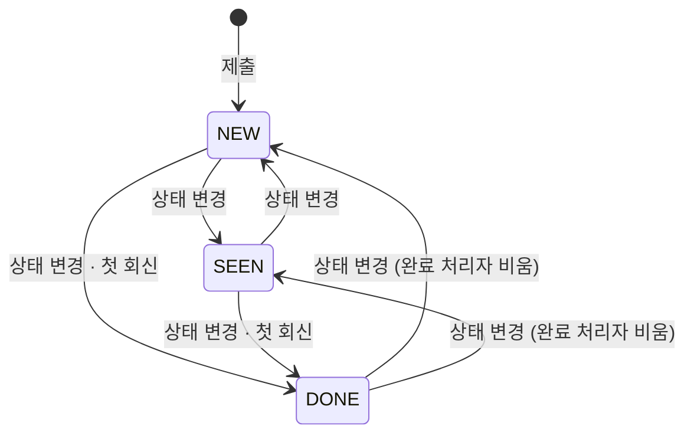

# 문의·오류 신고 API Spec — 크루 제출 · 내 문의 · 운영 콘솔 처리

> ERD: [FEEDBACK](../../docs/erd/README.md) (신규) · [FEEDBACK_IMAGE](../../docs/erd/README.md) (신규) · [STORAGE_OBJECT](../../docs/erd/STORAGE_OBJECT.md) · [ACCOUNT](../../docs/erd/ACCOUNT.md) · [NOTIFICATION](../../docs/erd/NOTIFICATION.md)
> 생성일: 2026-10-25
> 상태: 스펙작성중 — [미확정](#미확정) 9건
>
> Story PRD:
> - [크루는 캡틴에게 문의/오류신고를 제출할 수 있다](../../01-planning/stories/crew-submit-feedback/PRD.md)
> - [캡틴은 유저가 제출한 문의/오류신고를 조회할 수 있다](../../01-planning/stories/captain-view-feedbacks/PRD.md)
>
> 정책: [POL-0001 역할과 권한](../../01-planning/_registry/policies/POL-0001-roles.md) — `/api/admin/**` 은 캡틴
> 관련: [profile-image/spec.md](../profile-image/spec.md) — 이미지는 공용 업로드(`POST /api/uploads/images`)로 올리고 번호로 잇는다. [notification/spec.md](../notification/spec.md) — 회신 알림은 새 이벤트 하나를 더한다. [user-leave/spec.md](../user-leave/spec.md) — 탈퇴 때 이 테이블을 어떻게 할지 더해야 한다 ([미확정](#미확정)). [authz-guards/spec.md](../authz-guards/spec.md) — 인가는 어노테이션으로만
> 기준 프로토타입: playground 사용자 사이트 › 내 문의 (`frontend/apps/playground/src/proto/core/components/{Feedback,MyFeedback}.tsx`) · 운영 콘솔 › 문의·오류 신고 (`proto/console/components/{FeedbacksTable,FeedbackDetail}.tsx`) · 데이터 모양 `proto/lib/feedback.ts`. **PRD 와 프로토가 다르면 프로토를 따른다** (최신본)

## 엔드포인트 목록

| Method | Path | 설명 | 인증 | 상태 |
|--------|------|------|------|------|
| POST | /api/feedbacks | 문의·오류 신고 제출 — 이미지 번호를 잇고, 계정 기준 rate limit | O (`@RequireOnboarding`) | 스펙작성중 |
| GET | /api/me/feedbacks | 내 문의 목록 — 본인 것만, 접수 시각 내림차순, 페이지 | O (`@RequireOnboarding`) | 스펙작성중 |
| GET | /api/me/feedbacks/{feedbackId} | 내 문의 상세 — 본인 것만, 회신 포함 | O (`@RequireOnboarding`) | 스펙작성중 |
| GET | /api/admin/feedbacks | 운영 목록 — 유형·상태·검색·페이지, 걸러진 뒤 총 건수 | O (`@RequireAdmin`) | 스펙작성중 |
| GET | /api/admin/feedbacks/{feedbackId} | 운영 상세 — 제출 환경·회신·캡틴 전용 메모 포함 | O (`@RequireAdmin`) | 스펙작성중 |
| PATCH | /api/admin/feedbacks/{feedbackId} | 상태 · 회신 · 캡틴 전용 메모 중 하나를 바꾼다. 첫 회신은 완료 + 알림 이벤트 | O (`@RequireAdmin`) | 스펙작성중 |

상태: `스펙작성중` → `스펙확정` → `구현중` → `구현완료`

---

## 먼저 읽을 것 — 용어와 저장 값

화면은 PRD 의 이름을 쓰고, API 는 **DB enum 값 그대로** 주고받는다. 화면 이름으로 바꾸는 일은 각 앱의 라벨 맵 한 곳에서 한다.

### 유형 — `FEEDBACK.TYPE`

| 화면 | API·DB 값 | 프로토 값 |
|---|---|---|
| 문의 | `QUESTION` | `question` |
| 개선 의견 | `IDEA` | `idea` |
| 오류 신고 | `BUG` | `bug` |

고르는 순서는 문의 · 개선 의견 · 오류 신고 (프로토 `FEEDBACK_TYPES`). 순서는 화면이 정한다.

### 상태 — 운영자가 보는 값과 제출자가 보는 값이 다르다

| 운영 콘솔 | `FEEDBACK.STATUS` | 제출자(내 문의) | `/api/me` 응답 `status` |
|---|---|---|---|
| 미확인 | `NEW` | 접수 | `RECEIVED` |
| 확인 | `SEEN` | 접수 | `RECEIVED` |
| 완료 | `DONE` | 답변 완료 | `ANSWERED` |

- **제출자 상태는 서버가 바꿔서 준다** — `계산: Feedback.submitterStatus()`. `/api/me` 응답에 `NEW`·`SEEN`·`DONE` 을 내려보내지 않는다. 내려보내면 화면이 둘을 다시 묶어야 하고, 운영 단계가 늘어날 때 사용자 화면이 같이 깨진다 ([판정은 서버가 내려준다](../../docs/backend-development-guide/api/endpoint-convention.md#판정은-서버가-내려준다))
- `DONE` 인데 회신이 없는 경우가 생긴다 — 캡틴이 상태만 「완료」로 바꿨을 때. 이때 제출자에게 「답변 완료」 + 「답변을 준비하고 있어요」가 같이 보인다 ([미확정 2](#미확정))



세 값 사이를 어느 쪽으로든 바꿀 수 있다 (상태 드롭다운). 막는 전이는 없다.

### 진입점 — 이 스펙은 정하지 않는다

API 는 어디서 팝업을 여는지와 상관없다. 화면 쪽 결정만 적어 둔다.

| 진입 | 상태 |
|---|---|
| 푸터 「문의·오류 신고」 링크 → `/my/feedbacks?write=1` (팝업이 바로 열림, 비로그인이면 로그인으로) | **확정** — 프로토 `Footer.tsx` 그대로 둔다 (2026-10-25) |
| 「내 문의」 목록의 [문의하기] | 확정 (PRD · 프로토 같음) |
| 오른쪽 아래 플로팅 버튼 | **[NEEDS CLARIFICATION]** 업무 요청에는 있고, PRD 는 「두지 않는다」, 프로토에는 없다 — [미확정 1](#미확정) |
| 프로필 드롭다운 「문의·오류 신고」 | PRD 에는 있으나 프로토가 푸터로 **옮겼다** (`NavAuth.tsx` 주석). 프로토를 따라 두지 않는다 |

### 인가 — authz-guards 를 따른다

[authz-guards](../authz-guards/spec.md) 대로 권한은 어노테이션으로만 건다. 서비스 안에서 권한 검사를 다시 하지 않는다.

- `FeedbackController`(`/api/feedbacks`) · `MyFeedbackController`(`/api/me/feedbacks`) — 메서드에 `@RequireOnboarding`. 제출자에게는 늘 닉네임이 있어야 한다 (PRD 「로그인한 사람만」, 운영 목록 「늘 닉네임이 있다」). 온보딩 전 닉네임은 `account_<랜덤>` 임시값이다
- `AdminFeedbackController`(`/api/admin/feedbacks`) — 클래스에 `@RequireAdmin`
- 「본인 것만」은 권한이 아니라 **조회 조건**이다 — `WHERE ID = ? AND ACCOUNT_ID = 요청자`. 남의 것은 403 이 아니라 404 (있는지조차 알리지 않는다)

### 기획 문서와 다른 곳

| 기획 (PRD) | 이 스펙 | 이유 |
|---|---|---|
| 사용자 PRD — 경로 `GET /api/my/feedbacks(/{id})` | `GET /api/me/feedbacks(/{id})` | 본인 리소스는 이미 `/api/me` 아래에 있다 (`/api/me/studies` · `/api/me/discord`). `/api/my` 를 새로 열면 접두가 둘이 된다. **리뷰에서 확인** |
| 사용자 PRD — 진입은 프로필 드롭다운, 푸터 링크 없음 | 푸터 링크 확정, 드롭다운 없음 | 프로토가 최신본 (2026-10-25 확인) |
| 사용자 PRD — 이미지 PNG · JPG · WEBP · **GIF** | 지금 업로드가 받는 것은 **jpeg · png · webp** 뿐 | `ImageSanitizer` 가 GIF 를 판정·메타데이터 제거하지 못한다 — [미확정 4](#미확정) |
| 사용자 PRD — 제출 본문에 `userAgent` | 본문에 받지 않고 **요청 헤더 `User-Agent`** 를 서버가 읽어 「브라우저 · OS」로 줄여 저장. 원문은 저장하지 않는다 | 브라우저가 늘 보내는 값이라 화면이 따로 실을 필요가 없다. PRD 의 「브라우저·OS 와 화면 크기뿐」을 저장 단계에서 지킨다 — 원문 UA 에는 기기 모델명 등 더 많은 정보가 있다 |
| 운영 PRD — 처리 「삭제 — 소프트 삭제」 | `DELETED_AT` 컬럼과 조회 조건만 둔다. **삭제 API 는 없다** | 두 PRD 의 API 표에 삭제가 없다 — [미확정 6](#미확정) |
| 운영 PRD — 목록 `submitterNickname` · `doneBy` | `submitter: { nickname }` · `doneBy: { nickname } \| null` | 「완료가 아님」(`doneBy = null`)과 「완료 처리한 캡틴이 탈퇴함」(`doneBy.nickname = null`)을 가르기 위해 |

---

## 데이터 모델

### FEEDBACK (신규)

| 컬럼 | 타입 | NULL | 설명 |
|---|---|---|---|
| ID | BIGINT PK | N | |
| ACCOUNT_ID | BIGINT | N | 제출자. ID 참조([ACCOUNT](../../docs/erd/ACCOUNT.md), FK 없음 — 애그리거트 간 참조). 탈퇴로 ACCOUNT 행이 지워지면 이 값이 가리키는 행이 없다 → 「탈퇴한 사용자」 |
| TYPE | VARCHAR(20) | N | `QUESTION` / `IDEA` / `BUG` |
| TITLE | VARCHAR(100) | N | 2~100자, 앞뒤 공백 자른 뒤 |
| CONTENT | VARCHAR(2000) | N | 10~2000자. 평문 — 받은 글자 그대로 저장한다 (HTML 이스케이프·제거 없음) |
| BROWSER | VARCHAR(60) | Y | 「Chrome 141 · macOS」 꼴. 요청 헤더 `User-Agent` 를 서버가 줄인 값. 헤더가 없으면 NULL |
| VIEWPORT_WIDTH | SMALLINT | Y | 제출 때 화면 너비(CSS px). 화면이 안 보냈으면 NULL |
| VIEWPORT_HEIGHT | SMALLINT | Y | 〃 높이 |
| STATUS | VARCHAR(20) | N | `NEW` / `SEEN` / `DONE`. 처음은 `NEW` |
| DONE_BY_ACCOUNT_ID | BIGINT | Y | 「완료」로 바꾼 캡틴 — 회신 전송이든 상태 변경이든. `STATUS ≠ DONE` 이면 NULL. ID 참조(FK 없음) |
| REPLY_CONTENT | VARCHAR(2000) | Y | 캡틴 회신. 10~2000자. 수정하면 이 값만 바뀐다 |
| REPLIED_AT | DATETIME(6) | Y | **첫** 회신 시각. 수정해도 그대로 |
| ADMIN_MEMO | VARCHAR(2000) | Y | 캡틴 전용 메모. 빈 문자열은 NULL 로 저장 — 길이 상한은 [미확정 7](#미확정) |
| DELETED_AT | DATETIME(6) | Y | 소프트 삭제 시각. NULL 이 아니면 모든 조회에서 빠진다 |
| CREATED_AT / UPDATED_AT | DATETIME(6) | N | `BaseEntity`. `CREATED_AT` 이 「접수 시각」 |

- 인덱스 `idx_feedback_account_created (ACCOUNT_ID, CREATED_AT)` — 내 문의 목록과 rate limit 의 「최근 n분 안 내 제출 수」
- 인덱스 `idx_feedback_created (CREATED_AT)` — 운영 목록 정렬. 유형·상태 필터는 건수가 적어 인덱스 없이 시작한다
- `REPLY_CONTENT IS NOT NULL ⇔ REPLIED_AT IS NOT NULL`, `STATUS = DONE ⇔ DONE_BY_ACCOUNT_ID IS NOT NULL` — 엔티티 메서드가 지킨다 (DB CHECK 는 두지 않는다)

### FEEDBACK_IMAGE (신규)

| 컬럼 | 타입 | NULL | 설명 |
|---|---|---|---|
| ID | BIGINT PK | N | |
| FEEDBACK_ID | BIGINT | N | `fk_feedback_image_feedback` — 애그리거트 **안**이라 FK 를 건다 |
| STORAGE_OBJECT_ID | BIGINT | N | 연결한 업로드 행. ID 참조(FK 없음) — 지울 때 이 행을 `DELETING` 으로 |
| IMAGE_URL | VARCHAR(512) | N | 공개 주소 스냅샷 (`ACCOUNT.PROFILE_IMG_URL` 과 같은 방식) |
| DISPLAY_ORDER | TINYINT | N | 0부터. 요청 배열 순서 |

- `UNIQUE(FEEDBACK_ID, DISPLAY_ORDER)`. 한 건에 최대 3행 — 엔티티가 지킨다

### STORAGE_OBJECT — 용도 하나 추가

- `StoragePurpose.FEEDBACK` 를 더한다. 폴더는 [미확정 3](#미확정) — 지금 공용 업로드는 전부 `gigs/`(CloudFront 공개) 아래다
- 화면은 `POST /api/uploads/images?purpose=FEEDBACK` 로 먼저 올리고 받은 `fileId` 를 제출 본문에 싣는다. 장당 5MB(`spring.servlet.multipart.max-file-size`) · 계정당 연결 안 된 업로드 20개 상한은 기존 그대로

### NOTIFICATION — 이벤트 하나 추가

- `NotificationEventType.FEEDBACK_REPLIED` — 첫 회신 전송 때 발행 ([회신 알림](#회신-알림))

---

## 문의·오류 신고 제출

### 기본 정보

- **Method**: POST
- **Path**: `/api/feedbacks`
- **인증**: 필요 (`@RequireOnboarding`)
- **설명**: 로그인한 크루가 문의 · 개선 의견 · 오류 신고를 보낸다. 이미지 번호를 이 건에 잇고, 「미확인」으로 접수한다

### Path Parameters

없음

### Query Parameters

없음

### Request Headers

| 이름 | 필수 | 설명 |
|---|---|---|
| User-Agent | N | 브라우저가 늘 보낸다. 서버가 「브라우저 · OS」로 줄여 `BROWSER` 에 저장. 원문은 저장하지 않는다 |

### Request Body

```json
{
  "type": "BUG",
  "title": "모바일에서 출석 체크 버튼이 안 눌려요",
  "content": "아이폰 사파리에서 오늘 출석 버튼을 눌러도 반응이 없습니다.\n데스크톱에서는 됩니다.",
  "imageFileIds": [812, 813],
  "viewport": { "width": 390, "height": 844 }
}
```

| 필드 | 타입 | 필수 | 규칙 |
|---|---|---|---|
| type | String | Y | `QUESTION` \| `IDEA` \| `BUG`. 기본값 없음 (화면도 기본 선택 없음) |
| title | String | Y | 앞뒤 공백을 자른 뒤 2~100자 |
| content | String | Y | 앞뒤 공백을 자른 뒤 10~2000자. 줄바꿈 그대로 |
| imageFileIds | Long[] | N | 0~3개, 중복 없음. 없으면 `[]` 과 같다 |
| viewport | Object | N | 제출 때 `window.innerWidth` · `innerHeight` |
| viewport.width | Integer | Y (viewport 가 있으면) | 1~10000 |
| viewport.height | Integer | Y (viewport 가 있으면) | 1~10000 |

- 글자 수는 Java `String.length()` (UTF-16 단위)로 센다 — 화면의 `string.length` 와 같은 단위라 화면이 막은 길이와 서버가 막는 길이가 어긋나지 않는다
- `content` 는 평문이다. `<b>` 같은 글자를 지우거나 바꾸지 않고 그대로 저장한다 (PRD 「내용에 HTML — 문자 그대로 저장·출력」). 출력할 때 이스케이프는 화면 몫 — React 기본 출력이면 된다
- 화면 경로(URL)는 받지 않는다 (PRD — 목록을 거쳐 쓰므로 문제의 화면을 가리키지 않는다)

### 처리 규칙

한 트랜잭션 안에서:

1. **rate limit** — 이 계정의 `FEEDBACK` 중 `CREATED_AT > now - 1분` 이 1건이라도 있으면 429 `TOO_MANY_REQUESTS` ([미확정 5](#미확정) — 기준 값). 소프트 삭제된 건도 센다
2. 본문 검증 (위 표). 하나라도 틀리면 400, 아무것도 저장하지 않는다
3. `FEEDBACK` INSERT — `STATUS = NEW`, `BROWSER = 파싱(User-Agent)`, `VIEWPORT_* = viewport`
4. `imageFileIds` 를 순서대로 `UploadService.attach(fileId, 요청자, FEEDBACK, now)` → `FEEDBACK_IMAGE` INSERT. 번호가 없든 · 남의 것이든 · 용도가 다르든 · 이미 연결됐든 · 만료됐든 400 하나 (기존 attach 와 같은 문구 「업로드한 사진을 찾을 수 없습니다. 다시 올려 주세요.」). 하나라도 실패하면 전체 롤백 — 앞에서 연결한 번호도 `PENDING` 으로 남는다

- 동시에 두 번 누르면 1 의 COUNT 가 둘 다 0 을 볼 수 있다 — 화면이 전송 중 버튼을 막고(PRD), 두 건이 들어가도 해가 없어 잠금은 걸지 않는다
- `User-Agent` 파싱은 프로토 `describeAgent()` 와 같은 규칙으로 서버에 둔다 (Edge → Firefox → Chrome → Safari 순, OS 는 iOS · Android · macOS · Windows). 모르는 값은 「브라우저 · OS」 대신 NULL — 라이브러리를 새로 들이지 않는다 (AGENT.md 외부 라이브러리 합의)

### Response — 201

방금 만든 건을 [내 문의 목록](#내-문의-목록)의 한 줄과 같은 모양으로 준다. 화면은 다시 조회하지 않고 이 값을 목록 맨 위에 넣는다 (PRD 완료 기준 6).

```json
{
  "id": 241,
  "type": "BUG",
  "title": "모바일에서 출석 체크 버튼이 안 눌려요",
  "status": "RECEIVED",
  "createdAt": "2026-10-25T08:12:40Z"
}
```

| 필드 | 타입 | NULL | 설명 | 소스 |
|------|------|------|------|------|
| id | Long | N | | FEEDBACK.ID |
| type | String | N | | FEEDBACK.TYPE |
| title | String | N | | FEEDBACK.TITLE |
| status | String | N | 늘 `RECEIVED` | 계산: `Feedback.submitterStatus()` |
| createdAt | String | N | 접수 시각. UTC ISO 8601 | FEEDBACK.CREATED_AT |

### Error Responses

| 상태 | errorCode | 조건 |
|------|-----------|------|
| 400 | INVALID_INPUT | `type` 없음·모르는 값, `title`·`content` 길이 밖, `imageFileIds` 4개 이상·중복, `viewport` 값 범위 밖, 이미지 번호를 이을 수 없음 |
| 401 | UNAUTHORIZED | 토큰 없음·무효, 또는 토큰의 계정이 없음(탈퇴) |
| 403 | ONBOARDING_REQUIRED | 온보딩 전 계정 (`@RequireOnboarding`) |
| 429 | TOO_MANY_REQUESTS | 이 계정이 1분 안에 이미 보냈음 — **새 ErrorCode** (`HttpStatus.TOO_MANY_REQUESTS`, 기본 문구 「잠시 후 다시 시도해 주세요.」). [exception-handling-guide](../../docs/backend-development-guide/exception-handling-guide.md) 표에 한 줄 추가 |

화면 처리 (PRD 상태별 화면):
- 400 · 5xx · 네트워크 오류 → 팝업 유지, 빨간 알림 「의견을 보내지 못했습니다. 다시 시도해 주세요.」 + 다시 시도
- 429 → 팝업 유지, 빨간 알림 「잠시 후 다시 시도해 주세요.」
- 201 → 팝업 닫기, 초록 알림 「의견을 보내주셔서 감사합니다.」

### 프론트엔드 사용처

- `frontend/apps/core-front/src/` — 문의하기 팝업 (신규). 프로토 `proto/core/components/Feedback.tsx` 의 `FeedbackDialog` 를 옮긴다: 입력 검증 · 글자 수 · 이미지 고르기 · 끌어 놓기 · ⌘V 붙여넣기 · 3장 · 5MB. 이미지는 고르는 즉시 `POST /api/uploads/images?purpose=FEEDBACK` 로 올리고 `fileId` 를 모은다
- `frontend/apps/core-front/src/components/Footer.tsx` — 「문의·오류 신고」 링크 (`/my/feedbacks?write=1`) · 운영 메일 `contact@studyclub.life` 글자 (프로토 `Footer.tsx`)

---

## 내 문의 목록

### 기본 정보

- **Method**: GET
- **Path**: `/api/me/feedbacks`
- **인증**: 필요 (`@RequireOnboarding`)
- **설명**: 요청자가 보낸 문의를 접수 시각 내림차순으로 준다. 캡틴 전용 메모 · 제출 환경은 주지 않는다

### Path Parameters

없음

### Query Parameters

| 이름 | 타입 | 필수 | 기본값 | 설명 |
|------|------|------|--------|------|
| offset | Integer | N | 0 | 0 이상 |
| limit | Integer | N | 20 | 1 ~ 100. 화면은 20 고정 |

### 정렬

`CREATED_AT DESC, ID DESC` 고정. 정렬 파라미터는 받지 않는다.

### Request Body

없음

### Response — 200

```json
{
  "items": [
    {
      "id": 241,
      "type": "BUG",
      "title": "모바일에서 출석 체크 버튼이 안 눌려요",
      "status": "RECEIVED",
      "createdAt": "2026-10-25T08:12:40Z"
    },
    {
      "id": 198,
      "type": "QUESTION",
      "title": "클럽이랑 스터디는 뭐가 다른가요",
      "status": "ANSWERED",
      "createdAt": "2026-10-12T16:40:00Z"
    }
  ],
  "total": 2,
  "offset": 0,
  "limit": 20
}
```

| 필드 | 타입 | NULL | 설명 | 소스 |
|------|------|------|------|------|
| items | Array | N | 이 페이지의 건. 없거나 `offset` 이 범위 밖이면 `[]` | |
| items[].id | Long | N | 상세 경로 값 | FEEDBACK.ID |
| items[].type | String | N | `QUESTION` \| `IDEA` \| `BUG` | FEEDBACK.TYPE |
| items[].title | String | N | 화면은 한 줄로 자르고 가리키면 전체 | FEEDBACK.TITLE |
| items[].status | String | N | `RECEIVED` \| `ANSWERED` | 계산: `Feedback.submitterStatus()` |
| items[].createdAt | String | N | 접수 시각. UTC ISO 8601. 화면은 날짜만 적는다 | FEEDBACK.CREATED_AT |
| total | Long | N | 내 건 전체 수 | 계산: COUNT |
| offset | Integer | N | 요청 값 그대로 | |
| limit | Integer | N | 요청 값 그대로 | |

- 조회 조건: `ACCOUNT_ID = 요청자 AND DELETED_AT IS NULL` (PRD 「캡틴이 지운 문의는 내 문의에서도 빠진다」)
- `offset ≥ total` 이면 `items: []` 와 실제 `total` (에러 아님)

### Error Responses

| 상태 | errorCode | 조건 |
|------|-----------|------|
| 400 | INVALID_INPUT | `offset < 0`, `limit` 이 1~100 밖 |
| 401 | UNAUTHORIZED | 토큰 없음·무효, 또는 토큰의 계정이 없음(탈퇴) |
| 403 | ONBOARDING_REQUIRED | 온보딩 전 계정 |

화면 처리: 불러오는 중 스켈레톤 · 0건 「접수한 문의가 없습니다.」 + 문의하기 · 실패 「불러오지 못했습니다. 다시 시도해 주세요.」 (실패를 0건으로 보이지 않는다)

### 프론트엔드 사용처

- `frontend/apps/core-front/src/app/[locale]/my/feedbacks/page.tsx` (신규) — 프로토 `MyFeedback.tsx` 의 목록. `?write=1` 이면 팝업을 바로 연다

---

## 내 문의 상세

### 기본 정보

- **Method**: GET
- **Path**: `/api/me/feedbacks/{feedbackId}`
- **인증**: 필요 (`@RequireOnboarding`)
- **설명**: 요청자가 보낸 건 하나와 캡틴 회신. 캡틴 전용 메모 · 제출 환경 · 완료 처리자는 주지 않는다

### Path Parameters

| 이름 | 타입 | 설명 |
|------|------|------|
| feedbackId | Long | FEEDBACK.ID |

### Query Parameters

없음

### Request Body

없음

### Response — 200

```json
{
  "id": 198,
  "type": "QUESTION",
  "title": "클럽이랑 스터디는 뭐가 다른가요",
  "content": "모집 중인 목록에 클럽과 스터디가 섞여 있는데 차이를 모르겠습니다.",
  "status": "ANSWERED",
  "createdAt": "2026-10-12T16:40:00Z",
  "images": [
    { "url": "https://d27gz6v6wvae1d.cloudfront.net/studyclub/gigs/feedbacks/2f1c….webp" }
  ],
  "reply": {
    "content": "스터디는 기수마다 정해진 기간에 함께 진도를 나가는 모임이고, 클럽은 기간 없이 매달 이어지는 모임이에요.",
    "repliedAt": "2026-10-13T02:30:00Z"
  }
}
```

| 필드 | 타입 | NULL | 설명 | 소스 |
|------|------|------|------|------|
| id | Long | N | | FEEDBACK.ID |
| type | String | N | | FEEDBACK.TYPE |
| title | String | N | | FEEDBACK.TITLE |
| content | String | N | 평문. 화면은 HTML 로 해석하지 않고 줄바꿈만 살린다 | FEEDBACK.CONTENT |
| status | String | N | `RECEIVED` \| `ANSWERED` | 계산: `Feedback.submitterStatus()` |
| createdAt | String | N | 접수 시각. UTC ISO 8601. 화면은 시각까지 | FEEDBACK.CREATED_AT |
| images | Array | N | 첨부 순서대로. 없으면 `[]` | FEEDBACK_IMAGE (`DISPLAY_ORDER`) |
| images[].url | String | N | | FEEDBACK_IMAGE.IMAGE_URL |
| reply | Object | Y | 회신이 없으면 null — 화면은 회색 「답변을 준비하고 있어요」 | |
| reply.content | String | N | 평문. 수정됐으면 수정된 내용 | FEEDBACK.REPLY_CONTENT |
| reply.repliedAt | String | N | **처음** 보낸 시각. UTC ISO 8601 | FEEDBACK.REPLIED_AT |

- 조회 조건: `ID = feedbackId AND ACCOUNT_ID = 요청자 AND DELETED_AT IS NULL`

### Error Responses

| 상태 | errorCode | 조건 |
|------|-----------|------|
| 400 | INVALID_INPUT | `feedbackId` 가 숫자가 아님 |
| 401 | UNAUTHORIZED | 토큰 없음·무효, 또는 토큰의 계정이 없음(탈퇴) |
| 403 | ONBOARDING_REQUIRED | 온보딩 전 계정 |
| 404 | NOT_FOUND | 없는 번호 · 남의 것 · 소프트 삭제됨 — 셋을 가르지 않는다. 화면 「찾을 수 없는 문의입니다.」 |

### 프론트엔드 사용처

- `frontend/apps/core-front/src/app/[locale]/my/feedbacks/[id]/page.tsx` (신규) — 프로토 `MyFeedback.tsx` 의 상세

---

## 운영 목록

### 기본 정보

- **Method**: GET
- **Path**: `/api/admin/feedbacks`
- **인증**: 필요 (`@RequireAdmin`)
- **설명**: 접수된 문의·오류 신고를 유형 · 상태 · 검색으로 거르고 페이지로 준다. `total` 은 **걸러진 뒤 전체 수**

### Path Parameters

없음

### Query Parameters

| 이름 | 타입 | 필수 | 기본값 | 설명 |
|------|------|------|--------|------|
| type | String | N | — | `QUESTION` \| `IDEA` \| `BUG`. 없으면 전체 |
| status | String | N | — | `NEW` \| `SEEN` \| `DONE`. 없으면 전체 |
| q | String | N | — | 제목 **또는** 내용 부분 일치, 대소문자 무시. 앞뒤 공백을 자르고 빈 문자열이면 조건 없음. 최대 100자. `%`·`_` 는 글자로 취급 (LIKE 이스케이프) |
| offset | Integer | N | 0 | 0 이상 |
| limit | Integer | N | 20 | 1 ~ 100. 화면은 20 고정 |

- 모든 조건은 AND. `q` 안의 제목·내용은 OR
- 검색 지연(400ms)과 「무엇이든 바꾸면 1페이지」는 화면 몫

### 정렬

`CREATED_AT DESC, ID DESC` 고정. 열 머리 정렬 없음 (PRD).

### Request Body

없음

### Response — 200

```json
{
  "items": [
    {
      "id": 241,
      "createdAt": "2026-10-25T08:12:40Z",
      "type": "BUG",
      "title": "모바일에서 출석 체크 버튼이 안 눌려요",
      "submitter": { "nickname": "도윤" },
      "status": "NEW",
      "doneBy": null
    },
    {
      "id": 198,
      "createdAt": "2026-10-12T16:40:00Z",
      "type": "QUESTION",
      "title": "클럽이랑 스터디는 뭐가 다른가요",
      "submitter": { "nickname": null },
      "status": "DONE",
      "doneBy": { "nickname": "세린" }
    }
  ],
  "total": 24,
  "offset": 0,
  "limit": 20
}
```

| 필드 | 타입 | NULL | 설명 | 소스 |
|------|------|------|------|------|
| items | Array | N | 이 페이지의 건. 없거나 `offset` 이 범위 밖이면 `[]` | |
| items[].id | Long | N | | FEEDBACK.ID |
| items[].createdAt | String | N | 접수 시각. UTC ISO 8601 | FEEDBACK.CREATED_AT |
| items[].type | String | N | | FEEDBACK.TYPE |
| items[].title | String | N | 화면은 한 줄로 자르고 가리키면 전체 | FEEDBACK.TITLE |
| items[].submitter | Object | N | 제출자. 늘 있다 (로그인해야 보낸다) | |
| items[].submitter.nickname | String | Y | **null 이면 탈퇴** — 화면 「탈퇴한 사용자」 | ACCOUNT.NICKNAME (계산: `ACCOUNT_ID` 로 찾은 행이 없으면 null) |
| items[].status | String | N | `NEW` \| `SEEN` \| `DONE` | FEEDBACK.STATUS |
| items[].doneBy | Object | Y | 「완료」로 바꾼 캡틴. **완료가 아니면 null** — 화면 「—」 | |
| items[].doneBy.nickname | String | Y | null 이면 그 캡틴이 탈퇴 — 화면 「탈퇴한 사용자」 | ACCOUNT.NICKNAME (`DONE_BY_ACCOUNT_ID`) |
| total | Long | N | 걸러진 뒤 전체 수 — 화면 「총 n건」 | 계산: COUNT |
| offset | Integer | N | 요청 값 그대로 | |
| limit | Integer | N | 요청 값 그대로 | |

- 조회 조건에 늘 `DELETED_AT IS NULL`
- 닉네임은 한 페이지의 `ACCOUNT_ID` · `DONE_BY_ACCOUNT_ID` 를 모아 `ACCOUNT` 를 한 번에 읽는다 (N+1 금지 — [jpa-guide](../../docs/backend-development-guide/jpa-guide.md))
- 0건 · 걸러서 0건 문구는 화면이 조건 유무로 고른다 (「접수된 문의·오류 신고가 없습니다.」 / 「조건에 맞는 문의·오류 신고가 없습니다.」 + 전체 보기)

### Error Responses

| 상태 | errorCode | 조건 |
|------|-----------|------|
| 400 | INVALID_INPUT | `type`·`status` 가 모르는 값, `q` 100자 초과, `offset < 0`, `limit` 이 1~100 밖 |
| 401 | UNAUTHORIZED | 토큰 없음·무효, 또는 토큰의 계정이 없음(탈퇴) |
| 403 | FORBIDDEN | 요청자가 `ADMIN` 이 아님 |

### 프론트엔드 사용처

- `frontend/apps/back-office-front/src/app/feedbacks/page.tsx` (신규) — 프로토 `proto/console/components/FeedbacksTable.tsx`
- `frontend/apps/back-office-front/src/components/Sidebar.tsx` — 「문의·오류 신고」(말풍선) 공지 아래 · 알림 위

---

## 운영 상세

### 기본 정보

- **Method**: GET
- **Path**: `/api/admin/feedbacks/{feedbackId}`
- **인증**: 필요 (`@RequireAdmin`)
- **설명**: 목록 한 줄 + 내용 · 첨부 이미지 · 제출 환경 · 회신 · 캡틴 전용 메모

### Path Parameters

| 이름 | 타입 | 설명 |
|------|------|------|
| feedbackId | Long | FEEDBACK.ID |

### Query Parameters

없음

### Request Body

없음

### Response — 200

```json
{
  "id": 241,
  "createdAt": "2026-10-25T08:12:40Z",
  "type": "BUG",
  "title": "모바일에서 출석 체크 버튼이 안 눌려요",
  "submitter": { "nickname": "도윤" },
  "status": "NEW",
  "doneBy": null,
  "content": "아이폰 사파리에서 오늘 출석 버튼을 눌러도 반응이 없습니다.\n데스크톱에서는 됩니다.",
  "images": [
    { "url": "https://d27gz6v6wvae1d.cloudfront.net/studyclub/gigs/feedbacks/9a0e….webp" }
  ],
  "browser": "Safari 26 · iOS",
  "viewport": { "width": 390, "height": 844 },
  "reply": null,
  "adminMemo": null
}
```

목록 항목의 필드(`id` · `createdAt` · `type` · `title` · `submitter` · `status` · `doneBy`)는 [운영 목록](#운영-목록)과 같다. 더해지는 것:

| 필드 | 타입 | NULL | 설명 | 소스 |
|------|------|------|------|------|
| content | String | N | 평문 — 문자 그대로 출력 | FEEDBACK.CONTENT |
| images | Array | N | 없으면 `[]` — 화면은 칸을 두지 않는다 | FEEDBACK_IMAGE (`DISPLAY_ORDER`) |
| images[].url | String | N | | FEEDBACK_IMAGE.IMAGE_URL |
| browser | String | Y | 「Chrome 141 · macOS」. 모르면 null — 화면 「—」 | FEEDBACK.BROWSER |
| viewport | Object | Y | 화면이 안 보냈으면 null. 화면은 「390 × 844」 로 적는다 | |
| viewport.width | Integer | N | | FEEDBACK.VIEWPORT_WIDTH |
| viewport.height | Integer | N | | FEEDBACK.VIEWPORT_HEIGHT |
| reply | Object | Y | 회신 전이면 null — 화면은 입력칸과 「전송」. 있으면 읽기 전용과 「수정」 | |
| reply.content | String | N | | FEEDBACK.REPLY_CONTENT |
| reply.repliedAt | String | N | 처음 보낸 시각 | FEEDBACK.REPLIED_AT |
| adminMemo | String | Y | 캡틴 전용 메모. 없으면 null | FEEDBACK.ADMIN_MEMO |

### Error Responses

| 상태 | errorCode | 조건 |
|------|-----------|------|
| 400 | INVALID_INPUT | `feedbackId` 가 숫자가 아님 |
| 401 | UNAUTHORIZED | 토큰 없음·무효 |
| 403 | FORBIDDEN | 요청자가 `ADMIN` 이 아님 |
| 404 | NOT_FOUND | 없는 번호 · 소프트 삭제됨. 화면 「삭제되었거나 없는 문의·오류 신고입니다.」 |

### 프론트엔드 사용처

- `frontend/apps/back-office-front/src/app/feedbacks/[id]/page.tsx` (신규) — 프로토 `proto/console/components/FeedbackDetail.tsx`

---

## 운영 처리 — 상태 · 회신 · 메모

### 기본 정보

- **Method**: PATCH
- **Path**: `/api/admin/feedbacks/{feedbackId}`
- **인증**: 필요 (`@RequireAdmin`)
- **설명**: `status` · `reply` · `adminMemo` 중 **하나만** 바꾼다. 화면의 세 동작(상태 드롭다운 · 회신 전송/수정 · 메모 저장)이 각각 따로 부른다

### Path Parameters

| 이름 | 타입 | 설명 |
|------|------|------|
| feedbackId | Long | FEEDBACK.ID |

### Query Parameters

없음

### Request Body

셋 중 하나만 싣는다.

```json
{ "status": "SEEN" }
```

```json
{ "reply": "디스코드 #캡틴-지원 채널에 하고 싶은 스터디 주제와 진행 방식을 남겨 주세요." }
```

```json
{ "adminMemo": "스터디 카드 제목 렌더링 확인 필요 — 이스케이프 누락 의심" }
```

| 필드 | 타입 | 규칙 |
|---|---|---|
| status | String | `NEW` \| `SEEN` \| `DONE` |
| reply | String | 앞뒤 공백을 자른 뒤 10~2000자 |
| adminMemo | String | 0~2000자 ([미확정 7](#미확정)). 빈 문자열이면 메모를 지운다(NULL) |

- 키가 하나도 없거나 둘 이상이면 400. 키가 있는데 값이 `null` 이어도 400 (메모를 지우려면 `""`)

### 처리 규칙

트랜잭션의 첫 조회로 그 `FEEDBACK` 행을 잠근다(`SELECT … FOR UPDATE`). 두 캡틴이 동시에 첫 회신을 보내도 알림이 한 번만 나가게 하기 위해서다.

**`status`** — `Feedback.changeStatus(next, 요청자)`
- `DONE` 으로 → `DONE_BY_ACCOUNT_ID = 요청자`
- `DONE` 에서 벗어남 → `DONE_BY_ACCOUNT_ID = NULL`
- 지금과 같은 값 → 아무것도 바꾸지 않고 200 (완료 처리자도 그대로)
- 회신 여부와 상관없다. 회신이 있는 건을 `SEEN` 으로 내려도 회신은 남는다 — 제출자에게는 「접수」 + 답변이 보인다 ([미확정 2](#미확정))

**`reply`** — `Feedback.reply(content, 요청자, now)`
- **첫 회신** (`REPLY_CONTENT IS NULL`): `REPLY_CONTENT` · `REPLIED_AT = now` 저장, `STATUS = DONE`, `DONE_BY_ACCOUNT_ID = 요청자`. 그리고 `FeedbackRepliedEvent(feedbackId)` 발행 → [회신 알림](#회신-알림)
  - 이미 `DONE` 이었어도 완료 처리자를 요청자로 바꾼다 (회신을 보낸 사람이 처리한 사람)
- **회신 수정** (`REPLY_CONTENT IS NOT NULL`): `REPLY_CONTENT` 만 바꾼다. `REPLIED_AT` · `STATUS` · 완료 처리자 그대로, 이벤트 없음 (PRD 「고치는 것은 새 회신이 아니다」)

**`adminMemo`** — `ADMIN_MEMO` 만 바꾼다. 다른 컬럼 · 이벤트 없음

### Response — 200

바뀐 뒤의 [운영 상세](#운영-상세)와 같은 모양. 화면은 다시 조회하지 않고 이 값으로 상태 뱃지 · 완료 처리자 · 회신 칸을 갱신한다.

### Error Responses

| 상태 | errorCode | 조건 |
|------|-----------|------|
| 400 | INVALID_INPUT | 키가 없거나 둘 이상, 값이 null, `status` 가 모르는 값, `reply` 길이 밖, `adminMemo` 2000자 초과 |
| 401 | UNAUTHORIZED | 토큰 없음·무효 |
| 403 | FORBIDDEN | 요청자가 `ADMIN` 이 아님 |
| 404 | NOT_FOUND | 없는 번호 · 소프트 삭제됨 |

화면 처리 (PRD 상태별 화면):
- 상태 — 성공 「상태를 변경했습니다.」 / 실패면 이전 값으로 되돌리고 「상태를 변경하지 못했습니다. 다시 시도해 주세요.」
- 회신 — 성공 「회신을 보냈습니다.」 / 실패면 입력 유지 「회신을 보내지 못했습니다. 다시 시도해 주세요.」
- 메모 — 「저장했습니다.」 / 「저장하지 못했습니다. 다시 시도해 주세요.」

### 프론트엔드 사용처

- `frontend/apps/back-office-front/src/app/feedbacks/[id]/page.tsx` (신규) — 상태 드롭다운 · 회신 · 메모 (프로토 `FeedbackDetail.tsx`)

---

## 회신 알림

[notification/spec.md](../notification/spec.md) 의 구조(이벤트 → 리스너 → `NOTIFICATION` INSERT → 폴링 발송) 그대로 이벤트 하나를 더한다. 피드백 쪽은 이벤트를 발행할 뿐 무엇을 보낼지 모른다.

- 발행: `PATCH … reply` 의 **첫 회신**에서만. `FeedbackRepliedEvent(feedbackId)` — payload 는 id 뿐 ([domain-events](../domain-events/spec.md) — 리스너가 직접 읽는다)
- 구독: `notification` 모듈의 새 리스너, `AFTER_COMMIT`
  1. `FEEDBACK` 과 제출자 `ACCOUNT` 를 읽는다. 제출자가 탈퇴했으면 만들지 않는다
  2. `NOTIFICATION_TEMPLATE (FEEDBACK_REPLIED, EMAIL)` 이 없으면 만들지 않는다 (PRD 「템플릿이 등록돼 있으면」) — [미확정 8](#미확정)
  3. `NOTIFICATION` INSERT — `EVENT_TYPE = FEEDBACK_REPLIED`, `RECIPIENT_VALUE = 제출자 이메일`, `PAYLOAD = { nickname, feedbackTitle, feedbackId }` (INSERT 시점 스냅샷)
- 회신 내용은 payload 에 싣지 않는다 — 메일에는 「답변이 달렸다」와 내 문의 링크만. 본문은 로그인해서 본다 ([미확정 8](#미확정))
- 백오피스: 알림 템플릿 조건 선택지 · 발송 이력 조건 필터에 「문의 회신」(`FEEDBACK_REPLIED`) 추가 — `back-office-front/src/features/notifications/labels.ts` · `features/notification-templates/types.ts`

---

## 이번 스펙에서 뺀 것

- 비로그인 제출 · 자기 문의 삭제 · 답변에 되묻기 · 화면 경로 수집 (사용자 PRD 범위 밖)
- 이전·다음 건 이동 · 대시보드 미확인 수 · 상세 진입 시 자동 「확인」 (운영 PRD 범위 밖)
- 삭제 API ([미확정 6](#미확정))

---

## 미확정

1. **[NEEDS CLARIFICATION] 플로팅 버튼** — 업무 요청은 「오른쪽 아래 플로팅 피드백 버튼」, 사용자 PRD 는 「플로팅 버튼 · 푸터 링크는 두지 않는다」, 프로토에는 없다(푸터 링크만). 푸터 링크는 둔다(2026-10-25 확정). 플로팅 버튼을 **더할지** 기획 확인 중. API 는 영향 없음 — 버튼이 생기면 같은 팝업을 연다. 정해지면 비로그인일 때 버튼을 보일지(누르면 로그인으로)도 정한다
2. **[NEEDS CLARIFICATION] 상태와 회신이 어긋나는 경우** — (가) 회신 없이 「완료」 → 제출자에게 「답변 완료」 + 「답변을 준비하고 있어요」. (나) 회신 뒤 「확인」으로 내림 → 제출자에게 「접수」 + 답변. 이 스펙은 막지 않는다(PRD 「막는 전이 없음」). 제출자 상태를 「회신이 있으면 답변 완료」로 바꿀지, 지금처럼 `STATUS = DONE` 으로 둘지 기획 확인
3. **[NEEDS CLARIFICATION] 첨부 이미지가 공개 주소에 놓인다** — 지금 공용 업로드는 전부 `gigs/`(CloudFront 공개) 아래다. 오류 신고 스크린샷에는 이메일 · 닉네임 같은 개인정보가 찍힐 수 있다. 주소가 UUID 라 추측은 어렵지만, 한 번 새면 누구나 연다. (가) `gigs/feedbacks/` 그대로, (나) 비공개 폴더 + 짧은 서명 URL. (나)면 업로드 서비스에 비공개 경로가 새로 필요해 일정이 늘어난다. 운영진 · 리드 확인
4. **[NEEDS CLARIFICATION] GIF** — PRD 는 GIF 를 받는다. `ImageSanitizer` 는 jpeg · png · webp 만 판정하고 메타데이터를 지운다. (가) 이번에는 GIF 를 빼고 화면 안내도 「PNG · JPG · WEBP」로, (나) GIF 판정 · 정리를 더한다. (가)를 제안
5. **[NEEDS CLARIFICATION] rate limit 기준** — 초안은 「계정당 1분에 1건」. PRD 는 값을 정하지 않았다. 하루 상한(예: 20건)도 둘지 확인
6. **[NEEDS CLARIFICATION] 소프트 삭제는 누가 어떻게** — 운영 PRD 「처리」 표에 소프트 삭제가 있지만 화면 · API 표에는 삭제가 없다. 컬럼과 조회 조건만 두고 API 는 만들지 않는다. 필요하면 `DELETE /api/admin/feedbacks/{id}` 를 후속으로
7. **[NEEDS CLARIFICATION] 캡틴 전용 메모 길이** — PRD 에 상한이 없다. 2000자를 제안
8. **[NEEDS CLARIFICATION] 회신 알림 템플릿** — 템플릿을 만드는 API 가 아직 없다(`GET /api/admin/notification-templates` 조회만). 마이그레이션으로 「문의 회신」 템플릿 한 줄을 시딩할지, 시딩하면 제목 · 본문 문구(기획), 메일에 회신 본문까지 넣을지
9. **[NEEDS CLARIFICATION] 탈퇴 때 처리** — [user-leave](../user-leave/spec.md) 표에 `FEEDBACK` 이 없다. 초안: 행은 보존(운영 PRD 「탈퇴한 사용자」로 보인다 — `ACCOUNT` 가 지워져 자동으로 식별 불가), 단 **첨부 이미지는 파기**(`STORAGE_OBJECT` 를 `DELETING` → 커밋 뒤 삭제, `FEEDBACK_IMAGE` 행 삭제). 본문에 제출자가 쓴 개인정보가 남을 수 있는 점은 STUDY_REVIEW 와 같다. user-leave 스펙 · POL-0007 에 한 줄 더할지 확인
