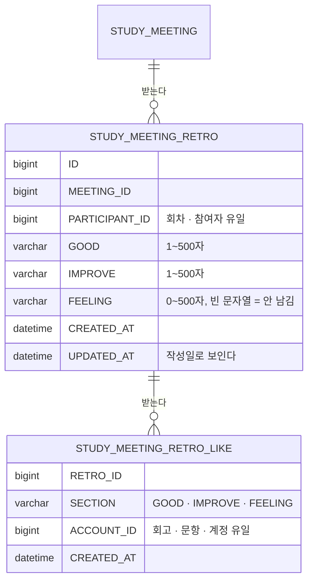

# meeting-retro API Spec

> ERD: 새 테이블 `STUDY_MEETING_RETRO` · `STUDY_MEETING_RETRO_LIKE` (아래 「데이터」) · 참조 [STUDY_MEETING](../../docs/erd/STUDY_MEETING.md)
> 정책: [POL-0001](../../01-planning/_registry/policies/POL-0001-roles.md)
> 생성일: 2026-11-21
> 상태: 스펙확정
>
> Story PRD:
> - [크루는 미팅이 끝나면 회고를 남기고 같은 반 회고에 공감할 수 있다. (ST-039)](../../01-planning/stories/crew-write-meeting-retro/PRD.md)
> - [네비게이터는 반의 회차별 회고 작성 현황을 볼 수 있다. (ST-040)](../../01-planning/stories/navigator-view-meeting-retros/PRD.md)
> - [캡틴은 백오피스에서 스터디 미팅 회고를 모아 볼 수 있다. (ST-041)](../../01-planning/stories/captain-collect-meeting-retros/PRD.md)

미팅이 끝나면 그 회차의 참여자가 좋았던 점 · 개선할 점 · 소감을 남기고, 같은 반 참여자가 문항마다 👍 로 공감한다.
사이트 경로는 반 참여자 · 반 네비게이터 · 담당 캡틴, `/api/admin` 경로는 캡틴(ADMIN) 전용이다.

## 엔드포인트 목록

| Method | Path | 설명 | 인증 | 상태 |
|--------|------|------|------|------|
| GET | /api/me/studies/{studyId}/meetings/{meetingId}/retros | 내 뷰어 컨텍스트 (내 회고 ID · 내가 누른 👍) | 필요 (반 참여자) | 스펙확정 |
| GET | /api/studies/{studyId}/meetings/{meetingId}/retros | 한 회차의 회고 목록 · 안 쓴 참여자(네비게이터 · 캡틴만) | 필요 (같음) | 스펙확정 |
| PUT | /api/me/studies/{studyId}/meetings/{meetingId}/retro | 내 회고 작성 · 수정 | 필요 (그 회차의 쓸 사람) | 스펙확정 |
| PUT | /api/studies/{studyId}/meetings/{meetingId}/retros/{retroId}/likes/{section} | 👍 누르기 | 필요 (반 참여자, 자기 회고 제외) | 스펙확정 |
| DELETE | /api/studies/{studyId}/meetings/{meetingId}/retros/{retroId}/likes/{section} | 👍 취소 | 필요 (같음) | 스펙확정 |
| GET | /api/admin/retros | 회고 모아보기 (쓴 회고만) | 필요 (ADMIN) | 스펙작성중 |
| GET | /api/admin/retros/export.csv | 같은 조건 CSV | 필요 (ADMIN) | 스펙작성중 |

상태: `스펙확정` → `스펙확정` → `구현중` → `구현완료`

`section` = `GOOD` · `IMPROVE` · `FEELING`

## 판정

- 미팅 종료 = 회차 시작 + 진행 시간
- 기한 = 다음 정규 회차 시작. 마지막 회차는 미팅 종료 + 7일
- 쓸 수 있음 = 미팅 종료 ≤ 지금 < 기한
- 쓸 사람 = 그 회차 시작 때 반에 있던 참여자(`STUDY_PARTICIPANT`, 그전에 참여를 중단했으면 뺀다). 캡틴은 넣지 않는다
- 킥오프 회차에는 회고가 없다. 킥오프 회차의 `retroDeadline` · `retroOpen` · `retroMine` 은 `null`
- 회차별 회고 상태(`retroDeadline` · `retroOpen` · `retroMine`)는 `GET /api/me/studies` 응답의 `meetings[]` 각 항목에 포함한다 — 별도 status 엔드포인트 없음
- 시각(회차 시작 · 종료 · 기한 · 작성일)은 모두 UTC 로 내려준다. 화면은 보는 사람의 시간대(사용자 사이트 = 프로필 시간대, 백오피스 = 표시 시간대)로 날짜 · 시각을 바꾸고 약칭을 붙인다 — 일정 표와 같은 날짜가 나와야 한다

## 데이터



## GET /api/me/studies/{studyId}/meetings/{meetingId}/retros

```json
{
  "participantId": 77,
  "retroId": 9001,
  "liked": {
    "9001": { "GOOD": true, "IMPROVE": false, "FEELING": false }
  }
}
```

- 인증 필요 (반 참여자)
- `retroId`: 내가 작성한 회고 ID. 미작성이면 `null`
- `liked`: 내가 👍 누른 항목. `retroId → { section: boolean }` 맵. 아무것도 안 눌렀으면 `{}`
- FE는 `GET .../retros` 와 병렬로 요청하고 `retroId` 로 조합해 내 회고 위치와 누른 항목을 표시한다
- 끝나지 않은 회차는 `409 RETRO_NOT_OPEN`

## GET /api/studies/{studyId}/meetings/{meetingId}/retros

```json
{
  "meetingId": 301,
  "deadline": "2026-11-24T11:30:00Z",
  "open": true,
  "targets": 8,
  "retros": [
    {
      "retroId": 9001,
      "author": { "participantId": 55, "displayName": "민호", "role": "MEMBER" },
      "good": "…",
      "improve": "…",
      "feeling": "",
      "writtenAt": "2026-11-17T12:42:00Z",
      "likes": { "GOOD": 3, "IMPROVE": 2, "FEELING": 0 }
    }
  ],
  "missing": [{ "participantId": 80, "displayName": "하늘" }]
}
```

- 순서: `writtenAt` 오름차순
- 👍 를 누른 사람은 내려주지 않는다 — 수만
- `missing` 은 그 반의 LEADER 와 ADMIN 에게만 채운다. 크루에게는 늘 `[]` — 안 쓴 사람 이름을 크루에게 보이지 않는다. 내가 썼는지 · 내가 누른 👍 는 `GET .../retros/me` 로 확인한다
- 끝나지 않은 회차는 `409 RETRO_NOT_OPEN`

## PUT /api/me/studies/{studyId}/meetings/{meetingId}/retro

```json
{ "good": "…", "improve": "…", "feeling": "" }
```

- 앞뒤 공백을 지우고 저장한다. 없으면 만들고(201) 있으면 고친다(200). 고쳐도 👍 는 남는다
- `400 VALIDATION` — 필수 누락 · 500자 초과
- `409 RETRO_NOT_OPEN` — 미팅 전 · `409 RETRO_CLOSED` — 기한 뒤
- `403` — 쓸 사람이 아님 (캡틴 포함)

## PUT · DELETE …/retros/{retroId}/likes/{section}

- 응답 `{ "count": 4, "liked": true }`. 같은 요청을 다시 보내도 결과가 같다
- `403` — 자기 회고 · 반 참여자가 아님
- `409 EMPTY_SECTION` — 비운 소감
- 기한과 상관없이 누른다

## GET /api/admin/retros

쿼리: `studyId` · `meetingId`(studyId 가 있을 때만) · `q`(참여자 이름 부분 일치) · `section=GOOD|IMPROVE|FEELING`(선택, 문항별 보기 — 그 문항을 쓴 회고만) · `sections=GOOD,IMPROVE,FEELING`(선택, 표 보기의 보이는 문항 — 하나도 안 쓴 회고는 뺀다. 없으면 셋 다) · `sort=RECENT|LIKES`(기본 RECENT) · `likeSort=GOOD|IMPROVE|FEELING`(선택, 표 보기에서 그 문항 👍 수로 먼저 세운다) · `likeDir=DESC|ASC`(기본 DESC) · `offset` · `limit`(기본 20)

```json
{
  "summary": { "rows": 31, "written": 21, "closedRows": 24, "closedWritten": 18, "good": 21, "improve": 21, "feeling": 15 },
  "total": 31,
  "items": [
    {
      "studyId": 5,
      "studyTitle": "React 실전 스터디 3기",
      "groupName": "A반",
      "meetingId": 301,
      "meetingNo": 3,
      "meetingStartAt": "2026-11-17T11:00:00Z",
      "participantName": "하늘",
      "closed": true,
      "retro": {
        "good": "…",
        "improve": "…",
        "feeling": "",
        "likes": { "GOOD": 3, "IMPROVE": 2, "FEELING": 0 },
        "writtenAt": "2026-11-17T12:42:00Z"
      }
    }
  ]
}
```

- `items` 는 진행 중인 스터디의 끝난 회차에서 **쓴 회고만**. 안 쓴 사람은 줄로 내려주지 않는다
- `summary` 의 `rows` · `closedRows` 는 작성률 분모라 쓸 사람 전체(끝난 회차 × 쓸 사람)로 센다. `total` 은 `items` 건수(쓴 회고)
- `summary` 는 좁힌 조건 전체로 센다
- `closed` = 작성 기한이 지났다. 작성률은 `closedWritten ÷ closedRows` — 기한 전 회차는 아직 쓸 수 있어 세지 않는다 (`closedRows` 가 0 이면 작성률 없음)
- 정렬: (RECENT) writtenAt 내림차순 / (LIKES) 아래 규칙
- `section` 이 있으면(문항별 보기) 그 문항이 빈 회고는 빼고, `total` 도 그 건수다. `sort` 는 `RECENT`(writtenAt 내림차순, 기본) · `LIKES`(그 문항 👍 내림차순, 같으면 RECENT). 표 보기에서도 `RECENT` · `LIKES` 를 쓴다 — 표의 `LIKES` 는 `sections` 문항 👍 합. `likeSort` 가 있으면 그것이 먼저다
- 시각은 모두 UTC(ISO 8601). 날짜 · 시각 표시는 화면이 보는 쪽 시간대로 바꾼다 — `meetingStartAt` 으로 회차 날짜를 구한다 (반 시간대 날짜를 내려주지 않는다)

## GET /api/admin/retros/export.csv

`GET /api/admin/retros` 와 같은 조건(페이지 없음). UTF-8 BOM.
쓴 회고만. 열: 스터디 · 반 · 회차 · 참여자 · 좋았던 점 · 좋았던 점 👍 · 개선할 점 · 개선할 점 👍 · 소감 · 소감 👍 · 작성일.
