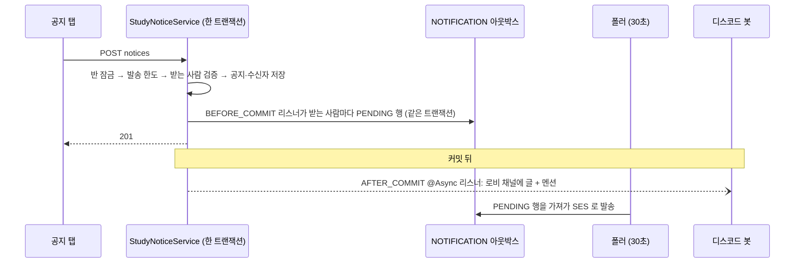

# study-notice API Spec

> ERD: [STUDY_NOTICE](../../docs/erd/STUDY_NOTICE.md) · [NOTIFICATION](../../docs/erd/NOTIFICATION.md)
> 정책: [POL-0010](../../01-planning/_registry/policies/POL-0010-study-notice.md) · [POL-0001](../../01-planning/_registry/policies/POL-0001-roles.md)
> 생성일: 2026-10-23
> 상태: 스펙작성중
>
> Story PRD:
> - [네비게이터는 스터디별 공지를 등록할 수 있다. (ST-016)](../../01-planning/stories/navigator-study-notice/PRD.md)

네비게이터(또는 그 스터디를 만든 캡틴)가 **자기 반 팀원 중 고른 사람에게** 공지를 메일·디스코드로 보낸다.
사이트용 엔드포인트다 — 백오피스 경로(`/api/admin`)는 두지 않는다 ([endpoint-convention](../../docs/backend-development-guide/api/endpoint-convention.md)).
권한은 [authz-guards](../authz-guards/spec.md) 의 `@RequireCaptainOrNavigator(scope = GROUP)` 이고, 서비스가 `StudyCaptainGuard.assertCanEditGroup` 으로 한 번 더 확인한다 (다른 캡틴은 크루로 본다).

## 엔드포인트 목록

| Method | Path | 설명 | 인증 | 상태 |
|--------|------|------|------|------|
| GET | /api/studies/{studyId}/groups/{groupId}/notices/compose | 보내기 화면에 필요한 값 (후보·디스코드 가능 여부·발송 한도) | 필요 (반 네비게이터·담당 캡틴) | 스펙작성중 |
| POST | /api/studies/{studyId}/groups/{groupId}/notices | 공지 보내기 | 필요 (같음) | 스펙작성중 |
| GET | /api/studies/{studyId}/groups/{groupId}/notices | 보낸 공지 기록 | 필요 (같음) | 스펙작성중 |

상태: `스펙작성중` → `스펙확정` → `구현중` → `구현완료`

## 처리 순서



- **메일은 잃으면 안 되므로** 아웃박스 행을 공지와 **같은 트랜잭션에** 만든다 (`BEFORE_COMMIT`). 행 생성이 실패하면 공지 전체가 롤백된다. 실제 SES 호출은 커밋 뒤 폴러가 한다
- **디스코드는 잃어도 되는 부수효과**라 커밋 뒤 `@Async` 로 보낸다. 결과는 `STUDY_NOTICE.DISCORD_STATUS` 에 남긴다 ([domain-events](../domain-events/spec.md))
- 디스코드 호출은 **봇이 최대 30초까지 걸릴 수 있어** 요청 트랜잭션 안에서 부르지 않는다

---

## 보내기 화면 값 (compose)

### 기본 정보

- **Method**: GET
- **Path**: `/api/studies/{studyId}/groups/{groupId}/notices/compose`
- **인증**: 필요 — 그 반의 네비게이터(`PARTICIPANT_ROLE=LEADER`) 또는 그 스터디를 만든 캡틴. 그 밖은 403
- **설명**: 받는 사람 후보와, 보낼 수 있는지·디스코드가 되는지·한도가 얼마나 남았는지. **화면이 날짜·횟수로 다시 계산하지 않고 이 값을 그린다** ([판정은 서버가 내려준다](../../docs/backend-development-guide/api/endpoint-convention.md#판정은-서버가-내려준다))

### Path Parameters

| 이름 | 타입 | 설명 |
|------|------|------|
| studyId | Long | 스터디 ID |
| groupId | Long | 반 ID. 이 스터디의 반이 아니면 400 |

### Response — 200

```json
{
  "recipients": [
    {
      "participantId": 20,
      "displayName": "태윤",
      "participantRole": "MEMBER",
      "participantStatus": "ACTIVE",
      "discordLinked": true
    }
  ],
  "discord": { "available": true, "unavailableReason": null },
  "canSend": true,
  "blockedReason": null,
  "nextAvailableAt": null,
  "remainingToday": 29
}
```

| 필드 | 타입 | NULL | 설명 | 소스 |
|------|------|------|------|------|
| recipients[].participantId | Long | N | 보낼 때 `participantIds` 에 넣는 값 | STUDY_PARTICIPANT.ID |
| recipients[].displayName | String | N | 화면 표시 이름. 이메일은 내려주지 않는다 | ACCOUNT.NICKNAME |
| recipients[].participantRole | String | N | `MEMBER` · `LEADER` | STUDY_PARTICIPANT.PARTICIPANT_ROLE |
| recipients[].participantStatus | String | N | `ACTIVE` · `PAUSED`. 이 둘만 후보다 | STUDY_PARTICIPANT.STATUS |
| recipients[].discordLinked | Boolean | N | 디스코드를 연동했는가. 아니면 멘션에서 빠진다 | 계산: `ACCOUNT.DISCORD_ID IS NOT NULL` |
| discord.available | Boolean | N | 디스코드로 보낼 수 있는가 | 계산: 봇 설정 · `STUDY_DISCORD_LINK` 존재 · 보내는 사람의 `DISCORD_ID` 존재 |
| discord.unavailableReason | String | Y | `BOT_NOT_CONFIGURED` · `NO_DISCORD_CHANNEL` · `SENDER_NOT_LINKED`. 가능하면 null | 위 계산 |
| canSend | Boolean | N | 지금 보낼 수 있는가 | 계산: `StudyNotice.sendBlock(...)` 이 없음 |
| blockedReason | String | Y | `COOLDOWN` · `DAILY_LIMIT`. 보낼 수 있으면 null | 계산: `StudyNotice.sendBlock(...)` |
| nextAvailableAt | String(ISO-8601) | Y | `COOLDOWN` 일 때 다시 보낼 수 있는 시각 | 계산: 직전 발송 + 1분 |
| remainingToday | Integer | N | 오늘(KST) 남은 횟수 | 계산: 30 − 오늘 이 반이 보낸 수 |

> `recipients` 는 보내는 본인을 포함한다. 후보 정렬은 이름순이고 쉬는 중(`PAUSED`)이 뒤로 간다.

### Error Responses

| 상태 | errorCode | 조건 |
|------|-----------|------|
| 400 | INVALID_INPUT | `groupId` 가 이 스터디의 반이 아님 |
| 401 | UNAUTHORIZED | 로그인 아님 |
| 403 | FORBIDDEN | 그 반의 네비게이터·담당 캡틴이 아님 (같은 스터디의 크루·다른 반 네비게이터 포함) |
| 404 | NOT_FOUND | 스터디·반 없음 |

---

## 공지 보내기

### 기본 정보

- **Method**: POST
- **Path**: `/api/studies/{studyId}/groups/{groupId}/notices`
- **인증**: compose 와 같음
- **설명**: 공지를 저장하고 메일은 받는 사람마다 한 통씩 큐에 넣고, 디스코드는 커밋 뒤 비동기로 보낸다

### Request Body

```json
{
  "title": "이번 주 모임 장소가 바뀌었어요",
  "body": "수요일 20:30 에 …",
  "channels": ["EMAIL", "DISCORD"],
  "participantIds": [20, 21, 22]
}
```

| 필드 | 타입 | 필수 | 검증 |
|------|------|------|------|
| title | String | Y | 앞뒤 공백을 자른 뒤 1~60자 |
| body | String | Y | 앞뒤 공백을 자른 뒤 1~1,500자. 줄바꿈 포함 |
| channels | String[] | Y | `EMAIL` · `DISCORD` 중 1개 이상, 중복 없음 |
| participantIds | Long[] | Y | 1명 이상, 중복 없음. **모두** 이 반의 `ACTIVE`·`PAUSED` 명부 행이어야 한다 |

### Response — 201

```json
{ "noticeId": 7, "recipientCount": 3 }
```

| 필드 | 타입 | NULL | 설명 | 소스 |
|------|------|------|------|------|
| noticeId | Long | N | 만든 공지 | STUDY_NOTICE.ID |
| recipientCount | Integer | N | 받는 사람 수 | 계산: 저장한 STUDY_NOTICE_RECIPIENT 행 수 |

응답은 **접수까지만**이다. 메일이 나갔는지·디스코드가 올라갔는지는 기록 조회로 본다.

### 처리 규칙

1. 반 행을 잠근다 (같은 반의 동시 발송을 줄세운다)
2. `StudyNotice.sendBlock(lastSentAt, todayCount, now)` 로 한도를 판정한다. 막히면 429
3. `participantIds` 가 모두 이 반의 `ACTIVE`·`PAUSED` 인지 확인한다. 하나라도 아니면 400 (일부만 보내지 않는다)
4. 공지와 수신자를 저장하고 `study_notice.sent` 를 발행한다
5. `BEFORE_COMMIT` 리스너가 `EMAIL` 이 있으면 받는 사람마다 `NOTIFICATION` 행(`STUDY_NOTICE`/`EMAIL`, `PENDING`)을 같은 트랜잭션에 만든다. 템플릿이 없으면 예외 → 전체 롤백
6. 커밋 뒤 `AFTER_COMMIT @Async` 리스너가 `DISCORD` 가 있으면 봇을 부른다

### Error Responses

| 상태 | errorCode | 조건 |
|------|-----------|------|
| 400 | INVALID_INPUT | 제목·본문 길이 위반, 채널 없음·중복, 받는 사람 없음·중복, 받는 사람이 이 반의 `ACTIVE`·`PAUSED` 가 아님 |
| 401 | UNAUTHORIZED | 로그인 아님 |
| 403 | FORBIDDEN | compose 와 같음 |
| 404 | NOT_FOUND | 스터디·반 없음 |
| 409 | STUDY_ENDED | 끝난 스터디 |
| 429 | STUDY_NOTICE_RATE_LIMITED | 직전 발송 1분 안(`COOLDOWN`) 또는 오늘 30회 초과(`DAILY_LIMIT`). 메시지에 사유와 `nextAvailableAt` |

> `ErrorCode` 에 429 가 없다. `STUDY_NOTICE_RATE_LIMITED(429, ...)` 를 새로 둔다.

---

## 보낸 공지 기록

### 기본 정보

- **Method**: GET
- **Path**: `/api/studies/{studyId}/groups/{groupId}/notices`
- **인증**: compose 와 같음. 반 멤버(크루)는 403 — 읽는 목록을 두지 않는다 ([POL-0010](../../01-planning/_registry/policies/POL-0010-study-notice.md))
- **설명**: 이 반이 보낸 공지를 최근 순으로

### Query Parameters

| 이름 | 타입 | 기본 | 설명 |
|------|------|------|------|
| offset | Integer | 0 | |
| limit | Integer | 20 | 최대 50 |

### Response — 200

```json
{
  "items": [
    {
      "noticeId": 7,
      "title": "이번 주 모임 장소가 바뀌었어요",
      "body": "수요일 20:30 에 …",
      "senderName": "태윤",
      "sentAt": "2026-10-23T10:00:00Z",
      "recipientCount": 3,
      "email": { "requested": true, "pending": 1, "sent": 2, "failed": 0 },
      "discord": { "requested": true, "status": "SKIPPED", "skipReason": "SENDER_NOT_LINKED", "mentionedCount": 0 }
    }
  ],
  "total": 1,
  "offset": 0,
  "limit": 20
}
```

| 필드 | 타입 | NULL | 설명 | 소스 |
|------|------|------|------|------|
| items[].noticeId | Long | N | | STUDY_NOTICE.ID |
| items[].title / body | String | N | 보낸 그대로 | STUDY_NOTICE.TITLE / BODY |
| items[].senderName | String | N | 보낸 사람 닉네임. 탈퇴했으면 「탈퇴한 회원」 | ACCOUNT.NICKNAME |
| items[].sentAt | String(ISO-8601) | N | | STUDY_NOTICE.CREATED_AT |
| items[].recipientCount | Integer | N | | 계산: STUDY_NOTICE_RECIPIENT 행 수 |
| items[].email.requested | Boolean | N | 메일을 골랐는가 | STUDY_NOTICE.SEND_EMAIL |
| items[].email.pending / sent / failed | Integer | N | 받는 사람 수 기준. `PENDING`·`PROCESSING` 은 pending, `CANCELLED` 는 세지 않는다 | 계산: NOTIFICATION(`REFERENCE_ID`=noticeId) 를 STATUS 별로 센 값. 메일을 안 골랐으면 0 |
| items[].discord.requested | Boolean | N | 디스코드를 골랐는가 | STUDY_NOTICE.SEND_DISCORD |
| items[].discord.status | String | N | `NOT_REQUESTED` · `PENDING` · `SENT` · `SKIPPED` · `FAILED` | STUDY_NOTICE.DISCORD_STATUS |
| items[].discord.skipReason | String | Y | `SKIPPED` 일 때만. `BOT_NOT_CONFIGURED` · `NO_DISCORD_CHANNEL` · `SENDER_NOT_LINKED` · `NO_TEXT_CHANNEL` | STUDY_NOTICE.DISCORD_SKIP_REASON |
| items[].discord.mentionedCount | Integer | N | 멘션된 사람 수 (연동한 사람) | 계산: `DISCORD_MENTIONED = true` 인 수 |

메일을 센 값은 **목록 한 번에 `GROUP BY` 로 센다** (공지마다 쿼리하지 않는다 — N+1).

### Error Responses

| 상태 | errorCode | 조건 |
|------|-----------|------|
| 401 · 403 · 404 | — | compose 와 같음 |

---

## 디스코드 호출

기존 `DiscordBotClient` 를 쓴다 (`sendMessage` · `getStudyChannels`). 새 봇 엔드포인트는 만들지 않는다.

| 단계 | 호출 | 비고 |
|---|---|---|
| 1 | `getStudyChannels(requesterId, discordStudyId)` | `STUDY_DISCORD_LINK.DISCORD_STUDY_ID`. 종류가 `TEXT` 인 채널(로비)을 고른다 |
| 2 | `sendMessage(requesterId, channelId, discordStudyId, msg, mentionUserIds)` | 멘션은 40명씩 나눠 여러 번. 첫 건에만 제목·본문을 싣고 나머지는 「이어서」 멘션만 |

- `msg` 는 `📢 [{반 이름}] {제목}` + 빈 줄 + 본문. `@everyone`·`@here` 는 봇이 지운다
- 멘션 대상은 받는 사람 중 `ACCOUNT.DISCORD_ID` 가 있는 사람만이다
- `requesterId` 는 **보내는 사람의 `DISCORD_ID`** 다. 한 곳(`resolveRequester`)에서 정한다 — 봇 정책이 바뀌면 이 한 곳만 고친다
- 호출 실패(`BusinessException`)는 `FAILED` 로 두고 WARN 로그에 `noticeId` 와 `eventId` 를 남긴다. 사용자 응답에는 영향이 없다
- 재시도는 하지 않는다. 봇은 중복을 막지 않으므로 자동 재시도가 같은 글을 두 번 올릴 수 있다

---

## 개인정보

- 응답에 **이메일을 싣지 않는다.** 메일 주소는 서버가 `ACCOUNT` 에서 읽어 아웃박스 행에 스냅샷한다
- 로그에 제목·본문·이메일·디스코드 ID 를 싣지 않는다. `noticeId` · 수신자 수 · 상태만 남긴다
- ops 알림은 보내지 않는다 — 운영자가 초반에 알아야 할 사실(가입·신청·승인·실패)이 아니다 ([ops-alerts](../ops-alerts/spec.md))
- 받는 사람이 탈퇴하면 `NOTIFICATION` 행은 [탈퇴 비식별](../user-leave/spec.md#알림-비식별화)을 따른다. `STUDY_NOTICE_RECIPIENT` 는 `ACCOUNT_ID` 만 가진 ID 참조라 손대지 않는다 — `ACCOUNT` 가 지워지면 되짚을 수 없어 자연히 비식별이다 (`STUDY_ATTENDANCE` 와 같은 원칙)
- 보낸 사람이 탈퇴하면 `SENDER_ACCOUNT_ID` 도 되짚을 수 없고, 기록에는 「탈퇴한 회원」으로 보인다

## 프론트엔드 사용처

- `frontend/apps/core-front/src/app/[locale]/my/joined/[id]/schedule/notice/page.tsx` (예정)
- 프로토: playground `/proto/core/ko/my/joined/{id}/schedule/notice`

## 미확정

- [NEEDS CLARIFICATION] **디스코드 호출 주체.** 봇의 메시지 보내기는 지금 캡틴·네비게이터 호출만 받고 시스템 호출을 받지 않는다. 보내는 사람의 길드 네비게이터 역할이 아직 자동으로 주어지지 않아(DSC-08) 403 으로 건너뛰어질 수 있다. stage 에서 직접 보내 보며 디스코드 스쿼드와 맞춘다 — 보낼 채널, 호출 주체(본인 vs 시스템 허용), 40명 초과 분할
- [NEEDS CLARIFICATION] 로비 채널 판별. 지금은 종류가 `TEXT` 인 채널 하나라는 가정이다 (채널 ID 는 저장하지 않는다 — [STUDY_DISCORD_LINK](../../docs/erd/STUDY_DISCORD_LINK.md))
- [OPEN] 메일 SES 카테고리. 지금은 `NOTIFY` 를 쓴다. 공지·뉴스레터 성격이라 `news` 가 맞지만 환경 설정이 새로 필요해 이번 범위에서 뺀다
